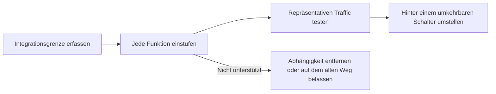

Suche jede Funktion, die deine aktuelle Gateway-Integration nutzt, und erledige, was in der letzten Spalte steht, bevor du Traffic verschiebst. Zuletzt geprüft am 4. November 2026.

Arbeite die Migration in dieser Reihenfolge ab. So findest du die Verhaltensweisen, die sich ändern können, selbst wenn beide Plattformen dieselbe OpenAI-kompatible Anfrage annehmen.

## Integrationsgrenze erfassen

Notiere jede Stelle, an der das aktuelle Gateway vorkommt, damit die Migration keinen zweiten, versteckten Konfigurationsweg zurücklässt:

- Basis-URLs und Umgebungsvariablen für API-Schlüssel;
- SDK-Initialisierung und benutzerdefinierte Header;
- Modell-IDs und Fallback-Modelle;
- Anbieterreihenfolge, Zulassungslisten und Datenschutzanforderungen;
- Code für Streaming, Tool-Aufrufe und strukturierte Ausgaben;
- Batch-Jobs, Dateien, Webhooks und asynchrones Status-Polling;
- Anfragezuordnung sowie Benutzer- oder Sitzungsmetadaten.

## Anfragen

| Funktion | Bei Phaseo | Vor der Umstellung |
| --- | --- | --- |
| Authentifizierung | `Authorization: Bearer $PHASEO_API_KEY` | Ändere Basis-URL und Schlüssel und führe dann eine authentifizierte Anfrage aus. |
| Chat Completions | `/v1/chat/completions` | Teste normale Anfragen, Streaming, Tool-Aufrufe und strukturierte Ausgaben. Unbekannte Felder auf oberster Ebene geben `400` zurück. |
| Responses | `/v1/responses`, ohne gespeicherten Zustand | Teste Eingabeformate, Streaming-Events, Tools und Parsing. `previous_response_id` und `conversation` geben `400` zurück; sende den vollständigen Verlauf. |
| Anthropic Messages | `/v1/messages` auf dem Root-Host `https://api.phaseo.app` | Übergib den Schlüssel als Bearer-Token und prüfe jeden `anthropic-beta`-Header; Phaseo leitet sie nicht weiter. |
| Modell-IDs | `<org>/<model>` | Prüfe jede Produktions-ID in `GET /v1/models?format=openai`. Geh nicht davon aus, dass Aliase übereinstimmen. |
| Embeddings, Bilder, Audio, Moderation | Je nach Modell und Anbieter unterstützt | Prüfe, ob das Modell die Operation unterstützt. |

## Routing und Richtlinien

| Funktion | Bei Phaseo | Vor der Umstellung |
| --- | --- | --- |
| Modell-Fallbacks | `models`-Array, 1 bis 25 Einträge | Fallbacks greifen bei `429`, `500`, `502`, `503` und `504`, nie bei Anfragefehlern. |
| Anbieterreihenfolge | `provider.order` | Bilde nur die Reihenfolge nach, die die Workload noch braucht. |
| Zulassungs- und Ausschlusslisten für Anbieter | `provider.only`, `provider.ignore` | Prüfe die Anbieter-IDs und dass mindestens eine Route übrig bleibt. |
| Sortierung nach Preis, Latenz oder Durchsatz | `provider.sort` | Prüfe nach dem Testen den gewählten Anbieter in den Anfragedetails. |
| Zero Data Retention | `provider.require_zero_data_retention` (Alias `provider.zdr`) | Stelle sicher, dass das Modell einen passenden Anbieter hat, bevor du es erzwingst. |
| Regionale Ausführung und Datenresidenz | `provider.required_execution_region`, `provider.required_data_region`, Datenschutz-Standards des Workspace | Teste sowohl eine erfolgreiche Route als auch den Fehler, wenn kein Anbieter passt. |
| Gemeinsame Prompts und Standards | [Presets](../guides/presets) | Verschiebe gemeinsame Konfiguration in ein Preset, statt sie in jeden Aufrufer zu kopieren. |

## Betrieb

| Funktion | Bei Phaseo | Vor der Umstellung |
| --- | --- | --- |
| App-Zuordnung | `X-App-Id`, `X-App-Name`, `HTTP-Referer`, `X-Title`, `X-App-Categories` | Behalte die Header, die die aufrufende Anwendung beschreiben; ohne sie lassen sich Kosten und Nutzung während der Migration schwerer vergleichen. Prüfe die App-Gruppierung im Dashboard. Kategoriewerte findest du unter [App-Zuordnung](../guides/app-attribution). |
| Kostenlabels | `X-Phaseo-Metadata`-Labels | Ordne benutzerdefinierte Eigenschaften oder Tags Labels zu. |
| Anfragedetails | Anfrage-Logs und `GET /v1/generations?id=<request_id>` | Vergleiche Anbieter, Latenz, Tokennutzung und Preis für repräsentative Prompts. |
| Wiederholung | `replay_request`, wenn `replay_supported` `true` ist | Prüfe, ob sich Endpunkt und Payload einer fehlgeschlagenen Anfrage wiederherstellen lassen. |
| Batch- und asynchrone Jobs | Batch-, Datei-, Video-, Webhook- und WebSocket-APIs | Prüfe Statusübergänge, Abrechnung im Endzustand, Abbruch und Abruf der Ergebnisse. `/v1/files` enthält nur Batch-Eingaben. |
| Ratenlimits | Kontingent an Anfragen pro Minute je Benutzer, ab 10 für einen neuen Workspace | Ein Proxy, der den Traffic eines Teams über den Schlüssel einer einzelnen Person leitet, kann es erreichen. Siehe [Limits](../api-reference/limits). |
| Schrittweise Umstellung | Traffic-Aufteilung im Client oder in der Infrastruktur | Halte das Zurückrollen auf eine Änderung von Basis-URL und Schlüssel beschränkt, bis die Umstellung stabil ist. |

## Nicht verfügbar

Für diese Funktionen gibt es bei Phaseo keine Entsprechung. Behalte sie in der App oder auf der alten Plattform:

- **Antwort-Caching.** Phaseo cacht keine Antworten. [Prompt-Caching](../guides/prompt-caching) senkt trotzdem die Eingabekosten.
- **Gespeicherte Antworten und Unterhaltungen.** Es gibt kein `GET` oder `DELETE /v1/responses/{id}`.
- **Tokenzählung** (`/v1/messages/count_tokens`).
- **OpenAI Assistants, Threads, Vektorspeicher, Fine-Tuning und das alte `/v1/completions`.**

## Jede Funktion einstufen

Gib jedem Produktionsverhalten genau einen Status, anhand der Tabellen oben und der Anleitung für deine [Ausgangsplattform](./index#platform-migrations):

| Status | Bedeutung |
| --- | --- |
| Unverändert | Dasselbe Anfragefeld und dasselbe Antwortverhalten wurden geprüft. |
| Zugeordnet | Phaseo liefert dasselbe Ergebnis über ein anderes Feld oder eine andere Einstellung. |
| Angepasst | Eine Kompatibilitätsschicht übersetzt Anfrage oder Antwort. |
| Nicht unterstützt | Entferne die Abhängigkeit oder belasse diese Workload auf ihrem aktuellen Weg. |
| Nicht geprüft | Unterstützung kann vorhanden sein, aber es gibt noch keinen produktionsnahen Nachweis. |

## Mit deinem eigenen Traffic prüfen

API-Kompatibilität bedeutet nicht, dass sich diese Punkte gleich verhalten:

- automatische Anbieterauswahl und Fallback-Reihenfolge;
- Prompt-Cache-Affinität und Cache-Preise;
- anbieterspezifische Anfragefelder und Metadaten, die nur in Antworten vorkommen;
- Ratenlimits und Zeitpunkte von Wiederholungen;
- Richtlinien zu Datenaufbewahrung, Datenresidenz und Training;
- genaue Modellverfügbarkeit und Preise.

Stelle aus echten Workload-Mustern einen kleinen Testsatz zusammen, ohne sensible Produktionsdaten zu kopieren, und führe aus:

1. eine normale Anfrage für jeden genutzten Endpunkt;
2. Streaming über denselben Client-Pfad wie in der Produktion;
3. Tool-Aufrufe und strukturierte Ausgaben mit realistischen Schemas;
4. jede Anbieter- oder Datenschutzvorgabe;
5. ungültige Schlüssel, ungültige Modelle, Ratenlimits und Fehler durch nicht verfügbare Anbieter;
6. Batch- oder asynchrone Jobs bis zu Erfolg, Fehler und Abbruch.

Vergleiche Ausgabequalität, Latenz, Tokennutzung, gewählten Anbieter und Endkosten. Notiere jede Anfrage-ID, damit du sie in den Anfrage-Logs oder mit `GET /v1/generations?id=<request_id>` untersuchen kannst.

## Mit einem umkehrbaren Schalter umstellen

Beginne mit Entwicklungs- und internem Traffic. Verschiebe einen kleinen Teil des Produktions-Traffics erst, wenn der Testsatz besteht, und halte das Zurückrollen auf Basis-URL und Schlüssel beschränkt, bis die Ergebnisse stabil sind. Kombiniere die Umstellung nicht mit Änderungen an Prompts, Modellen oder Routing; nimm diese erst vor, wenn die Gateway-Grenze geprüft ist.
