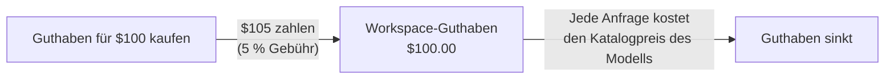

Kaufe einmal Guthaben und gib es für Anfragen zum Katalogpreis des jeweiligen Modells aus. Die einzige Gebühr von Phaseo auf verwaltete Anfragen beträgt 5 % jedes Guthabenkaufs, mindestens $1; auf die Anfragen selbst gibt es keinen Aufschlag.

## Was eine Aufladung kostet

Die Gebühr ist der größere Wert aus 5 % des gekauften Guthabens und $1. Die Gebühr wird zu dem Betrag addiert, den du zahlst.

| Gekauftes Guthaben | Gebühr | Du zahlst |
| ---: | ---: | ---: |
| $5.00 | $1.00 (Minimum) | $6.00 |
| $20.00 | $1.00 | $21.00 |
| $100.00 | $5.00 | $105.00 |
| $1,000.00 | $50.00 | $1,050.00 |

Umgekehrt betrachtet bringt eine Zahlung von $100.00 Guthaben über $95.24 und eine Gebühr von $4.76. Aufladungen im Dashboard beginnen bei $5.

Kaufe Guthaben unter **Einstellungen -> Abrechnung -> Abrechnung und Guthaben** oder im Terminal mit `phaseo credits add --amount <usd>` (siehe den [Schnellstart](../quickstart#add-credits-for-paid-models)). Dieselbe Seite zeigt dein Guthaben, die aktuelle Gebühr und die jüngsten Ausgaben; **Einstellungen -> Abrechnung -> Transaktionen** listet jeden Kauf auf.

## Was kein Guthaben verbraucht

| Nutzung | Gebühr von Phaseo |
| --- | --- |
| Kostenlose Modelle (`phaseo/free` und Modelle mit einem Preis von $0) | Keine. Anfragen an kostenlose Modelle haben ein tägliches Kontingent; siehe [Tarife](../exploring/subscription-plans). |
| Bring Your Own Key (BYOK) | Keine Aufladung. Die ersten 250.000 abgeschlossenen BYOK-Anfragen pro Workspace und UTC-Monat sind frei von Servicegebühren, danach fallen 2.5 % der anbieteräquivalenten Kosten an. Dein Anbieter rechnet die Modellnutzung ab. Siehe [Hinweise zu BYOK](../guides/routing-and-fallbacks#byok-considerations). |

## Enterprise

Self Serve Enterprise ist ein separates Monatsabonnement für SSO, SCIM, Verzeichnisverwaltung, Abteilungen und bevorzugten E-Mail-Support. Es beginnt bei $29/Monat für bis zu 100 Workspace-Mitglieder und kostet $79/Monat bei 1.000 Mitgliedern. Es enthält kein Guthaben und ändert nichts an der Gebühr von 5 % (mindestens $1). Unter [Tarife](../exploring/subscription-plans#enterprise-member-pricing) findest du die vollständigen Mitgliederpreise und wie Mitglieder gezählt werden.

Für Rechnungsstellung, Beschaffung oder individuelle kommerzielle Bedingungen wende dich an das [Hilfecenter](https://phaseo.app/help). Für die normale Gateway-Nutzung brauchst du kein Enterprise.
