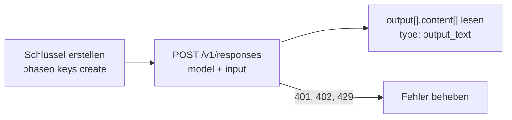

Erstelle einen API-Schlüssel, sende eine Anfrage an `POST /v1/responses` und lies die Antwort aus `output_text`.



<Prompt description="**Verwendest du einen Programmieragenten?** Füge diesen Prompt ein, bevor du anfängst." icon="bot" actions={["copy", "cursor"]}>
{`You are integrating this project with Phaseo Gateway.

Before editing anything:
- Install the Phaseo skills: npx skills add https://phaseo.app/docs
- Read https://phaseo.app/docs/skill.md and the API reference for the endpoint you will use. If your tools support MCP, search the docs at https://phaseo.app/docs/mcp.
- Inspect the existing provider configuration and identify the smallest safe change.

Rules:
- Call https://api.phaseo.app/v1 with a server-side PHASEO_API_KEY. Never print or commit credentials.
- Keep the current provider and model behaviour unless I ask for a migration. Check model IDs with GET /v1/models instead of guessing them.
- Explain the files you would change and the verification commands first.
- Do not deploy, rotate keys, send external messages, or make unrelated edits without my approval.`}
</Prompt>

<Visibility for="agents">
Schnellstart-Checkliste für Agenten:

- Erstelle den Schlüssel mit der CLI: `npm install -g @phaseo/cli`, dann `phaseo login` (oder `phaseo login --device-code` in einer Shell ohne Browser; ein Mensch bestätigt die Anmeldung), dann `phaseo keys create --name <name> --json`. Erzeuge oder rate nie einen Schlüssel. Sende ihn als `Authorization: Bearer phaseo_v1_sk_<kid>_<secret>` und nur aus serverseitigem Code.
- Für kostenpflichtige Modelle führe einmal `phaseo login --scopes billing:write` aus; danach startet `phaseo credits add --amount <usd> --json` eine Aufladung. Mit gespeicherter Karte bestätigt ein Inhaber oder Admin des Workspace sie über einen Link per E-Mail. Ohne gespeicherte Karte enthält die Antwort `next_action: "open_checkout_url"` und einen Zahlungslink, den ein Inhaber oder Admin zum Bezahlen öffnet; die Karte wird dann für spätere Aufladungen gespeichert. Schicke den Nutzer für Schlüssel, Guthaben oder Einstellungen nicht ins Dashboard; siehe https://phaseo.app/docs/de/v1/developers/manage-from-an-agent.md.
- Sende die erste Anfrage mit `POST https://api.phaseo.app/v1/responses` und den Feldern `model` und `input`. Die Beispiele verwenden `openai/gpt-6-astra`, ein kostenpflichtiges Modell, das Guthaben braucht. `phaseo/free` wählt ein verfügbares kostenloses Modell und funktioniert ohne Wallet-Guthaben.
- Lies die Antwort aus `output[].content[]`, wo `type` den Wert `output_text` hat.
- Wenn die Anfrage fehlschlägt, entscheide anhand des JSON-Codes `error`, wie in https://phaseo.app/docs/de/v1/api-reference/errors.md beschrieben.
</Visibility>

## 1. API-Schlüssel erstellen

Installiere die [Phaseo CLI](./guides/integrations/phaseo-cli), melde dich an und erstelle einen Schlüssel:

```bash
npm install -g @phaseo/cli
phaseo login                 # über SSH oder in einer Agenten-Sandbox --device-code verwenden
phaseo keys create --name "Quickstart" --json
export PHASEO_API_KEY="phaseo_v1_sk_..."
```

Der Schlüssel wird nur einmal angezeigt. Jede Anfrage sendet ihn als Bearer-Token:

```http
Authorization: Bearer phaseo_v1_sk_<kid>_<secret>
```

Du kannst einen Schlüssel auch im [Dashboard](https://phaseo.app/settings/keys) unter **Einstellungen -> API-Schlüssel** erstellen.

<Danger>
Behandle deinen API-Schlüssel wie ein Passwort. Halte ihn in serverseitigem Code und liefere ihn nie an einen Browser oder eine mobile App aus.
</Danger>

<span id="add-credits-for-paid-models"></span>
### Guthaben für kostenpflichtige Modelle aufladen

`phaseo/free` funktioniert ohne Guthaben. Kostenpflichtige Modelle wie `openai/gpt-6-astra` brauchen ein Wallet-Guthaben:

```bash
phaseo login --scopes billing:write   # einmalig; Aufladungen brauchen diesen Scope
phaseo credits add --amount 20
```

Mit gespeicherter Karte bestätigt ein Inhaber oder Admin des Workspace die Zahlung über einen Link per E-Mail. Ohne gespeicherte Karte gibt der Befehl einen Zahlungslink zurück, den ein Inhaber oder Admin zum Bezahlen öffnet, und die Karte wird für spätere Aufladungen gespeichert.

## 2. Textanfrage senden

`POST /v1/responses` ist der empfohlene Endpunkt für neue Textanwendungen. Die Beispiele verwenden `openai/gpt-6-astra`, ein kostenpflichtiges Modell. Um ohne Guthaben zu testen, ersetze es durch `phaseo/free`, das ein verfügbares kostenloses Modell wählt; siehe [Mit dem kostenlosen Router starten](./cookbook/free-router-first-deploy).

Für cURL und `fetch` musst du nichts installieren. Ein SDK installierst du zuerst:

<CodeGroup>
```bash npm
npm install @phaseo/sdk
```

```bash pnpm
pnpm add @phaseo/sdk
```

```bash pip
pip install phaseo
```
</CodeGroup>

Laufzeitanforderungen und die anderen SDKs findest du auf der [Installationsseite für TypeScript und Python](./sdk-reference/client/installation).

<CodeGroup>
```bash cURL
curl https://api.phaseo.app/v1/responses \
  -H "Authorization: Bearer $PHASEO_API_KEY" \
  -H "Content-Type: application/json" \
  -d '{
    "model": "openai/gpt-6-astra",
    "input": "Reply with: quickstart works"
  }'
```

```javascript JavaScript
const response = await fetch("https://api.phaseo.app/v1/responses", {
  method: "POST",
  headers: {
    Authorization: `Bearer ${process.env.PHASEO_API_KEY}`,
    "Content-Type": "application/json",
  },
  body: JSON.stringify({
    model: "openai/gpt-6-astra",
    input: "Reply with: quickstart works",
  }),
});

const data = await response.json();
const assistantText = data.output
  ?.find((item) => item.type === "message")
  ?.content?.find((part) => part.type === "output_text")
  ?.text;

console.log(assistantText);
```

```typescript TypeScript SDK
import Phaseo, { outputText } from "@phaseo/sdk";

const client = new Phaseo(); // reads PHASEO_API_KEY

const response = await client.generateResponse({
  model: "openai/gpt-6-astra",
  input: "Reply with: quickstart works",
});

console.log(outputText(response));
```

```python Python SDK
from phaseo import Phaseo

client = Phaseo()  # reads PHASEO_API_KEY

response = client.responses.create(
    {
        "model": "openai/gpt-6-astra",
        "input": "Reply with: quickstart works",
    }
)

print(response.output_text)
```

```go Go SDK
package main

import (
  "context"
  "fmt"

  phaseo "github.com/phaseoteam/Phaseo/packages/sdk/sdk-go/v3"
)

func main() {
  client := phaseo.MustNewFromEnv() // reads PHASEO_API_KEY

  response, err := client.GenerateResponse(context.Background(), phaseo.ResponsesRequest{
    Model: "openai/gpt-6-astra",
    Input: "Reply with: quickstart works",
  })
  if err != nil {
    panic(err)
  }

  fmt.Println(response)
}
```

```csharp C# SDK
using PhaseoSdk;
using System.Collections.Generic;

var client = new Phaseo(); // reads PHASEO_API_KEY

var response = await client.GenerateResponse(new Dictionary<string, object>
{
    ["model"] = "openai/gpt-6-astra",
    ["input"] = "Reply with: quickstart works",
});

Console.WriteLine(response);
```

```php PHP SDK
<?php
require 'vendor/autoload.php';

use Phaseo\Sdk\Phaseo;

$client = new Phaseo(getenv('PHASEO_API_KEY'));

$response = $client->generateResponse([
    'model' => 'openai/gpt-6-astra',
    'input' => 'Reply with: quickstart works',
]);

print_r($response);
```

```ruby Ruby SDK
require 'phaseo_sdk'

client = PhaseoSdk::Phaseo.new # reads PHASEO_API_KEY

response = client.generate_response(
  model: 'openai/gpt-6-astra',
  input: 'Reply with: quickstart works',
)

puts response
```

```java Java SDK
// Build from source: https://phaseo.app/docs/v1/sdk-reference/client/installation
import app.phaseo.sdk.Phaseo;
import java.util.Map;

public class Main {
    public static void main(String[] args) throws Exception {
        var client = new Phaseo(System.getenv("PHASEO_API_KEY"));
        var response = client.createResponse(Map.of(
            "model", "openai/gpt-6-astra",
            "input", "Reply with: quickstart works"
        ));
        for (var item : response.path("output")) {
            for (var part : item.path("content")) {
                if ("output_text".equals(part.path("type").asText())) {
                    System.out.println(part.path("text").asText());
                }
            }
        }
    }
}
```

```rust Rust SDK
use phaseo::Phaseo;
use serde_json::{json, Value};

fn main() -> Result<(), Box<dyn std::error::Error>> {
    let client = Phaseo::from_env()?;
    let response = client.responses(&json!({
        "model": "openai/gpt-6-astra",
        "input": "Reply with: quickstart works"
    }))?;

    let assistant_text = response.body
        .get("output")
        .and_then(Value::as_array)
        .into_iter()
        .flatten()
        .filter(|item| item.get("type").and_then(Value::as_str) == Some("message"))
        .flat_map(|item| {
            item.get("content")
                .and_then(Value::as_array)
                .into_iter()
                .flatten()
        })
        .find_map(|part| {
            (part.get("type").and_then(Value::as_str) == Some("output_text"))
                .then(|| part.get("text").and_then(Value::as_str))
                .flatten()
        })
        .unwrap_or("");

    println!("{assistant_text}");
    Ok(())
}
```

```typescript Vercel AI SDK
import { phaseo } from "@phaseo/ai-sdk-provider";
import { generateText } from "ai";

const result = await generateText({
  model: phaseo("openai/gpt-6-astra"),
  prompt: "Reply with: quickstart works",
});

console.log(result.text);
```
</CodeGroup>

## 3. Antwort lesen

```json
{
  "id": "G-...",
  "nativeResponseId": "resp_...",
  "object": "response",
  "created_at": 1730000000,
  "status": "completed",
  "completed_at": 1730000001,
  "model": "openai/gpt-6-astra",
  "output": [
    {
      "type": "message",
      "id": "msg_...",
      "status": "completed",
      "role": "assistant",
      "content": [{ "type": "output_text", "text": "quickstart works", "annotations": [] }]
    }
  ],
  "usage": {
    "input_tokens": 9,
    "output_tokens": 3,
    "total_tokens": 12
  },
  "error": null,
  "incomplete_details": null
}
```

| Feld | Inhalt |
| --- | --- |
| `output[].content[]` mit `type: "output_text"` | Der Antworttext. Der TypeScript-Helfer `outputText()` und `response.output_text` in Python lesen ihn für dich aus; das Vercel AI SDK gibt ihn als `result.text` zurück. |
| `id` | Die Phaseo-Anfrage-ID. Die Anfrage erscheint unter **Einstellungen -> Nutzung -> Protokolle -> Anfragen**. |
| `nativeResponseId` | Die ID des Anbieters für dieselbe Antwort. |
| `usage` | Eingabe-, Ausgabe- und Gesamttokens, die für die Anfrage abgerechnet wurden. |

### Antwort streamen

Streame, um die Antwort auszugeben, während sie generiert wird. Das Feld `text` jedes `response.output_text.delta`-Events enthält nur den neuen Text, daher gibt diese Schleife die Antwort genau einmal aus. Abschließende Events wie `response.output_text.done` wiederholen bereits gestreamten Text. Die vollständige Liste der Events findest du unter [Streaming](./guides/streaming).

<CodeGroup>
```typescript TypeScript SDK
import Phaseo from "@phaseo/sdk";

const client = new Phaseo(); // reads PHASEO_API_KEY

for await (const chunk of client.streamResponses({
  model: "openai/gpt-6-astra",
  input: "Reply with: quickstart works",
})) {
  if (chunk.type === "response.output_text.delta") process.stdout.write(chunk.text);
}
```

```python Python SDK
from phaseo import Phaseo

client = Phaseo()  # reads PHASEO_API_KEY

for chunk in client.stream_responses(
    {
        "model": "openai/gpt-6-astra",
        "input": "Reply with: quickstart works",
    }
):
    if chunk.get("type") == "response.output_text.delta":
        print(chunk["text"], end="", flush=True)
print()
```
</CodeGroup>

## 4. Fehler bei der ersten Anfrage beheben

| Status | Prüfen |
| --- | --- |
| `401` | Den API-Schlüssel und den Header `Authorization: Bearer`. |
| `400` | Den Anfragetext und die Modell-ID. Gültige IDs listest du mit `GET /v1/models` auf. |
| `402` | Dein Guthaben. Lade Guthaben auf oder wechsle zu `phaseo/free`. |
| `429` oder `5xx` | Mit exponentiellem Backoff erneut versuchen. |

Die [Fehlerreferenz](./api-reference/errors) listet jeden Fehlercode und was dagegen zu tun ist.

## Typisierte Antworten statt Text erhalten

Wenn dein Code einen Wert statt Fließtext braucht, sende Fragen an `POST /v1/decisions` (Beta). Jede Antwort kommt typisiert und mit Wahrscheinlichkeiten zurück, in derselben Reihenfolge wie die Fragen. Die Fragetypen sind `predicate` (ja/nein), `choice` (eine deiner Optionen) und `score` (eine Stufe auf deiner Skala).

<CodeGroup>
```bash cURL
curl https://api.phaseo.app/v1/decisions \
  -H "Authorization: Bearer $PHASEO_API_KEY" \
  -H "Content-Type: application/json" \
  -d '{
    "model": "openai/gpt-6-luna",
    "input": "I was charged twice and need a refund. I cannot log in to pay my team.",
    "questions": [
      {
        "type": "choice",
        "name": "department",
        "instructions": "Which team should handle this request?",
        "choices": [
          { "value": "billing", "description": "Payments, invoices, refunds and duplicate charges" },
          { "value": "support", "description": "Product usage and troubleshooting" }
        ]
      },
      {
        "type": "predicate",
        "name": "is_urgent",
        "instructions": "Is the customer blocked from using the product?"
      }
    ]
  }'
```

```typescript TypeScript SDK
import Phaseo from "@phaseo/sdk";

const client = new Phaseo(); // reads PHASEO_API_KEY

const decision = await client.decisions.create({
  model: "openai/gpt-6-luna",
  input: "I was charged twice and need a refund. I cannot log in to pay my team.",
  questions: [
    {
      type: "choice",
      name: "department",
      instructions: "Which team should handle this request?",
      choices: [
        { value: "billing", description: "Payments, invoices, refunds and duplicate charges" },
        { value: "support", description: "Product usage and troubleshooting" },
      ],
    },
    {
      type: "predicate",
      name: "is_urgent",
      instructions: "Is the customer blocked from using the product?",
    },
  ],
});

console.log(decision.answers);
```

```python Python SDK
from phaseo import Phaseo

client = Phaseo()  # reads PHASEO_API_KEY

decision = client.decisions.create(
    {
        "model": "openai/gpt-6-luna",
        "input": "I was charged twice and need a refund. I cannot log in to pay my team.",
        "questions": [
            {
                "type": "choice",
                "name": "department",
                "instructions": "Which team should handle this request?",
                "choices": [
                    {"value": "billing", "description": "Payments, invoices, refunds and duplicate charges"},
                    {"value": "support", "description": "Product usage and troubleshooting"},
                ],
            },
            {
                "type": "predicate",
                "name": "is_urgent",
                "instructions": "Is the customer blocked from using the product?",
            },
        ],
    }
)

print(decision["answers"])
```
</CodeGroup>

Die Antwort (Werte zur Veranschaulichung):

```json
{
  "model": "openai/gpt-6-luna",
  "answers": [
    {
      "type": "choice",
      "name": "department",
      "choice": "billing",
      "confidence": 0.89,
      "probabilities": [
        { "value": "billing", "probability": 0.91 },
        { "value": "support", "probability": 0.09 }
      ]
    },
    { "type": "predicate", "name": "is_urgent", "probability": 0.84 }
  ],
  "usage": { "input_tokens": 42, "output_tokens": 18, "total_tokens": 60 }
}
```

Lies `answers[0].choice` oder `answers[1].probability` und lege mit `confidence` oder `probabilities` deinen eigenen Schwellenwert fest. Die [Decisions-Referenz](./api-reference/endpoint/decisions) listet jedes Entscheidungsmodell mit seinen Limits und Preisen, die Bildeingabe und das ältere `state`-Format mit benannten Fragen-Maps (`noul`, `criteria`), das weiterhin funktioniert und von manchen Modellen vorausgesetzt wird.

## Ein Video generieren

Die Videogenerierung ist asynchron: Erstelle einen Job, frage seinen Status ab und lade dann die Datei herunter.

```bash
# 1. Job erstellen
curl https://api.phaseo.app/v1/videos \
  -H "Authorization: Bearer $PHASEO_API_KEY" \
  -H "Content-Type: application/json" \
  -d '{
    "model": "google/veo-3.1-fast",
    "prompt": "A cinematic sunrise over a mountain lake"
  }'

# 2. Abfragen, bis der Status completed ist
curl https://api.phaseo.app/v1/videos/VIDEO_ID \
  -H "Authorization: Bearer $PHASEO_API_KEY"

# 3. Video herunterladen
curl https://api.phaseo.app/v1/videos/VIDEO_ID/content \
  -H "Authorization: Bearer $PHASEO_API_KEY" \
  -o video.mp4
```

Wie du statt der Abfrage einen Webhook erhältst, steht unter [Asynchrone Jobs und Webhooks](./guides/async-video-and-batch).

## Weiterentwickeln

<Columns cols={2}>
	<Card title="Das Gateway integrieren" icon="plug" href="./developers/integrating-with-the-gateway">
		Wähle einen Endpunkt und richte eine Produktionsintegration ein.
	</Card>
	<Card title="API-Referenz" icon="book" href="./api-reference/introduction">
		Jedes Anfrage- und Antwortfeld für jeden Endpunkt.
	</Card>
	<Card title="Beispiele" icon="code" href="./guides/examples">
		Starteranwendungen für gängige Arbeitsabläufe.
	</Card>
	<Card title="Support" icon="message-circle" href="https://phaseo.app/help">
		Hilfe beim Debuggen, beim Routing und zum Modellverhalten.
	</Card>
</Columns>
