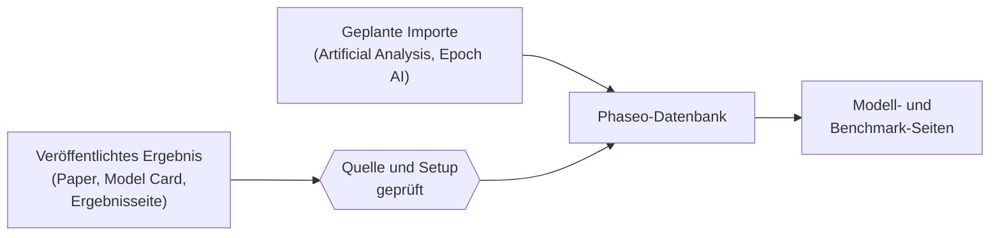

Phaseo veröffentlicht Benchmark-Ergebnisse, die andere gemessen haben, jeweils mit einem Link zur Herkunft. Phaseo führt selbst keine Benchmarks durch und fasst sie nicht zu einem Gesamtwert zusammen.

## Woher Ergebnisse stammen

| Quelle | Wie sie hinzukommen |
| --- | --- |
| Paper, Model Cards und Ankündigungen der Modellentwickler | Von Maintainern hinzugefügt, als **selbst gemeldet** gekennzeichnet |
| Ergebnisseiten der Benchmark-Organisatoren | Von Maintainern hinzugefügt |
| Indizes von Artificial Analysis und Epoch AI | Geplante Importe, stündlich geprüft |
| Meldungen aus der Community | GitHub-Issues, veröffentlicht, nachdem ein Maintainer die Belege geprüft hat |

Jedes Ergebnis braucht vor der Veröffentlichung eine öffentliche Quelle oder ein reproduzierbares Evaluierungsprotokoll.

## Was Vereinheitlichung bedeutet

Phaseo belässt jeden Benchmark auf seiner eigenen Skala. Vereinheitlicht wird der Datensatz rund um das Ergebnis, nicht das Ergebnis selbst:

1. Jedes Ergebnis wird genau einer Benchmark-ID zugeordnet, sodass derselbe Benchmark unter verschiedenen Namen zusammengefasst wird.
2. Weicht das Setup ab, etwa bei der Anzahl der Few-Shot-Beispiele, dem Harness oder dem Reasoning-Effort, wird es als Variante geführt, statt mit dem Standard zusammengelegt zu werden.
3. Jeder Benchmark hat eine Sortierrichtung. Bei Benchmarks, bei denen niedriger besser ist, etwa Fehlerraten, steht das niedrigste Ergebnis oben.
4. Der Quellenlink und die Kennzeichnung „selbst gemeldet“ bleiben beim Ergebnis.

Die Kennzeichnung „selbst gemeldet“ ist ein Hinweis, keine Ablehnung. Ein Ergebnis ohne ausreichenden Kontext kann mit Quellennotizen gespeichert werden; betrachte es nicht als gleichwertig mit einem vollständig geprüften Eintrag in einer Bestenliste.

## Eine Abweichung melden

1. Eröffne ein Issue mit den Belegen, die unter [Benchmark-Ergebnisse einreichen](./submitting-scores.mdx) aufgeführt sind.
2. Beantworte Rückfragen im Issue. Maintainer veröffentlichen geprüfte Korrekturen über den Datenbank-Editor.
3. Stimme größere Forschungsbeiträge auf [Discord](https://discord.gg/aQyywCvgZ5) ab.

Die öffentliche Seite zur [Vereinheitlichung von Benchmarks](https://phaseo.app/how-phaseo-normalises-ai-benchmarks) beschreibt dieselben Regeln für Leser des Katalogs.
