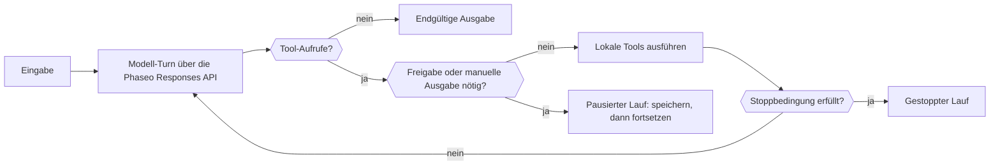

Verwende ein Phaseo Agent SDK, wenn eine einzelne Anfrage nicht reicht: Das SDK führt in deinem Prozess eine begrenzte Schleife aus, die jeden Turn an die Responses API sendet, die vom Modell aufgerufenen Tools ausführt und für einen Menschen pausiert, wenn ein Tool eine Freigabe braucht. Den Ausführungsstatus behältst du; Phaseo hostet nichts für den Agenten.

## Dein Paket auswählen

| Sprache | Paket | Version | Installierter Core-Client |
| --- | --- | --- | --- |
| TypeScript | [`@phaseo/agent-sdk`](https://www.npmjs.com/package/@phaseo/agent-sdk) | 0.3.0 | `@phaseo/sdk` |
| Python | [`phaseo-agent-sdk`](https://pypi.org/project/phaseo-agent-sdk/) (Modul `phaseo_agent`) | 0.3.0 | `phaseo` 3.x |
| Go | [`github.com/phaseoteam/Phaseo/packages/sdk/agent-sdk-go`](https://pkg.go.dev/github.com/phaseoteam/Phaseo/packages/sdk/agent-sdk-go) | v0.3.0 | `sdk-go/v3` |
| C# | [`Phaseo.AgentSdk`](https://www.nuget.org/packages/Phaseo.AgentSdk) | 0.3.0 | `Phaseo.Sdk` |
| PHP | [`phaseo/agent-sdk`](https://packagist.org/packages/phaseo/agent-sdk) | v0.3.0 | `phaseo/sdk` `^3.0.0` |
| Ruby | [`phaseo_agent_sdk`](https://rubygems.org/gems/phaseo_agent_sdk) | 0.3.0 | `phaseo_sdk` `>= 3.0.0, < 4.0.0` |
| Java | `app.phaseo:phaseo-agent-sdk` (Maven Central) | 0.3.0 | `app.phaseo:phaseo-sdk` 3.0.0 |
| Rust | [`phaseo-agent`](https://crates.io/crates/phaseo-agent) | 0.2.0 | `phaseo` 0.2 |

TypeScript ist das Referenzdesign. Für C++ gibt es kein Agent SDK. [Installation](./installation) enthält die Installationsbefehle und Laufzeitanforderungen, und unter [Verwendung](./usage) baust du einen ersten Agenten.

<Prompt description="Lass einen Coding-Agenten mit dem Phaseo Agent SDK einen ersten Agenten in deiner Sprache bauen." icon="bot" actions={["copy", "cursor"]}>
{`Build a small agent in this project with the Phaseo Agent SDK.

1. Install the Phaseo skills: npx skills add https://phaseo.app/docs
   For TypeScript, follow the phaseo-agent-sdk-typescript skill.
2. Read the Agent SDK pages at https://phaseo.app/docs/v1/sdk-reference/agent/overview, pick this project's language tab, and use only the APIs it documents.
3. Define one agent with at most two local tools that fit [AGENT TASK]. Keep the loop bounded with a step limit, and require approval for any tool that changes data.
4. Use a server-side PHASEO_API_KEY and check the model ID with GET /v1/models before using it.
5. Stream the agent's steps to the console so a run can be inspected.
6. Run the agent once, then report what you verified and what you could not verify.`}
</Prompt>

## Vergleichen, was jede Laufzeit unterstützt

Jedes SDK führt lokale Tools aus, pausiert für Freigaben oder manuelle Ausgaben anhand exakter Tool-Call-IDs und gibt serialisierbaren Ausführungsstatus zurück, den deine Anwendung speichert. Der Rest unterscheidet sich je nach Sprache:

| Funktion | TypeScript | Python | Go | C# | PHP | Ruby | Java | Rust |
| --- | --- | --- | --- | --- | --- | --- | --- | --- |
| Standard-Schrittlimit | 12 | 12 | 8 | 12 | 12 | 12 | 12 | 8 |
| Schrittlimit erreicht | Wirft `Max steps exceeded` | Löst `RuntimeError` aus | Gibt einen Fehler zurück | Wirft `InvalidOperationException` | Wirft | Löst aus | Wirft | Gibt einen `stopped`-Lauf zurück (`max_steps:N`) |
| Modell-Streaming | Async Iterable | Iterator (Hintergrund-Thread) | Channel | Async Enumerable | Iterable; läuft nur, während du iterierst (Fiber) | Enumerator (Worker-Thread) | Listen nach dem Lauf; live über `onEvent` | Noch nicht |
| Tool-Fortschritts-Events | Async Generator | `emit_progress` oder Generator | `EmitProgress` | `EmitProgress` | `emitProgress` | `emit_progress` | `emitProgress` | Noch nicht |
| Parallele Tools | Ja | Ja (Threads) | Ja | Ja | Nein | Ja (Threads) | Ja (Thread-Pool) | Nein |
| Tool-Timeout | Bricht `context.signal` ab | Lässt den Lauf fehlschlagen; der Thread läuft weiter | Lässt den Aufruf fehlschlagen; die Goroutine läuft weiter | Bricht `CancellationToken` ab | Wird geprüft, nachdem das Tool zurückkehrt | Unterbricht den Aufruf | Unterbricht den Thread | Keiner |
| Schemavalidierung zur Laufzeit | Ja | Ja | Ja | Ja | Ja | Ja | Ja | Nein; das JSON-Schema wird nur an das Modell gesendet |
| Tool-Fehler standardmäßig | Lässt den Lauf fehlschlagen | Lässt den Lauf fehlschlagen | Lässt den Lauf fehlschlagen | Lässt den Lauf fehlschlagen | Lässt den Lauf fehlschlagen | Lässt den Lauf fehlschlagen | Lässt den Lauf fehlschlagen | Geht an das Modell zurück |
| Freigeben und Ablehnen per Call-ID | Ja | Ja | Ja | Ja | Ja | Ja | Ja | Nur Freigeben |
| Interaktive Tools (Human-in-the-Loop) | Ja | Ja | Ja | Ja | Ja | Ja | Ja | Nur `human_review` auf Agentenebene |
| Stoppbedingungen | Kombinierbar | Kombinierbar; nur bei Schritten ohne Tool-Aufrufe geprüft | Kombinierbar | Kombinierbar | Kombinierbar | Kombinierbar | Kombinierbar | Schrittlimit |
| Dynamische Turns | Ja | Modell, Anweisungen und Sampling; Tools über `next_turn_params` | Ja | Ja | Ja | Ja | Ja | Modell, Schrittlimit und Kontext pro Lauf |
| Typisierte Timeline-Items | `AgentItem`-Union | Dicts | `Details`-Map | `Details`-Dictionary | Arrays | Hashes | `details()`-Map | Nein; lies `messages` und `steps` |
| Nutzung und Kosten | Ja | Ja | Ja | Ja | Ja | Ja | Ja | Tokens, dazu Kosten, wenn die Antwort `meta.cost` oder `cost` enthält |
| Abbruch | `cancel()` | `cancel()` | Context | `CancellationToken` | `cancel()` | `cancel` | `cancel()` | Noch nicht |
| Devtools-Aufzeichnung | Ja | Ja | Ja | Ja | Ja | Ja | Ja | Noch nicht |

Rust (`phaseo-agent` 0.2) ist synchron: kein Streaming, keine asynchrone Ausführung, keine parallelen Tools, keine Schemavalidierung zur Laufzeit und keine Devtools-Aufzeichnung. Führe es auf einem Worker-Thread aus, wenn ein Lauf keinen Request-Handler blockieren soll. PHP führt Tools nacheinander aus, und sein Stream geht nur weiter, während dein Code iteriert.

## Zwischen Agent SDK, Client und roher API wählen

| Einsatz | Wähle | Zuständig für |
| --- | --- | --- |
| Eine einzelne API-Anfrage oder vollständige Endpunktabdeckung | [Client-SDK](../client/overview) | Generierte API-Typen und Transport |
| Mehrstufige Anwendungslogik mit Tools | Agent SDK | Lokale Schleife, Tools, Checkpoints, Prüfung, Events und Devtools |
| Eigener Transport oder eine nicht unterstützte Sprache | Rohe API | Verarbeitung von HTTP-Anfrage und -Antwort |

Der Gateway-Client jedes Agent SDK sendet Modell-Turns über das Client-SDK der jeweiligen Sprache. Die meisten akzeptieren eine `requestOptions`-Map (oder das Gegenstück der Sprache) für zusätzliche Responses-API-Felder; `model`, `input`, `instructions` und die Funktions-Tools setzt weiterhin der Agent. Der Rust-0.2-Adapter sendet nur die normalisierten Agentenfelder und hat keinen Hook für zusätzliche Optionen.

## Mit einem Rezept starten

| Rezept | Sprache |
| --- | --- |
| [Eine dauerhafte Agentenschleife bauen](../../cookbook/agent-sdk-durable-loop) | TypeScript |
| [Recherche mit strukturierter Ausgabe und Websuche](../../cookbook/agent-sdk-research-brief) | TypeScript |
| [Support-Triage mit Presets und Guardrail-bewussten Fehlern](../../cookbook/agent-sdk-support-triage) | TypeScript |
| [Einen Code-Review-Agenten mit Laufzeit-Tools ausführen](../../cookbook/agent-sdk-coding-review) | TypeScript |
| [Lokale Agenten-Tools parallel ausführen](../../cookbook/agent-sdk-parallel-tools) | TypeScript |
| [Strukturiertes JSON extrahieren](../../cookbook/agent-sdk-python-structured-extraction) | Python |
| [Einen Ops-Runbook-Agenten bauen](../../cookbook/agent-sdk-go-ops-runbook) | Go |
| [Tickets triagieren](../../cookbook/agent-sdk-csharp-ticket-triage) | C# |
| [CMS-Inhalte prüfen](../../cookbook/agent-sdk-php-content-review) | PHP |
| [Interne Notizen zusammenfassen](../../cookbook/agent-sdk-ruby-rag-notes) | Ruby |

Die TypeScript-Rezepte lassen sich mit den APIs auf diesen Seiten in jede Sprache übertragen.
