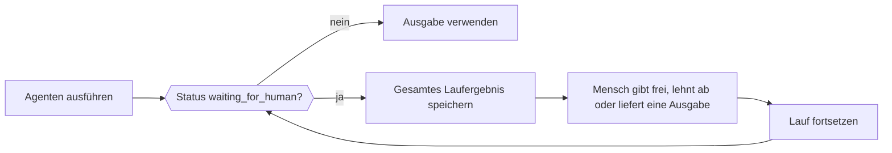

Wenn ein Agent einen Menschen, einen externen Job oder ein Tool braucht, das deine Anwendung ausführt, kehrt der Lauf normal zurück (nicht als Fehler), mit dem Status `waiting_for_human` und allem, was zum Fortsetzen nötig ist. Speichere das gesamte Ergebnis, hole die Entscheidung in deiner Anwendung ein und übergib dann das gespeicherte Ergebnis und die Entscheidung an die Fortsetzungsmethode des Agenten.



<Note>
Phaseo speichert keine Läufe des Agent SDK. Speichere fortsetzbaren Status in deiner eigenen Anwendung, wenn er eine Anfrage oder einen Prozessneustart überdauern muss.
</Note>

| Sprache | Fortsetzen | Mit Streaming fortsetzen | Hinweise |
| --- | --- | --- | --- |
| TypeScript | `agent.continueRun()` | `agent.continueStream()` | |
| Python | `agent.continue_run()` | `agent.continue_stream()` | |
| Go | `agent.Continue(ctx, ContinueOptions)` | `agent.ContinueStream` | |
| C# | `agent.ContinueRun(ContinueOptions)` | `agent.ContinueStream` | |
| PHP | `$agent->continueRun()` | `$agent->continueStream()` | `continueRunById()` lädt den Lauf zuerst über einen Status-Accessor |
| Ruby | `agent.continue_run` | `agent.continue_stream` | |
| Java | `agent.continueRun(ContinueOptions)` | `agent.continueStream` | `ContinueOptions` ist ein positionaler Record |
| Rust | `agent.continue_run(&mut client, options)` | Keine | `continue_with_events` fügt einen Event-Callback hinzu; Läufe sind synchron |

## Tool-Aufrufe freigeben oder ablehnen

Freigabepflichtige, manuelle und Human-in-the-Loop-Tools pausieren den Lauf, bevor sie ausgeführt werden. Jeder ausstehende Aufruf hat den `call` des Modells (mit seiner `id`) und eine `kind`: `approval`, `manual` oder `hitl`. Beantworte jeden Aufruf über seine exakte Call-ID, nicht über den Tool-Namen, damit zwei Aufrufe desselben Tools getrennt bleiben.

Ein freigegebener Aufruf führt sein Tool aus. Ein abgelehnter Aufruf sendet `{"error": "<reason>"}` als Tool-Ergebnis an das Modell, mit dem Standardgrund `Tool call rejected`.

<CodeGroup>

```typescript TypeScript
const resumed = await agent.continueRun({
  run: paused,
  client,
  approvals: [{ toolCallId: "call_deploy_42" }],
  rejections: [
    { toolCallId: "call_delete_17", reason: "Not authorized" },
  ],
});
```

```python Python
from phaseo_agent import AgentToolDecision

pending = paused.run.pause.pending_tool_calls

continued = agent.continue_run(
    run=paused,
    client=client,
    approvals=[AgentToolDecision(pending[0].call.id)],
    rejections=[AgentToolDecision(pending[1].call.id, "Not authorized")],
)
```

```go Go
var approvals, rejections []phaseoagent.ToolDecision
for _, pending := range result.Run.Pause.PendingToolCalls {
  if pending.Kind != "approval" {
    continue
  }
  if userApproved(pending.Call) {
    approvals = append(approvals, phaseoagent.ToolDecision{ToolCallID: pending.Call.ID})
  } else {
    rejections = append(rejections, phaseoagent.ToolDecision{ToolCallID: pending.Call.ID, Reason: "Not now"})
  }
}

result, err = agent.Continue(ctx, phaseoagent.ContinueOptions{
  Run: result, Client: client, Approvals: approvals, Rejections: rejections,
})
```

```csharp C#
var pending = result.Run.Pause!.PendingToolCalls!.Where(item => item.Kind == "approval");

result = await agent.ContinueRun(new ContinueOptions
{
    Run = result,
    Client = client,
    Approvals = pending.Where(item => UserApproved(item.Call)).Select(item => new ToolDecision(item.Call.Id)).ToList(),
    Rejections = pending.Where(item => !UserApproved(item.Call)).Select(item => new ToolDecision(item.Call.Id, "Not now")).ToList(),
});
```

```php PHP
use Phaseo\AgentSdk\ToolDecision;

$approvals = $rejections = [];
foreach ($result->run->pause->pendingToolCalls as $pending) {
    if ($pending->kind !== "approval") continue;
    if (userApproved($pending->call)) {
        $approvals[] = new ToolDecision($pending->call->id);
    } else {
        $rejections[] = new ToolDecision($pending->call->id, "Not now");
    }
}

$result = $agent->continueRun(run: $result, client: $client, approvals: $approvals, rejections: $rejections);
```

```ruby Ruby
pending = result.run.pause.pending_tool_calls.select { |item| item.kind == "approval" }
approved, declined = pending.partition { |item| user_approved?(item.call) }

result = agent.continue_run(
  run: result,
  client: client,
  approvals: approved.map { |item| PhaseoAgentSdk::ToolDecision.new(tool_call_id: item.call.id) },
  rejections: declined.map { |item| PhaseoAgentSdk::ToolDecision.new(tool_call_id: item.call.id, reason: "Not now") }
)
```

```java Java
var pending = result.run().pause().pendingToolCalls();
var approvals = pending.stream().filter(item -> item.kind().equals("approval") && userApproved(item.call()))
    .map(item -> new AgentSdk.ToolDecision(item.call().id())).toList();
var rejections = pending.stream().filter(item -> item.kind().equals("approval") && !userApproved(item.call()))
    .map(item -> new AgentSdk.ToolDecision(item.call().id(), "Not now")).toList();

result = agent.continueRun(new AgentSdk.ContinueOptions(
    result, client, null, null, null, null, null, null, null, null, null,
    approvals, rejections, List.of()));
```

```rust Rust
use phaseo_agent::{ContinueOptions, ToolDecision};

let approvals = paused.run.pause.as_ref().unwrap()
    .pending_tool_calls
    .iter()
    .map(|pending| ToolDecision {
        tool_call_id: pending.call.id.clone(),
        reason: Some("Approved by the release operator".to_string()),
    })
    .collect();

let mut options = ContinueOptions::new(paused);
options.approvals = approvals;

let completed = agent.continue_run(&mut client, options)?;
```

</CodeGroup>

Wo die ausstehenden Aufrufe liegen und was passiert, wenn eine Entscheidung fehlt:

| Sprache | Ausstehende Aufrufe | Fehlende Entscheidung |
| --- | --- | --- |
| TypeScript | `run.pause.pendingToolCalls` | Wirft `Missing approval decision for tool call <id>` |
| Python | `run.pause.pending_tool_calls` | Löst `ValueError` aus |
| Go | `Run.Pause.PendingToolCalls` | Gibt `missing approval decision for tool call <id>` zurück |
| C# | `Run.Pause.PendingToolCalls` | Wirft `Missing approval decision for tool call <id>` |
| PHP | `$result->run->pause->pendingToolCalls` | Wirft `Missing approval decision for tool call <id>` |
| Ruby | `result.run.pause.pending_tool_calls` | Löst `Missing approval decision for tool call <id>` aus |
| Java | `run().pause().pendingToolCalls()` | Wirft `Missing approval decision for tool call <id>` |
| Rust | `run.pause.pending_tool_calls` (eine `Option`) | Gibt einen `AgentError` zurück |

Auch die Pause selbst hat eine `kind`. Go und C# setzen sie bei jeder Tool-Pause auf `tool_approval`. PHP, Ruby und Java setzen `tool_approval`, wenn irgendein ausstehender Aufruf eine Freigabe braucht, andernfalls die `kind` des ersten Aufrufs. Rust verwendet `tool_approval` für Freigabeaufrufe, `external_output`, wenn jeder ausstehende Aufruf ein externes Ergebnis braucht, und `tool_input` für eine Mischung aus beidem.

<Warning>
Rust `0.2` hat keinen Ablehnungstyp und kein Feld `rejections`. Lass einen nicht freigegebenen Aufruf pausiert oder wende vor dem Fortsetzen die Ablehnungsrichtlinie deiner Anwendung an.
</Warning>

Um für jeden Tool-Aufruf statt pro Tool eine Freigabe zu verlangen, setze `requireApproval` in der Agentendefinition (`require_approval` in Python und Ruby, `RequireApproval` in Go und C#). In TypeScript ist es eine Funktion `requireApproval(call, context)`. Rust unterstützt Freigaben nur pro Tool, mit `Tool::require_approval()`. Unter [Tools](./tools) siehst du, wie jede Art von Tool definiert wird.

## Ergebnisse für manuelle und Human-in-the-Loop-Tools liefern

Für `manual`- und `hitl`-Aufrufe übergibst du das Ergebnis, das deine Anwendung erzeugt hat, mit der Call-ID als Schlüssel. In Rust sind das Tools, die mit `Tool::external(...)` gebaut wurden.

<CodeGroup>

```typescript TypeScript
await agent.continueRun({
  run: paused,
  client,
  toolOutputs: [{ toolCallId: callId, output: { status: "shipped" } }],
});
```

```python Python
from phaseo_agent import AgentToolOutput

agent.continue_run(
    run=paused,
    client=client,
    tool_outputs=[AgentToolOutput(call_id, {"status": "shipped"})],
)
```

```go Go
ToolOutputs: []phaseoagent.ToolOutput{{ToolCallID: callID, Output: map[string]any{"status": "shipped"}}},
```

```csharp C#
ToolOutputs = new[] { new ToolOutput(callId, new { status = "shipped" }) },
```

```php PHP
use Phaseo\AgentSdk\ToolOutput;

toolOutputs: [new ToolOutput($callId, ["status" => "shipped"])],
```

```ruby Ruby
tool_outputs: [PhaseoAgentSdk::ToolOutput.new(tool_call_id: call_id, output: { status: "shipped" })]
```

```java Java
// Das Argument toolOutputs von ContinueOptions
List.of(new AgentSdk.ToolOutput(callId, Map.of("status", "shipped")))
```

```rust Rust
use phaseo_agent::{ContinueOptions, ToolOutput};
use serde_json::json;

let mut options = ContinueOptions::new(paused);
options.tool_outputs = vec![ToolOutput {
    tool_call_id: call_id,
    output: json!({ "status": "shipped" }),
}];

let completed = agent.continue_run(&mut client, options)?;
```

</CodeGroup>

Eine fehlende Ausgabe lässt die Fortsetzung mit `Missing output for tool call <id>` fehlschlagen (kleingeschriebenes `missing` in Go, ein `ValueError` in Python, ein `AgentError` in Rust). Eine menschliche Eingabenachricht ersetzt keine Tool-Ausgabe.

## Für eine menschliche Prüfung pausieren

Setze in der Agentendefinition einen Callback für die menschliche Prüfung, um jede Modellantwort zu prüfen, bevor der Lauf weitergeht. Gib eine Prüfanfrage mit einem `reason` (und optional einem `payload`) zurück, um zu pausieren, oder nichts, um fortzufahren. Die `kind` der Pause ist `human_review`. Der Callback erhält die Lauf-ID, den Schrittindex, die Nachrichten, die Modellantwort und die geparste Ausgabe (Rust: Lauf- und Agenten-ID, Schrittindex, Nachrichten, Antwort und Anwendungskontext).

<CodeGroup>

```typescript TypeScript
const agent = createAgent({
  id: "support-agent",
  humanReview: ({ response }) =>
    response.message.content.includes("needs approval")
      ? {
          reason: "approval_required",
          payload: { draft: response.message.content },
        }
      : null,
});
```

```python Python
from phaseo_agent import AgentHumanReviewRequest

def review(context):
    if "needs approval" in context.response.message.content:
        return AgentHumanReviewRequest("approval_required", {"draft": context.response.message.content})
    return None

agent = create_agent({"id": "support-agent", "human_review": review})
```

```go Go
HumanReview: func(review phaseoagent.HumanReviewContext) *phaseoagent.HumanReviewRequest {
  if strings.Contains(review.Response.Message.Content, "refund") {
    return &phaseoagent.HumanReviewRequest{Reason: "Refunds need sign-off"}
  }
  return nil
},
```

```csharp C#
HumanReview = review => Task.FromResult<HumanReviewRequest?>(
    review.Response.Message.Content.Contains("refund")
        ? new HumanReviewRequest("Refunds need sign-off")
        : null),
```

```php PHP
use Phaseo\AgentSdk\HumanReviewRequest;

humanReview: fn ($review) => str_contains($review->response->message->content, "refund")
    ? new HumanReviewRequest("Refunds need sign-off")
    : null,
```

```ruby Ruby
human_review: ->(review) {
  if review.response.message.content.include?("refund")
    PhaseoAgentSdk::HumanReviewRequest.new(reason: "Refunds need sign-off")
  end
}
```

```java Java
AgentSdk.HumanReview review = context ->
    context.response().message().content().contains("refund")
        ? new AgentSdk.HumanReviewRequest("Refunds need sign-off", null)
        : null;
```

```rust Rust
use phaseo_agent::{AgentDefinition, HumanReviewRequest};
use serde_json::json;

let definition = AgentDefinition::new("review-agent", "openai/gpt-6-astra")
    .human_review(|context| {
        if context.response.message.content.contains("needs approval") {
            Some(HumanReviewRequest {
                reason: "Review the proposed action".to_string(),
                payload: json!({ "draft": context.response.message.content }),
            })
        } else {
            None
        }
    });
```

</CodeGroup>

Setze mit einer menschlichen Eingabe fort, die der Unterhaltung als Benutzernachricht hinzugefügt wird:

<CodeGroup>

```typescript TypeScript
const continued = await agent.continueRun({
  run: pausedResult,
  client,
  humanInput: "Approved. Continue and return the final answer.",
});
```

```python Python
continued = agent.continue_run(
    run=paused,
    client=client,
    human_input="Approved. Continue and return the final answer.",
)
```

```go Go
result, err = agent.Continue(ctx, phaseoagent.ContinueOptions{
  Run:        result,
  Client:     client,
  HumanInput: "Approved. Refund up to $50.",
})
```

```csharp C#
result = await agent.ContinueRun(new ContinueOptions
{
    Run = result,
    Client = client,
    HumanInput = "Approved. Refund up to $50.",
});
```

```php PHP
$result = $agent->continueRun(
    run: $result,
    client: $client,
    humanInput: "Approved. Refund up to $50."
);
```

```ruby Ruby
result = agent.continue_run(
  run: result,
  client: client,
  human_input: "Approved. Refund up to $50."
)
```

```java Java
result = agent.continueRun(new AgentSdk.ContinueOptions(
    result, client, null, null, null, null,
    "Approved. Refund up to $50.",          // humanInput
    null, null, null, null));
```

```rust Rust
use phaseo_agent::ContinueOptions;

let mut options = ContinueOptions::new(paused);
options.human_input = Some("Approved. Continue and return the final result.".to_string());

let completed = agent.continue_run(&mut client, options)?;
```

</CodeGroup>

Das Fortsetzen einer Prüfpause ohne menschliche Eingabe schlägt mit `Run <id> is waiting for human input` fehl (Go: `run <id> is waiting for human input`; Java: `Run is waiting for human input`). Rust verlangt ein nicht leeres `human_input`. TypeScript akzeptiert außerdem strukturierte `humanMessages`.

## Ausführungsstatus zwischen Anfragen speichern

Das Laufergebnis besteht aus einfachen Daten: Speichere es in deiner Datenbank, deinem Objektspeicher oder deinem Job-Eintrag und halte den Anwendungs-`context` serialisierbar. Ein Lauf kann nur von einem Agenten mit derselben ID fortgesetzt werden. [Das Rezept für eine dauerhafte Agentenschleife](../../cookbook/agent-sdk-durable-loop) zeigt einen vollständigen Ablauf zum Speichern und Fortsetzen.

Wenn das SDK Läufe für dich speichern und laden soll, übergib einen Status-Accessor mit `load(runId)` und `save(result)`. Das SDK speichert dann nach jedem Lauf und jeder Fortsetzung, und du kannst über die Lauf-ID fortsetzen, statt den Eintrag durch jede Schicht zu reichen.

| Sprache | Status-Accessor | Über ID fortsetzen |
| --- | --- | --- |
| TypeScript | `state` mit asynchronem `load(runId)` und `save(result)` | `continueRun({ runId, state, client })` |
| Python | `state`, implementiert `AgentStateAccessor` | `continue_run(run_id=..., state=..., client=...)` |
| Go | `State`, implementiert `StateAccessor`, an `RunOptions` und `ContinueOptions` | `ContinueOptions{RunID: id, State: store}` |
| C# | `State`, implementiert `IStateAccessor`, an `RunOptions` und `ContinueOptions` | `new ContinueOptions { RunId = id, State = store, Client = client }` |
| PHP | `state`, implementiert `StateAccessor` | `continueRunById($runId, $state, $client, approvals: ..., rejections: ..., toolOutputs: ...)`; wirft `Run <id> not found`, wenn er fehlt |
| Ruby | `state:`, ein beliebiges Objekt mit `load(run_id)` und `save(result)` | `continue_run(run_id: id, state: store, client: client)` |
| Java | `StateAccessor`, das letzte Argument von `RunOptions` | Die `ContinueOptions` mit 16 Argumenten, mit `runId` und `state` am Ende und `run` auf null. Sie laden den Lauf, speichern das fortgesetzte Ergebnis aber nicht; das musst du selbst tun. |
| Rust | Keiner | Serialisiere `RunResult` mit Serde und übergib es an `ContinueOptions::new` |

<CodeGroup>

```go Go
type StateAccessor interface {
  Load(ctx context.Context, runID string) (*phaseoagent.RunResult, error)
  Save(ctx context.Context, result phaseoagent.RunResult) error
}
```

```csharp C#
public interface IStateAccessor
{
    Task<RunResult?> Load(string runId, CancellationToken cancellationToken = default);
    Task Save(RunResult result, CancellationToken cancellationToken = default);
}
```

```rust Rust
use phaseo_agent::RunResult;

// Pausierten Lauf speichern
std::fs::write("paused-run.json", serde_json::to_string_pretty(&paused)?)?;

// Später wiederherstellen
let paused: RunResult = serde_json::from_str(&std::fs::read_to_string("paused-run.json")?)?;
```

</CodeGroup>

Erstelle in Rust vor dem Fortsetzen dieselbe Agentendefinition und dieselben Tools neu: Closures und `AgentDefinition` sind nicht Teil des serialisierten Laufs. Das effektive Modell und das Schrittlimit werden in `RunRecord` gespeichert, sodass Überschreibungen pro Lauf nach dem Fortsetzen aktiv bleiben.

Was auch immer du speicherst: Für Verschlüsselung und Aufbewahrung gespeicherter Läufe, die Autorisierung von Freigaben und menschlichen Eingaben sowie die Idempotenz von Nebeneffekten, die nach einem Fortsetzen erneut laufen, ist deine Anwendung zuständig.
