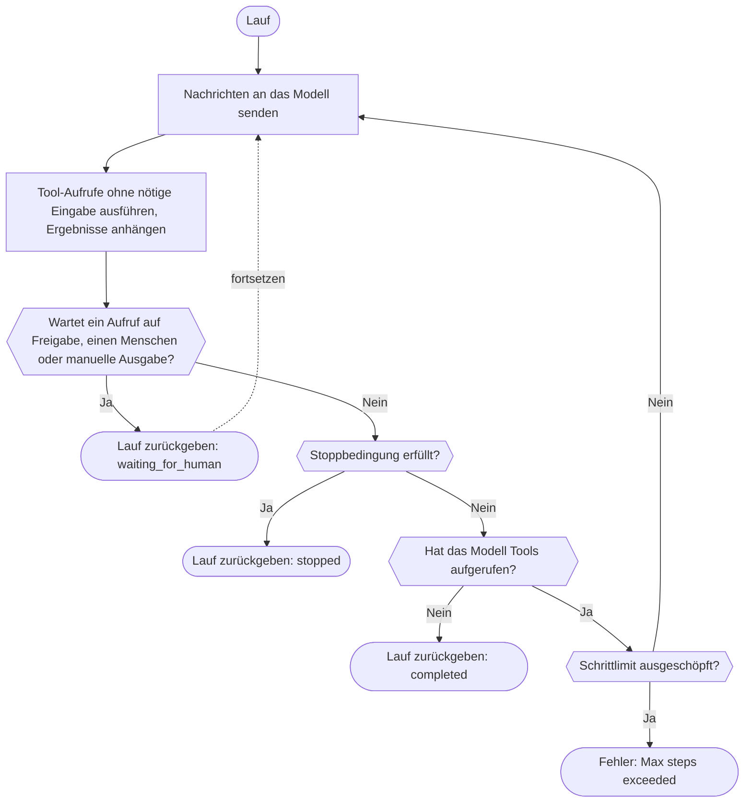

Definiere ein Tool, erstelle einen Agenten und führe ihn mit einem Gateway-Client aus. Das Modell ruft dein Tool auf, das SDK führt es aus und sendet das Ergebnis zurück, und der Lauf endet, wenn das Modell ohne Tool-Aufruf antwortet, für einen Menschen pausiert oder eine [Stoppbedingung](./stop-conditions) zutrifft. Erreicht der Lauf vorher sein Schrittlimit, wirft das SDK einen Fehler; nur Rust gibt den Lauf mit dem Status `stopped` zurück. Phaseo hostet weder den Agenten noch speichert es seine Läufe; das übernimmt deine Anwendung.

## Einen ersten Agenten bauen

<CodeGroup>

```typescript TypeScript
import {
  createAgent,
  createGatewayAgentClient,
  defineTool,
} from "@phaseo/agent-sdk";

const lookupDocs = defineTool({
  id: "lookup-docs",
  description: "Look up an internal docs page by slug.",
  parameters: {
    type: "object",
    properties: {
      slug: { type: "string" },
    },
    required: ["slug"],
    additionalProperties: false,
  },
  async execute(input: { slug: string }) {
    return {
      slug: input.slug,
      url: `https://phaseo.app/docs/v1/${input.slug}`,
    };
  },
});

const agent = createAgent({
  id: "support-docs-agent",
  model: "openai/gpt-6-astra",
  instructions: "Use tools when helpful and finish with a concise answer.",
  tools: [lookupDocs],
});

const result = await agent.run({
  input: "Find the docs page for presets and explain when to use them.",
  client: createGatewayAgentClient({
    clientOptions: {
      apiKey: process.env.PHASEO_API_KEY!,
    },
  }),
});

console.log(result.output);
```

```python Python
import os
from phaseo_agent import AgentTool, create_agent, create_gateway_agent_client, define_tool

lookup_docs = define_tool(AgentTool(
    id="lookup-docs",
    description="Look up an internal docs page by slug.",
    parameters={
        "type": "object",
        "properties": {"slug": {"type": "string"}},
        "required": ["slug"],
        "additionalProperties": False,
    },
    execute=lambda tool_input, runtime: {
        "slug": tool_input["slug"],
        "url": f"https://phaseo.app/docs/v1/{tool_input['slug']}",
    },
))

agent = create_agent({
    "id": "support-docs-agent",
    "model": "openai/gpt-6-astra",
    "instructions": "Use tools when helpful and finish with a concise answer.",
    "tools": [lookup_docs],
})

result = agent.run(
    input="Find the docs page for presets and explain when to use them.",
    client=create_gateway_agent_client(client_options={"api_key": os.environ["PHASEO_API_KEY"]}),
)

print(result.output)
```

```go Go
package main

import (
  "context"
  "fmt"

  phaseoagent "github.com/phaseoteam/Phaseo/packages/sdk/agent-sdk-go"
)

func main() {
  client, err := phaseoagent.CreateGatewayAgentClient(phaseoagent.GatewayAgentClientOptions{})
  if err != nil {
    panic(err) // PHASEO_API_KEY ist erforderlich
  }

  lookup := phaseoagent.DefineTool(phaseoagent.Tool{
    ID:          "lookup_docs",
    Description: "Look up a Phaseo documentation topic",
    Parameters: map[string]any{
      "type":       "object",
      "properties": map[string]any{"topic": map[string]any{"type": "string"}},
      "required":   []string{"topic"},
    },
    Execute: func(input any, runtime phaseoagent.RuntimeContext) (any, error) {
      args, _ := input.(map[string]any)
      return map[string]any{"topic": args["topic"], "found": true}, nil
    },
  })

  agent := phaseoagent.CreateAgent(phaseoagent.AgentDefinition{
    ID:           "docs-agent",
    Model:        "openai/gpt-6-astra",
    Instructions: "Use tools when helpful and finish with a concise answer.",
    Tools:        []phaseoagent.Tool{lookup},
    MaxSteps:     6,
  })

  result, err := agent.Run(context.Background(), phaseoagent.RunOptions{
    Input:  "Explain when to use routing presets.",
    Client: client,
  })
  if err != nil {
    panic(err)
  }

  fmt.Println(result.Output)
  fmt.Println(result.Run.Status, result.Usage.TotalTokens)
}
```

```csharp C#
using System.Text.Json;
using PhaseoAgentSdk;

var lookup = AgentSdk.DefineTool(new Tool(
    "lookup_docs",
    async (input, runtime) =>
    {
        var topic = ((JsonElement)input!).GetProperty("topic").GetString();
        return new { topic, found = true };
    },
    "Look up a Phaseo documentation topic",
    new Dictionary<string, object?>
    {
        ["type"] = "object",
        ["properties"] = new Dictionary<string, object?> { ["topic"] = new { type = "string" } },
        ["required"] = new[] { "topic" },
    }));

var agent = AgentSdk.CreateAgent(new AgentDefinition
{
    Id = "docs-agent",
    Model = "openai/gpt-6-astra",
    Instructions = "Use tools when helpful and finish with a concise answer.",
    Tools = new[] { lookup },
    MaxSteps = 6,
});

var result = await agent.Run(new RunOptions
{
    Input = "Explain when to use routing presets.",
    Client = AgentSdk.CreateGatewayAgentClient(), // wirft, wenn PHASEO_API_KEY fehlt
});

Console.WriteLine(result.Output);
Console.WriteLine($"{result.Run.Status} {result.Usage.TotalTokens}");
```

```php PHP
<?php
require "vendor/autoload.php";

use Phaseo\AgentSdk\AgentDefinition;
use Phaseo\AgentSdk\AgentSdk;
use Phaseo\AgentSdk\Tool;

$lookup = AgentSdk::defineTool(new Tool(
    id: "lookup_docs",
    execute: fn (array $input, $runtime) => ["topic" => $input["topic"], "found" => true],
    description: "Look up a Phaseo documentation topic",
    parameters: [
        "type" => "object",
        "properties" => ["topic" => ["type" => "string"]],
        "required" => ["topic"],
    ],
));

$agent = AgentSdk::createAgent(new AgentDefinition(
    id: "docs-agent",
    model: "openai/gpt-6-astra",
    instructions: "Use tools when helpful and finish with a concise answer.",
    tools: [$lookup],
    maxSteps: 6,
));

$result = $agent->run(
    input: "Explain when to use routing presets.",
    client: AgentSdk::createGatewayAgentClient() // wirft, wenn PHASEO_API_KEY fehlt
);

echo $result->output . PHP_EOL;
echo $result->run->status . " " . $result->usage["total_tokens"] . PHP_EOL;
```

```ruby Ruby
require "phaseo_agent_sdk"

lookup = PhaseoAgentSdk.define_tool(
  PhaseoAgentSdk::Tool.new(
    id: "lookup_docs",
    description: "Look up a Phaseo documentation topic",
    parameters: {
      type: "object",
      properties: { topic: { type: "string" } },
      required: ["topic"]
    },
    execute: ->(input, runtime) { { topic: input["topic"], found: true } }
  )
)

agent = PhaseoAgentSdk.create_agent(
  id: "docs-agent",
  model: "openai/gpt-6-astra",
  instructions: "Use tools when helpful and finish with a concise answer.",
  tools: [lookup],
  max_steps: 6
)

result = agent.run(
  input: "Explain when to use routing presets.",
  client: PhaseoAgentSdk.create_gateway_agent_client # löst aus, wenn PHASEO_API_KEY fehlt
)

puts result.output
puts "#{result.run.status} #{result.usage[:total_tokens]}"
```

```java Java
import app.phaseo.agent.AgentSdk;
import java.time.Duration;
import java.util.List;
import java.util.Map;

var lookup = AgentSdk.defineTool(new AgentSdk.Tool(
    "lookup_docs",
    (input, context) -> Map.of("topic", ((Map<?, ?>) input).get("topic"), "found", true),
    "Look up a Phaseo documentation topic",
    Map.of(
        "type", "object",
        "properties", Map.of("topic", Map.of("type", "string")),
        "required", List.of("topic")),
    Duration.ofSeconds(10)
));

var agent = AgentSdk.createAgent(new AgentSdk.AgentDefinition(
    "docs-agent",                       // id
    "openai/gpt-6-astra",               // model
    null,                               // preset
    "Use tools when helpful and finish with a concise answer.", // instructions
    List.of(lookup),                    // tools
    6,                                  // maxSteps
    null, null, null, null              // parseOutput, humanReview, modelRetry, toolExecution
));

var result = agent.run(new AgentSdk.RunOptions(
    "Explain when to use routing presets.",  // input
    AgentSdk.createGatewayAgentClient(),     // wirft, wenn PHASEO_API_KEY fehlt
    null, null, null, null, null, null, null, null
));

System.out.println(result.output());
System.out.println(result.run().status() + " " + result.usage().totalTokens());
```

```rust Rust
use phaseo_agent::{
    create_agent, create_gateway_agent_client, define_tool, AgentDefinition,
    RunOptions, Tool,
};
use serde_json::json;

fn main() -> Result<(), Box<dyn std::error::Error>> {
    let lookup = define_tool(Tool::new(
        "lookup_docs",
        "Look up a Phaseo documentation topic",
        json!({
            "type": "object",
            "properties": {
                "topic": { "type": "string" }
            },
            "required": ["topic"]
        }),
        |input, context| {
            Ok(json!({
                "topic": input["topic"],
                "run_id": context.run_id,
                "found": true
            }))
        },
    ));

    let agent = create_agent(
        AgentDefinition::new("docs-agent", "openai/gpt-6-astra")
            .instructions("Use lookup_docs when helpful. Answer concisely.")
            .max_steps(6)
            .tool(lookup),
    );

    let mut client = create_gateway_agent_client("openai/gpt-6-astra")?;
    let result = agent.run(
        &mut client,
        RunOptions::new("Explain when to use routing presets."),
    )?;

    println!("{}", result.output);
    println!("steps: {}", result.run.step_count);
    println!("tokens: {}", result.usage.total_tokens);
    Ok(())
}
```

</CodeGroup>

Die ID des Tools ist der Funktionsname, den das Modell sieht, und seine Parameter sind das JSON-Schema, das das Modell ausfüllt. Die Argumente erreichen deinen Code in der jeweils nativen Form der Sprache:

| Sprache | Tool erhält | Hinweise |
| --- | --- | --- |
| TypeScript | Typisiertes Objekt | `execute(input, context)` |
| Python | `dict` | `execute(tool_input, runtime)` |
| Go | `any` (dekodiertes JSON, meist `map[string]any`) | `Execute(input, runtime) (any, error)` |
| C# | `JsonElement` | `Execute(input, runtime)`, mit `await` |
| PHP | Assoziatives Array | `execute(array $input, $runtime)` |
| Ruby | Hash mit String-Schlüsseln | Baue Tools mit `PhaseoAgentSdk::Tool.new`; `define_tool` gibt zurück, was du übergibst, daher funktioniert ein einfacher Hash nicht |
| Java | `Map` | Records sind positional; übergib `null` für alles, was du nicht setzt |
| Rust | `serde_json::Value` | Die Closure läuft lokal; `RuntimeContext` enthält die Lauf-ID, die Agenten-ID, den Schrittindex, den Anwendungskontext und den Tool-Aufruf |

Wenn weder Agent noch Lauf noch Client ein Modell oder Preset setzen, sendet der Gateway-Client `phaseo/free`. `create_gateway_agent_client` in Rust nimmt das Modell als Argument.

## So läuft ein Lauf ab



Jeder Schritt wird im zurückgegebenen Laufergebnis als Checkpoint gespeichert. Um über Anfragen oder Neustarts hinweg fortzusetzen, speicherst du dieses Ergebnis in deinem eigenen Speicher und übergibst es an die Fortsetzungsmethode, oder du gibst dem Agenten einen Status-Accessor; siehe [Status und Freigabe](./state-and-approval). Das Schrittlimit und was passiert, wenn es ausgeschöpft ist, unterscheiden sich je nach Sprache:

<Tabs>
<Tab title="TypeScript">

Jeder Aufruf von `run()` oder `continueRun()` umfasst bis zu 12 Schritte, sofern du `maxSteps` nicht setzt; darüber hinaus wirft er `Max steps exceeded`. Mit [Stoppbedingungen](./stop-conditions) beendest du einen Lauf sauber.

</Tab>
<Tab title="Python">

Ein Lauf umfasst bis zu 12 Schritte, sofern du `max_steps` nicht setzt; darüber hinaus löst er `RuntimeError` aus. Stoppbedingungen werden nur bei einem Schritt geprüft, in dem das Modell keine Tools aufruft, daher weicht die Reihenfolge vom Diagramm ab: Eine Tool-Schleife läuft, bis sie pausiert, antwortet oder `max_steps` ausschöpft.

</Tab>
<Tab title="Go">

Ein Lauf, der mehr als `MaxSteps` Modell-Turns braucht (Standard 8), schlägt mit `Max steps exceeded (N)` fehl.

</Tab>
<Tab title="C#">

Ein Lauf, der mehr als `MaxSteps` Modell-Turns braucht (Standard 12), wirft `InvalidOperationException("Max steps exceeded (N)")`.

</Tab>
<Tab title="PHP">

Ein Lauf, der mehr als `maxSteps` Modell-Turns braucht (Standard 12), wirft `Max steps exceeded (N)`.

</Tab>
<Tab title="Ruby">

Ein Lauf, der mehr als `max_steps` Modell-Turns braucht (Standard 12), löst `Max steps exceeded (N)` aus.

</Tab>
<Tab title="Java">

Ein Lauf, der mehr als `maxSteps` Modell-Turns braucht (Standard 12), wirft `Max steps exceeded (N)`.

</Tab>
<Tab title="Rust">

Ein Lauf umfasst bis zu 8 Modell-Turns, sofern du nicht `.max_steps(n)` aufrufst oder `RunOptions.max_steps` setzt. Das Erreichen des Limits ist kein Fehler: Der Lauf kehrt mit `run.status` `stopped` und `run.stop_reason` `max_steps:<limit>` zurück. Läufe sind synchron, und lokale Tools werden nacheinander ausgeführt; verwende daher einen Worker-Thread oder eine Task-Grenze, wenn ein Lauf keinen Request-Handler blockieren soll.

</Tab>
</Tabs>

## Das Laufergebnis lesen

Jeder Lauf gibt dieselben Teile zurück. Die Feldnamen folgen der Schreibweise der jeweiligen Sprache (`output`, `Output`, `output()`):

| Teil | Inhalt |
| --- | --- |
| `run` | Status, IDs, effektives Modell, Schrittlimit, Kontext, Pausenstatus und Stoppgrund |
| `steps` | Ein Eintrag pro Modell-Turn: Request-ID, Anbieter, Modell, Finish-Reason, Warnungen, Tool-Aufrufe und Nutzung |
| `messages` | Die gesamte Unterhaltung einschließlich der Tool-Ergebnisse |
| `output` | Die endgültige Ausgabe |
| `usage` | Eingabe-, Ausgabe-, gecachte und Gesamt-Tokens sowie Kosten |

`usage.cost` kommt in Rust nur aus einem numerischen `meta.cost` oder `cost` in der Antwort; `cost_nanos` oder `cost_cents` werden nicht übernommen. Für Ausgabenberichte in Rust verwendest du die Gateway-Antwort oder den Generierungseintrag.

## Die passende Funktion finden

| Um… | Seite |
| --- | --- |
| dem Modell lokale, manuelle oder fortschrittsmeldende Tools zu geben | [Tools](./tools) |
| für eine Freigabe oder einen Menschen zu pausieren und dann fortzusetzen | [Status und Freigabe](./state-and-approval) |
| Text und Tool-Aktivität live anzuzeigen | [Streaming](./streaming) |
| eine Timeline aus Nachrichten, Reasoning und Tool-Aufrufen darzustellen | [Items](./items) |
| Schritte, Tokens, Kosten oder Zeit zu begrenzen | [Stoppbedingungen](./stop-conditions) |
| Modell oder Tools zwischen Turns zu ändern | [Dynamische Turns](./dynamic-turns) |
| typisierte Ausgabe zu erhalten, Modellaufrufe zu wiederholen oder ein Preset zu verwenden | [Ausgaben und Wiederholungen](./run-controls) |
| jeden Schritt zu protokollieren oder zu prüfen | [Lifecycle-Hooks](./lifecycle-hooks) |
| Nutzung, Kosten und Request-IDs eines Laufs zu erfassen | [Beobachtbarkeit](./observability) |
| Gateway-, Schema- und Schrittlimit-Fehler zu behandeln | [Events und Fehler](./events-and-errors) |
| Läufe lokal zu untersuchen | [DevTools](./devtools) |

Jeder Export ist in der [API-Referenz](./api-reference) aufgeführt, und vollständige Agenten findest du unter [Beispiele](./examples).
