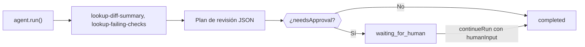

Crea un agente de TypeScript que inspecciona una solicitud de incorporación con herramientas locales, devuelve un plan de revisión en JSON estricto y se detiene a esperar a una persona cuando el plan indica que necesita aprobación. Al terminar tendrás un script que imprime un `CodeReviewPlan` validado y se queda en `waiting_for_human` hasta que alguien lo apruebe.

Las herramientas devuelven datos de ejemplo fijos, así que el script es ilustrativo; sustitúyelas por llamadas a tu alojamiento de código y a tu CI. Hay una versión empaquetada en `packages/sdk/agent-sdk-ts/examples/coding-review-agent.ts`.



## Créalo

<Steps>
<Step title="Instala">

```bash
npm install @phaseo/agent-sdk zod
export PHASEO_API_KEY="phaseo_v1_sk_..."
```

</Step>
<Step title="Escribe el agente">

```ts review-agent.ts
import { z } from "zod";
import { createAgent, createGatewayAgentClient, defineTool } from "@phaseo/agent-sdk";

const CodeReviewPlan = z
  .object({
    risk: z.enum(["low", "medium", "high"]),
    summary: z.string().min(1),
    recommendedActions: z.array(z.string()).min(1),
    needsApproval: z.boolean(),
  })
  .strict();
type CodeReviewPlan = z.infer<typeof CodeReviewPlan>;

const PullRequestInput = z.object({ pullRequestId: z.string().regex(/^pr_\d+$/) }).strict();
const pullRequestParameters = {
  type: "object",
  properties: { pullRequestId: { type: "string", pattern: "^pr_\\d+$" } },
  required: ["pullRequestId"],
  additionalProperties: false,
};

// Herramientas deterministas de solo lectura: se pueden repetir sin riesgo si un worker reanuda la ejecución.
const lookupDiffSummary = defineTool({
  id: "lookup-diff-summary",
  description: "Return a short summary of the changed files in one pull request.",
  parameters: pullRequestParameters,
  inputSchema: PullRequestInput,
  async execute({ pullRequestId }) {
    return {
      pullRequestId,
      files: ["apps/api/src/pipeline/before/index.ts"],
      summary: "Changes touch request validation.",
    };
  },
});

const lookupFailingChecks = defineTool({
  id: "lookup-failing-checks",
  description: "Return the failing CI checks for one pull request.",
  parameters: pullRequestParameters,
  inputSchema: PullRequestInput,
  async execute({ pullRequestId }) {
    return { pullRequestId, failingChecks: ["web-typecheck"] };
  },
});

const codingReviewAgent = createAgent<string, CodeReviewPlan>({
  id: "coding-review-agent",
  model: "openai/gpt-6-astra",
  instructions:
    "Use the available tools to inspect the coding task, then return a strict JSON review plan.",
  tools: [lookupDiffSummary, lookupFailingChecks],
  maxSteps: 6,
  parseOutput: (text) => JSON.parse(text),
  outputSchema: CodeReviewPlan,
  humanReview: ({ parsedOutput }) =>
    parsedOutput?.needsApproval
      ? { reason: "coding_review_approval_required", payload: parsedOutput }
      : null,
});

// Pide al Gateway exactamente esta forma de JSON y repara el JSON casi válido.
const client = createGatewayAgentClient({
  clientOptions: { apiKey: process.env.PHASEO_API_KEY! },
  responseFormat: {
    type: "json_schema",
    name: "code_review_plan",
    schema: {
      type: "object",
      properties: {
        risk: { type: "string", enum: ["low", "medium", "high"] },
        summary: { type: "string" },
        recommendedActions: { type: "array", items: { type: "string" }, minItems: 1 },
        needsApproval: { type: "boolean" },
      },
      required: ["risk", "summary", "recommendedActions", "needsApproval"],
      additionalProperties: false,
    },
  },
  plugins: [{ id: "response-healing", mode: "strict" }],
});

const result = await codingReviewAgent.run({
  input: "Review pull request pr_482 and produce a remediation plan.",
  client,
  onEvent(event) {
    console.log(event.type, event.runId);
  },
});

if (result.run.status === "waiting_for_human") {
  console.log("Needs approval:", result.run.pause?.payload);

  // En una aplicación real, guarda `result` y continúa cuando un revisor lo apruebe.
  if (process.env.APPROVE === "yes") {
    const continued = await codingReviewAgent.continueRun({
      run: result,
      client,
      humanInput: "Approved. Finalize the plan.",
    });
    console.log(continued.output);
  }
} else {
  console.log(result.output);
}
```

`responseFormat` hace que el Gateway solicite este esquema, y `outputSchema` vuelve a comprobar el resultado analizado en tu proceso. El modo estricto de [reparación de respuestas](./response-healing-for-structured-json) solo desenvuelve JSON que ya es válido.

</Step>
<Step title="Ejecútalo">

```bash
npx tsx review-agent.ts
APPROVE=yes npx tsx review-agent.ts
```

</Step>
</Steps>

## Comprueba que funciona

- El registro de eventos muestra `tool.started` y `tool.completed` para ambas herramientas y, después, `checkpoint.saved` tras el paso de herramientas.
- Un plan con `needsApproval: true` termina la primera ejecución en `waiting_for_human` con el plan en `result.run.pause.payload`; con `APPROVE=yes` continúa hasta `completed`.
- En **Ajustes → Uso → Registros**, cada turno del modelo muestra las llamadas a herramientas, y el registro de plugins de la solicitud indica si se aplicó la reparación.
- Un plan que no cumple el esquema hace fallar la ejecución con un `AgentSchemaValidationError` en lugar de devolver datos incorrectos.

## Hazlo seguro para repositorios reales

Mantén las herramientas de revisión en solo lectura. Si añades una herramienta que comenta, hace push o fusiona, pon `requireApproval: true` en ella para que la ejecución se detenga antes de usarla, y apruébala con `continueRun({ run, client, approvals: [toolCallId] })`. Trata el contenido del diff como entrada no fiable: los comentarios del código pueden contener instrucciones dirigidas al modelo. Para que una revisión en espera sobreviva a los reinicios, guarda la ejecución con un accesor `state` como en el [bucle duradero](./agent-sdk-durable-loop). [Estado y aprobación](../sdk-reference/agent/state-and-approval) explica las aprobaciones y los rechazos.
