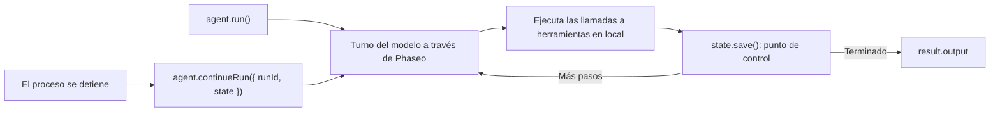

Ejecuta un agente que usa herramientas con el Agent SDK de TypeScript y guarda su estado después de cada paso, para que un proceso que falla o se reinicia continúe donde se detuvo. Al terminar tendrás un script que responde a una pregunta sobre la documentación con una herramienta de búsqueda, escribe cada ejecución en `.agent-runs/<run id>.json` y reanuda una ejecución cuando le pasas su ID.

El script es ilustrativo: el almacén en archivos sirve para una sola máquina. En producción, conserva el mismo par `load`/`save`, pero respáldalo con tu base de datos. Phaseo no guarda por ti las ejecuciones del Agent SDK.



## Créalo

<Steps>
<Step title="Instala">

<CodeGroup>
```bash npm
npm install @phaseo/agent-sdk zod
```

```bash pnpm
pnpm add @phaseo/agent-sdk zod
```

```bash yarn
yarn add @phaseo/agent-sdk zod
```

```bash bun
bun add @phaseo/agent-sdk zod
```
</CodeGroup>

`@phaseo/agent-sdk` instala `@phaseo/sdk` junto con él. Configura tu clave:

```bash
export PHASEO_API_KEY="phaseo_v1_sk_..."
```

</Step>
<Step title="Escribe el agente">

```ts agent.ts
import { mkdir, readFile, writeFile } from "node:fs/promises";
import { z } from "zod";
import {
  createAgent,
  createGatewayAgentClient,
  defineTool,
  type AgentStateAccessor,
} from "@phaseo/agent-sdk";

const DOC_SLUGS = ["guides/presets", "guides/routing-and-fallbacks", "guides/streaming"] as const;

// El modelo solo ve `parameters`; `inputSchema` rechaza cualquier otra cosa antes de que se ejecute execute.
const lookupDocs = defineTool({
  id: "lookup-docs",
  description: "Return the URL of one Phaseo docs page by slug.",
  parameters: {
    type: "object",
    properties: { slug: { type: "string", enum: [...DOC_SLUGS] } },
    required: ["slug"],
    additionalProperties: false,
  },
  inputSchema: z.object({ slug: z.enum(DOC_SLUGS) }).strict(),
  async execute({ slug }) {
    return { slug, url: `https://phaseo.app/docs/v1/${slug}` };
  },
});

const agent = createAgent<string, string>({
  id: "support-docs-agent",
  model: "openai/gpt-6-astra",
  instructions: "Use tools when helpful and finish with a concise answer that includes the docs URL.",
  tools: [lookupDocs],
  maxSteps: 6,
});

// Guarda la ejecución completa después de cada paso. Sustituye estas dos funciones por tu base de datos.
const RUNS_DIR = ".agent-runs";
const state: AgentStateAccessor<string, unknown, string> = {
  async load(runId) {
    try {
      return JSON.parse(await readFile(`${RUNS_DIR}/${runId}.json`, "utf8"));
    } catch {
      return null;
    }
  },
  async save(result) {
    await mkdir(RUNS_DIR, { recursive: true });
    await writeFile(`${RUNS_DIR}/${result.run.id}.json`, JSON.stringify(result));
  },
};

const client = createGatewayAgentClient({
  clientOptions: { apiKey: process.env.PHASEO_API_KEY! },
});

const onEvent = (event: { type: string; runId: string }) => {
  if (event.type === "checkpoint.saved") console.log("checkpoint", event.runId);
};

const resumeId = process.argv[2];
let result;

if (resumeId) {
  const saved = await state.load(resumeId);
  if (!saved) throw new Error(`No saved run ${resumeId}`);
  result = saved.run.status === "completed"
    ? saved
    : await agent.continueRun({ run: saved, client, state, onEvent });
} else {
  result = await agent.run({
    input: "Find the docs page for presets and explain when to use them.",
    client,
    state,
    onEvent,
  });
}

console.log(result.run.id, result.run.status);
console.log(result.output);
```

</Step>
<Step title="Ejecútalo">

```bash
npx tsx agent.ts
```

Para probar una reanudación, detén el script con `Ctrl+C` después de la primera línea `checkpoint` y pasa el ID de ejecución que imprimió (un UUID):

```bash
npx tsx agent.ts 3f6c1d2e-...
```

</Step>
</Steps>

## Comprueba que funciona

- El script imprime `checkpoint` una vez por paso y después el ID de ejecución, `completed` y una respuesta con una URL de `phaseo.app/docs`.
- `.agent-runs/<run id>.json` contiene el ID de ejecución, el estado, el historial de mensajes, las llamadas a herramientas y los resultados de cada paso, y la salida final.
- Tras una ejecución interrumpida, el comando de reanudación termina el mismo ID de ejecución en lugar de empezar uno nuevo.
- Cada turno del modelo aparece en **Ajustes → Uso → Registros**. Registra el ID de ejecución junto a cada ID de solicitud para poder relacionarlos.

## Qué contiene el estado guardado

Cada resultado guardado es el `AgentRunResult` completo: `run` (ID, estado, mensajes, uso y cualquier pausa), `steps` con sus ID de solicitud del gateway y sus llamadas a herramientas, y `output` cuando la ejecución termina. `continueRun()` lo acepta directamente, o bien un `runId` junto con `state`, y en ese caso llama a `load()` por sí mismo.

Una llamada a herramienta que estaba en curso cuando el proceso se detuvo puede haber tenido ya su efecto, así que mantén las herramientas idempotentes. Antes de continuar, el SDK repara el historial de una llamada que nunca obtuvo resultado. [Estado y aprobación](../sdk-reference/agent/state-and-approval) explica las pausas y las aprobaciones.

## Hazlo crecer con cuidado

Mantén un agente por flujo de trabajo, una lista corta de herramientas y una línea de registro por ejecución con el ID de ejecución y los ID de solicitud. Cuando necesites pausas de aprobación o varios agentes que compartan herramientas, conserva este par de cliente del gateway y estado y construye a su alrededor: [Agente de revisión de código](./agent-sdk-coding-review) añade una pausa de aprobación, y [Herramientas en paralelo](./agent-sdk-parallel-tools) ejecuta herramientas a la vez. Para valores predeterminados de solicitud compartidos, llama a un [preset](../guides/presets) en lugar de a un modelo fijo.
