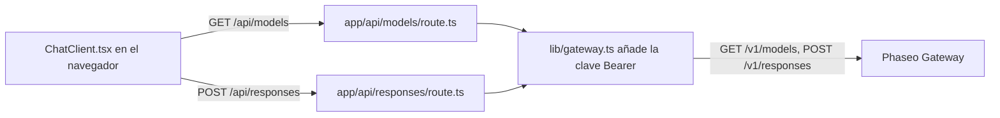

Ejecuta una pequeña aplicación de chat con Next.js cuyo código del navegador solo habla con tus propias rutas de servidor, de modo que tu clave de API de Phaseo nunca llega al navegador. Al terminar tendrás una página de chat local con un selector de modelos que se rellena desde `GET /v1/models` y respuestas de `POST /v1/responses`.

El ejemplo es ilustrativo: sus rutas no tienen inicio de sesión ni límite de solicitudes, así que cualquiera que pueda acceder a ellas gasta tu clave. Añade primero las comprobaciones de [Antes de desplegarla](#before-you-deploy-it).

Para que un agente de programación cree la misma aplicación desde cero, pega este prompt:

<Prompt
  description="Crea una **aplicación de chat web con Next.js** sobre Phaseo Gateway."
  icon="message-square"
  actions={["copy", "cursor"]}
>
{`You are building a small production-style chat app with Phaseo Gateway.

Create a Next.js app with:
- a chat UI
- a model picker backed by GET https://api.phaseo.app/v1/models
- a server-side route that calls POST https://api.phaseo.app/v1/responses
- server-side API key handling using PHASEO_API_KEY (Authorization: Bearer)
- loading, success, and error states

Keep the app intentionally small and easy to inspect.

Implementation requirements:
- Use one local API route for model discovery.
- Use one local API route for responses generation.
- Keep secrets server-side only.
- Send the whole conversation in input on every turn. The gateway rejects previous_response_id.
- Only accept model IDs from an allowlist on the server, and cap the input length.
- Show the request/response flow clearly in code.
- Add a short README with setup and run steps.

Verification:
- Run the app if possible.
- Verify two successful chat turns in a row.
- Report the exact files changed, what you verified, and any remaining assumptions.`}
</Prompt>

## Cómo está construido el ejemplo



El ejemplo está en [examples/web-chat-nextjs](https://github.com/phaseoteam/Phaseo/tree/main/examples/web-chat-nextjs):

| Archivo | Qué hace |
| --- | --- |
| `app/components/ChatClient.tsx` | Entrada, estados de carga y error, mensajes renderizados y selector de modelos |
| `app/api/models/route.ts` | Devuelve los ID de modelo de `GET /v1/models` |
| `app/api/responses/route.ts` | Comprueba que `model` e `input` son cadenas no vacías (`400 missing_model`, `400 missing_input`) y después llama a `POST /v1/responses` |
| `lib/gateway.ts` | Construye la URL y las cabeceras: `Authorization: Bearer $PHASEO_API_KEY`, `x-title` y `http-referer` cuando están definidas |

## Ejecútalo

Necesitas Node.js y una clave de API de Phaseo.

<Steps>
<Step title="Instala">

```bash
cd examples/web-chat-nextjs
npm install
```

El ejemplo incluye un `package-lock.json`, así que `npm` instala las versiones probadas.

</Step>
<Step title="Crea .env.local">

El ejemplo no tiene `.env.example`. Crea `.env.local` tú mismo:

```bash .env.local
PHASEO_API_KEY=phaseo_v1_sk_...
# Opcional. El valor predeterminado es https://api.phaseo.app; /v1 se añade automáticamente.
NEXT_PUBLIC_GATEWAY_URL=https://api.phaseo.app
# Cabeceras opcionales de atribución de la aplicación.
GATEWAY_APP_TITLE=My chat app
GATEWAY_HTTP_REFERER=https://myapp.example
```

Aquí `NEXT_PUBLIC_GATEWAY_URL` solo se lee en el servidor, pero el prefijo `NEXT_PUBLIC_` la expondría al código del navegador, así que nunca pongas una clave en ella. [Atribución de aplicaciones](../guides/app-attribution) explica las dos cabeceras opcionales.

</Step>
<Step title="Corrige el segundo turno del chat">

`ChatClient.tsx` envía el `id` de la respuesta anterior como `previous_response_id`. El Gateway no guarda respuestas, así que rechaza ese campo con `400 validation_error` (palabra clave `unsupported_param`) y el segundo mensaje falla. En `app/api/responses/route.ts`, elimina el bloque que copia `previous_response_id` en el payload:

```ts app/api/responses/route.ts
  // Elimina estas líneas:
  if (typeof body.previous_response_id === 'string' && body.previous_response_id.trim()) {
    payload.previous_response_id = body.previous_response_id.trim();
  }
```

Así cada turno se responde por separado. Para conservar el contexto, envía los turnos anteriores como un array de mensajes en `input`.

</Step>
<Step title="Inicia el servidor de desarrollo">

```bash
npm run dev
```

Abre `http://localhost:3000`.

</Step>
</Steps>

## Comprueba que funciona

- El selector de modelos se rellena con ID de modelo.
- Dos mensajes seguidos reciben cada uno una respuesta.
- En el panel de red del navegador, las solicitudes van solo a `/api/models` y `/api/responses`, y ninguna lleva `PHASEO_API_KEY`.
- Un ID de modelo incorrecto muestra el mensaje de error del Gateway en lugar de una respuesta en blanco.
- Las solicitudes aparecen en **Ajustes → Uso → Registros** con el título de aplicación que configuraste.

<span id="before-you-deploy-it"></span>
## Antes de desplegarla

- **Autentica las rutas.** Exige un usuario con sesión iniciada en `/api/responses` y `/api/models`, o usa el [banco de trabajo OAuth](./build-an-oauth-nextjs-workbench) para que cada usuario gaste sus propios créditos.
- **Limita los modelos a una lista permitida.** La ruta reenvía cualquier cadena `model` que llegue del navegador. Compruébala en el servidor contra una lista fija.
- **Limita la entrada y la frecuencia.** Limita la longitud de la entrada y las solicitudes por usuario, y fija un [límite de gasto en la clave](../api-reference/limits#key-limits-and-budgets).
- **Usa streaming si lo necesitas.** Pon `stream: true` y reenvía los eventos; [Streaming](../guides/streaming) muestra qué evento termina un stream de Responses.

Para un script de backend en lugar de una interfaz, empieza por la [aplicación de prueba REST con Node](./build-a-node-rest-smoke-app) o la [CLI del gateway en Python](./build-a-python-gateway-cli).
