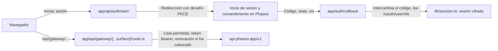

Permite que las personas inicien sesión con Phaseo y gasten sus propios créditos en tu aplicación: OAuth 2.1 con PKCE le da a tu servidor un token de acceso, y un único proxy del lado del servidor lo adjunta a cada llamada al Gateway. Al terminar tendrás una aplicación local con inicio de sesión, tokens guardados en la sesión que se renuevan, descubrimiento de modelos, un flujo de chat sobre `/responses` y un probador para otros endpoints.

El ejemplo descubre los endpoints OAuth de Phaseo, comprueba `state` e `iss` a la vuelta, renueva los tokens de forma segura y revoca la clave cuando la persona cierra sesión.

Para que un agente de programación cree la misma aplicación desde cero, pega este prompt:

<Prompt
  description="Crea un **banco de trabajo de Next.js con inicio de sesión**, OAuth y un proxy unificado de Phaseo."
  icon="shield-user"
  actions={["copy", "cursor"]}
>
{`You are building a signed-in Next.js app on top of Phaseo Gateway.

Create a workbench-style app with:
- OAuth 2.1 + PKCE sign-in against https://api.phaseo.app/oauth/authorize and https://api.phaseo.app/oauth/token (discover them from https://api.phaseo.app/.well-known/oauth-authorization-server), requesting the gateway:access scope
- session-backed token storage in an encrypted, httpOnly cookie
- one unified gateway proxy route on the server that calls https://api.phaseo.app/v1
- model discovery
- one chat flow using the Responses API, sending the whole conversation in input on every turn
- one generic endpoint tester for additional Phaseo endpoints

Requirements:
- Keep gateway credentials and access tokens server-side.
- Use a proxy allowlist of exact paths for safety.
- Support token refresh. Store the new refresh token from every refresh and drop the old one.
- Sign out by sending the refresh token to https://api.phaseo.app/oauth/revoke.
- Keep the workbench understandable rather than over-engineered.
- Add a short README with setup, env vars, and run steps.

Verification:
- run the app if possible
- verify sign-in flow as far as local setup allows
- verify at least one proxied gateway request path
- report exactly what you verified and what remains dependent on external OAuth configuration.`}
</Prompt>

## Cómo está construido el ejemplo



El ejemplo está en [examples/oauth-client-nextjs](https://github.com/phaseoteam/Phaseo/tree/main/examples/oauth-client-nextjs):

| Archivo | Qué hace |
| --- | --- |
| `app/page.tsx` | Página de entrada para iniciar sesión; muestra los errores de inicio de sesión |
| `app/api/auth/start/route.ts` | Construye la URL de autorización y guarda el verificador PKCE y el state |
| `app/auth/callback/route.ts` | Comprueba `state` e `iss`, intercambia el código, lee `/oauth/userinfo` |
| `app/api/auth/signout/route.ts` | Revoca el token de renovación y después borra la sesión |
| `app/dashboard/page.tsx` | Estructura protegida |
| `app/dashboard/GatewayWorkbench.tsx` | Muestra el estado del Gateway, lista los IDs de modelo, ejecuta el chat sobre `POST /responses` y prueba otros endpoints |
| `app/api/gateway/[...surface]/route.ts` | Proxy comodín: comprueba la lista permitida, añade el token Bearer, lo renueva cuando ha caducado y reenvía el cuerpo y el estado |
| `lib/oauth.ts` | Descubrimiento, PKCE, intercambio del código, renovación, revocación y userinfo |
| `lib/session.ts` | Almacenamiento cifrado de la sesión |

Separar el inicio de sesión de las llamadas al Gateway hace que un problema de inicio de sesión nunca parezca un problema del modelo, y que todos los endpoints compartan un único lugar que gestiona los tokens.

<span id="run-it"></span>
## Ejecútalo

Necesitas Node.js, una aplicación OAuth con `http://localhost:3000/auth/callback` (o tu propio callback) como URI de redirección y un secreto de sesión largo y aleatorio. Crea la aplicación OAuth en **Configuración → Aplicaciones OAuth** o con la [API de clientes OAuth](../api-reference/endpoint/oauth-clients-create).

<Steps>
<Step title="Instala">

```bash
cd examples/oauth-client-nextjs
npm install
```

</Step>
<Step title="Crea .env.local">

```bash
cp .env.example .env.local
```

Rellena los valores:

| Variable | Obligatoria | Valor |
| --- | --- | --- |
| `PHASEO_OAUTH_CLIENT_ID` | Sí | El ID de cliente de la aplicación OAuth |
| `PHASEO_OAUTH_CLIENT_SECRET` | Aplicaciones confidenciales | El secreto de cliente de la aplicación OAuth. Déjalo vacío en una aplicación pública. |
| `PHASEO_OAUTH_REDIRECT_URI` | Sí | `http://localhost:3000/auth/callback`, exactamente como lo registraste |
| `SESSION_SECRET` | Sí | Una cadena aleatoria de al menos 32 caracteres |
| `PHASEO_API_URL` | No | Por defecto, `https://api.phaseo.app` |

El ejemplo las lee todas solo en el servidor. Nunca pongas el secreto de cliente ni el secreto de sesión en una variable `NEXT_PUBLIC_`.

El ejemplo encuentra los endpoints de autorización, token, revocación y userinfo en `https://api.phaseo.app/.well-known/oauth-authorization-server`, y pide `openid email profile gateway:access`. `gateway:access` permite que el token llame al Gateway.

</Step>
<Step title="Inicia el servidor de desarrollo">

```bash
npm run dev
```

Abre `http://localhost:3000`, inicia sesión y abre el panel.

</Step>
</Steps>

## Comprueba que ha funcionado

- El inicio de sesión vuelve a tu URL de callback y crea una sesión.
- El panel lista los modelos a través de `/api/gateway/models`.
- Un turno de chat a través de `/api/gateway/responses` recibe respuesta, y ninguna solicitud del navegador lleva el token de acceso.
- Una ruta fuera de la lista permitida del proxy se rechaza.

## Duración de los tokens

El endpoint de token devuelve dos tokens:

| Token | Duración | Uso |
| --- | --- | --- |
| `access_token` | 7 días (`expires_in`) | Envíalo como `Authorization: Bearer` en las solicitudes al Gateway. Gasta créditos en el espacio de trabajo que eligió la persona. |
| `refresh_token` | 90 días desde su último uso | Envíalo con `grant_type=refresh_token` para obtener un par nuevo. |

- **Rota en cada renovación.** Cada renovación devuelve un token de acceso nuevo y un token de renovación nuevo. Guarda los dos y descarta los anteriores: el token de acceso anterior deja de funcionar al momento y el token de renovación anterior no se puede volver a usar.
- **Renueva después de la caducidad.** Puedes renovar cuando el token de acceso ya ha caducado, siempre que el token de renovación no lo haya hecho.
- **Nunca reutilices un token de renovación.** Usarlo una segunda vez termina el inicio de sesión. Phaseo lo trata como un token filtrado y revoca el token de acceso y todos los tokens de renovación de ese inicio de sesión, así que la persona tiene que volver a iniciar sesión.
- **Los scopes solo se reducen.** Una renovación nunca añade scopes. Conserva los scopes que aprobó la persona, menos los que haya quitado desde entonces.
- **Cuándo falla la renovación.** La renovación falla cuando la persona revoca tu aplicación, revoca o desactiva su clave, quita un scope que la clave necesita (como `gateway:access`) o sale del espacio de trabajo. Quitar `gateway:access` también revoca la clave, así que su token de acceso deja de funcionar al momento. Volver a conceder el scope no recupera el token de renovación. Haz que la persona vuelva a iniciar sesión.
- **Volver a iniciar sesión renueva la clave.** Renueva la misma clave en lugar de añadir otra, envíes o no `resource=https://api.phaseo.app/v1`. Obtienes un token de acceso y un token de renovación nuevos, los anteriores dejan de funcionar y la clave conserva el gasto de este mes. Su límite de gasto mensual pasa a ser el que la persona acaba de aprobar. El token de renovación de un inicio de sesión anterior simplemente se rechaza, y enviarlo al endpoint de token o de revocación no termina el nuevo inicio de sesión.
- **Una clave en pausa bloquea el inicio de sesión.** Si cualquiera de las claves de tu aplicación para esa persona y ese espacio de trabajo está en pausa, sea cual sea su recurso, el endpoint de token devuelve `invalid_grant` hasta que alguien vuelva a activar la clave en **Configuración → Claves de API**. La renovación solo funciona mientras la clave no esté revocada: después de cerrar sesión o de cualquier otra revocación, iniciar sesión emite una clave nueva, y sus límites y su gasto empiezan de cero.
- **Cierra sesión con la revocación.** Envía el token de renovación a `https://api.phaseo.app/oauth/revoke`. Eso revoca la clave y todos los tokens de renovación del inicio de sesión, incluido uno que una renovación haya emitido un momento antes.

## Límites de gasto

En la pantalla de consentimiento, la persona fija un límite de gasto mensual para tu aplicación: $20.00 por defecto, otro importe o sin límite. Cuando la clave lo ha gastado en un mes natural, las solicitudes al Gateway devuelven `429` con `key_limit_exceeded` hasta el mes siguiente o hasta que la persona suba el límite en **Configuración → Claves de API**.

Tenga los scopes que tenga, tu aplicación no puede quitar ese límite ni saltárselo a través de la API. Solo puede renombrar o eliminar claves de API. No puede crear ni rotar claves, cambiar los límites, el estado o la caducidad de una clave, crear claves de gestión ni cargas de trabajo de confianza, añadir miembros, cambiar presupuestos, guardrails, límites de frecuencia ni reglas de gasto, ni cambiar los límites de precio del espacio de trabajo para el enrutamiento ni su alternativa de BYOK a créditos.

## Antes de publicarlo

- **Reduce la lista permitida.** `lib/gateway.ts` permite las rutas que llama el banco de trabajo, además del estado de los trabajos bajo `videos/` y `music/generate/`. Conserva solo las rutas que llama tu producto.
- **Comparte las renovaciones entre instancias.** `lib/oauth.ts` comparte en memoria una sola renovación entre solicitudes paralelas. Si ejecutas más de una instancia del servidor, lleva eso a un almacenamiento compartido; si no, dos instancias pueden renovar con el mismo token y terminar el inicio de sesión.
- **Envía la conversación completa.** El Gateway no guarda las respuestas y rechaza `previous_response_id`, así que reenvía los turnos anteriores en `input`.
- **Sustituye el probador.** Conserva el banco de trabajo para QA interno y crea flujos específicos para los usuarios finales.

Para una aplicación con clave de API y sin inicio de sesión, empieza por la [aplicación de chat web con Next.js](./build-a-nextjs-web-chat-app).
