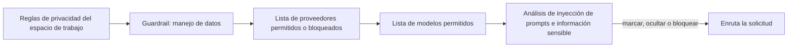

Crea un guardrail en **Configuración → Guardrails**, asígnalo a una clave de API de bajo riesgo y amplíalo solo cuando los registros muestren que se comporta bien. Al terminar, esa clave solo podrá llegar a los proveedores y modelos que permitas, y sus prompts se analizarán en busca de inyección de prompts y datos sensibles antes de llegar a un modelo.

Este es un procedimiento del panel; la misma política se puede automatizar con la [API de guardrails](../api-reference/endpoint/guardrails-create).

Las reglas de privacidad del espacio de trabajo se aplican primero; un guardrail solo puede restringirlas más. Los guardrails no limitan el gasto: para eso, fija un límite en la clave o un [presupuesto del espacio de trabajo](../api-reference/limits#key-limits-and-budgets).

## Despliégalo

<Steps>
<Step title="Crea el guardrail">

Abre **Configuración → Guardrails → Nuevo guardrail**. Ponle un nombre según lo que aplica, como `eu-models-pii-redact`, no según un equipo, para poder reutilizarlo en varias claves.

Configura el acceso a rutas antes que las comprobaciones de contenido:

| Ajuste | Opciones |
| --- | --- |
| **Modo de proveedores** | Permitir a todos los proveedores, Permitir solo proveedores seleccionados o Permitir todos excepto los proveedores seleccionados |
| **Modo de modelos** | Permitir todos los modelos o Solo permitir modelos seleccionados (se aplica después del filtrado de proveedores) |
| **Manejo de datos** | Sólo ZDR, y si siguen siendo elegibles los endpoints gratuitos o de pago que pueden entrenar con las entradas |

Una primera política habitual bloquea los proveedores de poca confianza y permite solo los modelos de producción exactos a los que debe llegar la clave. Usa la vista previa para comprobar qué proveedores y modelos siguen siendo enrutables, y si **Solo permitir** es más restrictivo de lo que querías.

</Step>
<Step title="Añade comprobaciones de contenido">

**Inyección de prompts** analiza el contenido que aporta el usuario en busca de patrones de inyección habituales. **Información sensible** detecta datos antes de que la solicitud salga de Phaseo:

| Detector | Se oculta como | Añade latencia |
| --- | --- | --- |
| Dirección de correo electrónico | `[EMAIL]` | No |
| Número de teléfono | `[PHONE]` | No |
| Número de la Seguridad Social de EE. UU. | `[SSN]` | No |
| Número de tarjeta de crédito | `[CREDIT_CARD]` | No |
| Dirección IP (IPv4) | `[IP_ADDRESS]` | No |
| Nombre de persona | `[PERSON_NAME]` | Sí |
| Dirección postal | `[ADDRESS]` | Sí |

Cada comprobación tiene una acción: **Marcar**, **Ocultar** o **Bloquear**. Empieza la inyección de prompts en **Marcar** u **Ocultar**, y pasa a **Bloquear** solo después de revisar los falsos positivos. Usa primero los detectores rápidos. Añade patrones personalizados como reglas regex explícitas.

</Step>
<Step title="Pruébalo en la vista previa">

Antes de guardar, pasa tres entradas por la vista previa: una inofensiva, una que claramente deba detenerse y un prompt realista de producción. Comprueba el texto de ocultación, el resultado de bloqueo o permiso, y que no coincida nada que no tenga relación.

</Step>
<Step title="Asígnalo a una clave">

En **Aplicar a claves**, elige una clave de staging o de bajo riesgo. Puedes asignar el guardrail mientras lo creas. **Aplicar a miembros** lo aplica en cambio a las claves de API que creen esos miembros. Los miembros no pueden editar ni quitar un guardrail que haya asignado un propietario o un administrador del espacio de trabajo.

</Step>
<Step title="Comprueba que se aplica">

Envía solicitudes reales con la clave y después comprueba:

- **Configuración → Uso → Guardrails** para ver los recuentos de bloqueos, ocultaciones y marcas.
- La sección **Aplicación de guardrails** de una solicitud en **Configuración → Uso → Registros**, para ver qué guardrail y qué detector se activaron.
- La columna **Guardrails** de **Configuración → Claves de API**, para confirmar a qué claves está asignado.

</Step>
<Step title="Amplía el despliegue">

Asigna el mismo guardrail a más claves, endurece las acciones de **Marcar** a **Ocultar** o **Bloquear**, y añade los detectores de nombre de persona y dirección solo donde su latencia sea aceptable.

</Step>
</Steps>

Un guardrail desactivado conserva su configuración, pero no se aplica. Para compartir reglas de enrutamiento entre llamantes en lugar de aplicarlas a claves, usa un [preajuste](../guides/presets).
