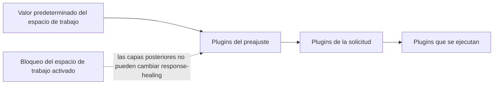

Activa la [reparación de respuestas](./response-healing-for-structured-json) una sola vez para todo el espacio de trabajo o para un preajuste, en lugar de en cada solicitud. Al terminar, todos los llamantes con salida estructurada recibirán la misma política de reparación, y podrás bloquearla para que ningún preajuste ni ninguna solicitud la desactive.

Este es un procedimiento del panel; el ejemplo de solicitud del final está listo para producción.

## Cómo se combinan las capas

Phaseo construye la lista de plugins de cada solicitud a partir de tres capas. Una capa posterior sustituye los ajustes de una capa anterior para el mismo plugin, salvo que la anterior esté bloqueada:



| Capa | Dónde se define | Sustituye a |
| --- | --- | --- |
| Espacio de trabajo | **Configuración → Enrutamiento → Reparación de respuestas** | Nada |
| Preajuste | **Configuración → Preajustes → (preajuste) → Reparación de respuestas** | El espacio de trabajo, salvo que esté bloqueado |
| Solicitud | `plugins` en el cuerpo | El preajuste y el espacio de trabajo, salvo que el espacio de trabajo esté bloqueado |

## Configúralo

<Steps>
<Step title="Activa el valor predeterminado del espacio de trabajo">

En **Configuración → Enrutamiento → Reparación de respuestas**, activa **Habilitar de forma predeterminada** y elige un **Modo de reparación**: `safe` para una reparación de sintaxis acotada, `strict` para solo desenvolver JSON que ya era válido. Úsalo para valores predeterminados amplios que comparten todas las claves de API del espacio de trabajo.

</Step>
<Step title="Bloquéalo si no es negociable">

Activa **Bloquear la política del espacio de trabajo**. Entonces ni los preajustes ni las solicitudes pueden desactivar la reparación ni cambiar su modo. Los registros siguen mostrando si se aplicó o se omitió.

</Step>
<Step title="Define valores predeterminados del preajuste para un flujo">

En el editor del preajuste, activa **Reparación de respuestas** y elige su modo cuando una familia de solicitudes deba llevar tanto un formato de salida estructurada como la reparación. Los llamantes de ese preajuste solo envían su entrada.

</Step>
</Steps>

## Sustitúyelo en una solicitud

Cuando el espacio de trabajo no está bloqueado, una solicitud puede definir el plugin por sí misma. `"enabled": false` lo desactiva para esa solicitud:

```json
{
  "model": "openai/gpt-6-astra",
  "input": "Return the summary as JSON.",
  "text": {
    "format": {
      "type": "json_schema",
      "name": "answer",
      "schema": {
        "type": "object",
        "properties": { "summary": { "type": "string" } },
        "required": ["summary"],
        "additionalProperties": false
      }
    }
  },
  "plugins": [{ "id": "response-healing", "enabled": true, "mode": "strict" }],
  "meta": true
}
```

## Comprueba la política que se ejecutó

Abre la solicitud en **Configuración → Uso → Registros**, o lee `meta.plugin_executions` si enviaste `meta: true`. Muestra el estado (`applied`, `skipped` o `failed`), el modo que se ejecutó realmente y cualquier `validation_errors` cuando un candidato reparado no coincidía con el esquema.

Si dos servicios se comportan de forma distinta, compara el ajuste del espacio de trabajo y su bloqueo, los plugins del preajuste y los `plugins` de cada solicitud antes de tratarlo como un problema del modelo.
