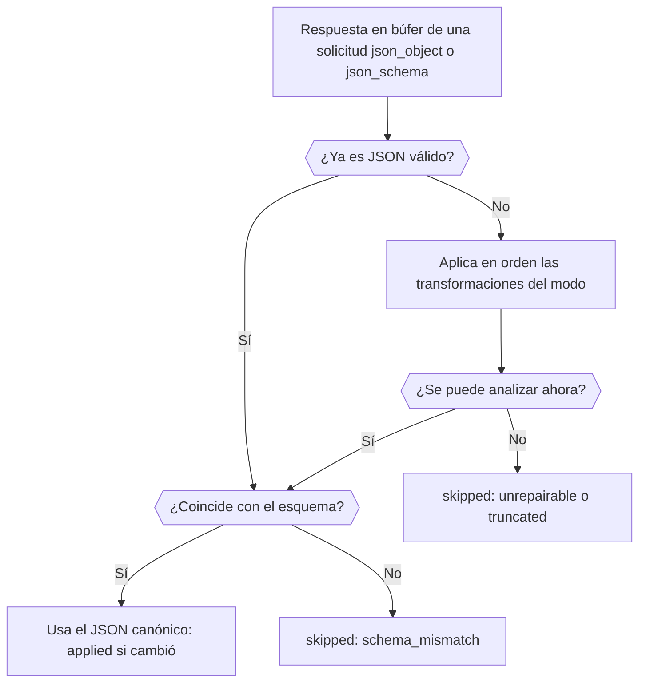

Añade el plugin `response-healing` a una solicitud con salida estructurada y Phaseo reparará el JSON casi válido, como un JSON dentro de un bloque Markdown o con una coma final, antes de que llegue a tu parser. Al terminar tendrás una solicitud que pide un JSON Schema, repara la respuesta cuando hace falta y te indica en la respuesta si lo hizo.

La solicitud está lista para producción. La reparación solo corrige la sintaxis, así que tu código sigue validando el resultado, como en [Valida el resultado](../guides/structured-outputs#validate-the-result).



## Envía una solicitud con reparación

<CodeGroup>
```bash cURL
curl https://api.phaseo.app/v1/responses \
  -H "Authorization: Bearer $PHASEO_API_KEY" \
  -H "Content-Type: application/json" \
  -d '{
    "model": "openai/gpt-6-astra",
    "input": "Summarize this release in one sentence: dark mode and faster search.",
    "text": {
      "format": {
        "type": "json_schema",
        "name": "answer",
        "strict": true,
        "schema": {
          "type": "object",
          "properties": { "summary": { "type": "string" } },
          "required": ["summary"],
          "additionalProperties": false
        }
      }
    },
    "plugins": [{ "id": "response-healing", "mode": "safe" }],
    "meta": true
  }'
```

```typescript TypeScript
import Phaseo from "@phaseo/sdk";

const client = new Phaseo({ apiKey: process.env.PHASEO_API_KEY! });

const response = await client.generateResponse({
  model: "openai/gpt-6-astra",
  input: "Summarize this release in one sentence: dark mode and faster search.",
  text: {
    format: {
      type: "json_schema",
      name: "answer",
      strict: true,
      schema: {
        type: "object",
        properties: { summary: { type: "string" } },
        required: ["summary"],
        additionalProperties: false,
      },
    },
  },
  plugins: [{ id: "response-healing", mode: "safe" }],
  meta: true,
});

console.log(response.meta?.plugin_executions);
```

```python Python
import os

from phaseo import Phaseo

client = Phaseo(api_key=os.environ["PHASEO_API_KEY"])

response = client.generate_response(
    {
        "model": "openai/gpt-6-astra",
        "input": "Summarize this release in one sentence: dark mode and faster search.",
        "text": {
            "format": {
                "type": "json_schema",
                "name": "answer",
                "strict": True,
                "schema": {
                    "type": "object",
                    "properties": {"summary": {"type": "string"}},
                    "required": ["summary"],
                    "additionalProperties": False,
                },
            }
        },
        "plugins": [{"id": "response-healing", "mode": "safe"}],
        "meta": True,
    }
)

print(response["meta"].get("plugin_executions"))
```
</CodeGroup>

En Chat Completions, envía el mismo esquema en `response_format` en lugar de `text.format`. La reparación solo se ejecuta cuando la solicitud pide `json_object` o `json_schema`, y nunca en streams: una solicitud en streaming la omite con `streaming_unsupported`.

## Comprueba que se ejecutó

Con `meta: true`, `meta.plugin_executions` incluye el plugin cuando se ejecutó:

```json
{
  "id": "response-healing",
  "stage": "response.post_provider",
  "status": "applied",
  "changed": true,
  "metadata": {
    "attempted": true,
    "healed": true,
    "mode": "safe",
    "transforms_applied": ["strip_markdown_fence"]
  }
}
```

| `status` | Significa |
| --- | --- |
| `applied` | La respuesta se reescribió como JSON válido. |
| `skipped` | La respuesta se dejó como estaba. Con `attempted: false`, la solicitud no era elegible; en otro caso, el JSON ya era válido o no se pudo arreglar. `metadata.failure_reason` indica el motivo: `streaming_unsupported`, `not_json` (no se pidió salida estructurada o no hay texto), `unrepairable`, `truncated` (la respuesta se detuvo en el límite de tokens) o `schema_mismatch` con `validation_errors`. |
| `failed` | El propio plugin dio error (`reason: plugin_error`); la respuesta no cambia. |

El mismo registro aparece en la solicitud dentro de **Configuración → Uso → Registros**. Si el plugin no aparece nunca, comprueba que la solicitud, su preajuste o el espacio de trabajo lo hayan activado realmente; [Define los valores predeterminados de los plugins](./plugin-defaults-and-response-healing) muestra dónde.

## Elige un modo

| Modo | Transformaciones, en orden |
| --- | --- |
| `safe` (predeterminado) | Quita un bloque Markdown, recorta al `{…}` o `[…]` más externo, elimina las comas finales, pone comillas a las claves sin ellas y añade los corchetes de cierre que faltan (no cuando la respuesta llegó al límite de tokens) |
| `strict` | Solo quita un bloque Markdown y recorta al `{…}` o `[…]` más externo, así que solo acepta JSON que ya era válido dentro de su envoltorio |

Con un JSON Schema, el resultado reparado se comprueba antes de sustituir la respuesta: claves obligatorias, tipos, `enum` y `const`, límites de arrays y `uniqueItems`, longitud de cadenas, `pattern` y los formatos `email`, `uri`, `uuid` y `date-time`, límites numéricos y `multipleOf`, número de propiedades y `additionalProperties: false`.

## Cuándo no ayuda

La reparación nunca inventa campos que faltan, ni adivina valores, ni convierte prosa en datos. Distingue estos fallos antes de recurrir a ella:

| Fallo | Solución |
| --- | --- |
| JSON estructuralmente cercano | Reparación de respuestas |
| JSON válido con campos incorrectos | Ajusta el esquema y el prompt |
| Prosa en lugar de JSON | Pide `json_schema`, no solo una instrucción en el prompt |
| Cortado en el límite de tokens | Sube `max_output_tokens` |

La reparación funciona mejor con un solo objeto con claves obligatorias explícitas, una temperatura baja y sin pedir texto fuera del JSON. Actívala primero en un preajuste, vigila `plugin_executions` en los registros y amplíala cuando los payloads reparados coincidan con tu esquema.
