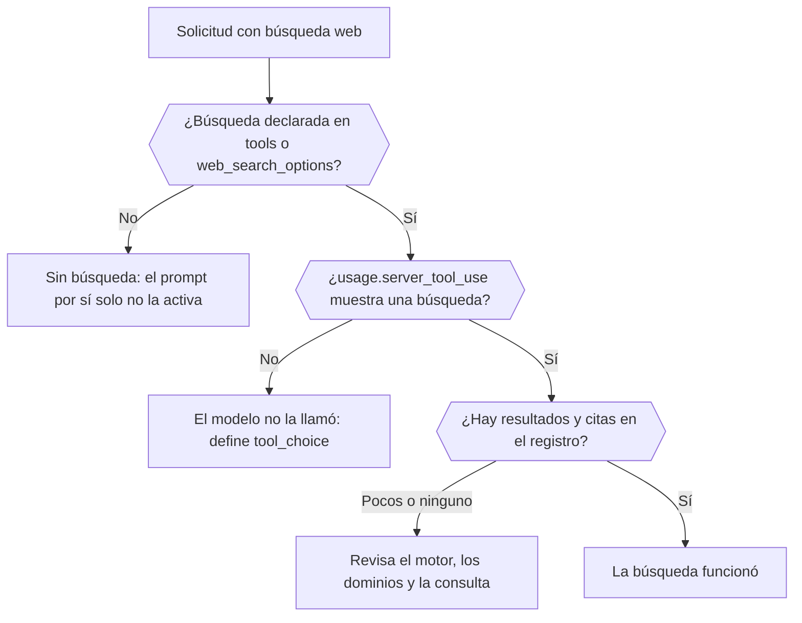

Averigua, a partir de la respuesta y del registro de la solicitud, si una búsqueda web se ejecutó realmente, qué motor la ejecutó y qué devolvió. Al terminar sabrás distinguir una búsqueda que nunca ocurrió de una que se ejecutó y encontró poco.



## Declara la búsqueda en la solicitud

Pedir "las últimas noticias" en el prompt no ejecuta una búsqueda. Añádela de forma explícita:

```json
{
  "model": "openai/gpt-6-astra",
  "input": "What changed in the Phaseo changelog this week?",
  "tools": [{ "type": "phaseo:web_search", "parameters": { "max_results": 5 } }],
  "tool_choice": "phaseo:web_search"
}
```

`phaseo:web_search` funciona en Chat Completions, Responses y Messages. `web_search_options` funciona donde el endpoint lo admite. `tool_choice` fuerza la llamada; sin él, el modelo puede responder de memoria. La [guía de búsqueda web](../guides/server-tools/web-search) lista todos los parámetros.

## Comprueba que se ejecutó

| Dónde mirar | Qué muestra |
| --- | --- |
| `usage.server_tool_use.web_search_requests` en la respuesta | Cuántas búsquedas gestionadas se ejecutaron |
| **Supervisión de la búsqueda web** en la solicitud dentro de **Configuración → Uso → Registros** | Búsquedas gestionadas, búsquedas nativas, el número de resultados y el número de citas, con los registros de resultados y citas extraídos |
| **Observabilidad de enrutamiento** en la misma solicitud | Qué proveedores se consideraron y cuáles se quitaron porque no admitían la solicitud |

## Distingue los casos de fallo

| Qué ves | Causa | Solución |
| --- | --- | --- |
| Ningún contador de búsqueda | La búsqueda no se declaró o el modelo decidió no llamarla | Añade la herramienta y define `tool_choice` |
| La herramienta devuelve `search_not_configured` al modelo | El motor gestionado que elegiste no está habilitado | Usa el motor predeterminado u otro |
| La herramienta devuelve `unsupported_search_engine` | El modelo pidió `engine: "native"` dentro de una llamada | Define `native` solo en la definición de la herramienta |
| `400 not_supported`, motivo `regional_hosted_tool_not_supported` | Se envió a `eu.api.phaseo.app` o `us.api.phaseo.app`, que rechazan las herramientas de servidor | Usa `api.phaseo.app` |
| Las búsquedas se ejecutaron, pero hay pocas citas | La consulta o las fuentes eran pobres | Ajusta `max_results`, `allowed_domains` o `engine` |

Con `engine: "native"`, la solicitud solo va a proveedores que ejecutan la búsqueda web por sí mismos. Si ninguno sirve el modelo, Phaseo ejecuta en su lugar su motor predeterminado y lo factura como búsqueda gestionada, así que una solicitud nativa puede mostrar contadores de búsqueda gestionada.

## Compara solicitudes

Cuando los resultados difieren entre ejecuciones, compara el ID del modelo, el proveedor seleccionado, los parámetros de búsqueda y los recuentos de resultados y citas. Los recuentos están normalizados entre proveedores, así que las diferencias en la calidad de búsqueda se ven sin leer los payloads sin procesar. Para un flujo completo fundamentado, consulta [Búsqueda web gestionada en TypeScript](./sdk-typescript-managed-search); para una URL conocida, usa [web fetch](./tool-grounding-with-web-fetch).
