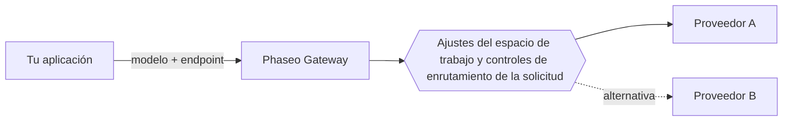

Envía un ID de modelo a un endpoint de Phaseo y Phaseo enrutará la solicitud a un proveedor que aloja ese modelo. Tu aplicación elige el modelo y el endpoint; los ajustes de tu espacio de trabajo y los controles de enrutamiento de la solicitud deciden qué proveedores pueden atenderla.

## Modelos y proveedores

Un modelo es el sistema que genera la salida. Un proveedor aloja el modelo y define su disponibilidad, los parámetros admitidos, el precio y el rendimiento. Un modelo puede tener varias ofertas de proveedores.

El catálogo público también lista modelos que todavía no están disponibles a través del Gateway. Comprueba la [disponibilidad del modelo](../exploring/models.mdx) antes de usar un ID en una solicitud.

## Solicitudes y enrutamiento

Usa [Responses, Chat Completions o Messages](../api-reference/introduction.mdx), el que coincida con el protocolo de tu aplicación. Que el endpoint sea compartido no significa que todos los modelos admitan todos los parámetros; las capacidades de los proveedores siguen variando.

Los [controles de enrutamiento](../guides/routing-and-fallbacks.mdx) restringen qué proveedores pueden atender una solicitud y cómo se clasifican. Las alternativas se mantienen dentro de esas restricciones y dependen de la capacidad disponible, así que no garantizan el éxito.

## Facturación y acceso

Las solicitudes gestionadas usan el saldo de tu espacio de trabajo de Phaseo, y los modelos `:free` funcionan sin créditos depositados. Con tus propias credenciales de proveedor (BYOK), se aplican la facturación y los límites de cuenta del proveedor. Revisa [precios y facturación](../pricing/tiers.mdx) antes del despliegue.

Los [trabajos de vídeo y por lotes](../guides/async-video-and-batch.mdx) devuelven un trabajo antes de que termine el procesamiento; el acceso en vista previa a ellos se gestiona por espacio de trabajo. Consulta el estado periódicamente o recibe un webhook, y después descarga el resultado.

## Próximos pasos

Haz tu primera solicitud con la [Guía de inicio rápido](../quickstart.mdx) y después [integra el Gateway](./integrating-with-the-gateway.mdx) en tu aplicación con la clave guardada en tu backend. Cuando algo falle, [Fiabilidad y estado](./reliability-and-status.mdx) muestra cómo investigarlo, y los [registros de solicitudes](../guides/integrations/observability.mdx) muestran el uso, la latencia, el coste y los errores de cada solicitud.
