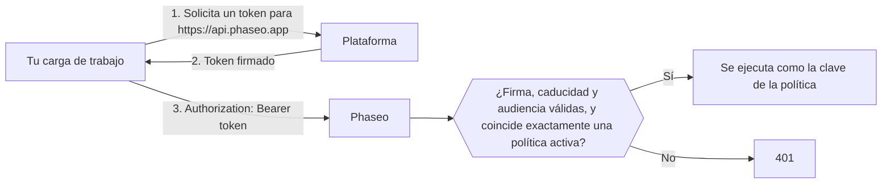

<Note>
Las cargas de trabajo de confianza están en beta y se están habilitando de forma gradual en los espacios de trabajo. Si **Ajustes → Claves de API → Cargas de trabajo de confianza** no aparece en tu panel, tu espacio de trabajo todavía no las tiene.
</Note>

Envía el token OIDC de corta duración de tu plataforma como token bearer en lugar de una clave de API de Phaseo, y no tendrás que guardar nada de larga duración en los ajustes del proyecto ni en los secretos de CI. Las plataformas dan a cada despliegue, job o carga de trabajo un token firmado que indica quién es, como "el despliegue de producción del proyecto `website`" o "un job del proyecto de GitLab `4815162`", y el token caduca en unas horas. Tú le indicas a Phaseo en qué cargas de trabajo confiar.

Phaseo confía en tokens de Vercel, GitHub Actions, GitLab, Google Cloud, Buildkite, CircleCI y AWS, y de un emisor OIDC que gestiones tú mismo, como un clúster de Kubernetes, Bitbucket Pipelines o GitLab autogestionado. Sigue usando claves de API para todo lo demás, como scripts locales y aplicaciones móviles.

## Cómo funciona



Un propietario o administrador del espacio de trabajo crea una **política de confianza** que indica la plataforma, el propietario en el que confía (como un propietario de GitHub, un proyecto de GitLab o un rol de AWS) y condiciones opcionales, como un proyecto, un repositorio, una rama o un entorno. Una solicitud que coincide se ejecuta como la clave de la política, con los mismos límites de frecuencia, presupuestos, registros y facturación que una solicitud hecha con una clave de API.

Los tokens deben emitirse para la audiencia `https://api.phaseo.app`; Phaseo rechaza cualquier otra audiencia. La mayoría de las plataformas usan por defecto una audiencia que comparten todos los servicios a los que llama tu carga de trabajo, y aceptarla permitiría reutilizar contra Phaseo un token que enviaste a otro servicio.

## Crea una política de confianza

<Steps>
<Step title="Abre Cargas de trabajo de confianza">
Ve a **Ajustes → Claves de API → Cargas de trabajo de confianza** y selecciona **Nueva política**. Solo los propietarios y administradores del espacio de trabajo pueden gestionar políticas.
</Step>
<Step title="Elige la plataforma y completa los ID">
Cada plataforma fija la política a un ID que no se puede renombrar ni puede pasar a manos de otra persona. Los nombres pueden cambiar de dueño, así que Phaseo nunca confía solo en un nombre.

<Tabs>
<Tab title="Vercel">
- **Slug del equipo**: el slug del equipo, como en `vercel.com/<team-slug>`. Déjalo vacío si tu proyecto usa el modo de emisor global de Vercel (emisor `https://oidc.vercel.com` en lugar de `https://oidc.vercel.com/<team-slug>`).
- **ID del equipo**: empieza por `team_`. Lo encontrarás en los ajustes del equipo en Vercel.
- **ID del proyecto** (recomendado): empieza por `prj_`. Lo encontrarás en los ajustes del proyecto en Vercel. Sin él, se confía en todos los proyectos del equipo.
- **Entorno**: producción, vista previa o desarrollo. Deja todos sin marcar para aceptar cualquier entorno.
</Tab>
<Tab title="GitHub Actions">
- **ID del propietario**: el ID numérico del usuario o la organización propietaria del repositorio.
- **ID del repositorio** (recomendado): el ID numérico del repositorio. Sin él, se confía en todos los repositorios del propietario.
- **Rama o etiqueta** y **Entorno** (opcionales): por ejemplo, `refs/heads/main` o `production`.

Obtén ambos ID con la CLI de GitHub:

```bash
gh api repos/OWNER/REPO --jq '.id, .owner.id'
```
</Tab>
<Tab title="GitLab">
Para proyectos en GitLab.com. Para GitLab autogestionado, usa **Emisor OIDC propio**.

- **ID del proyecto**: el ID numérico de la página de resumen del proyecto. No cambia cuando el proyecto se renombra o se mueve a otro grupo, por eso Phaseo fija el proyecto y no el grupo.
- **Rama o etiqueta** (opcional): el nombre de la rama o etiqueta, como `main`.
- **Entorno** (opcional): el entorno del job, como `production`.

Deja ambas condiciones vacías para aceptar todos los jobs del proyecto.
</Tab>
<Tab title="Google Cloud">
Para tokens del servidor de metadatos en Cloud Run, Compute Engine, GKE, Cloud Run functions, App Engine y Cloud Build.

- **ID único de la cuenta de servicio**: el ID único numérico de la página de detalles de la cuenta de servicio en la consola de Google Cloud. Todas las cuentas de Google comparten el mismo emisor, así que este ID es lo que distingue tu carga de trabajo. No uses el correo en su lugar: si se elimina la cuenta de servicio, alguien puede crear una nueva con el mismo correo.
- **Correo de la cuenta de servicio** (opcional): una comprobación adicional. Los tokens solo incluyen el correo cuando la carga de trabajo los solicita con `format=full`.
</Tab>
<Tab title="Buildkite">
- **ID de la organización**: el UUID de la organización. Todo token de Buildkite lo lleva en su claim `organization_id`, así que puedes leerlo de un token que solicite una de tus pipelines. A diferencia del slug de la organización, nunca cambia.
- **Slug de la pipeline** (opcional): sin él, se confía en todas las pipelines de la organización.
</Tab>
<Tab title="CircleCI">
- **ID de la organización**: lo encontrarás en **Organization Settings → Overview**. Cada organización de CircleCI tiene su propio emisor, `https://oidc.circleci.com/org/<organisation ID>`, y Phaseo lo construye a partir de este ID.
- **ID del proyecto** (opcional): lo encontrarás en **Project Settings → Overview**. Sin él, se confía en todos los proyectos de la organización.
</Tab>
<Tab title="AWS">
Para tokens de la federación de identidad web saliente de IAM, que da a un rol de IAM un token firmado para un servicio externo.

- **URL del emisor**: cada cuenta de AWS tiene su propio emisor, que termina en `.tokens.sts.global.api.aws`. Ejecuta `aws iam get-outbound-web-identity-federation-info` y copia `IssuerIdentifier`. Si falla, activa primero la función con `aws iam enable-outbound-web-identity-federation`.
- **ARN del rol de IAM**: solo se aceptan tokens de este rol, como `arn:aws:iam::123456789012:role/evals`. El emisor ya identifica tu cuenta, así que el ARN del rol identifica la carga de trabajo.
</Tab>
<Tab title="Emisor OIDC propio">
Úsalo para cualquier otro emisor OIDC que cumpla todo lo siguiente:

- Su URL de emisor es una URL `https://` pública, sin puerto, consulta ni fragmento, y no está en un host que pertenezca a una de las plataformas anteriores.
- Sirve un documento de descubrimiento en `<issuer>/.well-known/openid-configuration`.
- Sus claves de firma (`jwks_uri`) están en el mismo host que el emisor.
- Firma los tokens con RS256, ES256 o ES384, y puede emitirlos para la audiencia `https://api.phaseo.app`.

Completa:

- **URL del emisor**: cópiala exactamente como aparece en el claim `iss` del token, incluida cualquier barra final.
- **Claim del propietario** y **Valor del propietario**: el claim que debe llevar todo token y el valor exacto que debe tener. Elige un claim que nadie más pueda reutilizar, como un ID numérico, en lugar de un nombre que se pueda renombrar o volver a registrar.
- **Claim adicional** y **Valor obligatorio** (opcionales): un claim más con el que debe coincidir el token.

Las condiciones solo coinciden con claims de nivel superior. No se pueden usar claims anidados, como el objeto `kubernetes.io` de Kubernetes.

**Kubernetes (EKS, GKE, AKS)**: cada clúster tiene su propio emisor. En EKS, ejecuta `aws eks describe-cluster --name <cluster> --query cluster.identity.oidc.issuer`. En AKS, activa el emisor OIDC y ejecuta `az aks show -n <cluster> -g <resource-group> --query oidcIssuerProfile.issuerUrl`. En GKE, el emisor es `https://container.googleapis.com/v1/projects/<project>/locations/<location>/clusters/<cluster>`. Usa `sub` como claim del propietario, con el valor `system:serviceaccount:<namespace>:<service-account>`.

Los clústeres de Kubernetes autogestionados cuyo endpoint de descubrimiento no es público no funcionarán. Phaseo tiene que obtener el documento de descubrimiento y las claves desde internet sin credenciales, y la mayoría de los clústeres no lo permiten de forma predeterminada.

**Bitbucket Pipelines**: el emisor es `https://api.bitbucket.org/2.0/workspaces/<workspace>/pipelines-config/identity/oidc`. Usa `workspaceUuid` como claim del propietario, con el valor incluidas sus llaves, como `{a1b2c3d4-...}`. Solicita la audiencia de Phaseo en el step:

```yaml
- step:
    oidc:
      audiences:
        - https://api.phaseo.app
```

**GitLab autogestionado**: el emisor es la URL de tu GitLab, como `https://gitlab.example.com`. Usa `project_id` como claim del propietario, con el ID numérico del proyecto. Tu instancia debe ser accesible desde internet.
</Tab>
</Tabs>
</Step>
<Step title="Define el token más largo aceptado">
En **Token más largo aceptado (horas)**, define la duración máxima que aceptas. Se rechazan los tokens emitidos para durar más. El máximo, y el valor predeterminado, es 12 horas, lo que cubre los tokens de desarrollo de Vercel.
</Step>
</Steps>

Las políticas se aplican en aproximadamente un minuto. Si desactivas o eliminas una política, sus tokens dejan de funcionar en ese mismo tiempo.

## Gestiona políticas con Terraform o la API

Gestiona las políticas como código con una [clave de administración](./management-api-keys.mdx) que tenga las capacidades `keys:read`, `keys:write` y `keys:delete`. Solo los espacios de trabajo con cargas de trabajo de confianza pueden usar estas rutas.

Con Terraform, usa el recurso `phaseo_trusted_workload`:

```hcl
resource "phaseo_trusted_workload" "deploy" {
  name     = "GitHub deploy (main)"
  platform = "github_actions"
  owner_id = "123456"

  claim_conditions = {
    repository_id = ["987654321"]
    ref           = ["refs/heads/main"]
  }
}
```

`owner_id` es el valor del claim del propietario de la plataforma. Define `issuer` cuando la plataforma lo necesite:

| `platform` | `issuer` | Claim del propietario |
| --- | --- | --- |
| `vercel` | Obligatorio: `https://oidc.vercel.com/<team-slug>`, o `https://oidc.vercel.com` para el modo de emisor global | `owner_id` (ID del equipo) |
| `github_actions` | Por defecto, `https://token.actions.githubusercontent.com` | `repository_owner_id` |
| `gitlab` | Por defecto, `https://gitlab.com` | `project_id` |
| `google_cloud` | Por defecto, `https://accounts.google.com` | `sub` (ID único de la cuenta de servicio) |
| `buildkite` | Por defecto, `https://agent.buildkite.com` | `organization_id` |
| `circleci` | Obligatorio: `https://oidc.circleci.com/org/<organisation ID>` | `oidc.circleci.com/org-id` |
| `aws` | Obligatorio: el emisor de tu cuenta | `sub` (ARN del rol de IAM) |
| `custom` | Obligatorio: la URL de tu emisor | El claim que definas en `owner_claim` |

Para un emisor propio, define también `owner_claim`:

```hcl
resource "phaseo_trusted_workload" "cluster" {
  name        = "Production cluster"
  platform    = "custom"
  issuer      = "https://oidc.eks.us-east-1.amazonaws.com/id/EXAMPLED539D4633E53DE1B71EXAMPLE"
  owner_claim = "sub"
  owner_id    = "system:serviceaccount:prod:api"
}
```

Otros campos:

| Campo | Valores |
| --- | --- |
| `claim_conditions` | Nombre del claim y sus valores permitidos; cada claim debe coincidir con uno de sus valores. Hasta 15 claims además del claim del propietario, y 20 valores por claim. No se pueden usar `iss`, `aud`, `exp`, `iat`, `nbf`, `jti` ni el claim del propietario. |
| `max_token_lifetime_seconds` | Duración máxima aceptada del token, de `60` a `43200` (12 horas). Por defecto, `43200`. |
| `enabled` (Terraform) o `status` (API: `active` o `disabled`) | Si se aceptan los tokens que coinciden. |

Cambiar la plataforma, el emisor, el claim del propietario o el propietario sustituye la política. Una política no tiene secreto, así que no se guarda nada sensible en el estado de Terraform.

Con la API, envía los mismos campos a `/v1/workload-identity/policies`. La API llama a la plataforma `provider`:

```bash
curl https://api.phaseo.app/v1/workload-identity/policies \
  -H "Authorization: Bearer $PHASEO_MANAGEMENT_KEY" \
  -H "Content-Type: application/json" \
  -d '{"name":"GitHub deploy (main)","provider":"github_actions","owner_id":"123456","claim_conditions":{"repository_id":["987654321"],"ref":["refs/heads/main"]}}'
```

Para un emisor propio:

```bash
curl https://api.phaseo.app/v1/workload-identity/policies \
  -H "Authorization: Bearer $PHASEO_MANAGEMENT_KEY" \
  -H "Content-Type: application/json" \
  -d '{"name":"Production cluster","provider":"custom","issuer":"https://oidc.eks.us-east-1.amazonaws.com/id/EXAMPLED539D4633E53DE1B71EXAMPLE","owner_claim":"sub","owner_id":"system:serviceaccount:prod:api"}'
```

La [referencia de la API](../api-reference/endpoint/trusted-workloads-create.mdx) enumera todos los campos y respuestas.

## Llama a Phaseo con un token

Todos los SDK de Phaseo aceptan una función en lugar de la clave de API y la llaman antes de cada solicitud y cada reintento, así que cada solicitud usa un token vigente. Todos los SDK excepto C++ incluyen un helper para GitHub Actions y Vercel. Obtiene un token emitido para `https://api.phaseo.app` y lo reutiliza hasta un minuto antes de que caduque:

| SDK | GitHub Actions | Vercel |
| --- | --- | --- |
| TypeScript | `githubActionsToken()` | `vercelToken()` |
| Python | `github_actions_token()` | `vercel_token()` |
| Go | `phaseo.GitHubActionsToken()` | `phaseo.VercelToken()` |
| Java | `WorkloadTokens.gitHubActions()` | `WorkloadTokens.vercel()` |
| C# | `WorkloadTokens.GitHubActions()` | `WorkloadTokens.Vercel()` |
| PHP | `WorkloadTokens::githubActions()` | `WorkloadTokens::vercel()` |
| Ruby | `PhaseoSdk::WorkloadTokens.github_actions` | `PhaseoSdk::WorkloadTokens.vercel` |
| Rust | `phaseo::auth::github_actions_token()` | `phaseo::auth::vercel_token()` |
| C++ | Pasa tu propia función a `set_api_key_provider` | Pasa tu propia función a `set_api_key_provider` |

Los helpers requieren la próxima versión de cada SDK. En Vercel, el helper intercambia el token del despliegue de `VERCEL_OIDC_TOKEN_FILE` o `VERCEL_OIDC_TOKEN`. En Vercel Functions, el token llega en cada solicitud en el encabezado `x-vercel-oidc-token`; pásalo al helper como origen del token.

En otras plataformas, pasa tu propia función que devuelva el token, como una que lea la variable del job de GitLab o llame al servidor de metadatos de Google Cloud:

```ts
import Phaseo from "@phaseo/sdk";

const client = new Phaseo({
	apiKey: async () => {
		const response = await fetch(
			"http://metadata.google.internal/computeMetadata/v1/instance/service-accounts/default/identity?audience=https://api.phaseo.app",
			{ headers: { "Metadata-Flavor": "Google" } },
		);
		return response.text();
	},
});
```

<Tabs>
<Tab title="Vercel">
Usa `getVercelOidcToken` desde la entrada de servidor de `@vercel/oidc` 4.x. Al pasar `audience`, se intercambia el token del despliegue por uno emitido para Phaseo.

Con el [SDK de TypeScript](../sdk-reference/client/overview.mdx), pásalo como la función `apiKey`:

```ts
import Phaseo from "@phaseo/sdk";
import { getVercelOidcToken } from "@vercel/oidc";

const client = new Phaseo({
	apiKey: () => getVercelOidcToken({ audience: "https://api.phaseo.app" }),
});

const response = await client.responses.create({
	model: "openai/gpt-6-astra",
	input: "Hello from a trusted workload",
});
```

Pasar una función como `apiKey` requiere una versión de `@phaseo/sdk` posterior a la 3.0.0.

Con cualquier cliente HTTP, solicita un token por solicitud y envíalo como token bearer:

```ts
import { getVercelOidcToken } from "@vercel/oidc";

const token = await getVercelOidcToken({ audience: "https://api.phaseo.app" });

const response = await fetch("https://api.phaseo.app/v1/chat/completions", {
	method: "POST",
	headers: {
		Authorization: `Bearer ${token}`,
		"Content-Type": "application/json",
	},
	body: JSON.stringify({
		model: "openai/gpt-6-astra",
		messages: [{ role: "user", content: "Hello from a trusted workload" }],
	}),
});
```

No guardes el token en una variable a nivel de módulo: Vercel puede cambiarlo entre solicitudes.
</Tab>
<Tab title="GitHub Actions">
El job necesita el permiso `id-token: write` para solicitar un token.

```yaml
permissions:
  id-token: write
  contents: read

jobs:
  evals:
    runs-on: ubuntu-latest
    steps:
      - uses: actions/github-script@v7
        with:
          script: |
            const token = await core.getIDToken("https://api.phaseo.app");
            const response = await fetch("https://api.phaseo.app/v1/chat/completions", {
              method: "POST",
              headers: {
                Authorization: `Bearer ${token}`,
                "Content-Type": "application/json",
              },
              body: JSON.stringify({
                model: "openai/gpt-6-astra",
                messages: [{ role: "user", content: "Hello from GitHub Actions" }],
              }),
            });
            core.info(String(response.status));
```

Desde un step de shell, solicita el token con `curl`:

```bash
TOKEN=$(curl -sS -H "Authorization: bearer $ACTIONS_ID_TOKEN_REQUEST_TOKEN" \
  "$ACTIONS_ID_TOKEN_REQUEST_URL&audience=https://api.phaseo.app" | jq -r .value)

curl https://api.phaseo.app/v1/chat/completions \
  -H "Authorization: Bearer $TOKEN" \
  -H "Content-Type: application/json" \
  -d '{"model":"openai/gpt-6-astra","messages":[{"role":"user","content":"Hello"}]}'
```

Los tokens de GitHub Actions son de corta duración, así que solicita uno nuevo en los jobs largos.
</Tab>
<Tab title="GitLab">
Añade una entrada `id_tokens` al job en `.gitlab-ci.yml`. GitLab pone el token en la variable que indiques:

```yaml
evals:
  id_tokens:
    PHASEO_TOKEN:
      aud: https://api.phaseo.app
  script:
    - >
      curl https://api.phaseo.app/v1/chat/completions
      -H "Authorization: Bearer $PHASEO_TOKEN"
      -H "Content-Type: application/json"
      -d '{"model":"openai/gpt-6-astra","messages":[{"role":"user","content":"Hello from GitLab"}]}'
```

El token dura lo mismo que el tiempo límite del job.
</Tab>
<Tab title="Google Cloud">
Solicita el token al servidor de metadatos. Funciona en Cloud Run, Compute Engine, GKE, Cloud Run functions, App Engine y Cloud Build:

```bash
TOKEN=$(curl -sS -H "Metadata-Flavor: Google" \
  "http://metadata.google.internal/computeMetadata/v1/instance/service-accounts/default/identity?audience=https://api.phaseo.app")

curl https://api.phaseo.app/v1/chat/completions \
  -H "Authorization: Bearer $TOKEN" \
  -H "Content-Type: application/json" \
  -d '{"model":"openai/gpt-6-astra","messages":[{"role":"user","content":"Hello from Google Cloud"}]}'
```

Añade `&format=full` a la URL si tu política comprueba el correo de la cuenta de servicio. Los tokens duran 1 hora.
</Tab>
<Tab title="Buildkite">
Solicita el token con el agente en el comando de un step:

```bash
TOKEN=$(buildkite-agent oidc request-token --audience https://api.phaseo.app)

curl https://api.phaseo.app/v1/chat/completions \
  -H "Authorization: Bearer $TOKEN" \
  -H "Content-Type: application/json" \
  -d '{"model":"openai/gpt-6-astra","messages":[{"role":"user","content":"Hello from Buildkite"}]}'
```

Por defecto, los tokens duran 5 minutos. Para steps más largos, solicita uno nuevo o pasa `--lifetime` en segundos.
</Tab>
<Tab title="CircleCI">
Solicita el token con la CLI de CircleCI en un step del job:

```bash
TOKEN=$(circleci run oidc get --claims '{"aud":"https://api.phaseo.app"}')

curl https://api.phaseo.app/v1/chat/completions \
  -H "Authorization: Bearer $TOKEN" \
  -H "Content-Type: application/json" \
  -d '{"model":"openai/gpt-6-astra","messages":[{"role":"user","content":"Hello from CircleCI"}]}'
```

Los tokens duran 1 hora.
</Tab>
<Tab title="AWS">
Activa la federación de identidad saliente una vez por cuenta de AWS y después solicita un token como el rol de IAM. El rol necesita permiso para `sts:GetWebIdentityToken`.

```bash
# Una vez por cuenta
aws iam enable-outbound-web-identity-federation

# En la carga de trabajo
TOKEN=$(aws sts get-web-identity-token --audience https://api.phaseo.app \
  --signing-algorithm ES384 --query WebIdentityToken --output text)

curl https://api.phaseo.app/v1/chat/completions \
  -H "Authorization: Bearer $TOKEN" \
  -H "Content-Type: application/json" \
  -d '{"model":"openai/gpt-6-astra","messages":[{"role":"user","content":"Hello from AWS"}]}'
```

Phaseo acepta `ES384` y `RS256`. Por defecto, los tokens duran 5 minutos; pasa `--duration-seconds` para que duren hasta 1 hora.
</Tab>
<Tab title="Emisor OIDC propio">
En Kubernetes, monta un token proyectado de la cuenta de servicio emitido para la audiencia de Phaseo:

```yaml
spec:
  serviceAccountName: api
  containers:
    - name: app
      volumeMounts:
        - name: phaseo-token
          mountPath: /var/run/secrets/phaseo
  volumes:
    - name: phaseo-token
      projected:
        sources:
          - serviceAccountToken:
              audience: https://api.phaseo.app
              expirationSeconds: 3600
              path: token
```

Lee `/var/run/secrets/phaseo/token` antes de cada solicitud y envía su contenido como token bearer. Kubernetes renueva el archivo antes de que caduque el token, así que no guardes el valor en memoria.

En Bitbucket Pipelines, un step con audiencias `oidc` definidas recibe el token en `BITBUCKET_STEP_OIDC_TOKEN`.
</Tab>
</Tabs>

## Comportamiento y límites

- **Los mismos controles que una clave.** Las solicitudes se ejecutan como la clave de la política, así que se aplican como siempre los límites de frecuencia, los presupuestos, los vínculos con departamentos, las listas de IP permitidas, los ajustes de registro y la facturación de la clave.
- **Solo llamadas a modelos.** Los tokens de carga de trabajo funcionan donde funciona una clave de API de Gateway. Las API de administración los rechazan.
- **Una sola política coincidente.** Se rechaza un token que coincide con más de una política activa. Si las políticas están en espacios de trabajo distintos, envía el ID del espacio de trabajo en el encabezado `x-phaseo-workspace` para elegir uno. Si están en el mismo espacio de trabajo, restringe sus condiciones para que solo coincida una.
- **Duración del token.** Se rechazan los tokens emitidos para durar más que el **Token más largo aceptado** de la política, y Phaseo nunca acepta tokens emitidos para más de 12 horas. Por defecto, los tokens de Buildkite y AWS duran 5 minutos; los de Google Cloud y CircleCI duran 1 hora. Los tokens de GitLab duran lo mismo que el tiempo límite del job, así que un job con un tiempo límite superior a 12 horas recibe un token que Phaseo rechaza. AKS puede emitir tokens de hasta 24 horas, así que define un `expirationSeconds` más corto.
- **Azure aún no es compatible.** Las identidades administradas de Azure no pueden solicitar tokens para la audiencia de Phaseo. Los pods en AKS pueden seguir usando un token de cuenta de servicio de Kubernetes mediante un emisor propio.
- **Las claves de API no cambian.** Las cargas de trabajo de confianza añaden una segunda forma de autenticarse; no modifican ni desactivan las claves de API.

## Soluciona un token rechazado

Un token rechazado devuelve `401` con el código de error `unauthorised` y uno de estos valores de `reason`:

| `reason` | Significado | Qué hacer |
| --- | --- | --- |
| `workload_token_wrong_audience` | El token no se emitió para `https://api.phaseo.app`. | Solicita el token con esa audiencia. |
| `workload_token_malformed` | El token no es un token OIDC bien formado: no tiene ID de clave, emisor ni claims de tiempo válidos. | Envía el token sin modificar, exactamente como lo emitió la plataforma. |
| `workload_issuer_not_trusted` | Ninguna política activa usa el emisor de este token. | Comprueba que la política está activada y que su emisor coincide exactamente con el claim `iss` del token, incluido el slug del equipo o el modo de emisor de Vercel y cualquier barra final en un emisor propio. |
| `workload_identity_no_matching_policy` | El token es válido, pero ninguna política activa coincide con él. | Comprueba el ID del propietario, las condiciones de proyecto, repositorio, pipeline, rama, etiqueta o entorno, y que el token no dure más que el **Token más largo aceptado** de la política. |
| `workload_identity_ambiguous` | Más de una política activa coincide con este token. | Entre espacios de trabajo, envía `x-phaseo-workspace: <workspace id>`. Dentro de un espacio de trabajo, restringe las condiciones de las políticas. |
| `workload_identity_not_enabled` | Las cargas de trabajo de confianza todavía no están disponibles en este espacio de trabajo. | Usa una clave de API por ahora. |
| `workload_token_expired` | El token ha caducado. | Solicita un token nuevo para cada solicitud o step del job. |
| `workload_token_not_yet_valid` | La hora `nbf` del token está más de un minuto en el futuro. | Comprueba el reloj de la máquina que emite los tokens. |
| `workload_token_lifetime_too_long` | El token se emitió para durar más de 12 horas, el máximo que acepta Phaseo. | Solicita un token de menor duración, como un `expirationSeconds` más corto en Kubernetes o un tiempo límite del job más corto en GitLab. |
| `workload_token_too_many_claims` | El token de un emisor propio tiene más de 100 valores distintos de claims de nivel superior. | Configura el emisor para que envíe menos claims o mueve los valores adicionales a un objeto anidado. |
| `workload_token_unsupported_alg` | El token no está firmado con RS256, ES256 ni ES384. | Configura el emisor para que use uno de ellos. |
| `workload_token_invalid_signature` | La firma del token no coincide con las claves de la plataforma. | Envía el token sin modificar, exactamente como lo emitió la plataforma. |
| `workload_token_key_not_found` | Las claves publicadas del emisor no incluyen la clave que firmó el token. | Vuelve a intentarlo tras una breve espera. Para un emisor propio, comprueba que su `jwks_uri` sirve la clave de firma actual. |
| `key_ip_not_allowed` | La clave de la política tiene una lista de IP permitidas que no incluye a quien llama. | Añade las direcciones IP de la carga de trabajo a la lista de IP permitidas de la clave. |
| `workload_jwks_unavailable` | Phaseo no pudo obtener las claves de firma de la plataforma. | Vuelve a intentarlo tras una breve espera. Para un emisor propio, comprueba que `<issuer>/.well-known/openid-configuration` se carga desde internet sin credenciales y que su `jwks_uri` está en el mismo host. |
