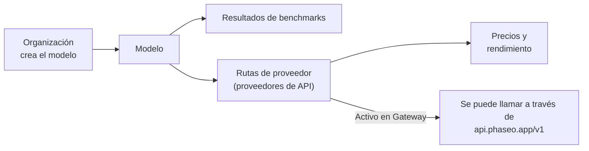

Busca cualquier modelo en [phaseo.app](https://phaseo.app/models) para ver quién lo creó, qué proveedores lo sirven, cuánto cuesta y qué puntuaciones obtiene, y después llámalo a través del Gateway cuando tenga una ruta activa.

## Qué contiene el catálogo

| Registro | Qué es | Dónde consultarlo |
| --- | --- | --- |
| [Organizaciones](./organisations.mdx) | Empresas y laboratorios de investigación que crean y publican modelos. | [Organizaciones](https://phaseo.app/organisations) |
| [Modelos](./models.mdx) | Cada modelo lanzado, agrupado en familias de modelos relacionados. | [Modelos](https://phaseo.app/models) |
| [Benchmarks](./benchmarks.mdx) | Evaluaciones y las puntuaciones que obtienen los modelos en ellas. | [Benchmarks](https://phaseo.app/benchmarks) |
| [Proveedores de API](./api-providers.mdx) | Plataformas que sirven modelos a través de una API. | [Proveedores de API](https://phaseo.app/api-providers) |
| [Precios y rendimiento](./pricing-performance.mdx) | El precio de cada proveedor por token, imagen, segundo o solicitud, y la velocidad medida en Gateway. | Páginas de modelos, [Comparar](https://phaseo.app/compare) |
| [Planes de suscripción](./subscription-plans.mdx) | Los planes de Phaseo y las suscripciones que venden los proveedores. | [Planes de suscripción](https://phaseo.app/subscription-plans) |

Que un registro esté en el catálogo no significa que puedas llamar al modelo. Solo los modelos marcados como **Activo en Gateway** tienen una ruta; `GET /v1/models` devuelve únicamente esos.

## Cómo interpretar los datos

- **Los precios** están en USD, por cada millón de tokens para texto, o en la unidad propia del proveedor (por imagen, por segundo, por solicitud) para contenido multimedia.
- **Las fechas** son días UTC, que en inglés se muestran como `01 Jan 2026`.
- **Las puntuaciones de benchmarks** mantienen la escala y el sentido propios del benchmark. Phaseo no las convierte a una puntuación común; consulta [Benchmarks](./benchmarks.mdx).
- **Las familias** agrupan modelos relacionados, como los tamaños y las versiones de una misma línea de modelos.

## Cómo se mantienen actualizados los datos

Los trabajos de sincronización con proveedores proponen precios nuevos, que un administrador revisa antes de publicarlos. Las importaciones de benchmarks y los trabajos del ciclo de vida de los modelos actualizan la base de datos de forma programada. Cualquiera puede informar de una corrección o de un registro que falta mediante un issue de GitHub; los responsables revisan las pruebas y aplican los cambios aprobados. Consulta [Contribuir](../contributing/overview.mdx).

## Preguntas de ejemplo

| Objetivo | Dónde encontrar la respuesta |
| --- | --- |
| Comparar dos modelos en un benchmark | [Comparar](https://phaseo.app/compare) o la página del benchmark |
| Encontrar el modelo más barato para una tarea | La lista de [Modelos](https://phaseo.app/models) ordenada por precio y, después, la [calculadora de precios](https://phaseo.app/tools/pricing-calculator) |
| Ver cómo ha evolucionado un benchmark con el tiempo | El gráfico **Progreso** del benchmark |
| Encontrar proveedores que admitan una función | La sección **Proveedores** de la página del modelo, o `GET /v1/models/{author}/{slug}/endpoints` |
| Encontrar registros a los que contribuir | Páginas de modelos a las que les faltan benchmarks o metadatos; consulta [Contribuir](../contributing/overview.mdx) |
