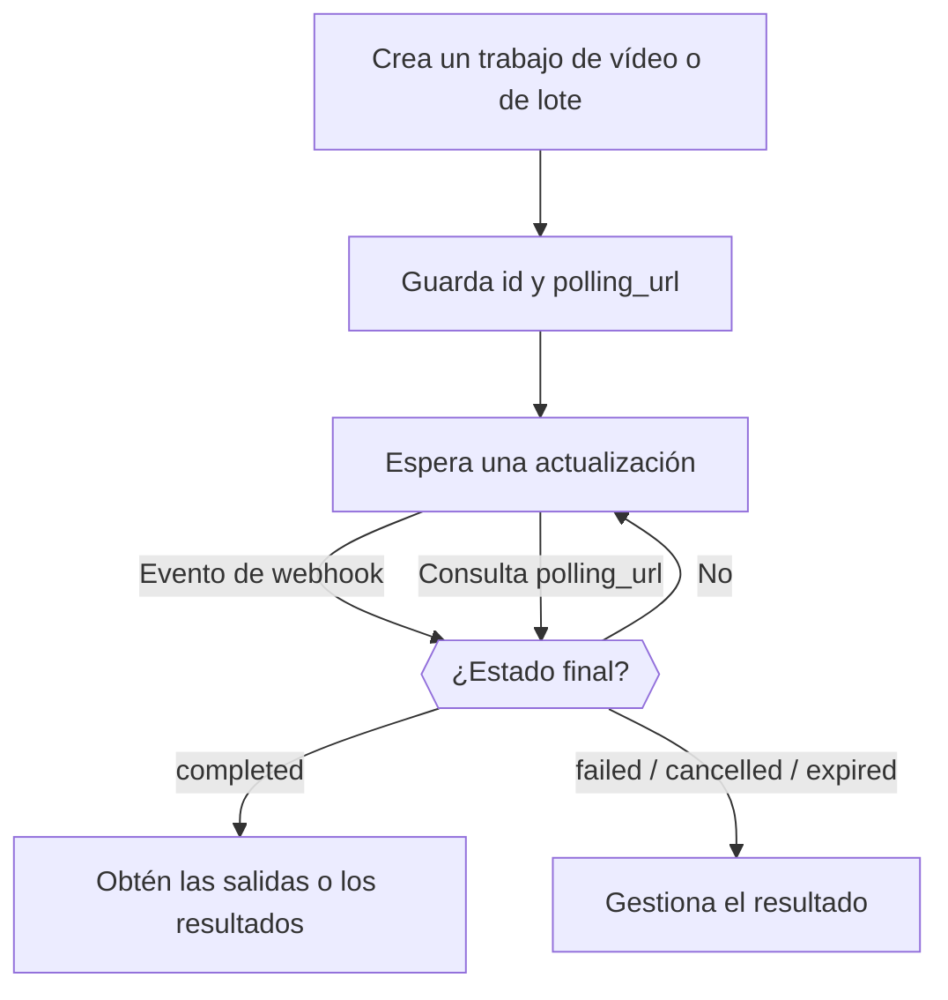

<Note>
La API de vídeo y la API de lotes son versiones beta preliminares, disponibles solo por invitación para espacios de trabajo seleccionados. Consulta **Ajustes → Vista previa de funciones** para comprobar la disponibilidad. El acceso se gestiona por espacio de trabajo; activar una preferencia web personal no concede acceso a la API. Se aplican los cargos habituales por uso del modelo.
</Note>

Crear un vídeo o un lote devuelve un trabajo antes de que termine la tarea. Guarda su `id` y su `polling_url`, y después espera un webhook o consulta periódicamente hasta que el trabajo llegue a un estado final: `completed`, `failed`, `cancelled` o `expired`. Una respuesta de creación correcta solo significa que se aceptó el trabajo.



Mantén la consulta periódica aunque uses webhooks. Durante la beta, empieza con solicitudes pequeñas y un límite de gasto en la clave de API. Las entradas de referencia, la cancelación y la conservación de las salidas dependen del proveedor y del modelo. Guarda tu propia copia de las salidas completadas antes de que caduquen.

<span id="receive-updates"></span>
## Recibe actualizaciones

Adjunta un endpoint de webhook de tu espacio de trabajo al crear cualquiera de los dos tipos de trabajo:

```json
{
  "webhook": {
    "endpoint_id": "YOUR_ENDPOINT_ID",
    "events": ["job.status_changed", "job.completed", "job.failed", "job.cancelled", "job.expired"]
  }
}
```

Phaseo reconcilia el estado del proveedor y envía las notificaciones, así que los proveedores que solo admiten consultas periódicas, como los lotes de mensajes de Anthropic, también generan webhooks. Un fallo en la entrega de un webhook no significa que haya fallado el trabajo.

Suscríbete por separado a los eventos de lotes y de vídeo con tipos de evento con espacio de nombres, como `batch.completed` o `video.failed`. Los tipos de evento genéricos `job.*` siguen funcionando y se suscriben a la fase correspondiente de ambos tipos de trabajo.

### Verifica y confirma las entregas

Verifica `x-phaseo-signature` con el secreto del endpoint: es el HMAC-SHA256 en hexadecimal de `x-phaseo-timestamp`, un punto literal y el **cuerpo de la solicitud sin modificar**. Comprueba que la marca de tiempo sea reciente, elimina duplicados con `x-phaseo-event-id` y confirma las entregas aceptadas con una respuesta 2xx. Las entregas pueden reintentarse o llegar desordenadas, así que recupera el trabajo antes de aplicar un cambio de estado contradictorio.

| Intento | Cuándo |
| --- | --- |
| 1 | En cuanto ocurre el evento |
| 2 | Aproximadamente 1 minuto después de un intento fallido |
| 3 | Aproximadamente 5 minutos después |
| 4 | Aproximadamente 15 minutos después; si falla, la entrega se marca como fallida de forma permanente |

Una respuesta 2xx termina la entrega. Los reintentos los envían barridos en segundo plano, así que un reintento puede llegar más tarde de lo previsto. Cada intento registra su número, la hora, el estado HTTP, el error y la hora del siguiente reintento. Aun así, elimina duplicados: una confirmación perdida o un worker interrumpido pueden dejar una entrega en estado incierto.

Después de guardar un endpoint, usa **Enviar evento de prueba** en Ajustes para entregar una carga `webhook.test` firmada. Una entrega de prueba se intenta una sola vez, no se reintenta y no se añade al historial de entregas del trabajo.

## Consulta los registros de trabajos y solicitudes

En **Ajustes → Uso → Registros**, usa **Solicitudes** para los detalles de las solicitudes de inferencia, **Vídeo** para el ciclo de vida de los vídeos y **Por lotes** para los trabajos por lotes y los resultados de cada fila. Las vistas de detalle de vídeo y de lotes incluyen el estado de facturación, los intentos con el proveedor y los intentos de webhook. Un trabajo puede completarse correctamente aunque falle la entrega de su webhook.

El envío de un vídeo reserva crédito antes de contactar con el proveedor. Un tiempo de espera agotado sin ID de tarea conserva la reserva para su reconciliación; no demuestra que la generación haya fallado. Si una reserva de pago de vídeo o de lote recibe inesperadamente un precio de cero tras un trabajo correcto, la facturación queda abierta con `unexpected_zero_cost` para investigarla. Que la respuesta de creación por sí sola tenga coste cero es normal en la generación asíncrona.

## Calcula lo que cuesta un vídeo

Los precios de vídeo dependen del proveedor y del modelo. Un precio por segundo debe multiplicarse por la duración facturable; un precio por clip solo se aplica a la duración y resolución especificadas. Las salidas múltiples y las entradas de referencia con cargo pueden aumentar el total.

La generación de texto o imagen de LTX factura los segundos de salida, mientras que la de audio a vídeo factura los segundos del audio de entrada. BytePlus Seedance usa tokens de vídeo, con tarifas distintas cuando hay un vídeo de referencia. MiniMax Hailuo V1 usa precios por clip de duración fija; H3 usa segundos y puede cobrar por las entradas de referencia. Revisa las dimensiones de precio del proveedor seleccionado en lugar de interpretar un precio destacado como el coste de una solicitud completa.

Las reservas son estimaciones retenidas antes del envío. La facturación final usa el uso facturable del trabajo; el crédito reservado que no se usa se libera tras la reconciliación. Que un proveedor admita una resolución u opción no garantiza que esté disponible en la beta.

## Define la duración, los fotogramas y las referencias

Usa `seconds` o `duration` para la duración de la salida. Si envías ambos, deben coincidir. Usa `resolution` con `aspect_ratio`, o un `size` en píxeles como `1280x720`.

Usa `frame_images` para indicar de forma explícita el primer y el último fotograma:

```json
{
  "frame_images": [
    {
      "type": "image_url",
      "frame_type": "first_frame",
      "image_url": { "url": "https://example.com/start.png" }
    }
  ],
  "input_references": [
    {
      "type": "image_url",
      "role": "reference",
      "image_url": { "url": "https://example.com/character.png" }
    }
  ]
}
```

Las URL de referencia deben usar HTTPS. Indica `role: "reference"` de forma explícita para las imágenes que solo son de referencia: las solicitudes antiguas sin `frame_images` interpretan la primera imagen sin etiqueta como primer fotograma. No combines `frame_images` con roles de primer o último fotograma en `input_references` ni con `input_reference`.

Las referencias de vídeo y audio usan `type: "video_url"` o `"audio_url"` y `media_url: { "url": "https://..." }`. Cada modelo y proveedor admite combinaciones distintas. Cuando la duración de la referencia afecta al precio, indica `input_video_duration` e `input_audio_duration` en segundos.

## Pasa opciones de vídeo específicas del proveedor

Mantén el modelo, la duración, la resolución, la generación de audio, los medios de entrada y el número de salidas en los campos canónicos. Pasa las extensiones específicas del proveedor bajo su ID canónico:

```json
{
  "provider_options": {
    "atlascloud": { "watermark": false, "output_format": "mp4" },
    "byteplus": { "camera_fixed": true }
  }
}
```

Solo se reenvían las opciones del proveedor seleccionado. Las opciones no seleccionan un proveedor; para eso, usa la configuración de enrutamiento `provider`. No combines `provider_options` con el antiguo `provider_params`. Las opciones anidadas no pueden sobrescribir los campos de facturación ni de callback que controla el Gateway.

| Proveedor | Ejemplos de extensiones nativas | Referencia |
| --- | --- | --- |
| AtlasCloud Seedance 2.5 | `watermark`, `output_format`, `return_last_frame`, `omni_reference_task_type` | [API del modelo](https://www.atlascloud.ai/models/bytedance/seedance-2.5/reference-to-video) |
| Novita Seedance 1.5 | `watermark`, `camera_fixed`, `fps` (24), `service_tier` (`default`) | [API unificada de vídeo](https://docs.novita.ai/api-reference/reference-unified-video-generation) |
| BytePlus Seedance | `camera_fixed` | Revisa el contrato del proveedor del modelo seleccionado antes de usarlo. |
| MiniMax V1 | `fast_pretreatment`; usa el campo canónico `enhance_prompt` para optimizar el prompt | [API de vídeo](https://platform.minimax.io/docs/api-reference/video-generation-t2v) |

AtlasCloud Seedance usa los campos nativos `resolution`, `ratio` y `last_image`. Su variante de referencia a vídeo recibe referencias ordenadas de imagen, vídeo y audio. La edición con duración automática (`duration: -1`) no es compatible con el contrato de reserva de duración fija del Gateway. La disponibilidad y los precios del modelo en el proveedor deben estar configurados antes de poder enrutar un modelo; una opción del proveedor no habilita un modelo no disponible.

MiniMax H3 usa V2: de 4 a 15 segundos enteros en `768P` o `2K`. H3 Max admite de 5 a 15 segundos enteros en `480P` o `768P`, con texto o imágenes de fotogramas. H3 admite imágenes, vídeo y audio de referencia; las referencias no se pueden mezclar con primeros o últimos fotogramas. Ambos modelos generan un vídeo por solicitud y no admiten las opciones de optimización del prompt de V1. Usa el campo canónico `aspect_ratio`; las entradas de fotogramas determinan su propia proporción. Las reservas con vídeo de referencia cubren el límite de entrada de 15 segundos del proveedor, y el uso real se liquida al completarse. Consulta el [contrato V2 de MiniMax](https://platform.minimax.io/docs/api-reference/video-generation-v2-create).

## Comprueba qué admite cada proveedor de lotes

Las solicitudes de lotes también aceptan `provider_options`: OpenAI admite `output_expires_after` y Mistral admite `metadata`. Usa los ID canónicos de proveedor y no dupliques estos campos en el nivel superior. Por ejemplo, `provider_options: { "openai": { "output_expires_after": { "anchor": "created_at", "seconds": 86400 } } }` define la conservación de las salidas de OpenAI. Las entradas de las filas, los modelos, los endpoints y los destinos de webhook no se pueden sobrescribir mediante opciones.

Mistral ya tiene un adaptador nativo de lotes. Los lotes de mensajes de Anthropic se consultan periódicamente; otros proveedores pueden combinar la consulta periódica con notificaciones nativas de finalización. La disponibilidad depende de los endpoints que admite el proveedor y de la lista de lotes permitidos del despliegue. Revisa la respuesta de capacidades de lotes antes de enviar un archivo o solicitudes en línea.

Los lotes de Vertex Gemini aceptan `requests` en línea con `/v1/generateContent`, o `model` y `prompts`. Selecciona `provider: "google-vertex"` para usar Vertex. Las filas correctas se cobran a las tarifas de lotes. Este adaptador requiere credenciales gestionadas; BYOK, los archivos subidos, los embeddings y los lotes de `google-vertex-eu` no están disponibles. La entrada está limitada a 20 MB y 10.000 solicitudes. La entrada y la salida almacenadas caducan a los 30 días.

Los resultados de Vertex usan `custom_id` para identificar cada fila enviada, con una generación correcta en `response.body` o un `error` por solicitud. El orden de salida puede diferir del orden de entrada. Un envío con un resultado incierto en el proveedor queda en revisión manual y conserva su retención de crédito; no crees uno de sustitución hasta que se confirme su resultado.

La finalización de un lote puede incluir filas fallidas. Revisa cada resultado por su ID personalizado en lugar de suponer que todas las filas han funcionado. Conserva la entrada original y el ID del trabajo hasta que se reconcilien los resultados y la facturación. Un envío incierto debe investigarse antes de volver a enviarlo, porque el proveedor puede haber aceptado la solicitud original.

### Descarga los resultados de un lote

Cuando un lote compatible llega a un estado final, su `results_url` apunta a una descarga autenticada de Phaseo. Usa tu clave de API de Phaseo habitual del espacio de trabajo propietario del lote:

```bash
curl --fail "https://api.phaseo.app/v1/batches/$BATCH_ID/results" \
  -H "Authorization: Bearer $PHASEO_API_KEY" \
  --output results.jsonl
```

La respuesta transmite JSONL a través del mismo endpoint para todos los proveedores de lotes compatibles. Phaseo combina los archivos separados de éxitos y errores, convierte las matrices de resultados en línea en JSONL y sigue la paginación de resultados. Se conservan el contenido generado y los errores de cada solicitud. Los campos de las filas siguen siendo nativos del proveedor: usa `custom_id` para las filas compatibles con OpenAI y las de Anthropic, los metadatos de la solicitud para Gemini y `batch_request_id` para xAI. Las filas correctas de Anthropic contienen el mensaje generado en `result.message`.

Las descargas admiten los adaptadores de OpenAI, Anthropic, Google AI Studio, Mistral, Together, Groq, Alibaba Cloud, Moonshot, Parasail, OVHcloud y xAI. La disponibilidad de cada proveedor sigue dependiendo del acceso a la versión preliminar y de la lista de envíos permitidos; la compatibilidad con descargas no habilita rutas adicionales. Los endpoints existentes `output_file_id`, `error_file_id` y de contenido de archivos siguen disponibles. El endpoint de filas de solicitudes del lote contiene metadatos de seguimiento y facturación, no los cuerpos de los mensajes generados.

Descargar los resultados no envía otro lote ni añade un cargo de inferencia. No necesitas credenciales del proveedor. Los webhooks avisan de las actualizaciones del trabajo; los resultados se descargan por separado. Un trabajo en estado final puede tener resultados parciales o ninguna salida: el endpoint devuelve `409` mientras se procesa y `404` cuando no hay salida disponible. Guarda los resultados antes de que termine el período de conservación del proveedor. Si se interrumpe una descarga, descarta el archivo parcial y vuelve a intentar la descarga, no el envío del lote. Los resultados JSON en línea se transmiten con un límite de seguridad de 8 MiB por fila; los archivos JSONL nativos se transmiten sin ese límite por fila.

Para salidas grandes, `client.batches.streamResults(batchId, { signal })` de TypeScript devuelve un `ReadableStream<Uint8Array>` sin almacenar en búfer. Redirígelo a tu destino y cancela el stream o aborta la señal para detenerlo antes; no hay un tiempo de espera fijo para la descarga completa. `client.batches.stream_results(batch_id)` de Python produce fragmentos de bytes con el tiempo de espera HTTP configurado; cierra el iterador si lo detienes antes. Las operaciones generadas `retrieveBatchResults` devuelven el texto JSONL completo y son más adecuadas para salidas pequeñas.

### Límites de descarga de lotes

Las descargas de resultados de lotes permiten 10 intentos por espacio de trabajo y lote en una ventana móvil de 30 minutos, compartidos entre las claves de API y los alias `/batches` y `/batch`. Cuentan los intentos que superan la admisión de la descarga, aunque la descarga del proveedor falle o se cancele. No cuentan los fallos de propiedad ni de disponibilidad. Una respuesta `429` incluye `Retry-After` en segundos. Si el limitador no está disponible, las descargas devuelven `503` con `Retry-After: 30`.
