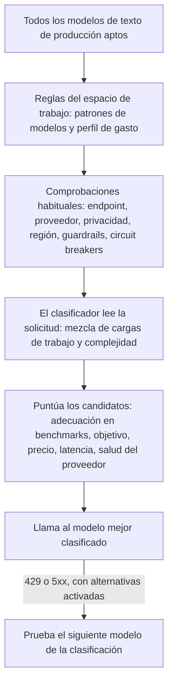

Envía `"model": "phaseo/auto"` y Phaseo elegirá un modelo para cada solicitud a partir de la carga de trabajo, el objetivo de tu espacio de trabajo y sus límites de precio. El enrutamiento automático es una versión Alpha disponible para espacios de trabajo seleccionados.

```json
{
  "model": "phaseo/auto",
  "input": "Review this TypeScript function for correctness."
}
```

El campo `model` de la respuesta indica qué modelo respondió.

## Cómo se elige un modelo



1. **Candidatos.** Phaseo parte de todos los modelos de texto de producción con precios estándar conocidos y conserva solo los que coinciden con tus patrones de modelos y tu perfil de gasto.
2. **Comprobaciones.** Cada candidato debe superar las mismas comprobaciones de endpoint, modelos del espacio de trabajo, proveedor, privacidad, guardrails y circuit breakers que una solicitud con un modelo fijo.
3. **Clasificador.** Un modelo de bajo coste fijado lee la solicitud y devuelve una mezcla de cargas de trabajo (código, razonamiento, uso de herramientas, etc.), una puntuación de complejidad y un nivel de confianza. Nunca elige el modelo por sí mismo. Las herramientas y la salida estructurada de la solicitud se le pasan como hechos de confianza.
4. **Puntuación.** La complejidad fija el modelo menos capaz que probablemente dé una respuesta aceptable, más un margen. Después, Phaseo combina los benchmarks del catálogo no autodeclarados con tu objetivo y el precio, la latencia, la salud y la fiabilidad actuales de cada candidato. Los datos que faltan cuentan como neutros; nunca amplían la lista de candidatos.

La solicitud no puede cambiar el objetivo, el perfil de gasto ni los patrones del espacio de trabajo. Una solicitud con un modelo fijo omite por completo el enrutamiento automático.

## Configúralo

<Steps>
<Step title="Abre Enrutamiento automático">

Ve a **Panel -> Ajustes -> Enrutamiento -> Enrutamiento automático**.

</Step>
<Step title="Elige un objetivo">

| Objetivo | Lo que más pesa |
| --- | --- |
| `balanced` | Una combinación práctica de calidad, precio, latencia y fiabilidad. |
| `quality` | Los resultados de benchmarks relevantes para la carga de trabajo. |
| `cost` | Un precio más bajo por token de entrada y de salida. |
| `latency` | Una latencia reciente del proveedor más baja. |

</Step>
<Step title="Elige un perfil de gasto">

Cada perfil es un límite estricto sobre los precios de texto del nivel estándar, en USD por millón de tokens. Los modelos que lo superan nunca se tienen en cuenta.

| Perfil de gasto | Entrada máxima | Salida máxima |
| --- | ---: | ---: |
| Económico | $0.10 | $0.50 |
| Estándar | $0.30 | $1.50 |
| Premium | $1 | $5 |
| Cualquier precio | Ninguno | Ninguno |

**Límites personalizados** te permite definir ambos límites.

</Step>
<Step title="Restringe los modelos (opcional)">

Añade patrones como `anthropic/*`, `openai/gpt-5.*` o un ID de modelo exacto.

</Step>
<Step title="Permite las alternativas y guarda">

Con las alternativas activadas, Phaseo prueba el siguiente modelo de la clasificación tras un `429`, `500`, `502`, `503` o `504`. Cada alternativa vuelve a pasar por todas las comprobaciones. Los errores del cliente no cambian de modelo.

</Step>
</Steps>

Desde la CLI: `phaseo routing auto update --objective <o> --spend-profile <p> --allowed-patterns <list> --allow-fallbacks`, y `phaseo routing auto get` para consultar la configuración. La API es `PATCH /v1/routing/auto`.

<Warning>
  Los perfiles de gasto y los patrones deciden qué modelos son aptos. No garantizan la calidad, así que comprueba la combinación de modelos resultante con tus propias cargas de trabajo.
</Warning>

## La solicitud al clasificador

Cada solicitud `phaseo/auto` crea una solicitud hija independiente al modelo clasificador, con el mismo espacio de trabajo y la misma identidad de facturación. Aparece por separado en los registros de solicitudes con `purpose=auto_routing_classifier` y el ID de la solicitud principal, y se mide por separado.

Si el clasificador falla, agota el tiempo de espera o devuelve datos no válidos, Phaseo usa en su lugar un clasificador local basado en reglas (código, razonamiento, uso de herramientas, salida estructurada, traducción, resumen o general), así que la solicitud principal se ejecuta igualmente.

## Límites de privacidad y de región

Los límites de datos de la solicitud también se aplican al enrutamiento automático:

- Con `provider.require_zero_data_retention: true`, o con un guardrail del espacio de trabajo o de la clave que solo permita proveedores sin retención de datos, solo se preseleccionan los modelos que tienen un proveedor así.
- Las regiones obligatorias se comprueban con los proveedores de cada candidato.
- La solicitud al clasificador lleva los mismos límites, además de las listas de proveedores `only` e `ignore`. Si su modelo no puede cumplirlos, Phaseo usa el clasificador local.

Si los requisitos de residencia por sí solos no dejan ningún modelo, la solicitud falla con `403 model_region_unavailable` y `unmet_requirements`, igual que con un modelo fijo. Si también se descartaron modelos por otros motivos, falla con `400 unsupported_model_or_endpoint`.

## Revisa una decisión

Los detalles de la solicitud muestran la carga de trabajo, el objetivo, el modelo seleccionado, el orden de las alternativas, las puntuaciones de cada candidato y de cada factor, los ID de los benchmarks, las exclusiones y la versión del algoritmo. Las trazas no contienen el contenido del prompt ni de la respuesta.

## Combínalo con otro enrutamiento

- **Rutas dinámicas.** Prevalece un modelo fijo elegido por una [ruta dinámica](./routing-and-fallbacks#attach-routing-rules-to-api-keys) asociada. La sustitución queda registrada y las alternativas del enrutamiento automático se desactivan para esa solicitud.
- **Alternativas de la solicitud.** `phaseo/auto` gestiona su propia clasificación de alternativas, así que no se puede combinar con una [lista `models`](./routing-and-fallbacks#request-level-model-fallbacks) ni aparecer en ella.
