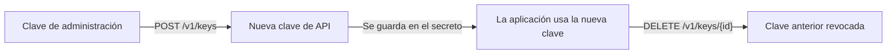

Rota las claves de API de Phaseo sin tiempo de inactividad: crea una clave de sustitución con una [clave de administración](../../developers/management-api-keys.mdx), cambia tu aplicación a ella y después borra la anterior. Esta página da los valores que usa una conexión de Infisical para esa rotación.

<Warning>
Phaseo todavía no es una App Connection que se pueda seleccionar en Infisical. El conector, las pruebas y la entrada en la interfaz aún tienen que ser aceptados en Infisical. Hasta entonces, usa las solicitudes de abajo desde tu propio trabajo de rotación.
</Warning>

## Cómo funciona la rotación



Phaseo muestra el valor de una clave de API una sola vez, cuando se crea. La clave anterior y la nueva funcionan hasta que borras la anterior, así que tu aplicación puede cambiar mientras se actualiza el secreto.

## Crea una clave de administración con permisos limitados

En **Ajustes → Claves de administración**, crea una clave con estas capacidades:

| Capacidad | Se usa para |
| --- | --- |
| `keys:read` | Comprobar la conexión y listar las claves gestionadas. |
| `keys:write` | Crear claves de sustitución. |
| `keys:delete` | Revocar claves anteriores. |

Guarda el valor `phaseo_v1_mk_...` en Infisical. Las claves de administración controlan tu cuenta y no se pueden usar para inferencia.

## Datos de la conexión

| Campo | Valor |
| --- | --- |
| Base URL | `https://api.phaseo.app/v1` |
| Autenticación | `Authorization: Bearer <PHASEO_MANAGEMENT_KEY>` |
| Comprobar la conexión | `GET /keys` |
| Listar claves de API | `GET /keys` |
| Crear una clave de API | [`POST /keys`](../../api-reference/endpoint/keys-create.mdx) |
| Revocar una clave de API | [`DELETE /keys/{id}`](../../api-reference/endpoint/keys-delete.mdx) |

## Crea la clave de sustitución

```bash
curl https://api.phaseo.app/v1/keys \
  -H "Authorization: Bearer $PHASEO_MANAGEMENT_KEY" \
  -H "Content-Type: application/json" \
  -d '{
    "name": "infisical-production",
    "limit": 100,
    "limit_reset": "monthly",
    "include_byok_in_limit": false
  }'
```

La respuesta contiene la nueva clave una sola vez en `data.key`, y su ID en `data.id`.

| Campo | Valores |
| --- | --- |
| `limit` | Límite de gasto en dólares estadounidenses. |
| `limit_reset` | `daily`, `weekly` o `monthly`. |
| `include_byok_in_limit` | Solo se acepta por compatibilidad. El uso con BYOK nunca cuenta para este límite. |

## Revoca la clave anterior

```bash
curl -X DELETE https://api.phaseo.app/v1/keys/$PREVIOUS_KEY_ID \
  -H "Authorization: Bearer $PHASEO_MANAGEMENT_KEY"
```

El borrado es idempotente: borrar una clave que ya está borrada devuelve `200` con `{"deleted": true}`, así que repetir una rotación es seguro.
