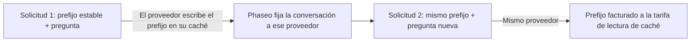

Mantén igual el inicio de tu prompt entre solicitudes y el proveedor lo leerá de su caché en lugar de procesarlo de nuevo: esos tokens se facturan a la tarifa de lectura de caché y el primer token llega antes. La mayoría de los proveedores almacenan en caché los prefijos repetidos por su cuenta. Claude solo almacena en caché lo que marcas con `cache_control`.



La caché de prompts sigue ejecutando la inferencia en cada solicitud. No devuelve una respuesta anterior a una solicitud idéntica.

## Almacena un prompt en caché

Marca el último bloque de la parte estable. Todo lo que hay hasta ese bloque, incluido, se almacena en caché.

<CodeGroup>
```bash Chat Completions
curl https://api.phaseo.app/v1/chat/completions \
  -H "Authorization: Bearer $PHASEO_API_KEY" \
  -H "Content-Type: application/json" \
  -d '{
    "model": "anthropic/claude-sonnet-5.5",
    "messages": [
      {
        "role": "system",
        "content": [
          {
            "type": "text",
            "text": "You are a support assistant. Follow the company policy exactly.",
            "cache_control": { "type": "ephemeral", "ttl": "1h" }
          }
        ]
      },
      { "role": "user", "content": "Summarise the latest ticket." }
    ]
  }'
```

```bash Responses
curl https://api.phaseo.app/v1/responses \
  -H "Authorization: Bearer $PHASEO_API_KEY" \
  -H "Content-Type: application/json" \
  -d '{
    "model": "anthropic/claude-sonnet-5.5",
    "input": [
      {
        "role": "user",
        "content": [
          {
            "type": "input_text",
            "text": "Reference document: Refunds are available for 30 days when...",
            "cache_control": { "type": "ephemeral", "ttl": "5m" }
          },
          {
            "type": "input_text",
            "text": "Answer this customer: Can I return an item after 20 days?"
          }
        ]
      }
    ]
  }'
```

```bash Anthropic Messages
curl https://api.phaseo.app/v1/messages \
  -H "Authorization: Bearer $PHASEO_API_KEY" \
  -H "Content-Type: application/json" \
  -d '{
    "model": "anthropic/claude-sonnet-5.5",
    "max_tokens": 512,
    "system": [
      {
        "type": "text",
        "text": "You are a careful support assistant. Use the policy below.",
        "cache_control": { "type": "ephemeral", "ttl": "1h" }
      }
    ],
    "messages": [
      {
        "role": "user",
        "content": [
          {
            "type": "text",
            "text": "Policy: refunds are available for 30 days when...",
            "cache_control": { "type": "ephemeral", "ttl": "5m" }
          },
          { "type": "text", "text": "Can this customer return an item after 20 days?" }
        ]
      }
    ],
    "tools": [
      {
        "name": "lookup_order",
        "description": "Look up order status.",
        "input_schema": {
          "type": "object",
          "properties": { "order_id": { "type": "string" } },
          "required": ["order_id"]
        },
        "cache_control": { "type": "ephemeral", "ttl": "5m" }
      }
    ]
  }'
```
</CodeGroup>

Después comprueba que ha funcionado:

1. Envía la solicitud una vez para escribir la caché.
2. Envíala otra vez con el mismo contenido almacenable en caché.
3. Comprueba `cached_tokens` y `cache_write_tokens` en el uso de la respuesta (consulta [Campos de uso y precios](#usage-and-pricing-fields)) y los medidores de caché en los detalles de la solicitud.
4. Compara la latencia y el coste a lo largo de varias llamadas, no solo de la primera.

Almacena en caché el contenido que se mantiene igual entre solicitudes: instrucciones de sistema largas, documentos reutilizados, ejemplos few-shot, definiciones de herramientas y resultados de herramientas grandes que el siguiente turno vuelve a enviar. No marques contenido que cambie en cada solicitud, entradas cortas de un solo uso ni datos que tu política no permita que el proveedor guarde.

<Note>
Phaseo envía a cada proveedor solo los controles de caché que documenta y elimina el resto. Los controles de caché nunca excluyen a un proveedor del enrutamiento. Cada página de modelo indica sus precios de lectura y escritura de caché.
</Note>

## Qué proveedores almacenan en caché automáticamente

| Proveedor | Caché | Qué envía Phaseo |
| --- | --- | --- |
| [OpenAI](https://developers.openai.com/api/docs/guides/prompt-caching), [Azure OpenAI](https://learn.microsoft.com/en-us/azure/foundry/openai/how-to/prompt-caching) | Automática para prompts de 1.024 tokens o más | `prompt_cache_key`; puntos de corte y `prompt_cache_options` en GPT-5.6 y posteriores; `prompt_cache_retention` en modelos anteriores |
| [Anthropic Claude](https://platform.claude.com/docs/en/build-with-claude/prompt-caching) en Anthropic, Claude on AWS, Amazon Bedrock y Google Vertex AI | Opcional (hay que activarla) | Puntos de corte `cache_control`, como máximo cuatro por solicitud |
| [Google Gemini](https://ai.google.dev/gemini-api/docs/caching) en Google AI Studio y [Vertex AI](https://docs.cloud.google.com/vertex-ai/generative-ai/docs/context-cache/context-cache-overview) | Automática en Gemini 2.5 y posteriores | `cached_content` para una caché explícita que hayas creado |
| [xAI](https://docs.x.ai/developers/advanced-api-usage/prompt-caching/maximizing-cache-hits) | Automática | `prompt_cache_key` y el encabezado `x-grok-conv-id` |
| [DeepSeek](https://api-docs.deepseek.com/guides/kv_cache) | Automática | Nada adicional |
| [Moonshot AI](https://platform.kimi.ai/docs/guide/context-caching) | Automática, con un TTL de 5 minutos; un TTL de 1 hora es opcional en Kimi K3 | `prompt_cache_key` y `prompt_cache_options` |
| [Groq](https://console.groq.com/docs/prompt-caching) | Automática en los modelos que indica Groq | Nada adicional |
| [Fireworks](https://docs.fireworks.ai/guides/prompt-caching) | Automática | `prompt_cache_key`, más el encabezado `x-session-affinity` y `user` |
| [Cerebras](https://inference-docs.cerebras.ai/capabilities/prompt-caching) | Automática | `prompt_cache_key` |
| [Cloudflare Workers AI](https://developers.cloudflare.com/workers-ai/features/prompt-caching) | Automática en algunos modelos | El encabezado `x-session-affinity` |
| [Together AI](https://docs.together.ai/docs/inference/chat/prompt-caching), [Mistral](https://docs.mistral.ai/studio-api/conversations/advanced/prompt-caching) | Automática; `prompt_cache_key` mejora la tasa de aciertos | `prompt_cache_key` |
| [Alibaba Model Studio](https://www.alibabacloud.com/help/en/model-studio/context-cache) | Automática (implícita); las cachés explícitas son opcionales | `cache_control` en bloques |
| [Venice](https://docs.venice.ai/overview/guides/prompt-caching) | Automática; Venice añade por su cuenta los puntos de corte de Claude | `cache_control` en bloques |
| [DeepInfra](https://docs.deepinfra.com/chat/prompt-cache-retention) | Automática; una ventana de retención es opcional | `prompt_cache_key`, `prompt_cache_breakpoint` y `prompt_cache_options` |
| [Inference.net](https://inference.net/models/claude-opus-5/) | Automática; caché explícita en los modelos Claude y Gemini 2.5 | `cache_control` en bloques en los modelos Claude y Gemini 2.5, sin `ttl` |
| [Baseten](https://docs.baseten.co/inference/model-apis/pricing-and-limits) | Automática | `prompt_cache_key` y el encabezado `x-session-affinity` |
| [Morph](https://docs.morphllm.com/sdk/components/caching) | Automática | `prompt_cache_key` y el encabezado `x-session-id` |

Otros proveedores compatibles con OpenAI reciben `prompt_cache_key` cuando su API lo acepta, y ningún otro control de caché. Phaseo siempre envía un hash de tu espacio de trabajo y de la clave en lugar de la clave en sí; consulta [Afinidad de proveedor](#provider-affinity).

<span id="cache-controls"></span>
## Controles de caché

### Deja que Phaseo coloque los puntos de corte de Claude

Un `cache_control` de nivel superior en Chat Completions, Responses o Anthropic Messages activa la caché en las rutas de Claude, y Phaseo coloca los puntos de corte por ti. Los demás proveedores lo ignoran.

```json
{
  "cache_control": { "type": "ephemeral", "ttl": "5m" }
}
```

Usa `ttl: "5m"` (el valor predeterminado) para contexto compartido de corta duración, y `ttl: "1h"` cuando el modelo admita entradas de caché de mayor duración. Un `cache_control` de nivel superior también mantiene la conversación en un solo proveedor; consulta [Afinidad de proveedor](#provider-affinity).

`provider_options.anthropic.cache_control` es el mismo ajuste, y además acepta un `scope`. Cuando una solicitud envía ambos, prevalece el valor de `provider_options`:

```json
{
  "provider_options": {
    "anthropic": {
      "cache_control": { "type": "ephemeral", "ttl": "5m", "scope": "agent" }
    }
  }
}
```

| `scope` | Dónde coloca Phaseo los puntos de corte |
| --- | --- |
| `all_text` (predeterminado) | El texto de sistema y los tres mensajes de usuario más recientes que contienen texto o imágenes. |
| `last_user_message` | Solo el último mensaje de usuario. |
| `agent` | Para bucles de herramientas: la última definición de herramienta, el texto de sistema, el mensaje final (incluidos los resultados de herramientas) y el mensaje del paso anterior. `conversation` es un alias. |
| `none` | En ningún sitio. |

Usa `agent` para bucles de herramientas de varios pasos. `all_text` y `last_user_message` no marcan los mensajes que solo contienen resultados de herramientas, así que el prefijo en caché deja de crecer. Los valores de `scope` no reconocidos se tratan como `agent`.

Los puntos de corte que pones tú en los bloques prevalecen sobre la política predeterminada y cuentan para el límite de Anthropic de cuatro por solicitud: la política predeterminada deja de añadir marcas al llegar a cuatro. Si tus propios bloques llevan más de cuatro marcas, Phaseo conserva la primera y las tres más recientes y elimina las demás, para que la solicitud no se rechace.

### Puntos de corte de caché en bloques

Una marca de caché en un bloque de contenido almacena en caché todo lo que hay hasta ese bloque, incluido. Phaseo acepta dos formas de escribirla:

- `cache_control`: `{"type": "ephemeral"}`, con un `ttl` opcional de `5m` o `1h`.
- `prompt_cache_breakpoint`: el `{"mode": "explicit"}` de OpenAI, con un `ttl` opcional de `30m` o `12h` (consulta [Caché de 12 horas en OpenAI](#12-hour-cache-on-openai)). Cuando un bloque lleva ambos, prevalece `prompt_cache_breakpoint`.

En Chat Completions y Responses, las marcas se aceptan en partes de texto e imagen, en definiciones de herramientas de función y en resultados de herramientas cuyo contenido es un array de partes de texto. Anthropic Messages acepta `cache_control` en los mismos lugares que Anthropic: bloques de texto de `system`, bloques de texto e imagen de los mensajes, bloques de resultados de herramientas y definiciones de herramientas. Cuando una solicitud tiene varios TTL, Anthropic exige que los puntos de corte `1h` vayan antes que los `5m`.

Cada proveedor recibe la marca en su propio formato:

| Proveedor | `cache_control` en bloques | `prompt_cache_breakpoint` |
| --- | --- | --- |
| Claude en Anthropic, Claude on AWS, Amazon Bedrock y Google Vertex AI | Se envía como `{"type": "ephemeral"}` con tu `ttl` | Se envía como `cache_control: {"type": "ephemeral"}` |
| OpenAI, GPT-5.6 y posteriores | Se envía como `prompt_cache_breakpoint: {"mode": "explicit"}`; el `ttl` se descarta | Se envía, con su `ttl` |
| Azure OpenAI, GPT-5.6 y posteriores | Se envía como `prompt_cache_breakpoint: {"mode": "explicit"}`; el `ttl` se descarta | Se envía sin `ttl` |
| OpenAI y Azure OpenAI, modelos anteriores | Se elimina | Se elimina |
| DeepInfra | Se elimina | Se envía sin `ttl` |
| Alibaba Model Studio y Venice | Se envía | Se elimina |
| Inference.net, modelos Claude y Gemini 2.5 | Se envía sin `ttl` | Se elimina |
| Otros proveedores | Se elimina | Se elimina |

Las marcas en definiciones de herramientas solo llegan a las rutas de Claude, a Alibaba Model Studio, a Venice y a los modelos Claude y Gemini 2.5 de Inference.net; OpenAI no acepta puntos de corte en herramientas. Eliminar una marca deja el resto del prompt sin cambios, así que el prefijo en caché coincide con el de una solicitud sin marcas.

Amazon Bedrock y Google Vertex AI almacenan en caché Claude 3.7 Sonnet, 3.5 Sonnet y 3 Opus solo durante 5 minutos, y Bedrock puede rechazar un `ttl` en esos modelos. En esas rutas, Phaseo envía tus puntos de corte sin `ttl`, de modo que se almacenan en caché durante 5 minutos, e indica un `1h` eliminado como `cache_control.ttl` en el encabezado `X-Phaseo-Dropped-Params` y en `meta.routing.dropped_params`. Inference.net documenta los puntos de corte sin `ttl`, así que Phaseo elimina e indica ahí un `ttl` de la misma forma, y las escrituras se facturan como escrituras de 5 minutos.

<span id="openai-retention-and-options"></span>
### Retención y opciones de OpenAI

Los controles de caché de OpenAI dependen de la generación del modelo. Phaseo envía cada uno solo donde se acepta:

| Campo | Valores | Se envía a |
| --- | --- | --- |
| `prompt_cache_options` | `mode`: `implicit` o `explicit`; `ttl`: `30m` (predeterminado) o `12h` | OpenAI GPT-5.6 y posteriores |
| `prompt_cache_options` | `mode`: `implicit` o `explicit`; `ttl`: `30m` | Azure OpenAI GPT-5.6 y posteriores |
| `prompt_cache_options` | `mode`: `explicit`; `ttl`: `5m` o `1h` | DeepInfra |
| `prompt_cache_options` | `mode`: `implicit`; `ttl`: `5m` (predeterminado), o `1h` en Kimi K3 | Moonshot AI |
| `prompt_cache_retention` | `in_memory` o `24h` | Modelos de OpenAI y Azure OpenAI anteriores a GPT-5.6 |

El modo `explicit` solo almacena en caché los puntos de corte que colocas. DeepInfra también necesita `prompt_cache_key` en cada solicitud de la sesión. Phaseo envía un `1h` de Moonshot AI solo a las rutas de Kimi K3 que tienen un precio de escritura de 1 hora, así que esas escrituras se facturan a ese precio; en los demás casos elimina el `ttl` y lo indica como `prompt_cache_options.ttl` en el encabezado `X-Phaseo-Dropped-Params`. Los demás proveedores no reciben ninguno de los dos campos.

Envía cualquiera de los dos campos en el nivel superior o en `provider_options.openai`. Cuando están ambos, prevalece el valor de nivel superior:

```json
{
  "prompt_cache_retention": "24h",
  "provider_options": {
    "openai": { "prompt_cache_retention": "in_memory" }
  }
}
```

Aquí la solicitud usa `24h`.

<span id="12-hour-cache-on-openai"></span>
### Caché de 12 horas en OpenAI

En GPT-5.6 y posteriores, OpenAI conserva una entrada de caché durante al menos 12 horas cuando estableces `ttl: "12h"`, ya sea para toda la solicitud en `prompt_cache_options` o para un punto de corte en `prompt_cache_breakpoint`. Un punto de corte sin `ttl` propio usa el de la solicitud. OpenAI factura una escritura de 12 horas a 2.5× la tarifa de entrada y una escritura de 30 minutos a 1.25×; las lecturas de caché cuestan lo mismo en ambos casos.

```json
{
  "model": "openai/gpt-5.6-sol",
  "prompt_cache_options": { "ttl": "30m" },
  "input": [
    {
      "role": "developer",
      "content": [
        {
          "type": "input_text",
          "text": "Shared tool manual...",
          "prompt_cache_breakpoint": { "mode": "explicit", "ttl": "12h" }
        }
      ]
    },
    { "role": "user", "content": "Find the failing test." }
  ]
}
```

- OpenAI solo documenta la duración de 12 horas en su Responses API. Una solicitud de Chat Completions que la pide se ejecuta en la Responses API de OpenAI, y la respuesta mantiene el formato de Chat Completions.
- Primero se prueban las rutas que aceptan una caché de 12 horas: la API propia de OpenAI (`openai` y `openai-eu`), en un modelo GPT-5.6 o posterior cuya tarjeta de precios tenga un precio de escritura de 12 horas. Cualquier otra ruta, como Azure OpenAI, otro proveedor o un modelo anterior a GPT-5.6, recibe la solicitud sin él, así que se aplica el valor predeterminado de 30 minutos. La solicitud se ejecuta igualmente, y el campo eliminado se indica como `prompt_cache_options.ttl` o `prompt_cache_breakpoint.ttl` en el encabezado `X-Phaseo-Dropped-Params` y en `meta.routing.dropped_params`.

### Usa una caché explícita de Gemini

Gemini 2.5 y posteriores almacenan en caché de forma implícita, sin necesidad de enviar nada. Para usar una caché explícita que creaste con la API de caché de Google, pasa su nombre en `provider_options.google.cached_content`:

```json
{
  "provider_options": {
    "google": { "cached_content": "cachedContents/abc123" }
  }
}
```

- En Google AI Studio, `cached_content` solo funciona con tu propia clave de API de Google (BYOK). Con la clave de Phaseo, la solicitud devuelve `400`, porque la caché pertenece a la cuenta que la creó.
- En Vertex AI, `cached_content` solo funciona con tu propia credencial de Vertex AI; con la credencial de Phaseo, la solicitud devuelve `400`. Envía el nombre completo de la caché, `projects/{project}/locations/{location}/cachedContents/{id}`, y Phaseo enviará la solicitud a ese proyecto y esa ubicación. Un nombre corto como `cachedContents/abc123` usa el `project_id` y la `region` del JSON de tu cuenta de servicio, y devuelve `400` si falta alguno de los dos.
- Google no admite cachés explícitas en Gemini 4 Argon y posteriores.

`provider_options.google.cache_control` y `provider_options.google.cache_ttl` se aceptan, pero no se envían a Google.

### Responses: envía la conversación completa

Phaseo no guarda las respuestas. Las solicitudes que establecen `previous_response_id` o `conversation` devuelven `400` `unsupported_param`, así que envía la conversación completa en `input` en cada paso. Su inicio estable es el prefijo que se almacena en caché. En los bucles de herramientas, devuelve también los elementos de salida `reasoning`; consulta [Razonamiento en bucles de herramientas](../api-reference/endpoint/responses.mdx#reasoning-in-tool-loops).

<span id="usage-and-pricing-fields"></span>
## Campos de uso y precios

Todos los endpoints de texto informan de las lecturas y escrituras de caché. Chat Completions y Responses siguen la semántica de OpenAI: el recuento de entrada incluye las lecturas y escrituras de caché. Anthropic Messages sigue la de Anthropic: `input_tokens` las excluye.

| Endpoint | Entrada total | Lecturas de caché | Escrituras de caché |
| --- | --- | --- | --- |
| Chat Completions | `prompt_tokens`, incluidas lecturas y escrituras | `prompt_tokens_details.cached_tokens` | `prompt_tokens_details.cache_write_tokens` |
| Responses | `input_tokens`, incluidas lecturas y escrituras | `input_tokens_details.cached_tokens` | `input_tokens_details.cache_write_tokens`, desglosado por duración en OpenAI GPT-5.6 y posteriores en `input_tokens_details.cache_write_tokens_details.ttl_30m_tokens` y `ttl_12h_tokens` |
| Anthropic Messages | `input_tokens` + `cache_read_input_tokens` + `cache_creation_input_tokens` | `cache_read_input_tokens` | `cache_creation_input_tokens`, desglosado por TTL en `cache_creation.ephemeral_5m_input_tokens` y `cache_creation.ephemeral_1h_input_tokens` |

En Chat Completions y Responses, la entrada sin caché es la entrada total menos las lecturas de caché menos las escrituras de caché. Las respuestas de Anthropic Messages en streaming llevan los campos de caché en `message_delta`. El uso de Chat Completions no tiene desglose por duración, porque OpenAI no documenta ninguno ahí; los detalles de la solicitud sí lo registran.

<Note>
Las respuestas anteriores indicaban las escrituras de caché como `output_tokens_details.cached_tokens` (`completion_tokens_details.cached_tokens` en Chat Completions), y las rutas de Claude dejaban las lecturas y escrituras de caché fuera de `input_tokens` en Chat Completions y Responses. Ninguna de las dos cosas se aplica ya: lee las escrituras en `cache_write_tokens`. Las respuestas de Anthropic Messages sin streaming devolvían antes `cache_creation_input_tokens: null`; ahora devuelven los recuentos reales.
</Note>

Los detalles de la solicitud y los desgloses de precios usan estos medidores:

| Medidor | Cuenta |
| --- | --- |
| `cached_read_text_tokens` | Lecturas de caché. |
| `cached_write_text_tokens` | Escrituras de caché, cuando el proveedor tiene un único precio de escritura de caché. |
| `cached_write_text_tokens_5m`, `cached_write_text_tokens_1h` | Escrituras de caché de Claude con un TTL de 5 minutos o de 1 hora, cuando el proveedor las indica por separado. |
| `cached_write_text_tokens_30m`, `cached_write_text_tokens_12h` | Escrituras de caché de OpenAI con una duración de 30 minutos o de 12 horas. |

### Cómo se cobran los tokens en caché

Phaseo factura cada token de entrada una sola vez, a una sola tarifa: la entrada sin caché a la tarifa de entrada, las lecturas de caché a la tarifa de lectura de caché y las escrituras de caché a la tarifa de escritura de caché, o a las tarifas de 5 minutos y 1 hora (Claude) o de 30 minutos y 12 horas (OpenAI) cuando el proveedor les pone precios distintos. Algunos proveedores cuentan las escrituras de caché dentro del total de entrada y otros las indican aparte; en cualquier caso, un token escrito nunca se factura además como entrada normal.

Por ejemplo, con tarifas ilustrativas de $5.00 por 1M de tokens de entrada, $0.50 por lecturas de caché, $6.25 por escrituras de caché de 30 minutos y $30.00 por salida, una solicitud con 53.100 tokens de entrada, de los cuales 48.000 son lecturas de caché y 3.000 son escrituras de caché, más 850 tokens de salida, cuesta:

| Tokens | Tarifa por 1M | Coste |
| --- | ---: | ---: |
| 2.100 de entrada sin caché | $5.00 | $0.01050 |
| 48.000 lecturas de caché | $0.50 | $0.02400 |
| 3.000 escrituras de caché | $6.25 | $0.01875 |
| 850 de salida | $30.00 | $0.02550 |
| Total | | $0.07875 |

Si 2.000 de esas escrituras tuvieran una duración de 12 horas, costarían $12.50 por 1M en lugar de $6.25, y la solicitud costaría $0.09125.

Algunos proveedores no aplican descuento a los tokens en caché en algunos modelos. Sus páginas de modelo muestran el mismo precio para la entrada y para las lecturas de caché.

### Cuando una ruta aún no tiene precio de caché

Si un proveedor indica tokens en caché en una ruta que todavía no tiene precio de caché en el catálogo, la solicitud no falla:

- Las lecturas de caché se facturan a la tarifa de entrada de la ruta.
- Las escrituras de caché se facturan a la tarifa de entrada multiplicada por el multiplicador de escritura documentado por el proveedor.
- La línea de precio se marca con `pricing_fallback: "input_rate"`.

| Escrituras | Multiplicador de la tarifa de entrada |
| --- | --- |
| Claude, cualquier plataforma | 1.25× para escrituras de 5 minutos, 2× para escrituras de 1 hora |
| Escrituras de 30 minutos de OpenAI, cualquier ruta | 1.25× |
| Escrituras de 12 horas de OpenAI, cualquier ruta | 2.5× |
| OpenAI, Azure OpenAI y Alibaba, otras escrituras | 1.25× |
| Moonshot AI y Kimi K3 | 1× para escrituras de 5 minutos, 2× para escrituras de 1 hora |
| Otros proveedores | 1× |

En una ruta de Claude cuyo catálogo tiene un único precio de escritura de caché, ese precio es la tarifa de 5 minutos. Las escrituras que el proveedor indica como escrituras de 1 hora se facturan a 2× la tarifa de entrada, en una línea `cached_write_text_tokens_1h` marcada con `pricing_fallback: "input_rate"`.

El `message_delta` final de una respuesta de Claude en streaming indica el total de escrituras de caché sin el desglose por TTL. Las escrituras que superan el desglose se facturan como escrituras de 5 minutos, porque las escrituras de herramientas de servidor pueden usar 5 minutos aunque la solicitud pida 1 hora.

<span id="provider-affinity"></span>
## Afinidad de proveedor

Una caché de prompts reside en un proveedor y, a menudo, en una región o un despliegue concretos de ese proveedor. Phaseo mantiene las solicitudes relacionadas en el proveedor y la ruta que las atendieron, para que un bucle de agente no pague por reconstruir su caché en otro sitio.

Envía `prompt_cache_key` o `session_id`, o activa la caché con `cache_control` (de nivel superior, `provider_options.anthropic.cache_control`, o una marca `cache_control` o `prompt_cache_breakpoint` en un bloque de mensaje o una herramienta), para fijar una conversación. Phaseo la fija al proveedor y la ruta que atendieron la primera solicitud correcta, y las solicitudes posteriores con la misma clave van también allí. Las fijaciones se guardan por espacio de trabajo, endpoint y modelo.

Cuánto dura una fijación depende de la retención de caché del proveedor:

| Solicitud | La fijación dura |
| --- | --- |
| `session_id` | 24 horas, renovadas mientras la sesión está activa |
| `cache_control` de Anthropic con `ttl: "1h"` | 90 minutos |
| OpenAI o Azure OpenAI con `prompt_cache_retention: "24h"` | 24 horas |
| OpenAI o Azure OpenAI con retención en memoria (el valor predeterminado) | 90 minutos |
| OpenAI con `ttl: "12h"` en `prompt_cache_options` o en un punto de corte, o una escritura de 12 horas indicada | 18 horas |
| OpenAI o Azure OpenAI con `prompt_cache_options.ttl: "30m"` | 45 minutos |
| Cualquier otra cosa | 15 minutos |

Una fijación solo se mueve cuando su proveedor falla (un circuit breaker abierto o una tasa de errores reciente alta), cuando se agota la cuota gestionada de Phaseo en ese proveedor o cuando la ruta activa, el preajuste, el guardrail o la política de la solicitud ya no lo permiten. Entonces la solicitud pasa a otro proveedor, y la fijación se mueve al proveedor que la atendió. Los detalles de la solicitud lo registran como `sticky_routing.demotionReason` en los diagnósticos de enrutamiento. Las solicitudes fijadas no se usan para sondear proveedores en recuperación.

Sin clave, `session_id` ni marca de caché, Phaseo sigue fijando el contexto inicial durante 15 minutos a un proveedor que indicó una lectura o una escritura de caché para él, siempre que la entrada en caché de ese proveedor sea más barata que su entrada estándar.

Phaseo envía a los proveedores un hash de tu espacio de trabajo y de `prompt_cache_key`, nunca la clave sin procesar, así que la misma clave en dos espacios de trabajo nunca comparte una caché de proveedor. Con solo un `session_id`, Phaseo deriva ese hash de la sesión para OpenAI, xAI, Fireworks y Cerebras. Fireworks, Cloudflare Workers AI y Baseten también lo reciben en el encabezado `x-session-affinity`, Morph en el encabezado `x-session-id`, y xAI como `x-grok-conv-id`, salvo que establezcas `provider_options.xai.conversation_id`. Las respuestas siguen devolviendo tu propio `prompt_cache_key`.

Establece `provider.cache_aware_routing` en `false` para desactivarlo en una solicitud. Establece `routing.session_affinity` en `false` cuando la solicitud lleve un `session_id` pero solo deba usar el enrutamiento normal basado en el contexto; Phaseo deja entonces también de derivar una clave de caché de proveedor a partir de la sesión. Para ver cómo encaja la afinidad con el orden de proveedores y las alternativas, consulta [Enrutamiento y alternativas](./routing-and-fallbacks.mdx). Todos los campos de caché aparecen también en la [referencia de parámetros](../api-reference/parameters.mdx).
