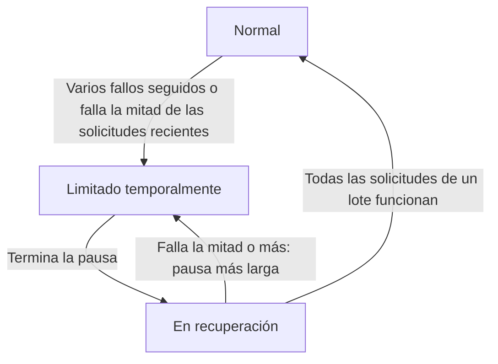

import { ProviderStatusExplorer } from "/snippets/provider-status.jsx";

En la página de un modelo aparecen hasta dos iconos después del nombre de cada proveedor: un **icono de estado**, que establece Phaseo, y un **icono de enrutamiento en directo**, que solo aparece mientras el Gateway desvía el tráfico de un proveedor que está fallando.

<ProviderStatusExplorer locale="es" />

## Icono de estado

Phaseo establece este estado manualmente y se mantiene hasta que Phaseo lo cambie. Las páginas de modelos muestran los tres niveles de prioridad reducida como `Prioridad más baja`.

| Icono | Estado | Enrutamiento |
| --- | --- | --- |
| <Icon icon="circle-check" color="#16a34a" /> | `Active` | Se enruta con normalidad. |
| <Icon icon="triangle-alert" color="#f59e0b" /> | `Deranked L1` | Enrutable, justo detrás de otros proveedores. |
| <Icon icon="triangle-alert" color="#d97706" /> | `Deranked L2` | Enrutable, detrás de proveedores en mejor estado. |
| <Icon icon="triangle-alert" color="#ef4444" /> | `Deranked L3` | Enrutable, muy por detrás de otros proveedores. |
| <Icon icon="ban" color="#dc2626" /> | `Disabled` | No se enruta. |

## Enrutamiento en directo

El Gateway lo establece automáticamente para cada proveedor, modelo y endpoint, según las solicitudes que atiende en este momento. Una ruta limitada o en recuperación sigue siendo enrutable, pero se prueban primero otros proveedores.

## Disponibilidad e integración

La tarjeta de estado también muestra si el proveedor ofrece el modelo y si Phaseo lo ha habilitado. Una ruta solo es pública cuando se cumplen ambas cosas. Por ejemplo, un proveedor puede ofrecer un modelo nuevo (`Available`) mientras Phaseo todavía desarrolla la compatibilidad (`Implementing`).

### Disponibilidad del proveedor

| Estado | Significado |
| --- | --- |
| `Available` | El proveedor acepta solicitudes para esta oferta. |
| `Preview` | El proveedor ofrece la oferta en versión preliminar. |
| `Limited Access` | La oferta existe, pero el acceso depende de la cuenta, la región, una lista permitida o la capacidad disponible. |
| `Coming Soon` | El proveedor anunció o publicó la oferta, pero todavía no se puede usar. |
| `Deprecated` | La oferta sigue disponible, aunque el proveedor recomienda migrar. |
| `Removed` | El proveedor ya no ofrece la oferta. |
| `Unknown` | Phaseo aún no ha verificado la disponibilidad en el proveedor original. |

### Integración de Phaseo

| Estado | Significado | Enrutamiento de Phaseo |
| --- | --- | --- |
| `Unsupported` | Phaseo no tiene una integración compatible para esta oferta. | No se puede enrutar. |
| `Planned` | Se aceptó el trabajo de integración, pero aún no ha comenzado. | No se puede enrutar. |
| `Implementing` | El trabajo de integración está en curso. | No se puede enrutar. |
| `Testing` | Está implementada y en pruebas de contrato, staging o canary. | No se puede enrutar públicamente. |
| `Enabled` | Está admitida y habilitada para producción. | Se puede enrutar si los controles de enrutamiento y el estado de salud lo permiten. |
| `Disabled` | Phaseo desactivó deliberadamente la integración. | No se puede enrutar. |
| `Blocked` | Una dependencia externa o sin resolver impide el despliegue. | No se puede enrutar. |

Solo las rutas `Enabled` pueden ser públicas. Las rutas `Internal` solo atienden el tráfico de prueba de Phaseo.

## Compatibilidad

`availability_status`, `routing_status`, `is_active_gateway` y `routable` siguen en la API para las integraciones existentes. Las integraciones nuevas deben leer los campos separados del proveedor y de Phaseo.

## Páginas relacionadas

- [Enrutamiento y alternativas](./routing-and-fallbacks.mdx)
- [Niveles de servicio](./service-tiers.mdx)
- [Referencia de la API de modelos](../api-reference/endpoint/models.mdx)
