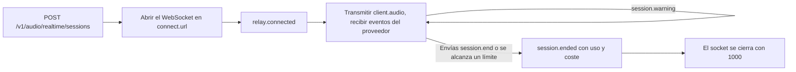

Crea una sesión desde tu servidor, conecta tu cliente al relay de Phaseo mediante un WebSocket y transmite el audio del micrófono al modelo en tiempo real de un proveedor. El relay reenvía sin cambios los eventos propios del proveedor, mide la llamada mientras transcurre y añade tres eventos propios: `session.warning` durante la llamada, `session.end` para colgar y `session.ended` con la factura final.

<Note>
La voz en tiempo real está en beta y el acceso se habilita por espacio de trabajo.
</Note>



## Inicia una sesión

Crea la sesión desde tu servidor:

```bash
curl https://api.phaseo.app/v1/audio/realtime/sessions \
  -H "Authorization: Bearer $PHASEO_API_KEY" \
  -H "Content-Type: application/json" \
  -d '{"model": "openai/gpt-realtime-2", "voice": "marin"}'
```

La respuesta incluye `client_secret`, `connect.url`, `max_duration_seconds` e `idle_timeout_seconds` (siempre `null` en las sesiones de API).

Abre un WebSocket a `connect.url` en `api.phaseo.app` y ofrece dos subprotocolos: `statsync-realtime` y `rtsec.<client_secret>`. El relay selecciona `statsync-realtime`. Si solo ofreces `rtsec.<client_secret>`, los navegadores y la mayoría de las bibliotecas de WebSocket hacen fallar el handshake porque no se selecciona ningún protocolo.

El relay envía `relay.connected` cuando el proveedor está listo. Después envía el audio del micrófono como `{"type": "client.audio", "audio": "<base64 PCM16>"}` con la frecuencia de muestreo del proveedor:

| Proveedor | Audio de entrada |
| --- | --- |
| OpenAI, xAI, ElevenLabs, GPT Live | PCM16 a 24 kHz |
| Google, Mistral | PCM16 a 16 kHz |

Phaseo retiene $5 de crédito al iniciar la sesión y amplía la retención a medida que avanza la llamada.

Los [SDK de TypeScript y Python](/es/v1/sdk-reference/client/audio-realtime) hacen todo esto por ti: `client.realtime.connect()` crea la sesión y abre el socket, y `session.end()` devuelve `session.ended`. Los demás SDK tienen el mismo cliente sencillo; el README de cada paquete incluye un ejemplo.

| SDK | Conexión | Biblioteca de WebSocket |
| --- | --- | --- |
| Go | `realtime.Connect(ctx, client, realtime.Options{...})` | `github.com/coder/websocket`, en el paquete independiente `realtime` |
| Java | `client.realtime.connect(Map.of("model", ...))` | `java.net.http.WebSocket` del JDK |
| C# | `await client.Realtime.ConnectAsync(new RealtimeConnectOptions { ... })` | `System.Net.WebSockets.ClientWebSocket` |
| PHP | `$client->realtime()->connect(["model" => ...])` | `phrity/websocket` (opcional, `composer require phrity/websocket`) |
| Ruby | `client.realtime.connect(model: ...)` | Gem `websocket` (opcional) |
| Rust | `client.realtime().connect(RealtimeOptions::new(...))` | `tungstenite`, tras la feature `realtime` |

El SDK de C++ no tiene cliente en tiempo real.

### Conexiones de Google Live

Sigue transmitiendo el audio del micrófono durante toda la llamada, incluidos los silencios. Google cierra una conexión que no recibe audio durante unos 150 segundos (código de cierre `1008`), y la llamada termina entonces con `provider_closed`. El relay envía un aviso `provider_closing` con `threshold: "input_idle"` tras 2 minutos sin audio. El silencio entre turnos no forma parte de ningún turno, así que no se factura.

Google también sustituye cada conexión al cabo de unos 10 minutos. El relay traslada la llamada a una conexión nueva con la reanudación de sesión de Google, mantiene tu socket abierto y envía `{"type": "relay.provider_reconnected", "reconnects": 1}` cuando termina el cambio. El audio que envías durante el cambio (normalmente menos de un segundo) se retiene y se reenvía. La conexión reanudada vuelve a procesar la conversación hasta ese momento, y Google lo factura de nuevo como tokens de entrada en el siguiente turno, así que una llamada larga cuesta un poco más por turno después de cada cambio. Todo se incluye en `usage` y en la factura. El relay solo avisa con `provider_closing` si no puede reanudar, y entonces la llamada termina cuando Google cierra la conexión.

### Sesiones de GPT Live

GPT Live (`openai/gpt-live-1`) gestiona la voz y delega el razonamiento en un modelo backend de Responses. Créala con `POST /v1/live/sessions`:

```bash
curl https://api.phaseo.app/v1/live/sessions \
  -H "Authorization: Bearer $PHASEO_API_KEY" \
  -H "Content-Type: application/json" \
  -d '{
    "model": "openai/gpt-live-1",
    "provider": "openai",
    "voice": "marin",
    "backend_model": "openai/gpt-5.6-luna",
    "backend_settings": {
      "tools": [{ "type": "function", "name": "get_time", "description": "Returns the current UTC time.", "parameters": { "type": "object", "properties": {} } }]
    }
  }'
```

`voice` es uno de `alloy`, `ash`, `ballad`, `beacon`, `bossa`, `cedar`, `cinder`, `coral`, `delta`, `echo`, `gleam`, `marin`, `meridian`, `quartz`, `ripple`, `sage`, `shimmer`, `stone`, `tempo`, `verse`, `vesper` o `willow`. `backend_model` es `openai/gpt-5.6-luna` (predeterminado) u `openai/gpt-5.6-terra`. Conecta y transmite audio a 24 kHz igual que en las demás sesiones.

Las herramientas de función se ejecutan en tu cliente. La llamada del backend llega como un `response.event` cuyo `event.item.type` es `function_call`. Su nombre y sus `arguments` vienen del modelo, y lo que dice quien llama puede influir en ellos, así que trátalos como entrada no fiable:

1. Ejecuta solo las herramientas que declaraste, buscadas por `name`, y rechaza cualquier otro nombre.
2. Analiza `arguments` como JSON y valídalo con el esquema `parameters` de la herramienta antes de usarlo.
3. Comprueba que el usuario que ha iniciado sesión tiene permiso para hacer lo que pide la llamada, y confírmalo con él antes de cualquier cosa que cambie datos, gaste dinero o contacte con alguien.

Después ejecuta la herramienta, envía el resultado y pide la respuesta de seguimiento. Si una llamada no supera estas comprobaciones, envía un `output` que explique por qué en lugar de ejecutarla:

```json
{ "type": "response.item.create", "item": { "type": "function_call_output", "call_id": "call_63hZ...", "output": "{\"utc\":\"2026-10-22T09:42:48Z\"}" } }
{ "type": "response.create" }
```

El relay solo acepta un `function_call_output` para una llamada que hizo el backend, una vez por llamada y hasta 64 KB, y `response.create` solo después de al menos una salida. Cualquier otra cosa recibe `{"type": "relay.client_event_rejected", "reason": "..."}` y la llamada continúa. Phaseo nunca ejecuta herramientas de función por su cuenta.

Una llamada de GPT Live se factura por segundo de voz ($0.05 por minuto, a partir del propio `usage.seconds` de GPT Live) más los tokens del modelo backend de cada respuesta, incluidas las respuestas posteriores a los resultados de herramientas. GPT Live hace caducar una sesión que no recibe audio durante unos 30 segundos, lo que termina la llamada con `provider_idle_timeout`. Sigue transmitiendo el audio del micrófono, incluidos los silencios.

### Sesiones de ElevenLabs Realtime

ElevenLabs Realtime tiene dos modelos: `eleven-labs/eleven-realtime-v1-mini`, el predeterminado, más rápido y barato, y `eleven-labs/eleven-realtime-v1-max`, que razona antes de responder y es adecuado para instrucciones complejas y el uso de herramientas en varios pasos. Ambos usan la misma solicitud de creación y el mismo relay que OpenAI, con audio a 24 kHz. Phaseo se conecta a ElevenLabs con su propia clave; tu cliente solo ve el relay.

ElevenLabs factura una llamada por cada segundo que está conectada, más los tokens del modelo de lenguaje que usa, y no informa del uso durante la llamada. El relay mide el tiempo conectado mientras dura la llamada, así que las retenciones y el tope de descubierto funcionan como con los demás proveedores. Cuando termina la llamada, Phaseo lee la factura de ElevenLabs de la conversación y cobra la mayor entre esa y su propio total a precio de lista. Normalmente tarda unos segundos. Si tarda más, `session.ended` llega con `billing_status: "pending"` y una solicitud `final_bill`, y la factura se liquida en cuanto ElevenLabs la comunica, normalmente en unos minutos. Tus retenciones se mantienen hasta entonces. Si ElevenLabs no ha comunicado la factura al cabo de 24 horas, la sesión pasa a revisión de facturación en lugar de cobrarse solo por el tiempo conectado.

### Transcripción en streaming

Los modelos Voxtral Realtime de Mistral transcriben el audio en directo a medida que llega: `mistral/voxtral-mini-transcribe-realtime-3` y `mistral/voxtral-mini-transcribe-realtime`. No responden con voz, así que crea la sesión sin `voice` ni `instructions`:

```bash
curl https://api.phaseo.app/v1/audio/realtime/sessions \
  -H "Authorization: Bearer $PHASEO_API_KEY" \
  -H "Content-Type: application/json" \
  -d '{"model": "mistral/voxtral-mini-transcribe-realtime-3"}'
```

Conecta de la misma forma y transmite PCM16 a 16 kHz como `client.audio`. Los eventos de Mistral se reenvían sin cambios: `session.created`, después `transcription.text.delta` con cada nuevo fragmento de texto, y `transcription.language` y `transcription.segment` cuando Mistral los envía. Para cambiar los ajustes de transcripción, envía `{"type": "session.update", "session": {...}}` con cualquiera de `language`, `target_streaming_delay_ms` (de 80 a 1.200, o 2.400), `context_bias`, `diarize` y `turn_detection`. Los demás campos, incluido el formato de audio, se rechazan con `relay.client_event_rejected`. Los ajustes quedan fijados en cuanto empieza el audio, así que envía `session.update` antes del primer `client.audio`; las actualizaciones posteriores se rechazan de la misma forma. El modelo anterior `mistral/voxtral-mini-transcribe-realtime` solo acepta `target_streaming_delay_ms`.

Cuando envías `session.end`, el relay termina el flujo de audio de Mistral y espera hasta 10 segundos a `transcription.done`, que contiene la transcripción completa, antes de liquidar y enviar `session.ended`. Se usa el audio que ya enviaste; no se descarta nada.

La transcripción en streaming se factura por minuto de audio que envías ($0.008 por minuto para Voxtral Mini Transcribe Realtime 3), medido por el relay. El recuento propio de Mistral en `transcription.done` es el mínimo que se cobra. Para una grabación que ya tienes, usa [transcripciones de audio](/es/v1/api-reference/endpoint/audio-transcriptions).

## Termina una sesión

Envía `session.end` cuando quien llama cuelgue:

```json
{ "type": "session.end", "reason": "caller hung up" }
```

| Campo | Tipo | Predeterminado | Significado |
| --- | --- | --- | --- |
| `reason` | string | ninguno | Tu propia nota, de hasta 120 caracteres imprimibles, que se devuelve como `client_reason`. |
| `cancel_response` | boolean | `true` | `true` cancela una respuesta que todavía se está reproduciendo. `false` deja que termine, durante un máximo de 20 segundos. |

A continuación, el relay:

1. deja de aceptar audio;
2. descarta el audio del micrófono que el proveedor no ha asignado a un turno;
3. cancela la respuesta en curso, o deja que termine, y espera hasta 10 segundos a su uso;
4. en GPT Live, envía al proveedor `session.close` y espera a `session.closed`;
5. liquida la factura;
6. envía `session.ended`;
7. cierra el socket con el código `1000`.

Cerrar el socket sin `session.end` también termina la llamada y la factura de la misma forma, pero tu cliente no recibirá `session.ended`.

## Lee la factura final: `session.ended`

El relay envía `session.ended` en todos los finales: el que solicitas tú, el que inicia el proveedor y el que inicia el Gateway. Se envía mientras tu socket sigue abierto, justo antes de que el relay lo cierre.

```json
{
  "type": "session.ended",
  "session_id": "rt_01k8...",
  "reason": "client_requested",
  "initiated_by": "client",
  "client_reason": "caller hung up",
  "duration_seconds": 184.2,
  "usage": { "input_audio_tokens": 1840, "output_audio_tokens": 3120, "input_text_tokens": 412 },
  "cost": {
    "total_usd": 0.231,
    "total_nanos": 231000000,
    "estimated": false,
    "estimate_basis": null,
    "debt_nanos": 0,
    "uncollected_nanos": 0,
    "currency": "USD"
  },
  "billing_status": "settled"
}
```

| Campo | Significado |
| --- | --- |
| `reason` | Un código de motivo estable. Consulta [códigos de motivo](#reason-codes). |
| `initiated_by` | `client`, `gateway` o `provider`. |
| `duration_seconds` | Tiempo desde que se conectó el relay. |
| `usage` | El uso por el que se factura la llamada: recuentos de tokens por modalidad, incluidas las lecturas y escrituras de caché; `audio_seconds`, la duración del audio de la llamada, que es lo que se factura en xAI, ElevenLabs, Mistral y la voz de GPT Live (en las llamadas facturadas por tokens se muestra solo como información); y `native_web_search_requests` para las búsquedas web de GPT Live. Cuando `billing_status` es `pending` o `unresolved`, muestra el uso conocido hasta el momento, y `final_bill` devuelve los medidores finales. |
| `cost.estimated` | `true` cuando parte del uso se estimó a partir del audio medido porque nunca llegó el uso del proveedor de un turno interrumpido. `estimate_basis` indica el motivo. |
| `cost.debt_nanos` | La parte del coste cobrada como descubierto por encima de tus retenciones y tu saldo libre. |
| `cost.uncollected_nanos` | Coste por encima del tope de descubierto que no se cobró. |
| `provider_close_code` | El código de cierre del WebSocket del proveedor, cuando el proveedor terminó la llamada. |
| `billing_status` | `settled`, `pending` o `unresolved`. |

Si la liquidación todavía se está reintentando, `billing_status` es `pending` y `cost` muestra la estimación en curso. Si la sesión necesita una revisión de facturación, es `unresolved`. En ambos casos, `final_bill` indica la solicitud para obtener el coste final una vez liquidado:

```json
"final_bill": { "method": "GET", "path": "/v1/generations?id=realtime%3Art_01k8..." }
```

<span id="reason-codes"></span>
### Códigos de motivo

| `reason` | `initiated_by` | Cuándo |
| --- | --- | --- |
| `client_requested` | client | Enviaste `session.end`. |
| `client_disconnected` | client | Tu socket se cerró sin `session.end`. |
| `provider_closed` | provider | El proveedor cerró su conexión; por ejemplo, Google tras unos 150 segundos sin audio (código `1008`), o tras un `goAway` desde el que el relay no pudo reanudar. |
| `provider_idle_timeout` | provider | GPT Live hizo caducar la sesión porque no recibió audio durante unos 30 segundos. |
| `provider_error` | provider | La conexión con el proveedor falló o informó de un error. |
| `max_duration_reached` | gateway | Se alcanzó el límite de sesión del proveedor. |
| `insufficient_funds` | gateway | Se alcanzó el tope de descubierto. |
| `key_revoked` | gateway | La clave de API se revocó o eliminó durante la llamada. |
| `key_expired` | gateway | La clave de API caducó durante la llamada. |
| `key_blocked` | gateway | La clave de API se pausó durante la llamada. |
| `workspace_disabled` | gateway | El espacio de trabajo ya no existe. |
| `policy_blocked` | gateway | Un cambio en una política del espacio de trabajo bloqueó el modelo, o quitó el proveedor de la lista de permitidos, y seguía en vigor 30 segundos después del aviso `policy_blocked`. |
| `input_rejected` | gateway | El relay rechazó el audio del cliente: demasiado grande, más rápido que el tiempo real o el proveedor se quedó atrás. |
| `session_reconciled` | gateway | El relay perdió su estado y la sesión se cerró mediante conciliación. |
| `gateway_error` | gateway | Phaseo no pudo procesar los eventos del proveedor ni registrar el uso. |
| `idle_timeout` | gateway | Solo en el Playground: cinco minutos sin audio. |
| `spend_limit_reached` | gateway | Solo en el Playground: se alcanzó un límite de gasto de la clave o el presupuesto del espacio de trabajo. |

Se pueden añadir códigos nuevos, así que trata un `reason` desconocido como `gateway_error`.

## Gestiona los avisos: `session.warning`

Los avisos te indican lo que va a pasar sin terminar la llamada. Cada código se envía como máximo una vez por umbral.

```json
{ "type": "session.warning", "code": "max_duration_approaching", "message": "...", "seconds_remaining": 120, "expires_at": "2026-10-22T11:00:00.000Z" }
```

| `code` | Campos adicionales | Cuándo |
| --- | --- | --- |
| `max_duration_approaching` | `seconds_remaining`, `expires_at` | 2 minutos antes del límite de sesión del proveedor, y otra vez 30 segundos antes. |
| `provider_closing` | `seconds_remaining`, y `threshold: "input_idle"` en el caso de inactividad | Google va a cerrar la conexión: tras un `goAway` desde el que el relay no pudo reanudar, o (`input_idle`) porque no ha llegado audio durante 2 minutos. |
| `funds_low` | `remaining_usd` | No se pudo ampliar la retención de crédito. La llamada continúa con tu saldo libre. |
| `overdraft_in_use` | `remaining_usd`, `overdraft_used_usd` | Tu saldo libre se ha agotado y la llamada funciona en descubierto. Se vuelve a enviar cuando queda menos de $0.25 del tope. |
| `spend_limit_exceeded` | `limit` (`key` o `workspace_budget`) | Se alcanzó un límite de gasto de la clave o el presupuesto del espacio de trabajo. La llamada continúa; las solicitudes nuevas se rechazan. |
| `policy_blocked` | `status`, más `seconds_remaining` y `ends_at` cuando `status` es `ending` | Una política del espacio de trabajo bloquea ahora la llamada, o su proveedor se quitó de la lista de permitidos. La llamada termina al cabo de 30 segundos salvo que se deshaga el cambio, en cuyo caso llega un segundo aviso con `status: "cleared"`. |

`remaining_usd` es lo que la llamada todavía puede gastar antes de terminar, incluido el descubierto.

## Cuando una llamada termina por sí sola

Phaseo nunca termina las sesiones de API por inactividad, y los límites de gasto solo avisan. Una llamada solo termina por sí sola cuando ocurre una de estas cosas:

| Límite | Valor |
| --- | --- |
| OpenAI Realtime | 60 minutos |
| xAI | 120 minutos |
| Google Live | 60 minutos, sumando las conexiones que reanuda el relay. La llamada también termina si tu cliente deja de enviar audio durante unos 150 segundos. |
| GPT Live | 25 minutos |
| ElevenLabs Realtime | 30 minutos |
| Transcripción en streaming de Mistral | 60 minutos |
| Tope de descubierto | $1 por encima de tus retenciones y tu saldo libre |
| Pérdida de acceso | La clave se revoca, caduca o se pausa, o se elimina el espacio de trabajo. Se detecta en aproximadamente un minuto y después la llamada termina sin periodo de gracia. |
| Cambio de política | 30 segundos después de un aviso `policy_blocked`, si la política sigue bloqueando la llamada |

Los límites de sesión cuentan desde que se conecta el relay, no desde que se creó la sesión.
