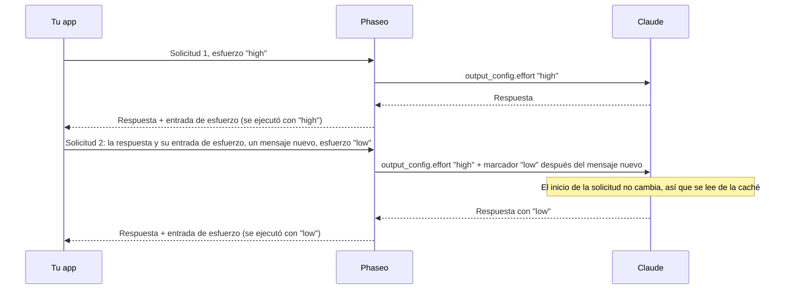

import { EffortCacheExplorer } from "/snippets/effort-cache.jsx";

Envía un `reasoning_effort` (Chat Completions) o un `reasoning.effort` (Responses) distinto en cualquier solicitud, y Phaseo cambia el esfuerzo de Claude sin reiniciar su caché de prompts. No tienes que cambiar nada más en tu código, siempre que devuelvas el razonamiento de Claude sin cambios en cada solicitud.

<EffortCacheExplorer locale="es" />

Phaseo sigue enviando a Claude el esfuerzo de la primera solicitud de tu conversación y añade cada cambio como un marcador de esfuerzo después de tu nuevo mensaje. Todo lo que está antes del marcador se mantiene igual, así que Claude lo lee de la caché. Si descartas el razonamiento, Phaseo cambia en su lugar el esfuerzo de nivel superior, y Claude vuelve a procesar todo desde su primera respuesta en adelante en lugar de leerlo de la caché.

## Cómo mantiene Phaseo la caché

Claude solo lee una conversación en caché cuando el inicio de la solicitud es idéntico byte a byte, y el esfuerzo de nivel superior forma parte de ese inicio. El [esfuerzo por mensaje](https://platform.claude.com/docs/en/build-with-claude/effort-per-message) de Anthropic cambia el nivel dentro de `messages`, con un mensaje `system` que tiene `content` vacío y un `output_config.effort`. Phaseo escribe esos marcadores por ti:



Phaseo no guarda nada entre solicitudes. Cada respuesta de Claude termina con una entrada de razonamiento que registra el nivel con el que se ejecutó, y Phaseo reconstruye cada marcador anterior, en el mismo lugar, a partir de las entradas que devuelves:

| Solicitud | Tú envías | Phaseo envía a Claude |
| --- | --- | --- |
| 1 | `"high"` | `output_config.effort: "high"` |
| 2 | `"low"` | `"high"`, más un marcador `low` después de tu nuevo mensaje |
| 3 | `"low"` | `"high"`, más el mismo marcador en el mismo lugar |
| 4 | `"high"` | `"high"`, el marcador anterior y un marcador `high` después de tu nuevo mensaje |

Los mensajes que devuelves nunca se modifican. Los marcadores solo existen en la solicitud que Phaseo envía a Claude.

## Devuelve el razonamiento sin cambios

<Warning>
Devuelve cada entrada de razonamiento exactamente como la recibiste, en cada solicitud: `reasoning_details` de Chat, elementos `reasoning` de Responses y bloques `thinking` de Anthropic, estén cifrados o no. No los descartes, edites, reordenes ni resumas. Sin ellos, un cambio de esfuerzo reinicia la caché de Claude, y Claude pierde su razonamiento entre los pasos del bucle de herramientas.
</Warning>

La entrada de esfuerzo no tiene texto. En Chat Completions es la última entrada `reasoning.encrypted` de `reasoning_details`:

```json
{
  "role": "assistant",
  "content": "1. Export the data. 2. Create the schema. 3. Import and verify.",
  "reasoning_details": [
    { "type": "reasoning.text", "text": "…", "signature": "phx1.…", "format": "anthropic-claude-v1" },
    { "type": "reasoning.encrypted", "data": "phx1.…", "format": "anthropic-claude-v1" }
  ]
}
```

En Responses es el último elemento `reasoning` de `output`, con un `id` que empieza por `rs_effort_`:

```json
{ "type": "reasoning", "id": "rs_effort_req_123", "summary": [], "content": [], "encrypted_content": "phx1.…" }
```

El valor es opaco, y Phaseo lo elimina antes de que la conversación llegue a cualquier proveedor.

## Cambia el esfuerzo en tu código

Añade la respuesta completa de Claude a tu conversación y luego establece el esfuerzo que quieras en la siguiente solicitud. El `cache_control` de nivel superior activa la caché en las rutas de Claude; consulta [Caché de prompts](./prompt-caching.mdx#which-providers-cache-automatically).

### Chat Completions

<CodeGroup>
```ts TypeScript
import OpenAI from "openai";

const client = new OpenAI({
	apiKey: process.env.PHASEO_API_KEY,
	baseURL: "https://api.phaseo.app/v1",
});

const messages: OpenAI.ChatCompletionMessageParam[] = [
	{ role: "user", content: "Plan a migration from SQLite to PostgreSQL." },
];

async function ask(effort: "low" | "medium" | "high") {
	const response = await client.chat.completions.create({
		model: "anthropic/claude-opus-5.5",
		reasoning_effort: effort,
		messages,
		// @ts-expect-error Campo de Phaseo: almacena la conversación en caché en las rutas de Claude
		cache_control: { type: "ephemeral" },
	});
	const message = response.choices[0].message;
	messages.push(message); // el mensaje completo, incluido reasoning_details
	return message.content;
}

await ask("high");
messages.push({ role: "user", content: "Summarise the plan in one sentence." });
await ask("low"); // Claude lee la solicitud 1 de la caché
```

```python Python
import os
from openai import OpenAI

client = OpenAI(
    api_key=os.environ["PHASEO_API_KEY"],
    base_url="https://api.phaseo.app/v1",
)

messages = [{"role": "user", "content": "Plan a migration from SQLite to PostgreSQL."}]

def ask(effort: str) -> str | None:
    response = client.chat.completions.create(
        model="anthropic/claude-opus-5.5",
        reasoning_effort=effort,
        messages=messages,
        extra_body={"cache_control": {"type": "ephemeral"}},
    )
    message = response.choices[0].message
    # El mensaje completo, incluido reasoning_details
    messages.append(message.model_dump(exclude_none=True))
    return message.content

ask("high")
messages.append({"role": "user", "content": "Summarise the plan in one sentence."})
ask("low")  # Claude lee la solicitud 1 de la caché
```
</CodeGroup>

### Responses

Phaseo no guarda las respuestas, así que envía la conversación completa en `input`, incluidos todos los elementos de `output`.

<CodeGroup>
```ts TypeScript
import OpenAI from "openai";

const client = new OpenAI({
	apiKey: process.env.PHASEO_API_KEY,
	baseURL: "https://api.phaseo.app/v1",
});

const input: OpenAI.Responses.ResponseInput = [
	{ role: "user", content: "Plan a migration from SQLite to PostgreSQL." },
];

async function ask(effort: "low" | "medium" | "high") {
	const response = await client.responses.create({
		model: "anthropic/claude-opus-5.5",
		reasoning: { effort },
		input,
		// @ts-expect-error Campo de Phaseo: almacena la conversación en caché en las rutas de Claude
		cache_control: { type: "ephemeral" },
	});
	input.push(...response.output); // todos los elementos, incluidos los de razonamiento
	return response.output_text;
}

await ask("high");
input.push({ role: "user", content: "Summarise the plan in one sentence." });
await ask("low"); // Claude lee la solicitud 1 de la caché
```

```python Python
import os
from openai import OpenAI

client = OpenAI(
    api_key=os.environ["PHASEO_API_KEY"],
    base_url="https://api.phaseo.app/v1",
)

conversation = [{"role": "user", "content": "Plan a migration from SQLite to PostgreSQL."}]

def ask(effort: str) -> str:
    response = client.responses.create(
        model="anthropic/claude-opus-5.5",
        reasoning={"effort": effort},
        input=conversation,
        extra_body={"cache_control": {"type": "ephemeral"}},
    )
    # Todos los elementos, incluidos los de razonamiento
    conversation.extend(item.model_dump(exclude_none=True) for item in response.output)
    return response.output_text

ask("high")
conversation.append({"role": "user", "content": "Summarise the plan in one sentence."})
ask("low")  # Claude lee la solicitud 1 de la caché
```
</CodeGroup>

### Anthropic Messages

En `/v1/messages`, envía tú mismo el marcador: un mensaje `system` con `content` vacío y `output_config.effort`. Mantén el mismo `output_config.effort` de nivel superior en cada solicitud, y deja cada marcador en su sitio en las solicitudes posteriores. Phaseo añade la cabecera beta `mid-conversation-output-config-2026-07-01`, así que no tienes que enviarla.

```bash cURL
curl https://api.phaseo.app/v1/messages \
  -H "x-api-key: $PHASEO_API_KEY" \
  -H "anthropic-version: 2023-06-01" \
  -H "Content-Type: application/json" \
  -d '{
    "model": "anthropic/claude-opus-5.5",
    "max_tokens": 4096,
    "cache_control": { "type": "ephemeral" },
    "output_config": { "effort": "high" },
    "messages": [
      { "role": "user", "content": "Plan a migration from SQLite to PostgreSQL." },
      { "role": "assistant", "content": "1. Export the data. 2. Create the schema. 3. Import and verify." },
      { "role": "system", "content": [], "output_config": { "effort": "low" } },
      { "role": "user", "content": "Summarise the plan in one sentence." }
    ]
  }'
```

La posición del marcador decide cuándo empieza el nuevo nivel:

- **Justo después de un mensaje de usuario:** la respuesta de Claude a ese mensaje usa el nuevo nivel.
- **En cualquier otro lugar**, por ejemplo entre la respuesta de Claude y tu siguiente mensaje, como en el ejemplo anterior: el nuevo nivel empieza con tu siguiente mensaje.

Un mensaje de usuario que solo contiene resultados de herramientas no cuenta como mensaje nuevo. En las rutas sin esfuerzo por mensaje, Phaseo elimina los marcadores y envía el nivel vigente como esfuerzo de nivel superior.

## Cuándo el cambio reinicia la caché

Phaseo cambia el esfuerzo de nivel superior, como hace con otros proveedores, cuando:

- **Falta el razonamiento.** Tu última respuesta de Claude no tiene entrada de esfuerzo, porque tu cliente descartó `reasoning_details` o los elementos `reasoning`.
- **El cambio llega entre pasos del bucle de herramientas.** Tu último mensaje solo contiene resultados de herramientas, así que un marcador solo se aplicaría a partir de tu siguiente mensaje. Phaseo cambia el esfuerzo de nivel superior para que este paso se ejecute con el nivel que pediste, y los cambios posteriores vuelven a usar marcadores.
- **La solicitud no establece ningún esfuerzo o desactiva el razonamiento.** Envía `reasoning_effort` o `reasoning.effort` en cada solicitud. `"none"` y `reasoning.enabled: false` desactivan el razonamiento.
- **La ruta no lo admite.** Consulta [Modelos compatibles](#supported-models).

Un cambio de nivel superior mantiene en la caché la parte de la conversación anterior a la primera respuesta de Claude. Claude vuelve a procesar todo desde esa respuesta en adelante y lo factura como entrada nueva.

<span id="supported-models"></span>
## Modelos compatibles

| Ruta | Modelos |
| --- | --- |
| Anthropic, Google Vertex AI | Claude Fable 5.2 y 5.1, Mythos 5.2 y 5.1, Opus 5.5 y 5, Sonnet 5.5, Haiku 5.5 |
| Claude on AWS | Los mismos modelos excepto Mythos |
| Amazon Bedrock | Claude Fable 5.1 y Opus 5.5 |

En las demás rutas, incluido Claude en Azure, un cambio de esfuerzo va al nivel superior.

## Comprueba que la caché se mantuvo

Lee los recuentos de caché en la solicitud posterior a un cambio: `usage.prompt_tokens_details.cached_tokens` en Chat Completions, `usage.input_tokens_details.cached_tokens` en Responses y `usage.cache_read_input_tokens` en Anthropic Messages. [Campos de uso y precios](./prompt-caching.mdx#usage-and-pricing-fields) enumera todos los campos.

Medimos la misma conversación de Chat Completions de cinco solicitudes en `anthropic/claude-haiku-5.5` el 11 de noviembre de 2026, una vez devolviendo las entradas de esfuerzo y otra sin ellas. El esfuerzo fue `high`, `high`, `low`, `low`, `high`, y un documento de 3.400 tokens llegó en el segundo mensaje:

| Solicitud 3 (esfuerzo de `high` a `low`) | Entradas de esfuerzo descartadas | Entradas de esfuerzo devueltas |
| --- | --- | --- |
| Tokens leídos de la caché | 0 | 3.575 |
| Tokens procesados de nuevo y escritos en la caché | 3.499 | 75 |
