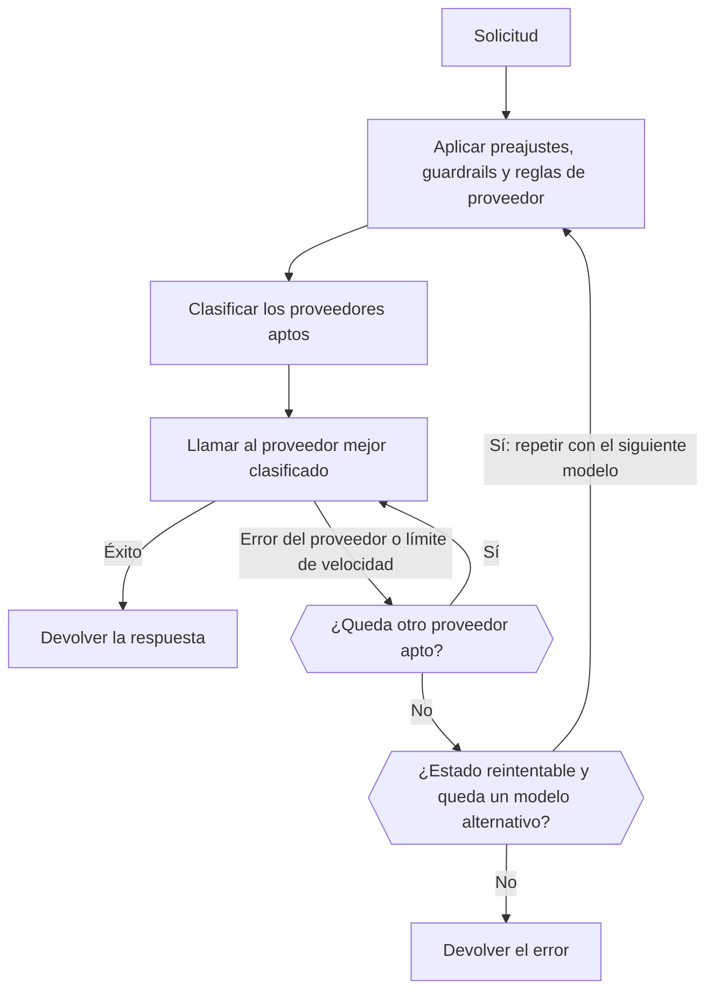

import { RoutingCostExplainer } from "/snippets/routing-cost.jsx";
import { FallbackChainExplorer } from "/snippets/fallback-chain.jsx";

La mayoría de los modelos los sirven varios proveedores. En cada solicitud, el Gateway conserva los proveedores que permiten tus reglas, los clasifica y llama al mejor. Si ese proveedor falla, prueba el siguiente; si todos los proveedores fallan con un error reintentable, puede pasar a un modelo alternativo.



Tu cliente debe seguir reintentando las respuestas `429` y `5xx` con backoff exponencial.

<span id="choose-how-providers-are-ranked"></span>
## Elige cómo se clasifican los proveedores

| Modo | Clasifica por | Úsalo cuando |
| --- | --- | --- |
| `balanced` (predeterminado) | Coste por respuesta correcta | Quieres la mejor combinación de precio, velocidad y fiabilidad. |
| `price` | Precio | El coste importa más que el tiempo de respuesta. |
| `latency` | Tiempo hasta el primer token | Las respuestas deben empezar rápido. |
| `throughput` | Velocidad de salida | Las salidas largas deben terminar rápido. |

Establece el valor predeterminado del espacio de trabajo en **Panel -> Ajustes -> Enrutamiento**, con `phaseo settings update --routing-mode <mode>` o con `routing_mode` en `PATCH /v1/settings`. Para una sola solicitud, envía `provider.sort` o `routing.mode`, o añade un sufijo al ID del modelo:

| Sufijo | Modo | Ejemplo |
| --- | --- | --- |
| `:nitro` | `throughput` | `openai/gpt-6-astra:nitro` |
| `:cheap` | `price` | `openai/gpt-6-astra:cheap` |
| `:fast` | `latency` | `openai/gpt-6-astra:fast` |

Un sufijo prevalece sobre `routing.mode`, `provider.sort` y los modos del preajuste y del espacio de trabajo. Las listas de permitidos, las regiones, los guardrails y los precios máximos se siguen aplicando.

La página de ajustes de Enrutamiento también tiene interruptores para los canales beta y alfa, de modo que los proveedores en vista previa solo reciben tráfico cuando lo activas.

## Cómo clasifica el modo balanced a los proveedores

En las solicitudes de texto (Chat Completions, Responses y Messages), `balanced` estima el **coste por respuesta correcta** de cada proveedor:

- **Tokens:** lo que cuesta una solicitud típica de este modelo en el proveedor, usando los tamaños medidos de prompt y salida del modelo y la tasa de aciertos de caché medida del proveedor.
- **Espera:** el tiempo hasta el primer token y hasta la respuesta completa, convertido a dólares al precio por segundo típico del modelo.
- **Fallos:** el total dividido por la tasa de éxito reciente del proveedor, más una penalización por errores del proveedor y otra menor por límites de velocidad.

Los proveedores cercanos al coste más bajo se reparten la mayor parte del tráfico. Todos los proveedores conservan una pequeña proporción, para que se detecte su recuperación. Elige un escenario para ver cómo funciona (los proveedores son ejemplos):

<RoutingCostExplainer locale="es" />

Los demás endpoints se puntúan por fiabilidad, latencia, latencia de cola, rendimiento, precio y ajuste de tokens. Si eres un proveedor, [Cómo ganan tráfico los proveedores](./how-providers-earn-traffic) explica cómo conseguir una proporción mayor.

<span id="request-level-model-fallbacks"></span>
## Modelos alternativos por solicitud

Enumera los modelos alternativos en `models`. Phaseo prueba primero `model` y después cada entrada en orden:

```json
{
  "model": "openai/gpt-6-astra",
  "models": ["anthropic/claude-sonnet-5.5", "google/gemini-4-argon"],
  "input": "Summarize this incident report."
}
```

Elige qué devuelve cada modelo para ver cuándo pasa Phaseo al siguiente:

<FallbackChainExplorer locale="es" />

**Qué pasa al siguiente modelo.** Un modelo solo se prueba después de que el anterior, con todos sus reintentos de proveedor, termine en `429`, `500`, `502`, `503` o `504`. Un `429` de un presupuesto de Phaseo o de la cuota de modelos gratuitos también pasa al siguiente, ya que otro modelo puede ajustarse al límite restante. Lo mismo ocurre con un modelo que ya no sirve ningún proveedor, por ejemplo uno [retirado](#retired-models).

**Qué no.** Los errores del cliente, como `400`, `401`, `402`, `403`, `404`, `408`, `413` y `422`, se devuelven de inmediato. Lo mismo ocurre con los fallos anteriores a la ejecución del primer modelo, como la autenticación o los límites de velocidad de la clave de API.

**Reglas de la lista:**

- `model` es obligatorio; enviar solo `models` devuelve `400`.
- `models` acepta de 1 a 25 entradas. Los duplicados y las copias de `model` se ignoran.
- Las entradas pueden ser ID de modelo, [ID calificados por proveedor](./provider-qualified-models) o preajustes como `@support`.
- Cada intento se valida como una solicitud independiente (endpoint, parámetros, modelos del espacio de trabajo, guardrails, preajustes, precios, BYOK). Una alternativa que no puede atender la solicitud se omite y se registra; nunca sustituye al error que recibirías en otro caso. Un intento idéntico a uno ya realizado también se omite.

**Registros y facturación.** Cada intento es una solicitud independiente con su propio registro de uso, facturada como si las alternativas no existieran. El campo `model` de la respuesta nombra el modelo que respondió, y su traza de enrutamiento enumera el ID de la solicitud principal, el orden de las alternativas y cada intento anterior.

**Streaming, vídeo y música.** Un stream solo recurre a una alternativa antes de su primer byte; después, los errores llegan dentro del stream. El vídeo y la música solo recurren a una alternativa mientras se envía el trabajo.

**Con otros controles de enrutamiento.** Las alternativas de una ruta dinámica vinculada tienen prioridad sobre `models`, y un modelo fijo elegido por la ruta se sigue aplicando a cada intento. Un preajuste aplica sus propias restricciones a cada intento en el que se usa. [`phaseo/auto`](./auto-routing) gestiona sus propias alternativas y no se puede combinar con `models`.

| Endpoint | `models` |
| --- | --- |
| Chat Completions, Responses, Messages | Se admite, incluidos los streams antes del primer byte |
| Embeddings, Moderations, Rerank | Se admite |
| Generación y edición de imágenes | Se admite, incluidas las subidas multipart |
| Voz, transcripción y traducción | Se admite, incluidas las subidas multipart |
| OCR, Parse, Decisions | Se admite |
| Generación de vídeo y música | Se admite al enviar el trabajo |
| Batches | `400`: cada fila del lote apunta a un modelo |
| Sesiones en tiempo real y live | `400`: una sesión se vincula a un modelo |
| Ejecuciones de Council | `400`: los modelos vienen de la configuración de la ejecución |

Los endpoints multipart aceptan campos `models` repetidos, campos `models[]` o una cadena con un array JSON. Consulta también [Límites de velocidad](../api-reference/limits.mdx) y [Errores](../api-reference/errors.mdx).

<span id="pin-one-provider"></span>
## Fija un solo proveedor

Pon el proveedor delante del ID del modelo para usar exactamente ese proveedor:

```json
{
  "model": "baseten:thinking-machines/inkling-small",
  "input": "Hello"
}
```

Esto desactiva la alternativa entre proveedores para la solicitud. Los sufijos siguen formando parte del ID del modelo, como en `baseten:google/gemma-4-26b-a4b:free`. [ID de modelo calificados por proveedor](./provider-qualified-models) explica la sintaxis completa y los errores.

## Limita qué proveedores se usan

| Control | Dónde | Qué hace |
| --- | --- | --- |
| [Preajustes](./presets) | **Ajustes -> Presets** | Modelos permitidos y listas de proveedores permitidos o ignorados, que se aplican antes de clasificar, así que también limitan las alternativas. |
| [Enrutamiento regional](./regional-routing) | Solicitud o espacio de trabajo | Mantiene la ejecución o los datos en una región. |
| Rutas dinámicas | **Ajustes -> Enrutamiento** | Reglas por clave: consulta más abajo. |
| Alternativa de BYOK | **Ajustes -> Trae tu propia clave** | Si una solicitud BYOK fallida puede reintentarse con créditos de Phaseo. |

<span id="attach-routing-rules-to-api-keys"></span>
### Vincula reglas de enrutamiento a claves de API

Una ruta dinámica es un flujo de reglas vinculado a una o varias claves de API de inferencia. Puede:

- ramificar según campos del cuerpo de la solicitud, encabezados, `metadata` personalizados, el endpoint, el modelo o el ID de sesión
- repartir el tráfico por porcentaje para pruebas A/B y despliegues
- limitar las solicitudes o el coste diarios, semanales o mensuales por clave
- cambiar el modelo, el modo de enrutamiento, la preferencia de proveedor y los modelos alternativos (hasta ocho)
- activar la afinidad de proveedor basada en la caché y en la sesión

Las condiciones tienen salidas verdadera y falsa; los nodos de velocidad y presupuesto tienen salidas de dentro del límite y de límite superado. Los repartos por porcentaje son deterministas por sesión o por clave de caché de prompt, así que una conversación en caché no cambia de rama.

Al guardar se crea una versión de borrador inmutable. Al desplegar se copia esa versión al Gateway y se vacían las cachés de políticas de sus claves; las versiones anteriores siguen disponibles para revertir. Las recomendaciones sobre la salud de los proveedores aparecen en **Insights**. Desde la CLI: `phaseo routing dynamic-routes create`, `set-keys` y `deploy`, o la API `/v1/routing/dynamic-routes`.

Los metadatos personalizados van en el cuerpo de la solicitud en los endpoints de texto compatibles con OpenAI:

```json
{
  "model": "openai/gpt-6-astra",
  "metadata": { "customer_plan": "pro", "workspace": "acme" }
}
```

## Mantén una conversación en un solo proveedor

El enrutamiento basado en la caché está activado de forma predeterminada para la generación de texto. Una solicitud que envía `prompt_cache_key` o `session_id`, o que activa la caché con `cache_control` (de nivel superior, en `provider_options.anthropic`, o como una marca `cache_control` o `prompt_cache_breakpoint` en un bloque de mensaje o una herramienta), queda fijada al proveedor y la ruta que atendieron su primera solicitud correcta. Las demás solicitudes quedan fijadas durante 15 minutos cuando un proveedor indica una lectura o escritura de caché para el mismo contexto inicial, si la entrada en caché de ese proveedor es más barata que su entrada estándar.

| | |
| --- | --- |
| Duración de la fijación | De 15 minutos a 24 horas, según la retención de caché del proveedor. Con `session_id`, hasta 24 horas de actividad de la sesión. |
| Ámbito | Por espacio de trabajo. Con `session_id`, vinculada a la sesión en lugar de al contexto inicial. |
| Una fijación se mueve cuando | Se abre el circuit breaker del proveedor, su tasa de errores es alta, se agota la cuota gestionada de Phaseo en él o tus reglas ya no lo permiten. |

Desactívalo para una solicitud con `provider.cache_aware_routing: false`, o mantén la afinidad de caché pero ignora la sesión con `routing.session_affinity: false`:

```json
{
  "model": "openai/gpt-6-astra",
  "session_id": "support-session-42",
  "routing": { "session_affinity": false }
}
```

[Afinidad de proveedor](./prompt-caching.mdx#provider-affinity) enumera las indicaciones que Phaseo envía a cada proveedor.

<span id="explain-a-routing-decision"></span>
## Explica una decisión de enrutamiento

Abre **Panel -> Ajustes -> Uso -> Registros de solicitudes**, selecciona una solicitud y despliega **Observabilidad de enrutamiento** en **Respuestas del proveedor**. Muestra:

- cada proveedor clasificado con su puntuación final, y cuáles se seleccionaron y se intentaron
- los proveedores excluidos antes de la clasificación, con el motivo
- los proveedores rebajados en la clasificación por su estado de despliegue o de enrutamiento
- las entradas, ponderaciones, contribuciones y multiplicadores de cada puntuación

Los factores de puntuación cambian la puntuación; el contexto registrado explica la decisión sin afectarla necesariamente. Las trazas solo contienen números y estados, nunca prompts ni salidas. Las solicitudes hechas antes de que se habilitara la observabilidad de enrutamiento pueden mostrar una traza parcial o ninguna.

### Qué cuenta en contra de la disponibilidad de un proveedor

| Reduce la disponibilidad | No la reduce |
| --- | --- |
| Fallos de autenticación `401` | Solicitudes incorrectas `400` |
| Fallos de pago `402` | Restricciones geográficas `403` |
| Modelo no encontrado `404` | Cargas útiles demasiado grandes `413` |
| `500` y superiores | Límites de velocidad `429` |
| Errores después de que empiece un stream | |
| Un `200` que termina con un motivo de error | |

Las restricciones geográficas y los límites de velocidad se registran por separado, porque no significan que el proveedor esté caído. En producción, registra los ID de solicitud, los códigos de estado y los ID de modelo para poder relacionar los fallos con estas trazas.

<span id="retired-models"></span>
## Modelos retirados

Un modelo retirado sigue funcionando mientras algún proveedor lo sirva. Después, las solicitudes fallan con `410 model_retired`, salvo que el espacio de trabajo las envíe a un sustituto con el enrutamiento de modelos retirados. Tu propia lista `models` siempre se prueba primero. Consulta [Obsolescencia y retirada de modelos](./model-retirement.mdx).

<span id="byok-considerations"></span>
## Consideraciones sobre BYOK

Con <Tooltip tip="Trae tu propia clave: Phaseo enruta la solicitud con tu propia clave de API del proveedor, y tu proveedor factura directamente el uso del modelo.">BYOK</Tooltip>, Phaseo enruta y registra la solicitud mientras tu proveedor factura el uso del modelo.

| | |
| --- | --- |
| Tarifa de servicio | Ninguna durante las primeras 250.000 solicitudes BYOK completadas de cada mes UTC; después, el 2.5% del coste equivalente del proveedor. |
| Crédito de Phaseo | Mantén al menos $1 disponible, para la alternativa gestionada y las tarifas tras la franquicia. |
| Reglas del proveedor | Se siguen aplicando las cuotas, la política de datos, el acceso a modelos y los límites de cuenta de tu proveedor. |
| Almacenamiento | Las claves se cifran con AES-256-GCM, vinculadas a su espacio de trabajo y su proveedor. |

Limita cada clave a los modelos y claves de API que la necesiten. Para evitar que una solicitud BYOK fallida se reintente con créditos de Phaseo, desactiva la alternativa en **Panel -> Ajustes -> Trae tu propia clave**, o establece `byok_fallback_enabled` en `PATCH /v1/settings` (`phaseo settings update --body-json '{"byok_fallback_enabled":false}'`). Añade claves con `phaseo byok create --provider <id> --name <name> --key-stdin`.
