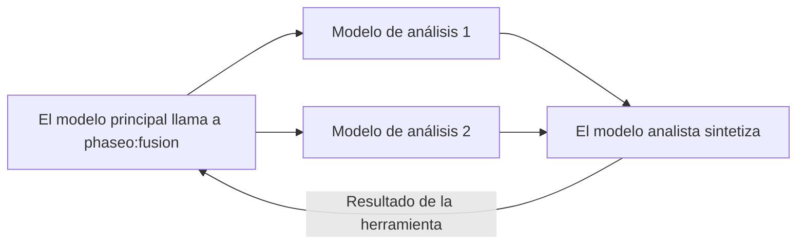

Añade `phaseo:fusion` cuando una respuesta se beneficie de varias opiniones independientes, como una decisión de planificación, una síntesis de investigación o una revisión de diseño. Cuando el modelo principal la llama, Phaseo envía la pregunta a todos los modelos de análisis en paralelo, pide a un modelo analista que combine sus conclusiones y devuelve esa síntesis. Añade latencia, así que usa un solo [Advisor](./advisor) cuando baste con una revisión.



```json
{
  "tools": [
    {
      "type": "phaseo:fusion",
      "parameters": {
        "analysis_models": ["anthropic/claude-opus-5", "openai/gpt-5"],
        "model": "google/gemini-pro-latest",
        "instructions": "Reconcile disagreements and return concise synthesis guidance.",
        "max_uses": 1,
        "max_completion_tokens": 1400
      }
    }
  ]
}
```

En el Playground, el menú de herramientas de servidor configura lo mismo: los modelos de análisis, un modelo juez (analista) opcional y un límite de llamadas.

## Parámetros

| Parámetro | Tipo | Predeterminado | Descripción |
| --- | --- | --- | --- |
| `analysis_models` | string[] | Obligatorio | Al menos 2 modelos. Con menos, la solicitud se rechaza. |
| `model` | string | El modelo de la solicitud | El modelo analista que escribe la síntesis. |
| `instructions` | string | Ninguno | Instrucciones para las llamadas de análisis y para la del analista. |
| `max_uses` | integer | `1` | Llamadas a Fusion por solicitud, hasta `4`. |
| `max_completion_tokens` | integer | `1400` | Tokens de salida de cada análisis y de la síntesis, hasta `32000`. |

## Qué envía el modelo

Un `prompt`: la pregunta que necesita varias perspectivas.

## Qué devuelve la herramienta

```json
{
  "status": "ok",
  "analyses": 2,
  "analysis": "Both reviewers flag the cutover order..."
}
```

`analyses` cuenta los modelos de análisis que respondieron. Si alguno falla, la síntesis usa los demás. Los resultados de error son `fusion_invalid_request` (sin prompt), `fusion_max_uses_exceeded`, `fusion_panel_failed` (fallaron todos los modelos de análisis) y `fusion_request_failed` (falló el analista).

## Uso y precios

Cada llamada suma 1 a `usage.server_tool_use.fusion_requests` y se puede facturar con `server_tool_fusion_requests`. Los tokens de cada llamada de análisis y del analista se suman al uso de la solicitud y se cobran a las tarifas de ese modelo.
