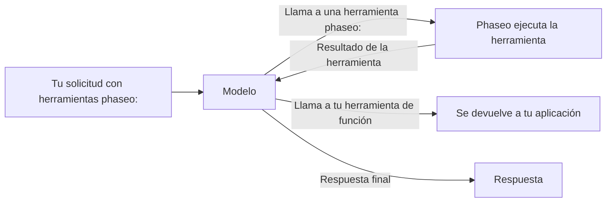

Añade una herramienta `phaseo:` a `tools` y Phaseo la ejecutará por ti cuando el modelo la llame: el modelo pide la hora actual, una búsqueda web o la opinión de un segundo modelo, Phaseo ejecuta la llamada, le devuelve el resultado y el modelo termina su respuesta. No tienes que escribir un ejecutor de herramientas.



<Note>
Las herramientas de servidor están en beta. La forma de las solicitudes y el contenido de los resultados pueden cambiar a medida que cambie la compatibilidad de los proveedores.
</Note>

## Herramientas disponibles

| Herramienta | Tipo | Úsala para | Endpoints |
| --- | --- | --- | --- |
| [Datetime](./datetime) | `phaseo:datetime` | Fecha y hora actuales en hasta 5 zonas horarias | Los tres |
| [Web Search](./web-search) | `phaseo:web_search` | Buscar en la web información actual o con fuentes | Los tres |
| [Web Fetch](./web-fetch) | `phaseo:web_fetch` | Leer el texto de una URL concreta | Los tres |
| [Advisor](./advisor) | `phaseo:advisor` | Pedir a otro modelo una revisión o un plan | Los tres |
| [Subagent](./subagent) | `phaseo:subagent` | Pasar una tarea autónoma a un modelo trabajador | Los tres |
| [Fusion](./fusion) | `phaseo:fusion` | Obtener el análisis de varios modelos y después una síntesis | Los tres |
| [Search Models](./search-models) | `phaseo:search_models` | Buscar un modelo en el catálogo actual de Phaseo | Los tres |
| [Generación de imágenes](./image-generation) | `phaseo:image_generation` | Crear una imagen mientras se responde | Los tres |
| [Aplicar parche](./apply-patch) | `phaseo:apply_patch` | Devolver parches de archivos validados | Solo `/v1/responses` |

"Los tres" significa `/v1/chat/completions`, `/v1/responses` y `/v1/messages`.

## Envía una solicitud

```bash
curl https://api.phaseo.app/v1/chat/completions \
  -H "Authorization: Bearer $PHASEO_API_KEY" \
  -H "Content-Type: application/json" \
  -d '{
    "model": "openai/gpt-6-astra",
    "messages": [
      { "role": "user", "content": "What are the latest AI policy updates this week?" }
    ],
    "tools": [
      { "type": "phaseo:web_search" },
      { "type": "phaseo:datetime", "parameters": { "timezones": ["Europe/London", "UTC"] } }
    ]
  }'
```

Cada herramienta acepta un objeto `parameters` opcional, que se describe en su página. `stream: true` también funciona: Phaseo ejecuta por su cuenta los turnos de las herramientas y te transmite la respuesta final en streaming.

## Combina herramientas de servidor con tus propias funciones

Phaseo solo ejecuta las herramientas `phaseo:`. Una herramienta `function` normal en la misma solicitud se devuelve a tu aplicación como siempre, y tú envías su resultado en una solicitud posterior, como en [Llamadas a herramientas](../tool-calling).

```json
{
  "model": "openai/gpt-6-astra",
  "messages": [
    { "role": "user", "content": "Find recent funding news and save the best item." }
  ],
  "tools": [
    { "type": "phaseo:web_search", "parameters": { "max_results": 3 } },
    {
      "type": "function",
      "function": {
        "name": "save_research_item",
        "description": "Save a selected research item",
        "parameters": {
          "type": "object",
          "properties": {
            "title": { "type": "string" },
            "url": { "type": "string" }
          },
          "required": ["title", "url"]
        }
      }
    }
  ]
}
```

## Límites del ciclo de herramientas

| Límite | Valor | Qué ocurre al alcanzarlo |
| --- | --- | --- |
| Llamadas a herramientas de servidor por solicitud | `max_tool_calls` en la solicitud; `30` por defecto, `100` como máximo | `400 gateway_server_tool_limit` |
| Turnos de seguimiento | `8` | `502 gateway_server_tool_error` |
| Llamadas a una misma herramienta | El `max_uses` de esa herramienta | La herramienta devuelve al modelo un resultado de error, y el modelo puede continuar sin ella |

## Uso y precios

Cada herramienta de servidor añade un contador a `usage.server_tool_use`, y la tarjeta de precios de un modelo puede facturar el medidor correspondiente. Los tokens que usa un segundo modelo (Advisor, Subagent, Fusion, Generación de imágenes) se suman al uso de la solicitud y se cobran a las tarifas de ese modelo.

```json
{
  "usage": {
    "input_tokens": 105,
    "output_tokens": 250,
    "server_tool_use": {
      "datetime_requests": 1,
      "web_search_requests": 2,
      "web_search_results": 8
    }
  }
}
```

| Herramienta | Contador de uso | Medidor de precio |
| --- | --- | --- |
| Datetime | `datetime_requests` | Ninguno |
| Web Search | `web_search_requests`, `web_search_results`, `web_search_extra_results` | `server_tool_web_search_requests`, `server_tool_web_search_extra_results` |
| Web Fetch | `web_fetch_requests` | `server_tool_web_fetch_requests` |
| Advisor | `advisor_requests` | `server_tool_advisor_requests` |
| Subagent | `subagent_requests` | `server_tool_subagent_requests` |
| Fusion | `fusion_requests` | `server_tool_fusion_requests` |
| Search Models | `search_models_requests` | `server_tool_search_models_requests` |
| Generación de imágenes | `image_generation_requests` | `server_tool_image_generation_requests` |
| Aplicar parche | `apply_patch_requests` | `server_tool_apply_patch_requests` |

Cuando Web Search o Web Fetch se ejecutan como herramienta propia del proveedor (`engine: "native"`), se facturan con `native_web_search_requests` o `native_web_fetch_requests`.
