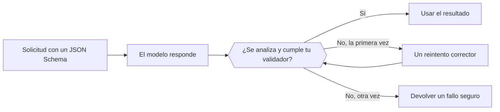

Envía un JSON Schema con la solicitud y el modelo devuelve JSON con esa forma en lugar de texto libre. Tu código sigue teniendo que analizarlo y validarlo antes de usarlo.



## Elegir un formato

| `type` | Qué obtienes |
| --- | --- |
| `json_schema` | JSON que sigue el esquema que envías. Úsalo de forma predeterminada. |
| `json_object` | Algún objeto JSON válido, sin una forma impuesta. |
| `text` | Texto sin formato (el valor predeterminado). |

Dónde va el formato depende del endpoint:

| Endpoint | Campo |
| --- | --- |
| `/v1/chat/completions` | `response_format` |
| `/v1/responses` | `text.format` |
| `/v1/messages` | No es compatible. Pide JSON en el prompt y valídalo de la misma forma. |

## Enviar un esquema

<CodeGroup>
```bash Chat Completions
curl https://api.phaseo.app/v1/chat/completions \
  -H "Authorization: Bearer $PHASEO_API_KEY" \
  -H "Content-Type: application/json" \
  -d '{
    "model": "openai/gpt-6-astra",
    "messages": [
      { "role": "user", "content": "Return the city and weather for London." }
    ],
    "response_format": {
      "type": "json_schema",
      "json_schema": {
        "name": "weather",
        "strict": true,
        "schema": {
          "type": "object",
          "properties": {
            "city": { "type": "string" },
            "weather": { "type": "string" }
          },
          "required": ["city", "weather"],
          "additionalProperties": false
        }
      }
    }
  }'
```

```bash Responses
curl https://api.phaseo.app/v1/responses \
  -H "Authorization: Bearer $PHASEO_API_KEY" \
  -H "Content-Type: application/json" \
  -d '{
    "model": "openai/gpt-6-astra",
    "input": "Return the city and weather for London.",
    "text": {
      "format": {
        "type": "json_schema",
        "name": "weather",
        "strict": true,
        "schema": {
          "type": "object",
          "properties": {
            "city": { "type": "string" },
            "weather": { "type": "string" }
          },
          "required": ["city", "weather"],
          "additionalProperties": false
        }
      }
    }
  }'
```
</CodeGroup>

El JSON vuelve como una cadena en el contenido del mensaje:

```json
{
  "choices": [
    {
      "finish_reason": "stop",
      "message": {
        "role": "assistant",
        "content": "{\"city\":\"London\",\"weather\":\"Cloudy\"}"
      }
    }
  ]
}
```

## Diseñar el esquema

Empieza con un objeto pequeño. Incluye todos los campos en `required`, usa `enum` para las categorías conocidas y define `additionalProperties: false` cuando haya que rechazar claves adicionales. Versiona el esquema junto con tu validador del servidor para que nunca se desincronicen.

<span id="validate-the-result"></span>
## Validar el resultado

Antes de analizarla, comprueba si la respuesta es un rechazo, si falta contenido o si está truncada (`finish_reason` distinto de `stop`). Después valida el objeto analizado. Este validador de Zod corresponde al esquema anterior:

```typescript
import { z } from "zod";

const Weather = z.object({
  city: z.string(),
  weather: z.string(),
}).strict();

function parseWeather(content: string) {
  return Weather.parse(JSON.parse(content));
}
```

Si la validación falla, reintenta una vez con el error en el prompt y después devuelve un fallo seguro. Cada reintento se cobra. Un JSON válido sigue sin demostrar que los valores sean correctos ni que una acción esté autorizada.

Haz un seguimiento de los fallos de validación por modelo y versión del esquema, y vuelve a ejecutar tus casos de evaluación cuando cambie cualquiera de los dos. Para reparar automáticamente un JSON mal formado, consulta la [reparación de respuestas](../cookbook/response-healing-for-structured-json.mdx).
