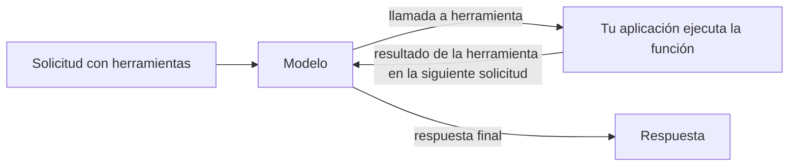

Describe tus funciones en `tools` y el modelo responderá con una llamada a una de ellas, como una consulta a una base de datos o una comprobación del tiempo, en lugar de adivinar. Tu aplicación ejecuta la función y devuelve el resultado; después el modelo escribe la respuesta final.



Las llamadas a herramientas funcionan en los tres endpoints de texto, cada uno con su propio formato:

| Endpoint | Llamada del modelo | Tu resultado |
| --- | --- | --- |
| `/v1/chat/completions` | `tool_calls` en el mensaje del asistente, `finish_reason: "tool_calls"` | Un mensaje `role: "tool"` |
| `/v1/responses` | Un elemento de salida `function_call` | Un elemento de entrada `function_call_output` |
| `/v1/messages` | Un bloque de contenido `tool_use` | Un bloque de contenido `tool_result` |

## Enviar una solicitud con herramientas

```bash
curl https://api.phaseo.app/v1/chat/completions \
  -H "Authorization: Bearer $PHASEO_API_KEY" \
  -H "Content-Type: application/json" \
  -d '{
    "model": "openai/gpt-6-astra",
    "messages": [
      { "role": "user", "content": "What is the weather in London?" }
    ],
    "tools": [
      {
        "type": "function",
        "function": {
          "name": "get_weather",
          "description": "Get current weather by city",
          "parameters": {
            "type": "object",
            "properties": {
              "city": { "type": "string" }
            },
            "required": ["city"]
          }
        }
      }
    ],
    "tool_choice": {
      "type": "function",
      "function": { "name": "get_weather" }
    }
  }'
```

Aquí `tool_choice` fuerza la llamada. Omítelo, o defínelo como `"auto"`, para que decida el modelo.

El modelo responde con una llamada en lugar de texto:

```json
{
  "id": "chatcmpl_...",
  "object": "chat.completion",
  "choices": [
    {
      "index": 0,
      "finish_reason": "tool_calls",
      "message": {
        "role": "assistant",
        "content": null,
        "tool_calls": [
          {
            "id": "call_123",
            "type": "function",
            "function": {
              "name": "get_weather",
              "arguments": "{\"city\":\"London\"}"
            }
          }
        ]
      }
    }
  ]
}
```

Analiza y comprueba `arguments` antes de ejecutar nada; consulta [Seguridad y validación de llamadas a herramientas](./tool-calling-safety). Después envía el mensaje del asistente y tu resultado en la siguiente solicitud. [Patrones de llamadas a herramientas](./tool-calling-patterns) muestra esa solicitud de seguimiento para Chat Completions y Responses.

## Dejar que Phaseo ejecute la herramienta

Las herramientas cuyo tipo empieza por `phaseo:` se ejecutan en Phaseo: el modelo las llama, Phaseo las ejecuta y continúa el ciclo, y tú recibes la respuesta final sin escribir un ejecutor. Puedes combinarlas con tus propias funciones en una misma solicitud.

| Herramienta | Tipo |
| --- | --- |
| [Fecha y hora](./server-tools/datetime) | `phaseo:datetime` |
| [Búsqueda web](./server-tools/web-search) | `phaseo:web_search` |
| [Web Fetch](./server-tools/web-fetch) | `phaseo:web_fetch` |
| [Asesor](./server-tools/advisor) | `phaseo:advisor` |
| [Subagente](./server-tools/subagent) | `phaseo:subagent` |
| [Fusion](./server-tools/fusion) | `phaseo:fusion` |
| [Buscar modelos](./server-tools/search-models) | `phaseo:search_models` |
| [Generación de imágenes](./server-tools/image-generation) | `phaseo:image_generation` |
| [Aplicar parche](./server-tools/apply-patch) | `phaseo:apply_patch` (solo Responses) |

```json
{
  "tools": [
    { "type": "phaseo:datetime", "parameters": { "timezones": ["Europe/London", "UTC"] } }
  ],
  "tool_choice": "auto"
}
```

Consulta [Herramientas del servidor](./server-tools) para ver los límites, los contadores de uso y los precios.

## Transmitir llamadas a herramientas

Las solicitudes con llamadas a herramientas aceptan `stream: true`. Los argumentos de las llamadas a funciones llegan por partes; acumúlalos todos antes de analizar la llamada. Cuando se ejecuta una herramienta del servidor, Phaseo termina ese turno de herramienta, ejecuta la herramienta, continúa con el modelo y te transmite el resto de la respuesta, así que tu cliente sigue leyendo un único stream. Consulta [Transmisión](./streaming).

Para respuestas que deben ajustarse a un esquema en lugar de llamar a una función, usa [Salidas estructuradas](./structured-outputs).
