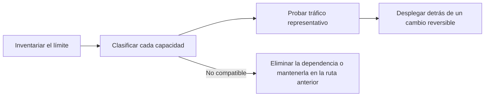

Busca cada capacidad que use tu integración actual con el gateway y haz lo que indica la última columna antes de mover tráfico. Última revisión: 4 de noviembre de 2026.

Sigue la migración en este orden. Así encuentras los comportamientos que pueden cambiar aunque ambas plataformas acepten la misma solicitud compatible con OpenAI.

## Inventaria el límite de la integración

Anota cada lugar donde aparece el gateway actual, para que la migración no deje una segunda ruta de configuración oculta:

- URL base y variables de entorno de claves de API;
- inicialización del SDK y encabezados personalizados;
- ID de modelos y modelos de respaldo;
- orden de proveedores, listas de permitidos y requisitos de privacidad;
- código de streaming, llamadas a herramientas y salidas estructuradas;
- trabajos por lotes, archivos, webhooks y consulta periódica del estado asíncrono;
- atribución de solicitudes y metadatos de usuario o sesión.

## Solicitudes

| Capacidad | En Phaseo | Antes del cambio |
| --- | --- | --- |
| Autenticación | `Authorization: Bearer $PHASEO_API_KEY` | Cambia la URL base y la clave y ejecuta una solicitud autenticada. |
| Chat Completions | `/v1/chat/completions` | Prueba solicitudes normales, con streaming, con llamadas a herramientas y con salida estructurada. Los campos de nivel superior desconocidos devuelven `400`. |
| Responses | `/v1/responses`, sin estado almacenado | Prueba los formatos de entrada, los eventos de streaming, las herramientas y el análisis. `previous_response_id` y `conversation` devuelven `400`; envía el historial completo. |
| Anthropic Messages | `/v1/messages` en el host raíz `https://api.phaseo.app` | Pasa la clave como token bearer y revisa cada encabezado `anthropic-beta`; Phaseo no los reenvía. |
| ID de modelos | `<org>/<model>` | Comprueba cada ID de producción en `GET /v1/models?format=openai`. No des por hecho que los alias coinciden. |
| Embeddings, imágenes, audio, moderaciones | Compatibles según el modelo y el proveedor | Confirma que el modelo admite la operación. |

## Enrutamiento y políticas

| Capacidad | En Phaseo | Antes del cambio |
| --- | --- | --- |
| Modelos de respaldo | Matriz `models`, de 1 a 25 entradas | Los respaldos se activan con `429`, `500`, `502`, `503` y `504`, nunca con errores de la solicitud. |
| Orden de proveedores | `provider.order` | Recrea solo el orden que la carga de trabajo todavía necesita. |
| Listas de proveedores permitidos e ignorados | `provider.only`, `provider.ignore` | Comprueba los ID de proveedor y que quede al menos una ruta. |
| Ordenación por precio, latencia o rendimiento | `provider.sort` | Después de probar, comprueba el proveedor seleccionado en los detalles de la solicitud. |
| Retención de datos cero | `provider.require_zero_data_retention` (alias `provider.zdr`) | Confirma que el modelo tiene un proveedor que cumple antes de exigirlo. |
| Ejecución regional y residencia de datos | `provider.required_execution_region`, `provider.required_data_region`, valores predeterminados de privacidad del espacio de trabajo | Prueba tanto una ruta correcta como el error de ningún proveedor coincidente. |
| Prompts y valores predeterminados compartidos | [Presets](../guides/presets) | Mueve la configuración compartida a un preset en lugar de copiarla en cada llamador. |

## Operaciones

| Capacidad | En Phaseo | Antes del cambio |
| --- | --- | --- |
| Atribución de aplicaciones | `X-App-Id`, `X-App-Name`, `HTTP-Referer`, `X-Title`, `X-App-Categories` | Conserva los encabezados que describen la aplicación que llama; quitarlos durante la migración dificulta comparar costes y uso. Comprueba la agrupación de aplicaciones en el panel. Consulta [Atribución de aplicaciones](../guides/app-attribution) para ver los valores de categoría. |
| Etiquetas de coste | Etiquetas `X-Phaseo-Metadata` | Asigna las propiedades o etiquetas personalizadas a etiquetas. |
| Detalles de la solicitud | Registros de solicitudes y `GET /v1/generations?id=<request_id>` | Compara proveedor, latencia, uso de tokens y precio con prompts representativos. |
| Repetición | `replay_request` cuando `replay_supported` es `true` | Confirma que se pueden recuperar el endpoint y la carga útil de una solicitud fallida. |
| Trabajos por lotes y asíncronos | API de lotes, archivos, vídeo, webhooks y WebSocket | Comprueba las transiciones de estado, la facturación final, la cancelación y la recuperación de resultados. `/v1/files` solo guarda entradas de lotes. |
| Límites de velocidad | Asignación de solicitudes por minuto por usuario, desde 10 para un espacio de trabajo nuevo | Un proxy que envía el tráfico de un equipo a través del propietario de una sola clave puede alcanzarla. Consulta [Límites](../api-reference/limits). |
| Despliegue gradual | División del tráfico en el cliente o en la infraestructura | Mantén la reversión como un cambio de URL base y clave hasta que el cambio sea estable. |

## No disponible

Esto no tiene equivalente en Phaseo. Mantenlo en la aplicación o en la plataforma anterior:

- **Caché de respuestas.** Phaseo no almacena respuestas en caché. El [almacenamiento en caché de prompts](../guides/prompt-caching) sigue reduciendo el coste de entrada.
- **Respuestas y conversaciones almacenadas.** No existe `GET` ni `DELETE /v1/responses/{id}`.
- **Recuento de tokens** (`/v1/messages/count_tokens`).
- **OpenAI Assistants, Threads, almacenes vectoriales, ajuste fino y el antiguo `/v1/completions`.**

## Clasifica cada capacidad

Asigna un estado a cada comportamiento de producción usando las tablas anteriores y la guía de tu [plataforma de origen](./index#platform-migrations):

| Estado | Significado |
| --- | --- |
| Sin cambios | Se han verificado el mismo campo de solicitud y el mismo comportamiento de respuesta. |
| Asignado | Phaseo da el mismo resultado mediante un campo o ajuste distinto. |
| Adaptado | Una capa de compatibilidad traduce la solicitud o la respuesta. |
| No compatible | Elimina la dependencia o mantén esa carga de trabajo en su ruta actual. |
| No verificado | Puede haber compatibilidad, pero aún no hay pruebas en condiciones similares a producción. |

## Valida con tu propio tráfico

La compatibilidad de la API no hace que esto se comporte igual:

- selección automática de proveedor y orden de respaldo;
- afinidad de la caché de prompts y precios de caché;
- campos de solicitud específicos del proveedor y metadatos que solo aparecen en la respuesta;
- límites de velocidad y tiempos de reintento;
- políticas de retención de datos, residencia y entrenamiento;
- disponibilidad exacta de modelos y precio.

Crea un pequeño conjunto de pruebas a partir de patrones reales de tu carga de trabajo, sin copiar datos de producción sensibles, y ejecuta:

1. una solicitud normal para cada endpoint en uso;
2. streaming por la misma ruta de cliente que en producción;
3. llamadas a herramientas y salidas estructuradas con esquemas realistas;
4. cada restricción de proveedor o de privacidad;
5. fallos por claves no válidas, modelos no válidos, límites de velocidad y proveedores no disponibles;
6. trabajos por lotes o asíncronos que terminen bien, fallen y se cancelen.

Compara la calidad de la salida, la latencia, el uso de tokens, el proveedor seleccionado y el coste final. Anota el ID de cada solicitud para poder inspeccionarla en los registros de solicitudes o con `GET /v1/generations?id=<request_id>`.

## Despliega con un cambio reversible

Empieza con el tráfico de desarrollo e interno. Mueve una pequeña parte del tráfico de producción solo después de que pase el conjunto de pruebas, y limita la reversión a la URL base y la clave hasta que los resultados sean estables. No combines el cambio con cambios de prompts, modelos o enrutamiento; hazlos después de verificar el límite del gateway.
