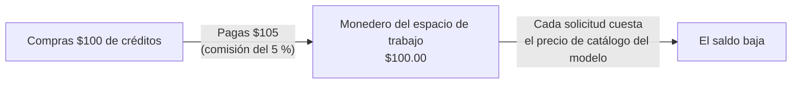

Compra créditos una vez y gástalos en solicitudes al precio de catálogo de cada modelo. La única comisión de Phaseo en las solicitudes gestionadas es el 5 % de cada compra de créditos, con un mínimo de $1; las solicitudes no llevan ningún recargo.

## Cuánto cuesta una recarga

La comisión es la mayor entre el 5 % de los créditos que compras y $1. Se suma al importe que pagas.

| Créditos que compras | Comisión | Pagas |
| ---: | ---: | ---: |
| $5.00 | $1.00 (mínimo) | $6.00 |
| $20.00 | $1.00 | $21.00 |
| $100.00 | $5.00 | $105.00 |
| $1,000.00 | $50.00 | $1,050.00 |

Visto al revés, un cargo de $100.00 añade $95.24 de créditos y una comisión de $4.76. Las recargas desde el panel empiezan en $5.

Compra créditos en **Configuración -> Facturación -> Facturación y créditos**, o desde una terminal con `phaseo credits add --amount <usd>` (consulta el [inicio rápido](../quickstart#add-credits-for-paid-models)). La misma página muestra tu saldo, la comisión actual y el gasto reciente; **Configuración -> Facturación -> Transacciones** enumera cada compra.

## Qué no usa créditos

| Uso | Cargo de Phaseo |
| --- | --- |
| Modelos gratuitos (`phaseo/free` y modelos con precio de $0) | Ninguno. Las solicitudes a modelos gratuitos tienen una asignación diaria; consulta [Planes](../exploring/subscription-plans). |
| Usa tu propia clave (BYOK) | Sin recarga. Las primeras 250.000 solicitudes BYOK completadas por espacio de trabajo en cada mes UTC no tienen comisión de servicio; después, el 2.5 % del coste equivalente del proveedor. Tu proveedor factura el uso del modelo. Consulta [Consideraciones sobre BYOK](../guides/routing-and-fallbacks#byok-considerations). |

## Enterprise

Self Serve Enterprise es una suscripción mensual aparte para SSO, SCIM, gestión de directorios, departamentos y soporte prioritario por correo electrónico. Empieza en $29/mes para hasta 100 miembros del espacio de trabajo y cuesta $79/mes con 1.000 miembros. No incluye créditos ni cambia la comisión del 5 % (mínimo de $1). En [Planes](../exploring/subscription-plans#enterprise-member-pricing) encontrarás todos los precios por miembro y cómo se cuentan los miembros.

Para facturación, compras o condiciones comerciales personalizadas, contacta con el [Centro de ayuda](https://phaseo.app/help). El uso estándar de Gateway no necesita Enterprise.
