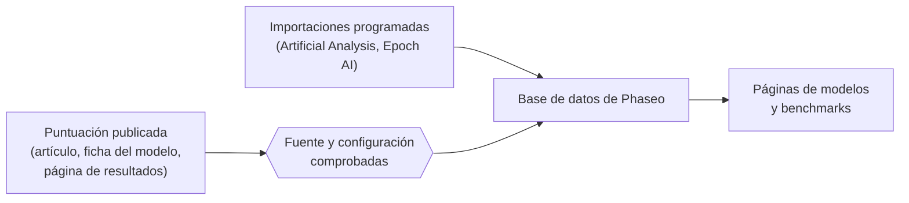

Phaseo publica puntuaciones de benchmarks medidas por otros, cada una con un enlace a su origen. No ejecuta benchmarks ni los combina en una única puntuación.

## De dónde vienen las puntuaciones

| Fuente | Cómo llega |
| --- | --- |
| Artículos, fichas de modelo y anuncios de los desarrolladores de modelos | La añaden los mantenedores, marcada como **autodeclarada** |
| Páginas de resultados de los organizadores de benchmarks | La añaden los mantenedores |
| Índices de Artificial Analysis y Epoch AI | Importaciones programadas, comprobadas cada hora |
| Informes de la comunidad | Incidencias de GitHub, publicadas después de que un mantenedor compruebe las pruebas |

Cada puntuación necesita una fuente pública o un registro de evaluación reproducible antes de publicarse.

## Qué significa normalizar

Phaseo mantiene cada benchmark en su propia escala. Normaliza el registro que rodea la puntuación, no la puntuación en sí:

1. Cada resultado se asigna a un único ID de benchmark, de modo que el mismo benchmark con nombres distintos se agrupa.
2. La configuración se conserva como variante cuando es distinta, por ejemplo el número de ejemplos few-shot, el sistema de evaluación o el esfuerzo de razonamiento, en lugar de combinarse con la predeterminada.
3. Cada benchmark tiene un sentido de ordenación. Los benchmarks en los que menos es mejor, como las tasas de error, ponen primero la puntuación más baja.
4. El enlace a la fuente y la marca de autodeclarada se mantienen junto a la puntuación.

La marca de autodeclarada es una aclaración, no un rechazo. Una puntuación sin contexto suficiente puede guardarse con notas sobre la fuente; no la interpretes como equivalente a una fila de una clasificación totalmente verificada.

## Informa de una discrepancia

1. Abre una incidencia con las pruebas descritas en [Enviar resultados de benchmarks](./submitting-scores.mdx).
2. Responde a las preguntas de revisión en la incidencia. Los mantenedores publican las correcciones verificadas mediante el editor de la base de datos.
3. Para propuestas de investigación más amplias, coordínate en [Discord](https://discord.gg/aQyywCvgZ5).

La página pública de [normalización de benchmarks](https://phaseo.app/how-phaseo-normalises-ai-benchmarks) explica las mismas reglas para los lectores del catálogo.
