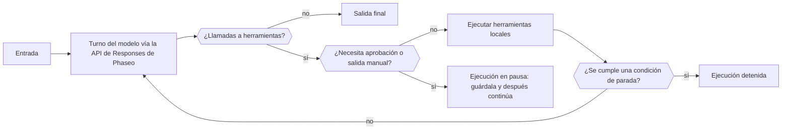

Usa un Agent SDK de Phaseo cuando una sola solicitud no basta: el SDK ejecuta en tu proceso un bucle acotado que envía cada turno a la API de Responses, ejecuta las herramientas que llama el modelo y se detiene para que intervenga una persona cuando una herramienta necesita aprobación. Tú guardas el estado de la ejecución; Phaseo no aloja nada del agente.

## Elige tu paquete

| Lenguaje | Paquete | Versión | Cliente principal que instala |
| --- | --- | --- | --- |
| TypeScript | [`@phaseo/agent-sdk`](https://www.npmjs.com/package/@phaseo/agent-sdk) | 0.3.0 | `@phaseo/sdk` |
| Python | [`phaseo-agent-sdk`](https://pypi.org/project/phaseo-agent-sdk/) (módulo `phaseo_agent`) | 0.3.0 | `phaseo` 3.x |
| Go | [`github.com/phaseoteam/Phaseo/packages/sdk/agent-sdk-go`](https://pkg.go.dev/github.com/phaseoteam/Phaseo/packages/sdk/agent-sdk-go) | v0.3.0 | `sdk-go/v3` |
| C# | [`Phaseo.AgentSdk`](https://www.nuget.org/packages/Phaseo.AgentSdk) | 0.3.0 | `Phaseo.Sdk` |
| PHP | [`phaseo/agent-sdk`](https://packagist.org/packages/phaseo/agent-sdk) | v0.3.0 | `phaseo/sdk` `^3.0.0` |
| Ruby | [`phaseo_agent_sdk`](https://rubygems.org/gems/phaseo_agent_sdk) | 0.3.0 | `phaseo_sdk` `>= 3.0.0, < 4.0.0` |
| Java | `app.phaseo:phaseo-agent-sdk` (Maven Central) | 0.3.0 | `app.phaseo:phaseo-sdk` 3.0.0 |
| Rust | [`phaseo-agent`](https://crates.io/crates/phaseo-agent) | 0.2.0 | `phaseo` 0.2 |

TypeScript es el diseño de referencia. C++ no tiene Agent SDK. En [Instalación](./installation) están los comandos de instalación y los requisitos de ejecución, y en [Uso](./usage) se crea un primer agente.

<Prompt description="Pide a un agente de programación que cree un primer agente con el Agent SDK de Phaseo en tu lenguaje." icon="bot" actions={["copy", "cursor"]}>
{`Build a small agent in this project with the Phaseo Agent SDK.

1. Install the Phaseo skills: npx skills add https://phaseo.app/docs
   For TypeScript, follow the phaseo-agent-sdk-typescript skill.
2. Read the Agent SDK pages at https://phaseo.app/docs/v1/sdk-reference/agent/overview, pick this project's language tab, and use only the APIs it documents.
3. Define one agent with at most two local tools that fit [AGENT TASK]. Keep the loop bounded with a step limit, and require approval for any tool that changes data.
4. Use a server-side PHASEO_API_KEY and check the model ID with GET /v1/models before using it.
5. Stream the agent's steps to the console so a run can be inspected.
6. Run the agent once, then report what you verified and what you could not verify.`}
</Prompt>

## Compara lo que admite cada runtime

Todos los SDK ejecutan herramientas locales, se detienen en IDs exactos de llamada a herramienta para pedir aprobación o salida manual y devuelven un estado de ejecución serializable que guarda tu aplicación. El resto varía según el lenguaje:

| Capacidad | TypeScript | Python | Go | C# | PHP | Ruby | Java | Rust |
| --- | --- | --- | --- | --- | --- | --- | --- | --- |
| Límite de pasos predeterminado | 12 | 12 | 8 | 12 | 12 | 12 | 12 | 8 |
| Al alcanzar el límite de pasos | Lanza `Max steps exceeded` | Lanza `RuntimeError` | Devuelve un error | Lanza `InvalidOperationException` | Lanza una excepción | Lanza una excepción | Lanza una excepción | Devuelve una ejecución `stopped` (`max_steps:N`) |
| Streaming del modelo | Iterable asíncrono | Iterador (hilo en segundo plano) | Canal | Enumerable asíncrono | Iterable; solo avanza mientras iteras (Fiber) | Enumerador (hilo de trabajo) | Listas tras la ejecución; en directo mediante `onEvent` | Todavía no |
| Eventos de progreso de herramientas | Generador asíncrono | `emit_progress` o generador | `EmitProgress` | `EmitProgress` | `emitProgress` | `emit_progress` | `emitProgress` | Todavía no |
| Herramientas concurrentes | Sí | Sí (hilos) | Sí | Sí | No | Sí (hilos) | Sí (pool de hilos) | No |
| Tiempo de espera de herramienta | Aborta `context.signal` | Hace fallar la ejecución; el hilo sigue en marcha | Hace fallar la llamada; la goroutine sigue en marcha | Cancela el `CancellationToken` | Se comprueba cuando la herramienta termina | Interrumpe la llamada | Interrumpe el hilo | Ninguno |
| Validación de esquemas en tiempo de ejecución | Sí | Sí | Sí | Sí | Sí | Sí | Sí | No; el JSON Schema solo se envía al modelo |
| Error de herramienta por defecto | Hace fallar la ejecución | Hace fallar la ejecución | Hace fallar la ejecución | Hace fallar la ejecución | Hace fallar la ejecución | Hace fallar la ejecución | Hace fallar la ejecución | Se devuelve al modelo |
| Aprobar y rechazar por ID de llamada | Sí | Sí | Sí | Sí | Sí | Sí | Sí | Solo aprobar |
| Herramientas interactivas (con intervención humana) | Sí | Sí | Sí | Sí | Sí | Sí | Sí | Solo `human_review` a nivel de agente |
| Condiciones de parada | Componibles | Componibles; solo se comprueban en pasos sin llamadas a herramientas | Componibles | Componibles | Componibles | Componibles | Componibles | Límite de pasos |
| Turnos dinámicos | Sí | Modelo, instrucciones y muestreo; herramientas mediante `next_turn_params` | Sí | Sí | Sí | Sí | Sí | Modelo, límite de pasos y contexto por ejecución |
| Elementos de la línea de tiempo tipados | Unión `AgentItem` | Dicts | Mapa `Details` | Diccionario `Details` | Arrays | Hashes | Mapa `details()` | No; lee `messages` y `steps` |
| Uso y coste | Sí | Sí | Sí | Sí | Sí | Sí | Sí | Tokens, más el coste cuando la respuesta tiene `meta.cost` o `cost` |
| Cancelación | `cancel()` | `cancel()` | Context | `CancellationToken` | `cancel()` | `cancel` | `cancel()` | Todavía no |
| Captura de Devtools | Sí | Sí | Sí | Sí | Sí | Sí | Sí | Todavía no |

Rust (`phaseo-agent` 0.2) es síncrono: no tiene streaming, ejecución asíncrona, herramientas concurrentes, validación de esquemas en tiempo de ejecución ni captura de Devtools. Ejecútalo en un hilo de trabajo cuando una ejecución no deba bloquear un manejador de solicitudes. PHP ejecuta las herramientas de una en una, y su stream solo avanza mientras tu código itera.

## Elige el Agent SDK, el cliente o la API directa

| Uso | Elige | De qué se encarga |
| --- | --- | --- |
| Una solicitud a la API o cobertura completa de endpoints | [Client SDK](../client/overview) | Tipos de la API generados y transporte |
| Lógica de aplicación de varios pasos que usa herramientas | Agent SDK | Bucle local, herramientas, puntos de control, revisión, eventos y Devtools |
| Transporte personalizado o un lenguaje sin SDK | API directa | Gestión de la solicitud y la respuesta HTTP |

El cliente de gateway de cada Agent SDK envía los turnos del modelo a través del client SDK de ese lenguaje. La mayoría acepta un mapa `requestOptions` (o el equivalente del lenguaje) para campos adicionales de la API de Responses; el agente sigue estableciendo `model`, `input`, `instructions` y sus herramientas de función. El adaptador de Rust 0.2 solo envía los campos normalizados del agente y no tiene ningún punto de extensión para opciones adicionales.

## Empieza con una receta

| Receta | Lenguaje |
| --- | --- |
| [Crea un bucle de agente duradero](../../cookbook/agent-sdk-durable-loop) | TypeScript |
| [Investiga con salida estructurada y búsqueda web](../../cookbook/agent-sdk-research-brief) | TypeScript |
| [Clasificación de soporte con presets y fallos que tienen en cuenta los guardrails](../../cookbook/agent-sdk-support-triage) | TypeScript |
| [Ejecuta un agente de revisión de código con herramientas en tiempo de ejecución](../../cookbook/agent-sdk-coding-review) | TypeScript |
| [Reparte herramientas locales del agente de forma concurrente](../../cookbook/agent-sdk-parallel-tools) | TypeScript |
| [Extrae JSON estructurado](../../cookbook/agent-sdk-python-structured-extraction) | Python |
| [Crea un agente de runbooks de operaciones](../../cookbook/agent-sdk-go-ops-runbook) | Go |
| [Clasifica tickets](../../cookbook/agent-sdk-csharp-ticket-triage) | C# |
| [Revisa contenido de un CMS](../../cookbook/agent-sdk-php-content-review) | PHP |
| [Resume notas internas](../../cookbook/agent-sdk-ruby-rag-notes) | Ruby |

Las recetas de TypeScript se pueden adaptar a cualquier lenguaje con las APIs de estas páginas.
