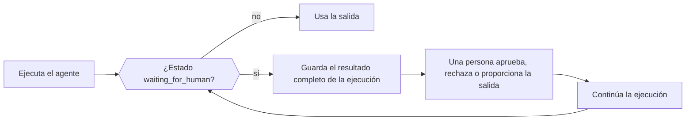

Cuando un agente necesita a una persona, un trabajo externo o una herramienta que ejecuta tu aplicación, la ejecución termina con normalidad (no como un error) con el estado `waiting_for_human` y todo lo necesario para continuar. Guarda el resultado completo, recoge la decisión en tu aplicación y después pasa el resultado guardado y la decisión al método de continuación del agente.



<Note>
Phaseo no guarda las ejecuciones del Agent SDK. Guarda el estado reanudable en tu propia aplicación cuando deba sobrevivir a una solicitud o a un reinicio del proceso.
</Note>

| Lenguaje | Continuar | Continuar con streaming | Notas |
| --- | --- | --- | --- |
| TypeScript | `agent.continueRun()` | `agent.continueStream()` | |
| Python | `agent.continue_run()` | `agent.continue_stream()` | |
| Go | `agent.Continue(ctx, ContinueOptions)` | `agent.ContinueStream` | |
| C# | `agent.ContinueRun(ContinueOptions)` | `agent.ContinueStream` | |
| PHP | `$agent->continueRun()` | `$agent->continueStream()` | `continueRunById()` carga primero la ejecución desde un accesor de estado |
| Ruby | `agent.continue_run` | `agent.continue_stream` | |
| Java | `agent.continueRun(ContinueOptions)` | `agent.continueStream` | `ContinueOptions` es un record posicional |
| Rust | `agent.continue_run(&mut client, options)` | Ninguno | `continue_with_events` añade un callback de eventos; las ejecuciones son síncronas |

## Aprueba o rechaza llamadas a herramientas

Las herramientas con aprobación, las manuales y las que requieren intervención humana ponen la ejecución en pausa antes de ejecutarse. Cada llamada pendiente tiene la `call` del modelo (con su `id`) y un `kind`: `approval`, `manual` o `hitl`. Responde a cada llamada por su ID exacto de llamada, no por el nombre de la herramienta, para que dos llamadas a la misma herramienta se mantengan separadas.

Una llamada aprobada ejecuta su herramienta. Una llamada rechazada envía `{"error": "<reason>"}` al modelo como resultado de la herramienta, con el motivo predeterminado `Tool call rejected`.

<CodeGroup>

```typescript TypeScript
const resumed = await agent.continueRun({
  run: paused,
  client,
  approvals: [{ toolCallId: "call_deploy_42" }],
  rejections: [
    { toolCallId: "call_delete_17", reason: "Not authorized" },
  ],
});
```

```python Python
from phaseo_agent import AgentToolDecision

pending = paused.run.pause.pending_tool_calls

continued = agent.continue_run(
    run=paused,
    client=client,
    approvals=[AgentToolDecision(pending[0].call.id)],
    rejections=[AgentToolDecision(pending[1].call.id, "Not authorized")],
)
```

```go Go
var approvals, rejections []phaseoagent.ToolDecision
for _, pending := range result.Run.Pause.PendingToolCalls {
  if pending.Kind != "approval" {
    continue
  }
  if userApproved(pending.Call) {
    approvals = append(approvals, phaseoagent.ToolDecision{ToolCallID: pending.Call.ID})
  } else {
    rejections = append(rejections, phaseoagent.ToolDecision{ToolCallID: pending.Call.ID, Reason: "Not now"})
  }
}

result, err = agent.Continue(ctx, phaseoagent.ContinueOptions{
  Run: result, Client: client, Approvals: approvals, Rejections: rejections,
})
```

```csharp C#
var pending = result.Run.Pause!.PendingToolCalls!.Where(item => item.Kind == "approval");

result = await agent.ContinueRun(new ContinueOptions
{
    Run = result,
    Client = client,
    Approvals = pending.Where(item => UserApproved(item.Call)).Select(item => new ToolDecision(item.Call.Id)).ToList(),
    Rejections = pending.Where(item => !UserApproved(item.Call)).Select(item => new ToolDecision(item.Call.Id, "Not now")).ToList(),
});
```

```php PHP
use Phaseo\AgentSdk\ToolDecision;

$approvals = $rejections = [];
foreach ($result->run->pause->pendingToolCalls as $pending) {
    if ($pending->kind !== "approval") continue;
    if (userApproved($pending->call)) {
        $approvals[] = new ToolDecision($pending->call->id);
    } else {
        $rejections[] = new ToolDecision($pending->call->id, "Not now");
    }
}

$result = $agent->continueRun(run: $result, client: $client, approvals: $approvals, rejections: $rejections);
```

```ruby Ruby
pending = result.run.pause.pending_tool_calls.select { |item| item.kind == "approval" }
approved, declined = pending.partition { |item| user_approved?(item.call) }

result = agent.continue_run(
  run: result,
  client: client,
  approvals: approved.map { |item| PhaseoAgentSdk::ToolDecision.new(tool_call_id: item.call.id) },
  rejections: declined.map { |item| PhaseoAgentSdk::ToolDecision.new(tool_call_id: item.call.id, reason: "Not now") }
)
```

```java Java
var pending = result.run().pause().pendingToolCalls();
var approvals = pending.stream().filter(item -> item.kind().equals("approval") && userApproved(item.call()))
    .map(item -> new AgentSdk.ToolDecision(item.call().id())).toList();
var rejections = pending.stream().filter(item -> item.kind().equals("approval") && !userApproved(item.call()))
    .map(item -> new AgentSdk.ToolDecision(item.call().id(), "Not now")).toList();

result = agent.continueRun(new AgentSdk.ContinueOptions(
    result, client, null, null, null, null, null, null, null, null, null,
    approvals, rejections, List.of()));
```

```rust Rust
use phaseo_agent::{ContinueOptions, ToolDecision};

let approvals = paused.run.pause.as_ref().unwrap()
    .pending_tool_calls
    .iter()
    .map(|pending| ToolDecision {
        tool_call_id: pending.call.id.clone(),
        reason: Some("Approved by the release operator".to_string()),
    })
    .collect();

let mut options = ContinueOptions::new(paused);
options.approvals = approvals;

let completed = agent.continue_run(&mut client, options)?;
```

</CodeGroup>

Dónde están las llamadas pendientes y qué pasa cuando falta una decisión:

| Lenguaje | Llamadas pendientes | Falta una decisión |
| --- | --- | --- |
| TypeScript | `run.pause.pendingToolCalls` | Lanza `Missing approval decision for tool call <id>` |
| Python | `run.pause.pending_tool_calls` | Lanza `ValueError` |
| Go | `Run.Pause.PendingToolCalls` | Devuelve `missing approval decision for tool call <id>` |
| C# | `Run.Pause.PendingToolCalls` | Lanza `Missing approval decision for tool call <id>` |
| PHP | `$result->run->pause->pendingToolCalls` | Lanza `Missing approval decision for tool call <id>` |
| Ruby | `result.run.pause.pending_tool_calls` | Lanza `Missing approval decision for tool call <id>` |
| Java | `run().pause().pendingToolCalls()` | Lanza `Missing approval decision for tool call <id>` |
| Rust | `run.pause.pending_tool_calls` (un `Option`) | Devuelve un `AgentError` |

La propia pausa también tiene un `kind`. Go y C# lo establecen en `tool_approval` para cualquier pausa de herramienta. PHP, Ruby y Java establecen `tool_approval` cuando alguna llamada pendiente necesita aprobación y, si no, el `kind` de la primera llamada. Rust usa `tool_approval` para las llamadas que requieren aprobación, `external_output` cuando todas las llamadas pendientes necesitan un resultado externo y `tool_input` cuando hay una mezcla de ambas.

<Warning>
Rust `0.2` no tiene un tipo de rechazo ni un campo `rejections`. Deja en pausa una llamada no aprobada o aplica la política de rechazo de tu aplicación antes de continuar.
</Warning>

Para exigir aprobación en todas las llamadas a herramientas en lugar de herramienta por herramienta, establece `requireApproval` en la definición del agente (`require_approval` en Python y Ruby, `RequireApproval` en Go y C#). En TypeScript es una función `requireApproval(call, context)`. Rust solo admite aprobación por herramienta, con `Tool::require_approval()`. En [Herramientas](./tools) se muestra cómo se define cada tipo de herramienta.

## Proporciona resultados para herramientas manuales y con intervención humana

Para las llamadas `manual` y `hitl`, pasa el resultado que produjo tu aplicación, asociado al ID de la llamada. En Rust, son las herramientas creadas con `Tool::external(...)`.

<CodeGroup>

```typescript TypeScript
await agent.continueRun({
  run: paused,
  client,
  toolOutputs: [{ toolCallId: callId, output: { status: "shipped" } }],
});
```

```python Python
from phaseo_agent import AgentToolOutput

agent.continue_run(
    run=paused,
    client=client,
    tool_outputs=[AgentToolOutput(call_id, {"status": "shipped"})],
)
```

```go Go
ToolOutputs: []phaseoagent.ToolOutput{{ToolCallID: callID, Output: map[string]any{"status": "shipped"}}},
```

```csharp C#
ToolOutputs = new[] { new ToolOutput(callId, new { status = "shipped" }) },
```

```php PHP
use Phaseo\AgentSdk\ToolOutput;

toolOutputs: [new ToolOutput($callId, ["status" => "shipped"])],
```

```ruby Ruby
tool_outputs: [PhaseoAgentSdk::ToolOutput.new(tool_call_id: call_id, output: { status: "shipped" })]
```

```java Java
// El argumento toolOutputs de ContinueOptions
List.of(new AgentSdk.ToolOutput(callId, Map.of("status", "shipped")))
```

```rust Rust
use phaseo_agent::{ContinueOptions, ToolOutput};
use serde_json::json;

let mut options = ContinueOptions::new(paused);
options.tool_outputs = vec![ToolOutput {
    tool_call_id: call_id,
    output: json!({ "status": "shipped" }),
}];

let completed = agent.continue_run(&mut client, options)?;
```

</CodeGroup>

Si falta una salida, la continuación falla con `Missing output for tool call <id>` (`missing` en minúsculas en Go, un `ValueError` en Python, un `AgentError` en Rust). Un mensaje de entrada humana no sustituye a la salida de una herramienta.

## Pon la ejecución en pausa para una revisión humana

Define un callback de revisión humana en la definición del agente para comprobar cada respuesta del modelo antes de que continúe la ejecución. Devuelve una solicitud de revisión con un `reason` (y, si quieres, un `payload`) para poner la ejecución en pausa, o nada para seguir. El `kind` de la pausa es `human_review`. El callback recibe el ID de la ejecución, el índice del paso, los mensajes, la respuesta del modelo y la salida analizada (Rust: los IDs de la ejecución y del agente, el índice del paso, los mensajes, la respuesta y el contexto de la aplicación).

<CodeGroup>

```typescript TypeScript
const agent = createAgent({
  id: "support-agent",
  humanReview: ({ response }) =>
    response.message.content.includes("needs approval")
      ? {
          reason: "approval_required",
          payload: { draft: response.message.content },
        }
      : null,
});
```

```python Python
from phaseo_agent import AgentHumanReviewRequest

def review(context):
    if "needs approval" in context.response.message.content:
        return AgentHumanReviewRequest("approval_required", {"draft": context.response.message.content})
    return None

agent = create_agent({"id": "support-agent", "human_review": review})
```

```go Go
HumanReview: func(review phaseoagent.HumanReviewContext) *phaseoagent.HumanReviewRequest {
  if strings.Contains(review.Response.Message.Content, "refund") {
    return &phaseoagent.HumanReviewRequest{Reason: "Refunds need sign-off"}
  }
  return nil
},
```

```csharp C#
HumanReview = review => Task.FromResult<HumanReviewRequest?>(
    review.Response.Message.Content.Contains("refund")
        ? new HumanReviewRequest("Refunds need sign-off")
        : null),
```

```php PHP
use Phaseo\AgentSdk\HumanReviewRequest;

humanReview: fn ($review) => str_contains($review->response->message->content, "refund")
    ? new HumanReviewRequest("Refunds need sign-off")
    : null,
```

```ruby Ruby
human_review: ->(review) {
  if review.response.message.content.include?("refund")
    PhaseoAgentSdk::HumanReviewRequest.new(reason: "Refunds need sign-off")
  end
}
```

```java Java
AgentSdk.HumanReview review = context ->
    context.response().message().content().contains("refund")
        ? new AgentSdk.HumanReviewRequest("Refunds need sign-off", null)
        : null;
```

```rust Rust
use phaseo_agent::{AgentDefinition, HumanReviewRequest};
use serde_json::json;

let definition = AgentDefinition::new("review-agent", "openai/gpt-6-astra")
    .human_review(|context| {
        if context.response.message.content.contains("needs approval") {
            Some(HumanReviewRequest {
                reason: "Review the proposed action".to_string(),
                payload: json!({ "draft": context.response.message.content }),
            })
        } else {
            None
        }
    });
```

</CodeGroup>

Continúa con una entrada humana, que se añade a la conversación como mensaje del usuario:

<CodeGroup>

```typescript TypeScript
const continued = await agent.continueRun({
  run: pausedResult,
  client,
  humanInput: "Approved. Continue and return the final answer.",
});
```

```python Python
continued = agent.continue_run(
    run=paused,
    client=client,
    human_input="Approved. Continue and return the final answer.",
)
```

```go Go
result, err = agent.Continue(ctx, phaseoagent.ContinueOptions{
  Run:        result,
  Client:     client,
  HumanInput: "Approved. Refund up to $50.",
})
```

```csharp C#
result = await agent.ContinueRun(new ContinueOptions
{
    Run = result,
    Client = client,
    HumanInput = "Approved. Refund up to $50.",
});
```

```php PHP
$result = $agent->continueRun(
    run: $result,
    client: $client,
    humanInput: "Approved. Refund up to $50."
);
```

```ruby Ruby
result = agent.continue_run(
  run: result,
  client: client,
  human_input: "Approved. Refund up to $50."
)
```

```java Java
result = agent.continueRun(new AgentSdk.ContinueOptions(
    result, client, null, null, null, null,
    "Approved. Refund up to $50.",          // humanInput
    null, null, null, null));
```

```rust Rust
use phaseo_agent::ContinueOptions;

let mut options = ContinueOptions::new(paused);
options.human_input = Some("Approved. Continue and return the final result.".to_string());

let completed = agent.continue_run(&mut client, options)?;
```

</CodeGroup>

Continuar una pausa de revisión sin entrada humana falla con `Run <id> is waiting for human input` (Go: `run <id> is waiting for human input`; Java: `Run is waiting for human input`). Rust exige un `human_input` no vacío. TypeScript también acepta `humanMessages` estructurados.

## Guarda el estado de la ejecución entre solicitudes

El resultado de la ejecución son datos simples: guárdalo en tu base de datos, en tu almacén de objetos o en el registro del trabajo, y mantén serializable el `context` de la aplicación. Una ejecución solo puede continuarla un agente con el mismo ID. [El recetario del bucle de agente duradero](../../cookbook/agent-sdk-durable-loop) muestra un flujo completo de guardado y reanudación.

Para que el SDK guarde y cargue las ejecuciones por ti, pasa un accesor de estado con `load(runId)` y `save(result)`. Así el SDK guarda después de cada ejecución y continuación, y puedes continuar por ID de ejecución en lugar de pasar el registro por todas las capas.

| Lenguaje | Accesor de estado | Continuar por ID |
| --- | --- | --- |
| TypeScript | `state` con `load(runId)` y `save(result)` asíncronos | `continueRun({ runId, state, client })` |
| Python | `state`, que implementa `AgentStateAccessor` | `continue_run(run_id=..., state=..., client=...)` |
| Go | `State`, que implementa `StateAccessor`, en `RunOptions` y `ContinueOptions` | `ContinueOptions{RunID: id, State: store}` |
| C# | `State`, que implementa `IStateAccessor`, en `RunOptions` y `ContinueOptions` | `new ContinueOptions { RunId = id, State = store, Client = client }` |
| PHP | `state`, que implementa `StateAccessor` | `continueRunById($runId, $state, $client, approvals: ..., rejections: ..., toolOutputs: ...)`; lanza `Run <id> not found` si no existe |
| Ruby | `state:`, cualquier objeto con `load(run_id)` y `save(result)` | `continue_run(run_id: id, state: store, client: client)` |
| Java | `StateAccessor`, el último argumento de `RunOptions` | El `ContinueOptions` de 16 argumentos con `runId` y `state` al final y `run` a null. Carga la ejecución, pero no guarda el resultado de la continuación, así que guárdalo tú. |
| Rust | Ninguno | Serializa `RunResult` con Serde y pásalo a `ContinueOptions::new` |

<CodeGroup>

```go Go
type StateAccessor interface {
  Load(ctx context.Context, runID string) (*phaseoagent.RunResult, error)
  Save(ctx context.Context, result phaseoagent.RunResult) error
}
```

```csharp C#
public interface IStateAccessor
{
    Task<RunResult?> Load(string runId, CancellationToken cancellationToken = default);
    Task Save(RunResult result, CancellationToken cancellationToken = default);
}
```

```rust Rust
use phaseo_agent::RunResult;

// Guarda la ejecución en pausa
std::fs::write("paused-run.json", serde_json::to_string_pretty(&paused)?)?;

// Restáurala más tarde
let paused: RunResult = serde_json::from_str(&std::fs::read_to_string("paused-run.json")?)?;
```

</CodeGroup>

En Rust, vuelve a crear la misma definición del agente y las mismas herramientas antes de continuar: los closures y `AgentDefinition` no forman parte de la ejecución serializada. El modelo efectivo y el límite de pasos se guardan en `RunRecord`, así que las sustituciones por ejecución siguen activas después de continuar.

Guardes lo que guardes, tu aplicación se encarga del cifrado y la retención de las ejecuciones guardadas, de la autorización de las aprobaciones y de la entrada humana, y de la idempotencia de los efectos secundarios que se vuelven a ejecutar tras una reanudación.
