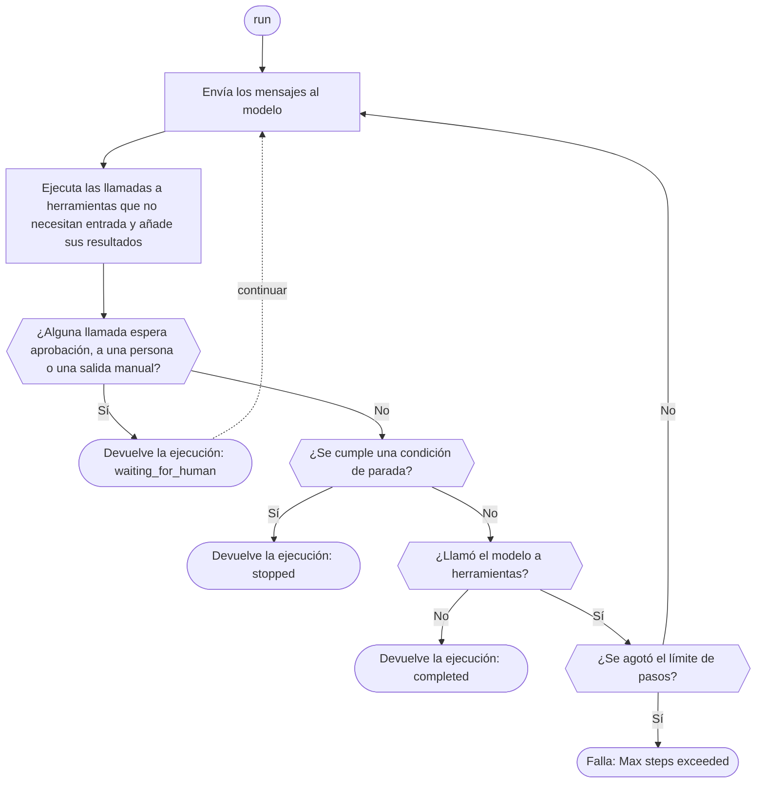

Define una herramienta, crea un agente y ejecútalo con un cliente de gateway. El modelo llama a tu herramienta, el SDK la ejecuta y devuelve el resultado, y la ejecución termina cuando el modelo responde sin llamar a ninguna herramienta, se pone en pausa para que intervenga una persona o se cumple una [condición de parada](./stop-conditions). Si la ejecución llega antes a su límite de pasos, el SDK lanza un error; solo Rust devuelve la ejecución con el estado `stopped`. Phaseo no aloja el agente ni guarda sus ejecuciones; de eso se encarga tu aplicación.

## Crea un primer agente

<CodeGroup>

```typescript TypeScript
import {
  createAgent,
  createGatewayAgentClient,
  defineTool,
} from "@phaseo/agent-sdk";

const lookupDocs = defineTool({
  id: "lookup-docs",
  description: "Look up an internal docs page by slug.",
  parameters: {
    type: "object",
    properties: {
      slug: { type: "string" },
    },
    required: ["slug"],
    additionalProperties: false,
  },
  async execute(input: { slug: string }) {
    return {
      slug: input.slug,
      url: `https://phaseo.app/docs/v1/${input.slug}`,
    };
  },
});

const agent = createAgent({
  id: "support-docs-agent",
  model: "openai/gpt-6-astra",
  instructions: "Use tools when helpful and finish with a concise answer.",
  tools: [lookupDocs],
});

const result = await agent.run({
  input: "Find the docs page for presets and explain when to use them.",
  client: createGatewayAgentClient({
    clientOptions: {
      apiKey: process.env.PHASEO_API_KEY!,
    },
  }),
});

console.log(result.output);
```

```python Python
import os
from phaseo_agent import AgentTool, create_agent, create_gateway_agent_client, define_tool

lookup_docs = define_tool(AgentTool(
    id="lookup-docs",
    description="Look up an internal docs page by slug.",
    parameters={
        "type": "object",
        "properties": {"slug": {"type": "string"}},
        "required": ["slug"],
        "additionalProperties": False,
    },
    execute=lambda tool_input, runtime: {
        "slug": tool_input["slug"],
        "url": f"https://phaseo.app/docs/v1/{tool_input['slug']}",
    },
))

agent = create_agent({
    "id": "support-docs-agent",
    "model": "openai/gpt-6-astra",
    "instructions": "Use tools when helpful and finish with a concise answer.",
    "tools": [lookup_docs],
})

result = agent.run(
    input="Find the docs page for presets and explain when to use them.",
    client=create_gateway_agent_client(client_options={"api_key": os.environ["PHASEO_API_KEY"]}),
)

print(result.output)
```

```go Go
package main

import (
  "context"
  "fmt"

  phaseoagent "github.com/phaseoteam/Phaseo/packages/sdk/agent-sdk-go"
)

func main() {
  client, err := phaseoagent.CreateGatewayAgentClient(phaseoagent.GatewayAgentClientOptions{})
  if err != nil {
    panic(err) // PHASEO_API_KEY es obligatoria
  }

  lookup := phaseoagent.DefineTool(phaseoagent.Tool{
    ID:          "lookup_docs",
    Description: "Look up a Phaseo documentation topic",
    Parameters: map[string]any{
      "type":       "object",
      "properties": map[string]any{"topic": map[string]any{"type": "string"}},
      "required":   []string{"topic"},
    },
    Execute: func(input any, runtime phaseoagent.RuntimeContext) (any, error) {
      args, _ := input.(map[string]any)
      return map[string]any{"topic": args["topic"], "found": true}, nil
    },
  })

  agent := phaseoagent.CreateAgent(phaseoagent.AgentDefinition{
    ID:           "docs-agent",
    Model:        "openai/gpt-6-astra",
    Instructions: "Use tools when helpful and finish with a concise answer.",
    Tools:        []phaseoagent.Tool{lookup},
    MaxSteps:     6,
  })

  result, err := agent.Run(context.Background(), phaseoagent.RunOptions{
    Input:  "Explain when to use routing presets.",
    Client: client,
  })
  if err != nil {
    panic(err)
  }

  fmt.Println(result.Output)
  fmt.Println(result.Run.Status, result.Usage.TotalTokens)
}
```

```csharp C#
using System.Text.Json;
using PhaseoAgentSdk;

var lookup = AgentSdk.DefineTool(new Tool(
    "lookup_docs",
    async (input, runtime) =>
    {
        var topic = ((JsonElement)input!).GetProperty("topic").GetString();
        return new { topic, found = true };
    },
    "Look up a Phaseo documentation topic",
    new Dictionary<string, object?>
    {
        ["type"] = "object",
        ["properties"] = new Dictionary<string, object?> { ["topic"] = new { type = "string" } },
        ["required"] = new[] { "topic" },
    }));

var agent = AgentSdk.CreateAgent(new AgentDefinition
{
    Id = "docs-agent",
    Model = "openai/gpt-6-astra",
    Instructions = "Use tools when helpful and finish with a concise answer.",
    Tools = new[] { lookup },
    MaxSteps = 6,
});

var result = await agent.Run(new RunOptions
{
    Input = "Explain when to use routing presets.",
    Client = AgentSdk.CreateGatewayAgentClient(), // lanza una excepción si falta PHASEO_API_KEY
});

Console.WriteLine(result.Output);
Console.WriteLine($"{result.Run.Status} {result.Usage.TotalTokens}");
```

```php PHP
<?php
require "vendor/autoload.php";

use Phaseo\AgentSdk\AgentDefinition;
use Phaseo\AgentSdk\AgentSdk;
use Phaseo\AgentSdk\Tool;

$lookup = AgentSdk::defineTool(new Tool(
    id: "lookup_docs",
    execute: fn (array $input, $runtime) => ["topic" => $input["topic"], "found" => true],
    description: "Look up a Phaseo documentation topic",
    parameters: [
        "type" => "object",
        "properties" => ["topic" => ["type" => "string"]],
        "required" => ["topic"],
    ],
));

$agent = AgentSdk::createAgent(new AgentDefinition(
    id: "docs-agent",
    model: "openai/gpt-6-astra",
    instructions: "Use tools when helpful and finish with a concise answer.",
    tools: [$lookup],
    maxSteps: 6,
));

$result = $agent->run(
    input: "Explain when to use routing presets.",
    client: AgentSdk::createGatewayAgentClient() // lanza una excepción si falta PHASEO_API_KEY
);

echo $result->output . PHP_EOL;
echo $result->run->status . " " . $result->usage["total_tokens"] . PHP_EOL;
```

```ruby Ruby
require "phaseo_agent_sdk"

lookup = PhaseoAgentSdk.define_tool(
  PhaseoAgentSdk::Tool.new(
    id: "lookup_docs",
    description: "Look up a Phaseo documentation topic",
    parameters: {
      type: "object",
      properties: { topic: { type: "string" } },
      required: ["topic"]
    },
    execute: ->(input, runtime) { { topic: input["topic"], found: true } }
  )
)

agent = PhaseoAgentSdk.create_agent(
  id: "docs-agent",
  model: "openai/gpt-6-astra",
  instructions: "Use tools when helpful and finish with a concise answer.",
  tools: [lookup],
  max_steps: 6
)

result = agent.run(
  input: "Explain when to use routing presets.",
  client: PhaseoAgentSdk.create_gateway_agent_client # lanza una excepción si falta PHASEO_API_KEY
)

puts result.output
puts "#{result.run.status} #{result.usage[:total_tokens]}"
```

```java Java
import app.phaseo.agent.AgentSdk;
import java.time.Duration;
import java.util.List;
import java.util.Map;

var lookup = AgentSdk.defineTool(new AgentSdk.Tool(
    "lookup_docs",
    (input, context) -> Map.of("topic", ((Map<?, ?>) input).get("topic"), "found", true),
    "Look up a Phaseo documentation topic",
    Map.of(
        "type", "object",
        "properties", Map.of("topic", Map.of("type", "string")),
        "required", List.of("topic")),
    Duration.ofSeconds(10)
));

var agent = AgentSdk.createAgent(new AgentSdk.AgentDefinition(
    "docs-agent",                       // id
    "openai/gpt-6-astra",               // model
    null,                               // preset
    "Use tools when helpful and finish with a concise answer.", // instructions
    List.of(lookup),                    // tools
    6,                                  // maxSteps
    null, null, null, null              // parseOutput, humanReview, modelRetry, toolExecution
));

var result = agent.run(new AgentSdk.RunOptions(
    "Explain when to use routing presets.",  // input
    AgentSdk.createGatewayAgentClient(),     // lanza una excepción si falta PHASEO_API_KEY
    null, null, null, null, null, null, null, null
));

System.out.println(result.output());
System.out.println(result.run().status() + " " + result.usage().totalTokens());
```

```rust Rust
use phaseo_agent::{
    create_agent, create_gateway_agent_client, define_tool, AgentDefinition,
    RunOptions, Tool,
};
use serde_json::json;

fn main() -> Result<(), Box<dyn std::error::Error>> {
    let lookup = define_tool(Tool::new(
        "lookup_docs",
        "Look up a Phaseo documentation topic",
        json!({
            "type": "object",
            "properties": {
                "topic": { "type": "string" }
            },
            "required": ["topic"]
        }),
        |input, context| {
            Ok(json!({
                "topic": input["topic"],
                "run_id": context.run_id,
                "found": true
            }))
        },
    ));

    let agent = create_agent(
        AgentDefinition::new("docs-agent", "openai/gpt-6-astra")
            .instructions("Use lookup_docs when helpful. Answer concisely.")
            .max_steps(6)
            .tool(lookup),
    );

    let mut client = create_gateway_agent_client("openai/gpt-6-astra")?;
    let result = agent.run(
        &mut client,
        RunOptions::new("Explain when to use routing presets."),
    )?;

    println!("{}", result.output);
    println!("steps: {}", result.run.step_count);
    println!("tokens: {}", result.usage.total_tokens);
    Ok(())
}
```

</CodeGroup>

El ID de la herramienta es el nombre de función que ve el modelo, y sus parámetros son el JSON Schema que rellena el modelo. Los argumentos llegan a tu código con la forma nativa de cada lenguaje:

| Lenguaje | La herramienta recibe | Notas |
| --- | --- | --- |
| TypeScript | Objeto tipado | `execute(input, context)` |
| Python | `dict` | `execute(tool_input, runtime)` |
| Go | `any` (JSON decodificado, normalmente `map[string]any`) | `Execute(input, runtime) (any, error)` |
| C# | `JsonElement` | `Execute(input, runtime)`, con await |
| PHP | Array asociativo | `execute(array $input, $runtime)` |
| Ruby | Hash con claves de tipo cadena | Crea las herramientas con `PhaseoAgentSdk::Tool.new`; `define_tool` devuelve lo que le pasas, así que un Hash simple no funciona |
| Java | `Map` | Los records son posicionales; pasa `null` en todo lo que no establezcas |
| Rust | `serde_json::Value` | El closure se ejecuta en local; `RuntimeContext` tiene el ID de la ejecución, el ID del agente, el índice del paso, el contexto de la aplicación y la llamada a herramienta |

Si ni el agente, ni la ejecución, ni el cliente establecen un modelo o un preset, el cliente de gateway envía `phaseo/free`. El `create_gateway_agent_client` de Rust recibe el modelo como argumento.

## Cómo funciona una ejecución



Cada paso se guarda como punto de control en el resultado de ejecución devuelto. Para reanudar entre solicitudes o reinicios, guarda ese resultado en tu propio almacén y pásalo al método de continuación, o dale al agente un accesor de estado; consulta [Estado y aprobación](./state-and-approval). El límite de pasos y lo que pasa cuando se agota varían según el lenguaje:

<Tabs>
<Tab title="TypeScript">

Cada llamada a `run()` o `continueRun()` realiza hasta 12 pasos, salvo que establezcas `maxSteps`; a partir de ahí lanza `Max steps exceeded`. Usa [condiciones de parada](./stop-conditions) para terminar una ejecución de forma limpia.

</Tab>
<Tab title="Python">

Una ejecución realiza hasta 12 pasos, salvo que establezcas `max_steps`; a partir de ahí lanza `RuntimeError`. Las condiciones de parada solo se comprueban en un paso en el que el modelo no hace llamadas a herramientas, así que el orden es distinto al del diagrama: un bucle de herramientas se ejecuta hasta que se pone en pausa, responde o agota `max_steps`.

</Tab>
<Tab title="Go">

Una ejecución que necesita más de `MaxSteps` turnos del modelo (8 por defecto) falla con `Max steps exceeded (N)`.

</Tab>
<Tab title="C#">

Una ejecución que necesita más de `MaxSteps` turnos del modelo (12 por defecto) lanza `InvalidOperationException("Max steps exceeded (N)")`.

</Tab>
<Tab title="PHP">

Una ejecución que necesita más de `maxSteps` turnos del modelo (12 por defecto) lanza `Max steps exceeded (N)`.

</Tab>
<Tab title="Ruby">

Una ejecución que necesita más de `max_steps` turnos del modelo (12 por defecto) lanza `Max steps exceeded (N)`.

</Tab>
<Tab title="Java">

Una ejecución que necesita más de `maxSteps` turnos del modelo (12 por defecto) lanza `Max steps exceeded (N)`.

</Tab>
<Tab title="Rust">

Una ejecución realiza hasta 8 turnos del modelo, salvo que llames a `.max_steps(n)` o establezcas `RunOptions.max_steps`. Alcanzar el límite no es un fallo: la ejecución termina con `run.status` `stopped` y `run.stop_reason` `max_steps:<limit>`. Las ejecuciones son síncronas y las herramientas locales se ejecutan de una en una, así que usa un hilo de trabajo o una tarea aparte cuando una ejecución no deba bloquear un manejador de solicitudes.

</Tab>
</Tabs>

## Lee el resultado de la ejecución

Todas las ejecuciones devuelven las mismas partes. Los nombres de los campos siguen el estilo de cada lenguaje (`output`, `Output`, `output()`):

| Parte | Contenido |
| --- | --- |
| `run` | Estado, IDs, modelo efectivo, límite de pasos, contexto, estado de pausa y motivo de parada |
| `steps` | Un registro por turno del modelo: ID de solicitud, proveedor, modelo, motivo de finalización, advertencias, llamadas a herramientas y uso |
| `messages` | La conversación completa, incluidos los resultados de las herramientas |
| `output` | La salida final |
| `usage` | Tokens de entrada, de salida, en caché y totales, y coste |

El `usage.cost` de Rust solo procede de un `meta.cost` o `cost` numérico en la respuesta; no convierte `cost_nanos` ni `cost_cents`. Usa la respuesta del Gateway o el registro de la generación para informar del gasto en Rust.

## Encuentra la función que necesitas

| Para… | Página |
| --- | --- |
| Dar al modelo herramientas locales, manuales o que informan del progreso | [Herramientas](./tools) |
| Poner la ejecución en pausa para pedir aprobación o la intervención de una persona y reanudarla después | [Estado y aprobación](./state-and-approval) |
| Mostrar el texto y la actividad de herramientas a medida que suceden | [Streaming](./streaming) |
| Mostrar una línea de tiempo de mensajes, razonamiento y llamadas a herramientas | [Elementos](./items) |
| Acotar pasos, tokens, coste o tiempo | [Condiciones de parada](./stop-conditions) |
| Cambiar el modelo o las herramientas entre turnos | [Turnos dinámicos](./dynamic-turns) |
| Obtener salida tipada, reintentar llamadas al modelo o usar un preset | [Salidas y reintentos](./run-controls) |
| Registrar o auditar cada paso | [Hooks del ciclo de vida](./lifecycle-hooks) |
| Registrar el uso, el coste y los IDs de solicitud de una ejecución | [Observabilidad](./observability) |
| Gestionar errores del gateway, de esquema y del límite de pasos | [Eventos y errores](./events-and-errors) |
| Inspeccionar ejecuciones en local | [DevTools](./devtools) |

Todas las exportaciones aparecen en la [Referencia de la API](./api-reference), y hay agentes completos en [Ejemplos](./examples).
