import { ChangelogFilters } from "/snippets/changelog-filters.jsx";

<ChangelogFilters labels={{"product":"Produit","api":"API et SDK","models":"Modèles"}} clearLabel="Effacer" />

<Update label="30 janvier 2026">

Produit

- Chat, sur [phaseo.app/chat](https://phaseo.app/chat), permet de discuter avec les modèles de la passerelle, de régler les paramètres des requêtes et de conserver l'historique dans votre navigateur ([#21](https://github.com/phaseoteam/Phaseo/pull/21)).
- Les équipes peuvent choisir comment la passerelle sélectionne les fournisseurs dans **Settings -> Routing** : **Balanced**, **Lowest cost**, **Lowest latency** ou **Highest throughput** ([#21](https://github.com/phaseoteam/Phaseo/pull/21)).
- Un calculateur de prix dans Tools estime le coût des requêtes à partir du nombre de tokens et le compare entre modèles ([#21](https://github.com/phaseoteam/Phaseo/pull/21)).

API et SDK

- `POST /v1/messages` accepte les requêtes au format Anthropic Messages, ce qui permet aux SDK Anthropic d'appeler les modèles de la passerelle ; voir [Créer un message](../api-reference/endpoint/anthropic-messages.mdx) ([#21](https://github.com/phaseoteam/Phaseo/pull/21)).
- `POST /v1/ocr` extrait le texte d'une image fournie par URL ou en base64 ; voir [Extraire du texte avec l'OCR](../api-reference/endpoint/ocr.mdx) ([#21](https://github.com/phaseoteam/Phaseo/pull/21)).
- `POST /v1/music/generate` crée des morceaux de musique et `GET /v1/music/generate/{id}` renvoie leur statut ; voir [Générer de la musique](../api-reference/endpoint/music-generate.mdx) ([#21](https://github.com/phaseoteam/Phaseo/pull/21)).
- L'API de gestion ajoute `GET /v1/credits` pour le solde de crédits, `GET /v1/activity` pour les requêtes récentes et `/v1/provisioning/keys` pour lister, modifier et supprimer des clés ; voir [Obtenir les crédits](../api-reference/endpoint/credits.mdx) ([#21](https://github.com/phaseoteam/Phaseo/pull/21)).

Modèles

- [z.AI: GLM 4.5 Air X](https://phaseo.app/models/z-ai/glm-4.5-air-x)
- [z.AI: GLM 4.5 X](https://phaseo.app/models/z-ai/glm-4.5-x)
- [xAI: Grok Imagine Image](https://phaseo.app/models/x-ai/grok-imagine-image)
- [xAI: Grok Imagine Video](https://phaseo.app/models/x-ai/grok-imagine-video)
- [Moonshot: Kimi K2.5](https://phaseo.app/models/moonshotai/kimi-k2.5)
- [MiniMax: MiniMax M2 Her](https://phaseo.app/models/minimax/minimax-m2-her)
- [Qwen: Qwen 3 Max Thinking](https://phaseo.app/models/qwen/qwen3-max-thinking)

</Update>

<Update label="29 janvier 2026">

Modèles

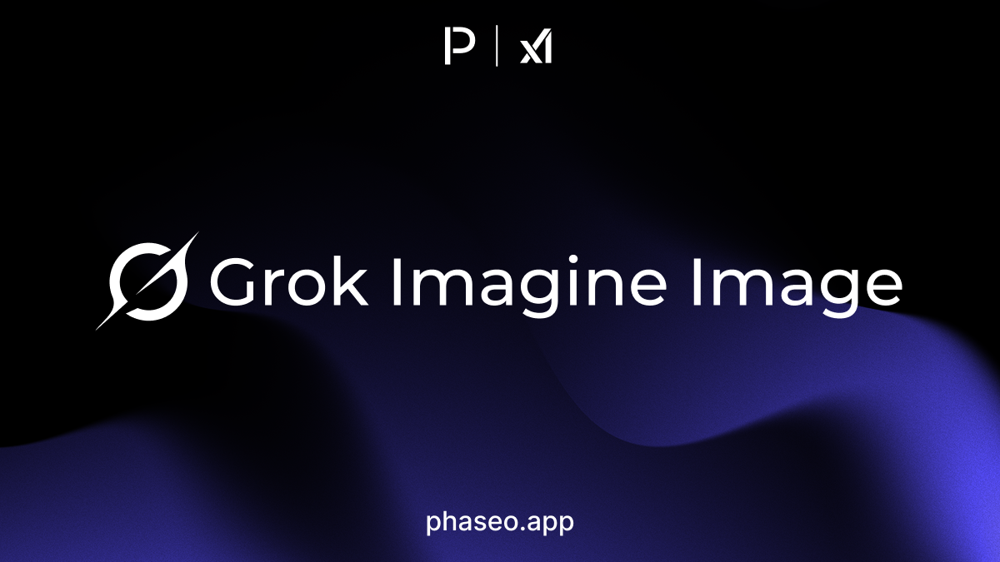

- [xAI: Grok Imagine Image](https://phaseo.app/models/x-ai/grok-imagine-image)
- [xAI: Grok Imagine Image Pro](https://phaseo.app/models/x-ai/grok-imagine-image-pro)
- [xAI: Grok Imagine Video](https://phaseo.app/models/x-ai/grok-imagine-video)

</Update>

<Update label="27 janvier 2026">

Modèles

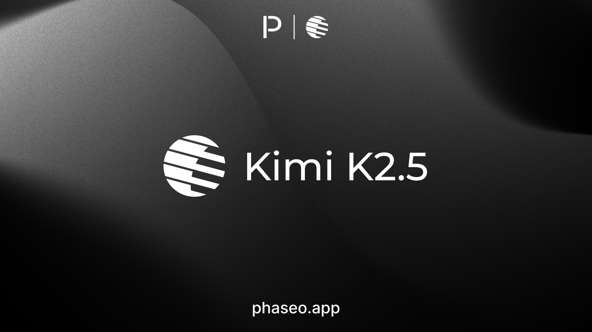

- [Arcee AI: Trinity Large](https://phaseo.app/models/arcee-ai/trinity-large)
- [CrofAI: Greg 1](https://phaseo.app/models/crofai/greg-1)
- [CrofAI: Greg 1 Mini](https://phaseo.app/models/crofai/greg-1-mini)
- [CrofAI: Greg 1 Super](https://phaseo.app/models/crofai/greg-1-super)
- [Moonshot: Kimi K2.5](https://phaseo.app/models/moonshotai/kimi-k2.5)

</Update>

<Update label="26 janvier 2026">

Modèles

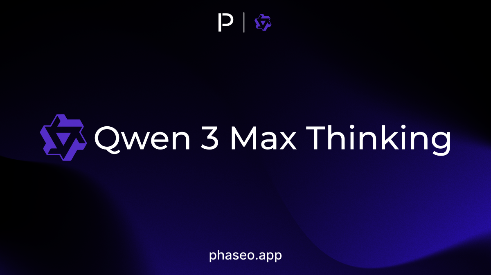

- [Qwen: Qwen 3 Max Thinking](https://phaseo.app/models/qwen/qwen3-max-thinking)
- [Upstage: Solar Pro 3 (2026-01-26)](https://phaseo.app/models/upstage/solar-pro-3)

</Update>

<Update label="24 janvier 2026">

Modèles

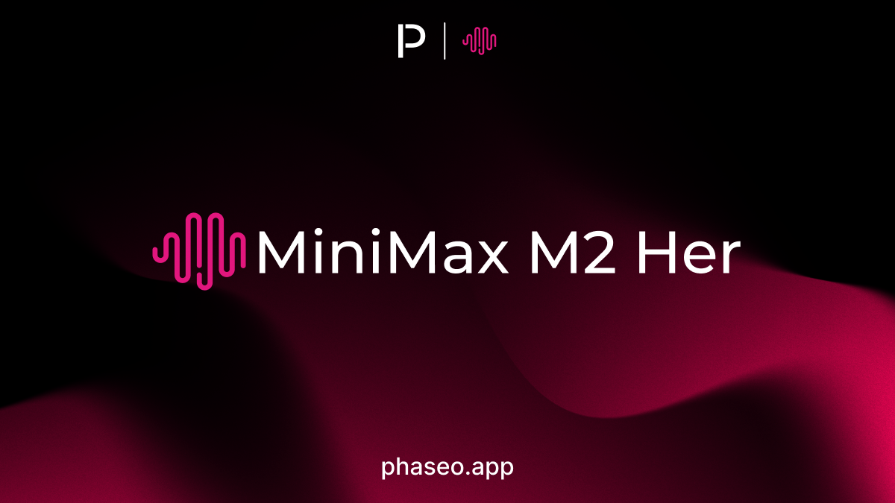

- [MiniMax: MiniMax M2 Her](https://phaseo.app/models/minimax/minimax-m2-her)

</Update>

<Update label="22 janvier 2026">

Modèles

- [Baidu: Ernie 5.0](https://phaseo.app/models/baidu/ernie-5.0)

</Update>

<Update label="20 janvier 2026">

Modèles

- [Liquid AI: LFM 2.5 1.2B Thinking](https://phaseo.app/models/liquid-ai/lfm-2.5-1.2b-thinking)

</Update>

<Update label="19 janvier 2026">

Modèles

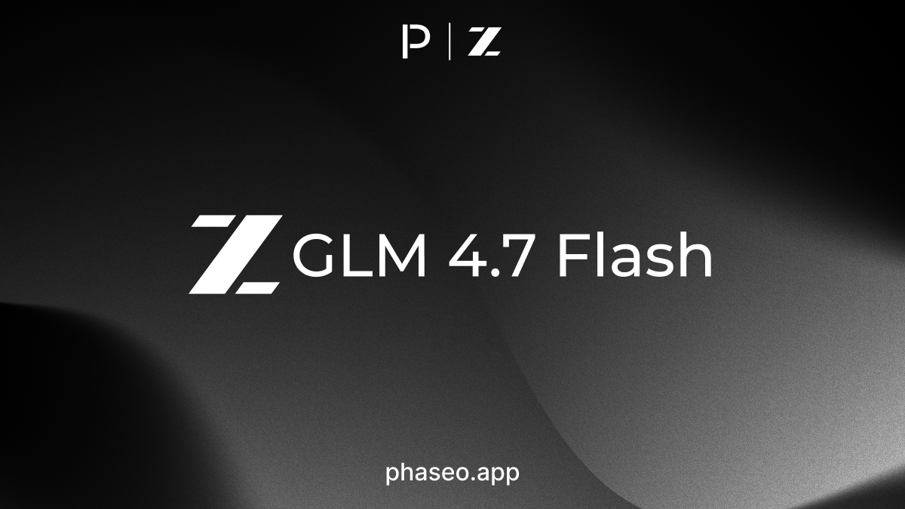

- [z.AI: GLM 4.7 Flash](https://phaseo.app/models/z-ai/glm-4.7-flash)

</Update>

<Update label="16 janvier 2026">

Modèles

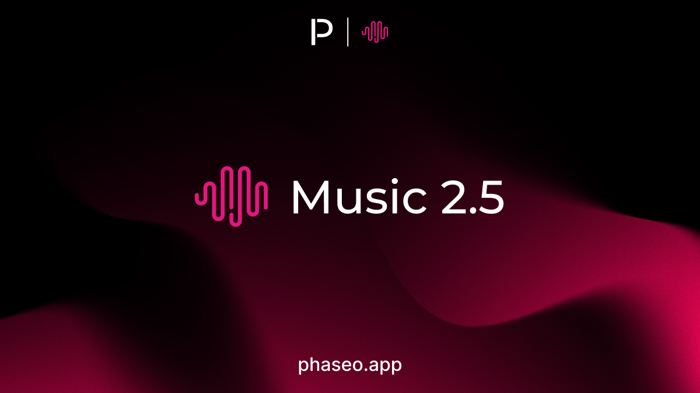

- [MiniMax: Music 2.5](https://phaseo.app/models/minimax/music-2.5)

</Update>

<Update label="15 janvier 2026">

Modèles

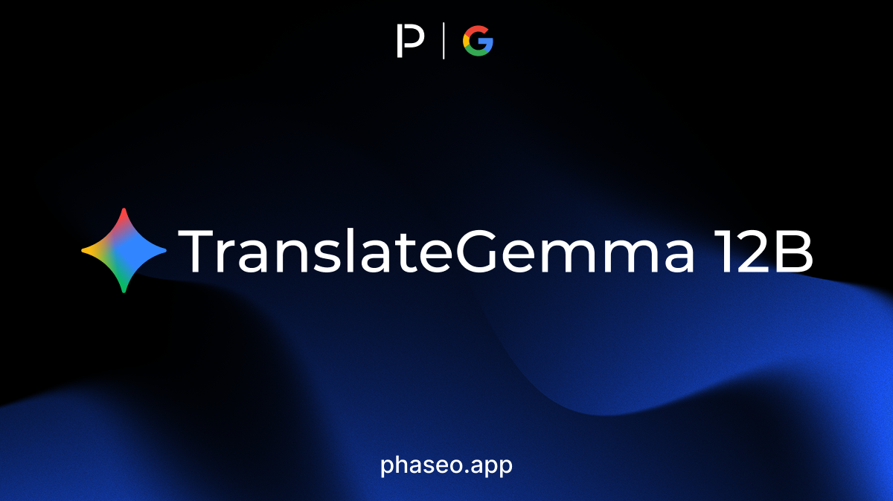

- [Black Forest Labs: Flux 2 Klein 4B](https://phaseo.app/models/black-forest-labs/flux-2-klein-4b)
- [Black Forest Labs: Flux 2 Klein 9B](https://phaseo.app/models/black-forest-labs/flux-2-klein-9b)
- [Google: TranslateGemma 12B](https://phaseo.app/models/google/translategemma-12b)
- [Google: TranslateGemma 27B](https://phaseo.app/models/google/translategemma-27b)
- [Google: TranslateGemma 4B](https://phaseo.app/models/google/translategemma-4b)
- [Voyage: Voyage 4](https://phaseo.app/models/voyage/voyage-4)
- [Voyage: Voyage 4 Large](https://phaseo.app/models/voyage/voyage-4-large)
- [Voyage: Voyage 4 Lite](https://phaseo.app/models/voyage/voyage-4-lite)
- [Voyage: Voyage Multimodal 3.5](https://phaseo.app/models/voyage/voyage-multimodal-3.5)

</Update>

<Update label="14 janvier 2026">

Modèles

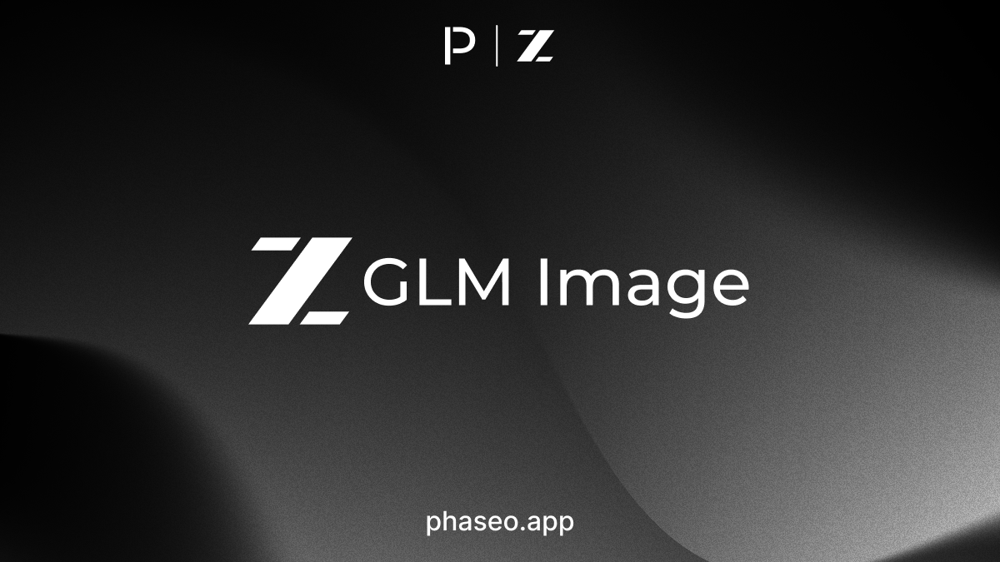

- [z.AI: GLM Image](https://phaseo.app/models/z-ai/glm-image)

</Update>

<Update label="13 janvier 2026">

Modèles

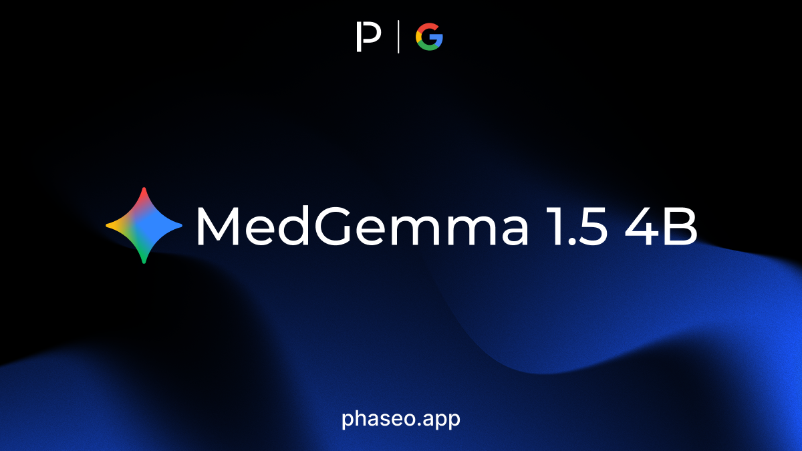

- [Google: MedGemma 1.5 4B](https://phaseo.app/models/google/medgemma-1.5-4b)

</Update>

<Update label="9 janvier 2026">

Modèles

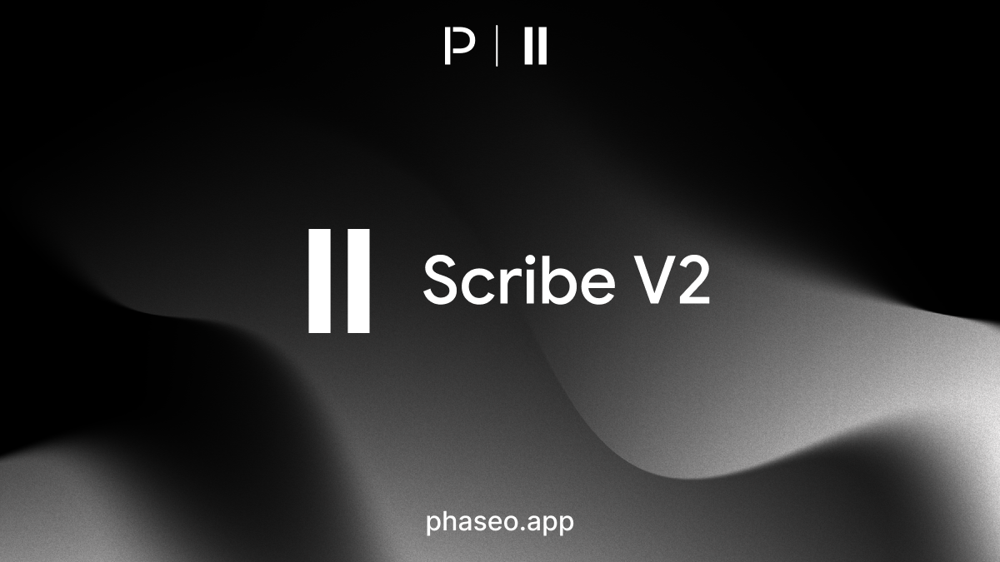

- [ElevenLabs: Scribe V2](https://phaseo.app/models/eleven-labs/scribe-v2)

</Update>

<Update label="8 janvier 2026">

Modèles

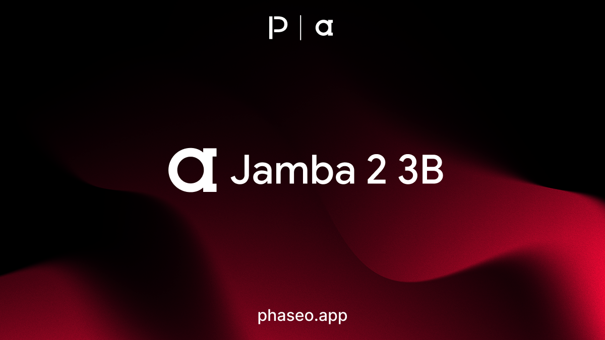

- [ai21: Jamba 2 3B](https://phaseo.app/models/ai21/jamba-2-3b)
- [ai21: Jamba Mini 2](https://phaseo.app/models/ai21/jamba-mini-2)

</Update>

<Update label="6 janvier 2026">

Modèles

- [Liquid AI: LFM 2.5 1.2B](https://phaseo.app/models/liquid-ai/lfm-2.5-1.2b)
- [Liquid AI: LFM 2.5 1.2B JP](https://phaseo.app/models/liquid-ai/lfm-2.5-1.2b-jp)
- [Nous: NousCoder 14B](https://phaseo.app/models/nous/nouscoder-14b)

</Update>

<Update label="3 janvier 2026">

Modèles

- [z.AI: GLM 4.7](https://phaseo.app/models/z-ai/glm-4.7)
- [MiniMax: Music 2.0](https://phaseo.app/models/minimax/music-2.0)
- [Relace: Relace Search](https://phaseo.app/models/relace/relace-search)
- [ByteDance: Seed 1.6 (2025-10-15)](https://phaseo.app/models/bytedance/seed-1.6-2025-10-15)
- [ByteDance: Seed 1.6 Flash (2025-08-28)](https://phaseo.app/models/bytedance/seed-1.6-flash-2025-08-28)
- [ByteDance: Seed 1.8](https://phaseo.app/models/bytedance/seed-1.8)
- [ByteDance: Seedream 4.5](https://phaseo.app/models/bytedance/seedream-4.5)
- [MiniMax: Speech 2.6](https://phaseo.app/models/minimax/speech-2.6)
- [Arcee AI: Trinity Large](https://phaseo.app/models/arcee-ai/trinity-large)

</Update>
