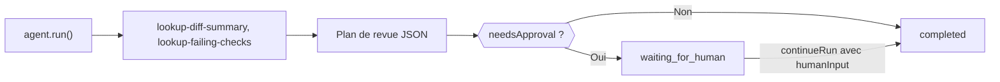

Créez un agent TypeScript qui examine une pull request avec des outils locaux, renvoie un plan de revue en JSON strict et se met en pause pour une personne quand le plan indique qu’il faut une approbation. À la fin, vous avez un script qui affiche un `CodeReviewPlan` validé et s’arrête sur `waiting_for_human` jusqu’à ce que quelqu’un l’approuve.

Les outils renvoient des données d’exemple fixes : le script est donc illustratif ; remplacez-les par des appels à votre hébergeur de code et à votre CI. Une version packagée se trouve dans `packages/sdk/agent-sdk-ts/examples/coding-review-agent.ts`.



## Le construire

<Steps>
<Step title="Installer">

```bash
npm install @phaseo/agent-sdk zod
export PHASEO_API_KEY="phaseo_v1_sk_..."
```

</Step>
<Step title="Écrire l’agent">

```ts review-agent.ts
import { z } from "zod";
import { createAgent, createGatewayAgentClient, defineTool } from "@phaseo/agent-sdk";

const CodeReviewPlan = z
  .object({
    risk: z.enum(["low", "medium", "high"]),
    summary: z.string().min(1),
    recommendedActions: z.array(z.string()).min(1),
    needsApproval: z.boolean(),
  })
  .strict();
type CodeReviewPlan = z.infer<typeof CodeReviewPlan>;

const PullRequestInput = z.object({ pullRequestId: z.string().regex(/^pr_\d+$/) }).strict();
const pullRequestParameters = {
  type: "object",
  properties: { pullRequestId: { type: "string", pattern: "^pr_\\d+$" } },
  required: ["pullRequestId"],
  additionalProperties: false,
};

// Outils en lecture seule et déterministes : sans risque à réexécuter si un worker reprend l’exécution.
const lookupDiffSummary = defineTool({
  id: "lookup-diff-summary",
  description: "Return a short summary of the changed files in one pull request.",
  parameters: pullRequestParameters,
  inputSchema: PullRequestInput,
  async execute({ pullRequestId }) {
    return {
      pullRequestId,
      files: ["apps/api/src/pipeline/before/index.ts"],
      summary: "Changes touch request validation.",
    };
  },
});

const lookupFailingChecks = defineTool({
  id: "lookup-failing-checks",
  description: "Return the failing CI checks for one pull request.",
  parameters: pullRequestParameters,
  inputSchema: PullRequestInput,
  async execute({ pullRequestId }) {
    return { pullRequestId, failingChecks: ["web-typecheck"] };
  },
});

const codingReviewAgent = createAgent<string, CodeReviewPlan>({
  id: "coding-review-agent",
  model: "openai/gpt-6-astra",
  instructions:
    "Use the available tools to inspect the coding task, then return a strict JSON review plan.",
  tools: [lookupDiffSummary, lookupFailingChecks],
  maxSteps: 6,
  parseOutput: (text) => JSON.parse(text),
  outputSchema: CodeReviewPlan,
  humanReview: ({ parsedOutput }) =>
    parsedOutput?.needsApproval
      ? { reason: "coding_review_approval_required", payload: parsedOutput }
      : null,
});

// Demander au Gateway exactement cette forme JSON, et réparer le JSON presque valide.
const client = createGatewayAgentClient({
  clientOptions: { apiKey: process.env.PHASEO_API_KEY! },
  responseFormat: {
    type: "json_schema",
    name: "code_review_plan",
    schema: {
      type: "object",
      properties: {
        risk: { type: "string", enum: ["low", "medium", "high"] },
        summary: { type: "string" },
        recommendedActions: { type: "array", items: { type: "string" }, minItems: 1 },
        needsApproval: { type: "boolean" },
      },
      required: ["risk", "summary", "recommendedActions", "needsApproval"],
      additionalProperties: false,
    },
  },
  plugins: [{ id: "response-healing", mode: "strict" }],
});

const result = await codingReviewAgent.run({
  input: "Review pull request pr_482 and produce a remediation plan.",
  client,
  onEvent(event) {
    console.log(event.type, event.runId);
  },
});

if (result.run.status === "waiting_for_human") {
  console.log("Needs approval:", result.run.pause?.payload);

  // Dans une vraie application, stockez `result` et continuez quand un relecteur approuve.
  if (process.env.APPROVE === "yes") {
    const continued = await codingReviewAgent.continueRun({
      run: result,
      client,
      humanInput: "Approved. Finalize the plan.",
    });
    console.log(continued.output);
  }
} else {
  console.log(result.output);
}
```

`responseFormat` fait demander ce schéma par le Gateway, et `outputSchema` vérifie à nouveau le résultat analysé dans votre processus. Le mode strict de [réparation des réponses](./response-healing-for-structured-json) ne fait que désencapsuler du JSON déjà valide.

</Step>
<Step title="L’exécuter">

```bash
npx tsx review-agent.ts
APPROVE=yes npx tsx review-agent.ts
```

</Step>
</Steps>

## Vérifier que ça fonctionne

- Le journal des événements affiche `tool.started` et `tool.completed` pour les deux outils, puis `checkpoint.saved` après l’étape d’outils.
- Un plan avec `needsApproval: true` termine la première exécution sur `waiting_for_human`, avec le plan dans `result.run.pause.payload` ; avec `APPROVE=yes`, elle continue jusqu’à `completed`.
- Dans **Paramètres → Utilisation → Journaux**, chaque tour du modèle affiche les appels d’outils, et l’enregistrement des plugins de la requête indique si la réparation a eu lieu.
- Un plan qui ne respecte pas le schéma fait échouer l’exécution avec une `AgentSchemaValidationError` au lieu de renvoyer des données incorrectes.

## Le sécuriser pour de vrais dépôts

Gardez les outils de revue en lecture seule. Si vous ajoutez un outil qui commente, pousse ou fusionne, définissez `requireApproval: true` sur cet outil pour que l’exécution se mette en pause avant son appel, et approuvez-le avec `continueRun({ run, client, approvals: [toolCallId] })`. Traitez le contenu du diff comme une entrée non fiable : des commentaires de code peuvent contenir des instructions destinées au modèle. Pour survivre aux redémarrages pendant qu’une revue attend, enregistrez l’exécution avec un accesseur `state`, comme dans la [boucle durable](./agent-sdk-durable-loop). [État et approbation](../sdk-reference/agent/state-and-approval) couvre les approbations et les refus.
