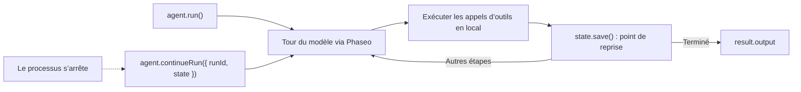

Exécutez un agent qui utilise des outils avec l’Agent SDK TypeScript et enregistrez son état après chaque étape, pour qu’un processus planté ou redémarré reprenne là où il s’était arrêté. À la fin, vous avez un script qui répond à une question sur la documentation avec un outil de recherche, écrit chaque exécution dans `.agent-runs/<run id>.json` et reprend une exécution quand vous lui passez son identifiant.

Le script est illustratif : le stockage dans des fichiers convient à une seule machine. En production, gardez la même paire `load`/`save`, mais appuyez-la sur votre base de données. Phaseo ne stocke pas les exécutions de l’Agent SDK à votre place.



## Le construire

<Steps>
<Step title="Installer">

<CodeGroup>
```bash npm
npm install @phaseo/agent-sdk zod
```

```bash pnpm
pnpm add @phaseo/agent-sdk zod
```

```bash yarn
yarn add @phaseo/agent-sdk zod
```

```bash bun
bun add @phaseo/agent-sdk zod
```
</CodeGroup>

`@phaseo/agent-sdk` installe `@phaseo/sdk` avec lui. Définissez votre clé :

```bash
export PHASEO_API_KEY="phaseo_v1_sk_..."
```

</Step>
<Step title="Écrire l’agent">

```ts agent.ts
import { mkdir, readFile, writeFile } from "node:fs/promises";
import { z } from "zod";
import {
  createAgent,
  createGatewayAgentClient,
  defineTool,
  type AgentStateAccessor,
} from "@phaseo/agent-sdk";

const DOC_SLUGS = ["guides/presets", "guides/routing-and-fallbacks", "guides/streaming"] as const;

// Le modèle ne voit que `parameters` ; `inputSchema` rejette tout le reste avant l’appel d’execute.
const lookupDocs = defineTool({
  id: "lookup-docs",
  description: "Return the URL of one Phaseo docs page by slug.",
  parameters: {
    type: "object",
    properties: { slug: { type: "string", enum: [...DOC_SLUGS] } },
    required: ["slug"],
    additionalProperties: false,
  },
  inputSchema: z.object({ slug: z.enum(DOC_SLUGS) }).strict(),
  async execute({ slug }) {
    return { slug, url: `https://phaseo.app/docs/v1/${slug}` };
  },
});

const agent = createAgent<string, string>({
  id: "support-docs-agent",
  model: "openai/gpt-6-astra",
  instructions: "Use tools when helpful and finish with a concise answer that includes the docs URL.",
  tools: [lookupDocs],
  maxSteps: 6,
});

// Enregistrer toute l’exécution après chaque étape. Remplacez ces deux fonctions par votre base de données.
const RUNS_DIR = ".agent-runs";
const state: AgentStateAccessor<string, unknown, string> = {
  async load(runId) {
    try {
      return JSON.parse(await readFile(`${RUNS_DIR}/${runId}.json`, "utf8"));
    } catch {
      return null;
    }
  },
  async save(result) {
    await mkdir(RUNS_DIR, { recursive: true });
    await writeFile(`${RUNS_DIR}/${result.run.id}.json`, JSON.stringify(result));
  },
};

const client = createGatewayAgentClient({
  clientOptions: { apiKey: process.env.PHASEO_API_KEY! },
});

const onEvent = (event: { type: string; runId: string }) => {
  if (event.type === "checkpoint.saved") console.log("checkpoint", event.runId);
};

const resumeId = process.argv[2];
let result;

if (resumeId) {
  const saved = await state.load(resumeId);
  if (!saved) throw new Error(`No saved run ${resumeId}`);
  result = saved.run.status === "completed"
    ? saved
    : await agent.continueRun({ run: saved, client, state, onEvent });
} else {
  result = await agent.run({
    input: "Find the docs page for presets and explain when to use them.",
    client,
    state,
    onEvent,
  });
}

console.log(result.run.id, result.run.status);
console.log(result.output);
```

</Step>
<Step title="L’exécuter">

```bash
npx tsx agent.ts
```

Pour tester une reprise, arrêtez le script avec `Ctrl+C` après la première ligne `checkpoint`, puis passez l’identifiant d’exécution qu’il a affiché (un UUID) :

```bash
npx tsx agent.ts 3f6c1d2e-...
```

</Step>
</Steps>

## Vérifier que ça fonctionne

- Le script affiche `checkpoint` une fois par étape, puis l’identifiant d’exécution, `completed` et une réponse avec une URL `phaseo.app/docs`.
- `.agent-runs/<run id>.json` contient l’identifiant d’exécution, le statut, l’historique des messages, les appels d’outils et résultats de chaque étape, et la sortie finale.
- Après une exécution interrompue, la commande de reprise termine la même exécution au lieu d’en démarrer une nouvelle.
- Chaque tour du modèle apparaît dans **Paramètres → Utilisation → Journaux**. Journalisez l’identifiant d’exécution à côté de chaque identifiant de requête pour pouvoir les faire correspondre.

## Ce que contient l’état enregistré

Chaque résultat enregistré est l’`AgentRunResult` complet : `run` (identifiant, statut, messages, utilisation, pause éventuelle), `steps` avec leurs identifiants de requête Gateway et leurs appels d’outils, et `output` une fois l’exécution terminée. `continueRun()` l’accepte directement, ou bien un `runId` accompagné de `state`, auquel cas il appelle `load()` lui-même.

Un appel d’outil en cours au moment où le processus s’est arrêté a peut-être déjà produit son effet : gardez donc vos outils idempotents. Le SDK répare l’historique d’un appel qui n’a jamais reçu de résultat avant de continuer. [État et approbation](../sdk-reference/agent/state-and-approval) couvre les pauses et les approbations.

## Le faire évoluer prudemment

Gardez un agent par flux de travail, une courte liste d’outils et une ligne de journal par exécution avec l’identifiant d’exécution et les identifiants de requête. Quand vous avez besoin de pauses d’approbation ou de plusieurs agents partageant des outils, conservez ce client Gateway et cette paire d’état et construisez autour : l’[agent de revue de code](./agent-sdk-coding-review) ajoute une pause d’approbation, et les [outils en parallèle](./agent-sdk-parallel-tools) exécutent des outils côte à côte. Pour des valeurs par défaut de requête partagées, appelez un [préréglage](../guides/presets) au lieu d’un modèle fixe.
