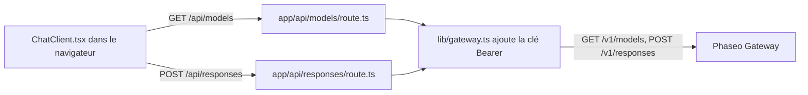

Exécutez une petite application de chat Next.js dont le code du navigateur ne communique qu’avec vos propres routes serveur, pour que votre clé API Phaseo n’atteigne jamais le navigateur. À la fin, vous avez une page de chat locale avec un sélecteur de modèle alimenté par `GET /v1/models` et des réponses venant de `POST /v1/responses`.

L’exemple est illustratif : ses routes n’ont ni connexion ni limite de débit, donc toute personne qui peut les atteindre dépense votre clé. Ajoutez d’abord les vérifications de [Avant de le déployer](#before-you-deploy-it).

Pour qu’un agent de code crée la même application de zéro, collez ce prompt :

<Prompt
  description="Créez une **application de chat web Next.js** avec Phaseo Gateway."
  icon="message-square"
  actions={["copy", "cursor"]}
>
{`You are building a small production-style chat app with Phaseo Gateway.

Create a Next.js app with:
- a chat UI
- a model picker backed by GET https://api.phaseo.app/v1/models
- a server-side route that calls POST https://api.phaseo.app/v1/responses
- server-side API key handling using PHASEO_API_KEY (Authorization: Bearer)
- loading, success, and error states

Keep the app intentionally small and easy to inspect.

Implementation requirements:
- Use one local API route for model discovery.
- Use one local API route for responses generation.
- Keep secrets server-side only.
- Send the whole conversation in input on every turn. The gateway rejects previous_response_id.
- Only accept model IDs from an allowlist on the server, and cap the input length.
- Show the request/response flow clearly in code.
- Add a short README with setup and run steps.

Verification:
- Run the app if possible.
- Verify two successful chat turns in a row.
- Report the exact files changed, what you verified, and any remaining assumptions.`}
</Prompt>

## Comment l’exemple est construit



L’exemple se trouve dans [examples/web-chat-nextjs](https://github.com/phaseoteam/Phaseo/tree/main/examples/web-chat-nextjs) :

| Fichier | Rôle |
| --- | --- |
| `app/components/ChatClient.tsx` | Saisie, états de chargement et d’erreur, messages affichés, sélecteur de modèle |
| `app/api/models/route.ts` | Renvoie les identifiants de modèle de `GET /v1/models` |
| `app/api/responses/route.ts` | Vérifie que `model` et `input` sont des chaînes non vides (`400 missing_model`, `400 missing_input`), puis appelle `POST /v1/responses` |
| `lib/gateway.ts` | Construit l’URL et les en-têtes : `Authorization: Bearer $PHASEO_API_KEY`, `x-title` et `http-referer` lorsqu’ils sont définis |

## L’exécuter

Il vous faut Node.js et une clé API Phaseo.

<Steps>
<Step title="Installer">

```bash
cd examples/web-chat-nextjs
npm install
```

L’exemple fournit un `package-lock.json` : `npm` installe donc les versions testées.

</Step>
<Step title="Créer .env.local">

L’exemple n’a pas de `.env.example`. Créez vous-même `.env.local` :

```bash .env.local
PHASEO_API_KEY=phaseo_v1_sk_...
# Facultatif. Vaut https://api.phaseo.app par défaut ; /v1 est ajouté pour vous.
NEXT_PUBLIC_GATEWAY_URL=https://api.phaseo.app
# En-têtes facultatifs d’attribution de l’application.
GATEWAY_APP_TITLE=My chat app
GATEWAY_HTTP_REFERER=https://myapp.example
```

Ici, `NEXT_PUBLIC_GATEWAY_URL` n’est lu que sur le serveur, mais le préfixe `NEXT_PUBLIC_` l’exposerait au code du navigateur : n’y mettez donc jamais de clé. [Attribution des applications](../guides/app-attribution) explique les deux en-têtes facultatifs.

</Step>
<Step title="Corriger le deuxième tour de chat">

`ChatClient.tsx` envoie l’`id` de la réponse précédente dans `previous_response_id`. Le Gateway ne stocke pas les réponses : il rejette donc ce champ avec `400 validation_error` (mot-clé `unsupported_param`) et le deuxième message échoue. Dans `app/api/responses/route.ts`, supprimez le bloc qui copie `previous_response_id` dans la charge utile :

```ts app/api/responses/route.ts
  // Supprimez ces lignes :
  if (typeof body.previous_response_id === 'string' && body.previous_response_id.trim()) {
    payload.previous_response_id = body.previous_response_id.trim();
  }
```

Chaque tour reçoit alors une réponse indépendante. Pour conserver le contexte, envoyez les tours précédents sous forme de tableau de messages dans `input`.

</Step>
<Step title="Démarrer le serveur de développement">

```bash
npm run dev
```

Ouvrez `http://localhost:3000`.

</Step>
</Steps>

## Vérifier que ça fonctionne

- Le sélecteur de modèle se remplit d’identifiants de modèle.
- Deux messages consécutifs reçoivent chacun une réponse.
- Dans le panneau réseau du navigateur, les requêtes vont uniquement vers `/api/models` et `/api/responses`, et aucune ne contient `PHASEO_API_KEY`.
- Un identifiant de modèle incorrect affiche le message d’erreur du Gateway au lieu d’une réponse vide.
- Les requêtes apparaissent dans **Paramètres → Utilisation → Journaux** avec le titre d’application que vous avez défini.

<span id="before-you-deploy-it"></span>
## Avant de le déployer

- **Authentifiez les routes.** Exigez un utilisateur connecté sur `/api/responses` et `/api/models`, ou utilisez le [workbench OAuth](./build-an-oauth-nextjs-workbench) pour que chaque utilisateur dépense ses propres crédits.
- **Limitez les modèles à une liste autorisée.** La route transmet n’importe quelle chaîne `model` venant du navigateur. Vérifiez-la sur le serveur par rapport à une liste fixe.
- **Plafonnez la saisie et le débit.** Limitez la longueur de la saisie et le nombre de requêtes par utilisateur, et définissez une [limite de dépenses sur la clé](../api-reference/limits#key-limits-and-budgets).
- **Utilisez le streaming si nécessaire.** Définissez `stream: true` et transmettez les événements ; [Streaming](../guides/streaming) indique quel événement termine un flux Responses.

Pour un script backend plutôt qu’une interface, partez de l’[application de test REST Node](./build-a-node-rest-smoke-app) ou de la [CLI Gateway en Python](./build-a-python-gateway-cli).
