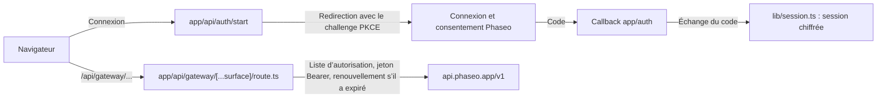

Permettez aux utilisateurs de se connecter avec Phaseo et de dépenser leurs propres crédits dans votre application : OAuth 2.1 avec PKCE fournit un jeton d’accès à votre serveur, et un unique proxy côté serveur l’ajoute à chaque appel au gateway. À la fin, vous disposez d’une application locale avec connexion, des jetons stockés en session qui se renouvellent, la découverte des modèles, un flux de chat sur `/responses` et un testeur pour les autres endpoints.

L’exemple est illustratif. Son fichier `lib/oauth.ts` appelle encore un ancien endpoint de connexion, que l’étape 3 de [Lancer l’application](#run-it) corrige, et la liste d’autorisation de son proxy est plus large que ce dont un produit a besoin.

Pour qu’un agent de codage crée la même application de zéro, collez ce prompt :

<Prompt
  description="Créer un **atelier Next.js avec connexion**, OAuth et un proxy Phaseo unifié."
  icon="shield-user"
  actions={["copy", "cursor"]}
>
{`You are building a signed-in Next.js app on top of Phaseo Gateway.

Create a workbench-style app with:
- OAuth 2.1 + PKCE sign-in against https://api.phaseo.app/oauth/authorize and https://api.phaseo.app/oauth/token (discover them from https://api.phaseo.app/.well-known/oauth-authorization-server), requesting the gateway:access scope
- session-backed token storage in an encrypted, httpOnly cookie
- one unified gateway proxy route on the server that calls https://api.phaseo.app/v1
- model discovery
- one chat flow using the Responses API, sending the whole conversation in input on every turn
- one generic endpoint tester for additional Phaseo endpoints

Requirements:
- Keep gateway credentials and access tokens server-side.
- Use a proxy allowlist of exact paths for safety.
- Support token refresh. Store the new refresh token from every refresh and drop the old one.
- Sign out by sending the refresh token to https://api.phaseo.app/oauth/revoke.
- Keep the workbench understandable rather than over-engineered.
- Add a short README with setup, env vars, and run steps.

Verification:
- run the app if possible
- verify sign-in flow as far as local setup allows
- verify at least one proxied gateway request path
- report exactly what you verified and what remains dependent on external OAuth configuration.`}
</Prompt>

## Comment l’exemple est construit



L’exemple se trouve dans [examples/oauth-client-nextjs](https://github.com/phaseoteam/Phaseo/tree/main/examples/oauth-client-nextjs) :

| Fichier | Rôle |
| --- | --- |
| `app/page.tsx` | Page d’entrée de connexion |
| `app/dashboard/page.tsx` | Interface protégée |
| `app/dashboard/GatewayWorkbench.tsx` | Charge les routes de contrôle, liste les ID de modèle, exécute le chat via `POST /responses` et teste les autres endpoints |
| `app/api/gateway/[...surface]/route.ts` | Proxy générique : vérifie la liste d’autorisation, ajoute le jeton Bearer, le renouvelle s’il a expiré, transmet le corps et le statut |
| `lib/oauth.ts` | PKCE, échange du code et renouvellement |
| `lib/session.ts` | Stockage chiffré de la session |

Séparer la connexion des appels au gateway évite qu’un problème de connexion ressemble à un problème de modèle, et tous les endpoints partagent un seul endroit qui gère les jetons.

<span id="run-it"></span>
## Lancer l’application

Il vous faut Node.js, une application OAuth dont l’URI de redirection est `http://localhost:3000/auth/callback` (ou votre propre callback), et un long secret de session aléatoire. Créez l’application OAuth dans **Paramètres → Applications OAuth** ou avec l’[API des clients OAuth](../api-reference/endpoint/oauth-clients-create).

<Steps>
<Step title="Installer">

```bash
cd examples/oauth-client-nextjs
npm install
```

</Step>
<Step title="Créer .env.local">

L’exemple ne fournit pas de `.env.example`. Créez `.env.local` avec les noms que lit le code :

```bash .env.local
NEXT_PUBLIC_OAUTH_CLIENT_ID=your_client_id
OAUTH_CLIENT_SECRET=your_client_secret
# L’exemple lit ce nom pour l’URL de base du serveur OAuth.
NEXT_PUBLIC_AISTATS_URL=https://api.phaseo.app
NEXT_PUBLIC_REDIRECT_URI=http://localhost:3000/auth/callback
SESSION_SECRET=a-long-random-string
NEXT_PUBLIC_GATEWAY_URL=https://api.phaseo.app
```

Ne mettez jamais `OAUTH_CLIENT_SECRET` ni `SESSION_SECRET` dans une variable `NEXT_PUBLIC_`.

</Step>
<Step title="Faire pointer l’exemple vers les endpoints OAuth actuels">

`lib/oauth.ts` construit `${NEXT_PUBLIC_AISTATS_URL}/auth/v1/oauth/authorize` et `/auth/v1/token`, et demande `openid email profile`. Le serveur OAuth de Phaseo publie ses endpoints à `https://api.phaseo.app/.well-known/oauth-authorization-server` :

| Usage | URL |
| --- | --- |
| Autorisation | `https://api.phaseo.app/oauth/authorize` |
| Jeton | `https://api.phaseo.app/oauth/token` |
| Révocation | `https://api.phaseo.app/oauth/revoke` |

Remplacez les trois URL de `lib/oauth.ts` par celles-ci, et ajoutez `gateway:access` à `scope` pour que le jeton puisse appeler le Gateway.

</Step>
<Step title="Démarrer le serveur de développement">

```bash
npm run dev
```

Ouvrez `http://localhost:3000`, connectez-vous et ouvrez le tableau de bord.

</Step>
</Steps>

## Vérifier que tout fonctionne

- La connexion revient sur votre URL de callback et crée une session.
- Le tableau de bord liste les modèles via `/api/gateway/models`.
- Un tour de chat via `/api/gateway/responses` reçoit une réponse, et aucune requête du navigateur ne transporte le jeton d’accès.
- Un chemin hors de la liste d’autorisation du proxy est refusé.

## Durée de vie des jetons

L’endpoint de jeton renvoie deux jetons :

| Jeton | Durée | Usage |
| --- | --- | --- |
| `access_token` | 7 jours (`expires_in`) | Envoyez-le comme `Authorization: Bearer` dans les requêtes au gateway. Il dépense les crédits de l’espace de travail choisi par l’utilisateur. |
| `refresh_token` | 90 jours après sa dernière utilisation | Envoyez-le avec `grant_type=refresh_token` pour obtenir une nouvelle paire. |

- **Rotation à chaque renouvellement.** Chaque renouvellement renvoie un nouveau jeton d’accès et un nouveau jeton de renouvellement. Stockez les deux et supprimez les anciens : l’ancien jeton d’accès cesse de fonctionner immédiatement, et l’ancien jeton de renouvellement ne peut plus être utilisé.
- **Renouvellement après expiration.** Vous pouvez renouveler après l’expiration du jeton d’accès, tant que le jeton de renouvellement n’a pas expiré.
- **Ne réutilisez jamais un jeton de renouvellement.** L’utiliser une seconde fois met fin à la connexion. Phaseo le traite comme un jeton divulgué et révoque le jeton d’accès ainsi que tous les jetons de renouvellement de cette connexion ; l’utilisateur doit alors se reconnecter.
- **Les scopes ne font que diminuer.** Un renouvellement n’ajoute jamais de scope. Il conserve les scopes approuvés par l’utilisateur, moins ceux qu’il a retirés depuis.
- **Quand le renouvellement échoue.** Le renouvellement échoue dès que l’utilisateur révoque votre application, révoque ou désactive sa clé, retire un scope dont la clé a besoin (comme `gateway:access`) ou quitte l’espace de travail. Retirer `gateway:access` révoque aussi la clé ; son jeton d’accès cesse donc de fonctionner immédiatement. Accorder à nouveau le scope ne rétablit pas le jeton de renouvellement. Faites repasser l’utilisateur par la connexion.
- **Se reconnecter renouvelle la clé.** La connexion renouvelle la même clé au lieu d’en ajouter une, que vous envoyiez `resource=https://api.phaseo.app/v1` ou non. Vous obtenez un nouveau jeton d’accès et un nouveau jeton de renouvellement, les précédents cessent de fonctionner, et la clé conserve les dépenses du mois en cours. Sa limite de dépenses mensuelle devient celle que l’utilisateur vient d’approuver. Le jeton de renouvellement d’une connexion antérieure est simplement refusé, et l’envoyer à l’endpoint de jeton ou de révocation ne met pas fin à la nouvelle connexion.
- **Une clé en pause bloque la connexion.** Si l’une des clés de votre application pour cet utilisateur et cet espace de travail est en pause, quelle que soit sa ressource, l’endpoint de jeton renvoie `invalid_grant` jusqu’à ce que quelqu’un réactive la clé dans **Paramètres → Clés API**. Le renouvellement ne fonctionne que tant que la clé n’est pas révoquée : après une déconnexion ou toute autre révocation, la connexion émet une nouvelle clé, dont les limites et les dépenses repartent de zéro.
- **Déconnexion par révocation.** Envoyez le jeton de renouvellement à `https://api.phaseo.app/oauth/revoke`. Cela révoque la clé et tous les jetons de renouvellement de la connexion, y compris celui qu’un renouvellement vient d’émettre.

## Limites de dépenses

Sur l’écran de consentement, l’utilisateur fixe une limite de dépenses mensuelle pour votre application : $20.00 par défaut, un autre montant ou aucune limite. Une fois ce montant dépensé par la clé au cours d’un mois calendaire, les requêtes au gateway renvoient `429` avec `key_limit_exceeded` jusqu’au mois suivant ou jusqu’à ce que l’utilisateur relève la limite dans **Paramètres → Clés API**.

Quels que soient ses scopes, votre application ne peut ni lever cette limite ni la contourner via l’API. Elle peut seulement renommer ou supprimer des clés API. Elle ne peut pas créer ni faire tourner de clés, modifier les limites, l’état ou l’expiration d’une clé, créer des clés de gestion ou des workloads de confiance, ajouter des membres, modifier les budgets, les garde-fous, les limites de débit ou les règles de dépenses, ni modifier les plafonds de prix de l’espace de travail pour le routage ou son repli BYOK vers les crédits.

## Avant la mise en production

- **Réduisez la liste d’autorisation.** `lib/gateway.ts` autorise des chemins exacts ainsi que tous les chemins sous `videos/`, `music/generate/`, `control/` et `internal/`. Ne gardez que les chemins exacts que votre produit appelle.
- **Envoyez toute la conversation.** Le Gateway ne stocke pas les réponses et refuse `previous_response_id` ; renvoyez donc les tours précédents dans `input`.
- **Remplacez le testeur.** Gardez l’atelier pour la QA interne et créez des parcours dédiés pour les utilisateurs finaux.

Pour une application à clé API sans connexion, partez de l’[application de chat web Next.js](./build-a-nextjs-web-chat-app).
