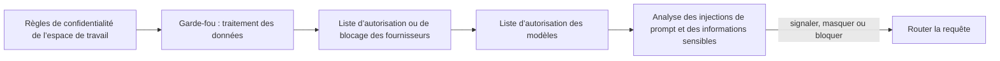

Créez un garde-fou dans **Paramètres → Règles de protection**, associez-le à une clé API à faible risque, et étendez-le seulement une fois que les journaux montrent qu’il se comporte comme prévu. À la fin, cette clé ne peut atteindre que les fournisseurs et modèles que vous autorisez, et ses prompts sont analysés pour détecter les injections de prompt et les données sensibles avant d’atteindre un modèle.

Il s’agit d’une procédure dans le tableau de bord ; la même règle peut être scriptée avec l’[API des garde-fous](../api-reference/endpoint/guardrails-create).

Les règles de confidentialité de l’espace de travail s’appliquent en premier ; un garde-fou peut seulement les restreindre. Les garde-fous ne plafonnent pas les dépenses : définissez plutôt une limite sur la clé ou un [budget d’espace de travail](../api-reference/limits#key-limits-and-budgets).

## Déployer le garde-fou

<Steps>
<Step title="Créer le garde-fou">

Ouvrez **Paramètres → Règles de protection → Nouveau garde-corps**. Nommez-le d’après ce qu’il impose, par exemple `eu-models-pii-redact`, et non d’après une équipe, pour pouvoir le réutiliser sur plusieurs clés.

Définissez l’accès aux routes avant les contrôles de contenu :

| Réglage | Choix |
| --- | --- |
| **Mode fournisseur** | Autoriser tout fournisseurs, Autoriser uniquement les fournisseurs sélectionnés, ou Autoriser tous sauf les fournisseurs sélectionnés |
| **Mode modèle** | Autoriser tous les modèles, ou Autoriser uniquement les fournisseurs sélectionnés modèles (appliqué après le filtrage des fournisseurs) |
| **Données traitement** | ZDR uniquement, et si les endpoints gratuits ou payants susceptibles d’entraîner des modèles sur les entrées restent éligibles |

Une première règle courante bloque les fournisseurs peu fiables et n’autorise que les modèles de production exacts que la clé doit atteindre. Utilisez l’aperçu pour vérifier quels fournisseurs et modèles restent routables, et si **Autoriser uniquement** est plus restrictif que prévu.

</Step>
<Step title="Ajouter des contrôles de contenu">

**Injection d’invite** analyse le contenu fourni par l’utilisateur à la recherche de schémas d’injection courants. **Informations sensibles** détecte les données avant que la requête ne quitte Phaseo :

| Détecteur | Masqué en | Ajoute de la latence |
| --- | --- | --- |
| Adresse e-mail | `[EMAIL]` | Non |
| Numéro de téléphone | `[PHONE]` | Non |
| Numéro de sécurité sociale américain | `[SSN]` | Non |
| Numéro de carte bancaire | `[CREDIT_CARD]` | Non |
| Adresse IP (IPv4) | `[IP_ADDRESS]` | Non |
| Nom de personne | `[PERSON_NAME]` | Oui |
| Adresse postale | `[ADDRESS]` | Oui |

Chaque contrôle a une action : **Signaler**, **Masquer** ou **Bloquer**. Démarrez l’injection de prompt sur **Signaler** ou **Masquer**, et passez à **Bloquer** seulement après avoir examiné les faux positifs. Utilisez d’abord les détecteurs rapides. Ajoutez des schémas personnalisés sous forme de règles regex explicites.

</Step>
<Step title="Le tester dans l’aperçu">

Avant d’enregistrer, faites passer trois entrées dans l’aperçu : une inoffensive, une qui doit clairement être arrêtée et un prompt de production réaliste. Vérifiez le texte de masquage, le résultat de blocage ou d’autorisation, et qu’aucun élément sans rapport ne correspond.

</Step>
<Step title="L’associer à une clé">

Sous **Appliquer aux clés**, choisissez une clé de préproduction ou à faible risque. Vous pouvez associer le garde-fou dès sa création. **Appliquer aux membres** l’impose plutôt aux clés API que ces membres créent. Les membres ne peuvent ni modifier ni retirer un garde-fou attribué par un propriétaire ou un administrateur de l’espace de travail.

</Step>
<Step title="Vérifier son application">

Envoyez de vraies requêtes avec la clé, puis vérifiez :

- **Paramètres → Utilisation → Règles de protection** pour le nombre de requêtes bloquées, masquées et signalées.
- La section **Application des règles de protection** d’une requête dans **Paramètres → Utilisation → Journaux**, pour voir le garde-fou et le détecteur qui se sont déclenchés.
- La colonne **Règles de protection** dans **Paramètres → Clés API**, pour confirmer les clés auxquelles il est associé.

</Step>
<Step title="Étendre le déploiement">

Associez le même garde-fou à d’autres clés, durcissez les actions de **Signaler** vers **Masquer** ou **Bloquer**, et n’ajoutez les détecteurs de nom de personne et d’adresse que là où leur latence est acceptable.

</Step>
</Steps>

Un garde-fou désactivé conserve sa configuration mais n’est pas appliqué. Pour partager des règles de routage entre appelants plutôt que de les imposer à des clés, utilisez un [préréglage](../guides/presets).
