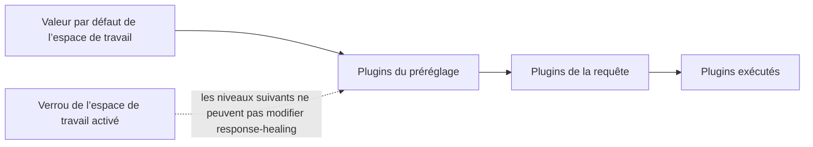

Activez la [réparation de réponse](./response-healing-for-structured-json) une seule fois pour tout l’espace de travail ou pour un préréglage, au lieu de le faire dans chaque requête. À la fin, chaque appelant à sortie structurée reçoit la même règle de réparation, et vous pouvez la verrouiller pour qu’aucun préréglage ni aucune requête ne la désactive.

Il s’agit d’une procédure dans le tableau de bord ; l’exemple de requête à la fin est prêt pour la production.

## Comment les niveaux se combinent

Phaseo construit la liste des plugins de chaque requête à partir de trois niveaux. Un niveau ultérieur remplace les réglages d’un niveau précédent pour le même plugin, sauf si le précédent est verrouillé :



| Niveau | Défini dans | Remplace |
| --- | --- | --- |
| Espace de travail | **Paramètres → Routage → Réparation des réponses** | Rien |
| Préréglage | **Paramètres → Préréglages → (préréglage) → Réparation des réponses** | L’espace de travail, sauf s’il est verrouillé |
| Requête | `plugins` dans le corps | Le préréglage et l’espace de travail, sauf si l’espace de travail est verrouillé |

## La configurer

<Steps>
<Step title="Activer la valeur par défaut de l’espace de travail">

Dans **Paramètres → Routage → Réparation des réponses**, activez **Activer par défaut** et choisissez un **Mode de réparation** : `safe` pour une réparation syntaxique bornée, `strict` pour seulement extraire un JSON déjà valide. Utilisez-le pour les valeurs par défaut générales que partagent toutes les clés API de l’espace de travail.

</Step>
<Step title="La verrouiller si elle n’est pas négociable">

Activez **Verrouiller la stratégie d'espace de travail**. Les préréglages et les requêtes ne peuvent alors ni désactiver la réparation ni changer son mode. Les journaux indiquent toujours si elle a été appliquée ou ignorée.

</Step>
<Step title="Définir les valeurs par défaut d’un préréglage pour un workflow">

Dans l’éditeur de préréglage, activez **Réparation des réponses** et choisissez son mode lorsqu’une famille de requêtes doit porter à la fois un format de sortie structurée et la réparation. Les appelants de ce préréglage n’envoient alors que leur entrée.

</Step>
</Steps>

## La remplacer pour une requête

Quand l’espace de travail n’est pas verrouillé, une requête peut définir le plugin elle-même. `"enabled": false` le désactive pour cette requête :

```json
{
  "model": "openai/gpt-6-astra",
  "input": "Return the summary as JSON.",
  "text": {
    "format": {
      "type": "json_schema",
      "name": "answer",
      "schema": {
        "type": "object",
        "properties": { "summary": { "type": "string" } },
        "required": ["summary"],
        "additionalProperties": false
      }
    }
  },
  "plugins": [{ "id": "response-healing", "enabled": true, "mode": "strict" }],
  "meta": true
}
```

## Vérifier la règle appliquée

Ouvrez la requête dans **Paramètres → Utilisation → Journaux**, ou lisez `meta.plugin_executions` si vous avez envoyé `meta: true`. Vous y trouvez le statut (`applied`, `skipped` ou `failed`), le mode réellement exécuté, et les éventuelles `validation_errors` quand un candidat réparé ne correspondait pas au schéma.

Si deux services se comportent différemment, comparez le réglage de l’espace de travail et son verrou, les plugins du préréglage et les `plugins` de chaque requête avant de conclure à un problème de modèle.
