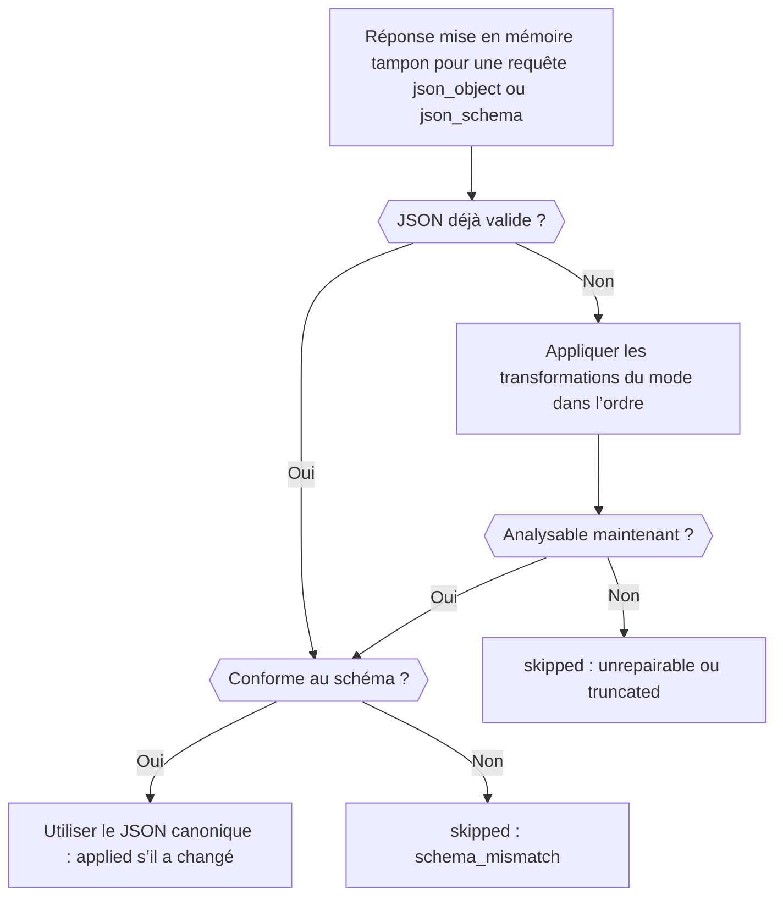

Ajoutez le plugin `response-healing` à une requête à sortie structurée et Phaseo répare le JSON presque valide, par exemple un JSON dans un bloc de code Markdown ou avec une virgule finale, avant qu’il n’atteigne votre parseur. À la fin, vous avez une requête qui demande un JSON Schema, répare la réponse si nécessaire, et vous indique dans la réponse si elle l’a fait.

La requête est prête pour la production. La réparation ne corrige que la syntaxe : votre code doit donc toujours valider le résultat, comme dans [Valider le résultat](../guides/structured-outputs#validate-the-result).



## Envoyer une requête réparée

<CodeGroup>
```bash cURL
curl https://api.phaseo.app/v1/responses \
  -H "Authorization: Bearer $PHASEO_API_KEY" \
  -H "Content-Type: application/json" \
  -d '{
    "model": "openai/gpt-6-astra",
    "input": "Summarize this release in one sentence: dark mode and faster search.",
    "text": {
      "format": {
        "type": "json_schema",
        "name": "answer",
        "strict": true,
        "schema": {
          "type": "object",
          "properties": { "summary": { "type": "string" } },
          "required": ["summary"],
          "additionalProperties": false
        }
      }
    },
    "plugins": [{ "id": "response-healing", "mode": "safe" }],
    "meta": true
  }'
```

```typescript TypeScript
import Phaseo from "@phaseo/sdk";

const client = new Phaseo({ apiKey: process.env.PHASEO_API_KEY! });

const response = await client.generateResponse({
  model: "openai/gpt-6-astra",
  input: "Summarize this release in one sentence: dark mode and faster search.",
  text: {
    format: {
      type: "json_schema",
      name: "answer",
      strict: true,
      schema: {
        type: "object",
        properties: { summary: { type: "string" } },
        required: ["summary"],
        additionalProperties: false,
      },
    },
  },
  plugins: [{ id: "response-healing", mode: "safe" }],
  meta: true,
});

console.log(response.meta?.plugin_executions);
```

```python Python
import os

from phaseo import Phaseo

client = Phaseo(api_key=os.environ["PHASEO_API_KEY"])

response = client.generate_response(
    {
        "model": "openai/gpt-6-astra",
        "input": "Summarize this release in one sentence: dark mode and faster search.",
        "text": {
            "format": {
                "type": "json_schema",
                "name": "answer",
                "strict": True,
                "schema": {
                    "type": "object",
                    "properties": {"summary": {"type": "string"}},
                    "required": ["summary"],
                    "additionalProperties": False,
                },
            }
        },
        "plugins": [{"id": "response-healing", "mode": "safe"}],
        "meta": True,
    }
)

print(response["meta"].get("plugin_executions"))
```
</CodeGroup>

Avec Chat Completions, envoyez le même schéma dans `response_format` au lieu de `text.format`. La réparation ne s’exécute que si la requête demande `json_object` ou `json_schema`, et jamais sur un flux : une requête en streaming l’ignore avec `streaming_unsupported`.

## Vérifier qu’elle s’est exécutée

Avec `meta: true`, `meta.plugin_executions` liste le plugin quand il s’est exécuté :

```json
{
  "id": "response-healing",
  "stage": "response.post_provider",
  "status": "applied",
  "changed": true,
  "metadata": {
    "attempted": true,
    "healed": true,
    "mode": "safe",
    "transforms_applied": ["strip_markdown_fence"]
  }
}
```

| `status` | Signification |
| --- | --- |
| `applied` | La réponse a été réécrite en JSON valide. |
| `skipped` | La réponse a été laissée telle quelle. Avec `attempted: false`, la requête n’était pas éligible ; sinon, le JSON était déjà valide ou n’a pas pu être corrigé. `metadata.failure_reason` donne la raison : `streaming_unsupported`, `not_json` (aucune sortie structurée demandée, ou pas de texte), `unrepairable`, `truncated` (la réponse s’est arrêtée à la limite de tokens), ou `schema_mismatch` avec `validation_errors`. |
| `failed` | Le plugin lui-même a rencontré une erreur (`reason: plugin_error`) ; la réponse est inchangée. |

Le même enregistrement apparaît sur la requête dans **Paramètres → Utilisation → Journaux**. Si le plugin n’apparaît jamais, vérifiez que la requête, son préréglage ou l’espace de travail l’a bien activé ; [Définir les valeurs par défaut des plugins](./plugin-defaults-and-response-healing) indique où.

## Choisir un mode

| Mode | Transformations, dans l’ordre |
| --- | --- |
| `safe` (par défaut) | Retirer un bloc de code Markdown, couper au `{…}` ou `[…]` le plus extérieur, supprimer les virgules finales, mettre entre guillemets les clés nues, et ajouter les crochets et accolades fermants manquants (sauf si la réponse a atteint la limite de tokens) |
| `strict` | Retirer un bloc de code Markdown et couper au `{…}` ou `[…]` le plus extérieur uniquement : seul un JSON déjà valide à l’intérieur de son enveloppe est accepté |

Avec un JSON Schema, le résultat réparé est vérifié avant de remplacer la réponse : clés obligatoires, types, `enum` et `const`, bornes des tableaux et `uniqueItems`, longueur des chaînes, `pattern` et les formats `email`, `uri`, `uuid` et `date-time`, bornes numériques et `multipleOf`, nombre de propriétés et `additionalProperties: false`.

## Savoir quand elle n’aidera pas

La réparation n’invente jamais de champs manquants, ne devine pas de valeurs et ne transforme pas de la prose en données. Distinguez ces échecs avant d’y recourir :

| Échec | Correction |
| --- | --- |
| JSON structurellement proche | Réparation de réponse |
| JSON valide avec de mauvais champs | Resserrer le schéma et le prompt |
| De la prose au lieu de JSON | Demander `json_schema`, pas seulement une instruction dans le prompt |
| Coupé à la limite de tokens | Augmenter `max_output_tokens` |

La réparation fonctionne au mieux sur un seul objet avec des clés obligatoires explicites, une température basse et aucune demande de texte hors du JSON. Activez-la d’abord pour un préréglage, surveillez `plugin_executions` dans les journaux, et étendez-la une fois que les payloads réparés correspondent à votre schéma.
