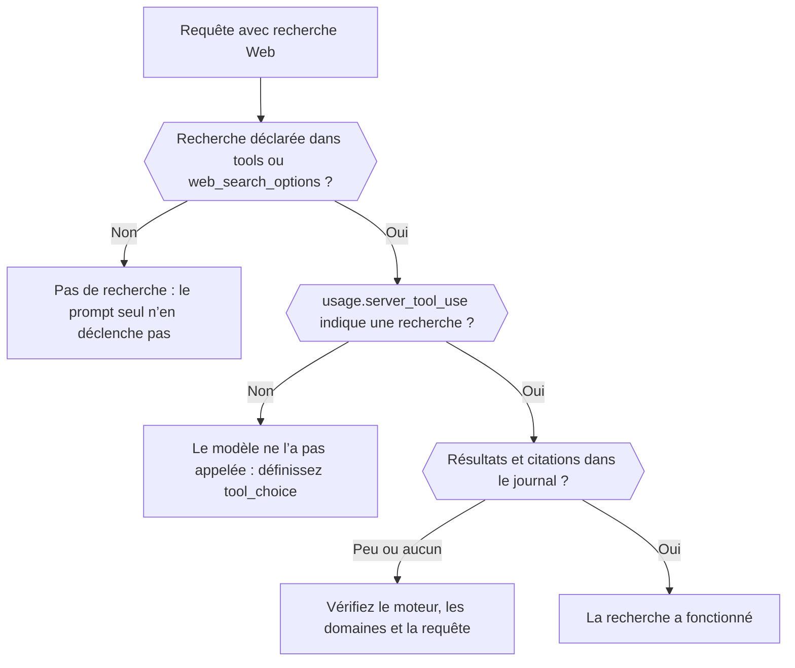

Déterminez, à partir de la réponse et du journal de la requête, si une recherche Web a réellement eu lieu, quel moteur l’a exécutée et ce qu’elle a renvoyé. À la fin, vous savez distinguer une recherche qui n’a jamais eu lieu d’une recherche qui a eu lieu mais a trouvé peu de choses.



## Déclarer la recherche dans la requête

Demander « les dernières actualités » dans le prompt ne lance pas de recherche. Ajoutez-la explicitement :

```json
{
  "model": "openai/gpt-6-astra",
  "input": "What changed in the Phaseo changelog this week?",
  "tools": [{ "type": "phaseo:web_search", "parameters": { "max_results": 5 } }],
  "tool_choice": "phaseo:web_search"
}
```

`phaseo:web_search` fonctionne avec Chat Completions, Responses et Messages. `web_search_options` fonctionne là où l’endpoint le prend en charge. `tool_choice` force l’appel ; sans lui, le modèle peut répondre de mémoire. Le [guide de la recherche Web](../guides/server-tools/web-search) liste tous les paramètres.

## Vérifier qu’elle a eu lieu

| Où regarder | Ce qu’on y voit |
| --- | --- |
| `usage.server_tool_use.web_search_requests` dans la réponse | Le nombre de recherches gérées exécutées |
| **Observabilité de la recherche sur le Web** sur la requête dans **Paramètres → Utilisation → Journaux** | Les recherches gérées, les recherches natives, le nombre de résultats et le nombre de citations, avec les résultats et citations extraits |
| **Observabilité du routage** sur la même requête | Les fournisseurs envisagés, et ceux qui ont été écartés parce qu’ils ne prenaient pas en charge la requête |

## Distinguer les cas d’échec

| Ce que vous voyez | Cause | Correction |
| --- | --- | --- |
| Aucun compteur de recherche | La recherche n’a pas été déclarée, ou le modèle a choisi de ne pas l’appeler | Ajoutez l’outil et définissez `tool_choice` |
| L’outil renvoie `search_not_configured` au modèle | Le moteur géré choisi n’est pas activé | Utilisez le moteur par défaut ou un autre |
| L’outil renvoie `unsupported_search_engine` | Le modèle a demandé `engine: "native"` dans un appel | Définissez `native` uniquement dans la définition de l’outil |
| `400 not_supported`, raison `regional_hosted_tool_not_supported` | Envoyée à `eu.api.phaseo.app` ou `us.api.phaseo.app`, qui refusent les outils serveur | Utilisez `api.phaseo.app` |
| Des recherches ont eu lieu mais les citations sont rares | La requête ou les sources étaient faibles | Ajustez `max_results`, `allowed_domains` ou `engine` |

Avec `engine: "native"`, la requête ne va qu’aux fournisseurs qui exécutent eux-mêmes la recherche Web. Si aucun ne sert le modèle, Phaseo exécute à la place son moteur par défaut et le facture comme une recherche gérée ; une requête native peut donc afficher des compteurs de recherche gérée.

## Comparer les requêtes

Quand les résultats diffèrent d’une exécution à l’autre, comparez l’ID du modèle, le fournisseur sélectionné, les paramètres de recherche, et le nombre de résultats et de citations. Ces nombres sont normalisés entre fournisseurs : les différences de qualité de recherche apparaissent sans lire les payloads bruts. Pour un workflow ancré complet, voir [Recherche Web gérée en TypeScript](./sdk-typescript-managed-search) ; pour une URL connue, utilisez plutôt [web fetch](./tool-grounding-with-web-fetch).
