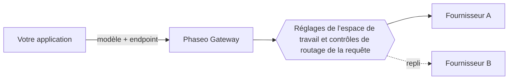

Envoyez un ID de modèle à un endpoint Phaseo, et Phaseo route la requête vers un fournisseur qui héberge ce modèle. Votre application choisit le modèle et l’endpoint ; les réglages de votre espace de travail et les contrôles de routage de la requête déterminent quels fournisseurs peuvent la servir.

## Modèles et fournisseurs

Un modèle est le système qui génère la sortie. Un fournisseur héberge le modèle et en fixe la disponibilité, les paramètres pris en charge, les prix et les performances. Un même modèle peut avoir plusieurs offres de fournisseurs.

Le catalogue public liste aussi des modèles qui ne sont pas encore disponibles via le Gateway. Vérifiez la [disponibilité du modèle](../exploring/models.mdx) avant d’utiliser un ID dans une requête.

## Requêtes et routage

Utilisez [Responses, Chat Completions ou Messages](../api-reference/introduction.mdx), selon le protocole de votre application. Un endpoint commun ne signifie pas que chaque modèle prend en charge chaque paramètre ; les capacités des fournisseurs varient toujours.

Les [contrôles de routage](../guides/routing-and-fallbacks.mdx) restreignent les fournisseurs qui peuvent servir une requête et la façon dont ils sont classés. Les replis restent dans ces restrictions et dépendent de la capacité disponible ; ils ne garantissent donc pas la réussite.

## Facturation et accès

Les requêtes gérées utilisent le solde de votre espace de travail Phaseo, et les modèles `:free` s’exécutent sans crédits déposés. Avec vos propres identifiants de fournisseur (BYOK), la facturation et les limites de compte du fournisseur s’appliquent. Consultez [Tarifs et facturation](../pricing/tiers.mdx) avant le déploiement.

Les [tâches vidéo et batch](../guides/async-video-and-batch.mdx) renvoient une tâche avant la fin du traitement ; l’accès en aperçu à ces tâches est géré par espace de travail. Interrogez l’état ou recevez un webhook, puis téléchargez le résultat.

## Étapes suivantes

Envoyez votre première requête avec le [Démarrage rapide](../quickstart.mdx), puis [intégrez le Gateway](./integrating-with-the-gateway.mdx) à votre application en gardant la clé sur votre backend. En cas d’échec, [Fiabilité et état](./reliability-and-status.mdx) montre comment enquêter, et les [journaux de requêtes](../guides/integrations/observability.mdx) affichent l’utilisation, la latence, le coût et les erreurs de chaque requête.
