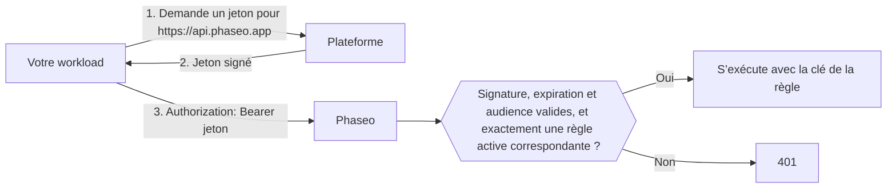

<Note>
Les workloads de confiance sont en bêta et sont déployés progressivement dans les espaces de travail. Si **Paramètres → Clés API → Workloads de confiance** n’apparaît pas dans votre tableau de bord, votre espace de travail n’y a pas encore accès.
</Note>

Envoyez le jeton OIDC de courte durée de votre plateforme comme jeton bearer à la place d’une clé API Phaseo : aucun secret durable n’a besoin d’être stocké dans les paramètres de votre projet ni dans les secrets de CI. Les plateformes donnent à chaque déploiement, job ou workload un jeton signé qui indique qui il est, par exemple « le déploiement de production du projet `website` » ou « un job du projet GitLab `4815162` », et ce jeton expire en quelques heures. Vous indiquez à Phaseo à quels workloads faire confiance.

Phaseo accepte les jetons de Vercel, GitHub Actions, GitLab, Google Cloud, Buildkite, CircleCI et AWS, ainsi que ceux d’un émetteur OIDC que vous gérez vous-même, comme un cluster Kubernetes, Bitbucket Pipelines ou une instance GitLab autogérée. Continuez d’utiliser des clés API pour tout le reste, comme les scripts locaux et les applications mobiles.

## Fonctionnement



Un propriétaire ou un administrateur de l’espace de travail crée une **règle de confiance** qui indique la plateforme, le propriétaire auquel elle fait confiance (comme un propriétaire GitHub, un projet GitLab ou un rôle AWS) et des conditions facultatives, comme un projet, un dépôt, une branche ou un environnement. Une requête correspondante s’exécute avec la clé de la règle, avec les mêmes limites de débit, budgets, journaux et facturation qu’une requête faite avec une clé API.

Les jetons doivent être émis pour l’audience `https://api.phaseo.app` ; Phaseo refuse toute autre audience. Par défaut, la plupart des plateformes utilisent une audience partagée par tous les services que votre workload appelle. Si Phaseo les acceptait, un jeton envoyé à un autre service pourrait être réutilisé contre Phaseo.

## Créer une règle de confiance

<Steps>
<Step title="Ouvrez Workloads de confiance">
Accédez à **Paramètres → Clés API → Workloads de confiance** et sélectionnez **Nouvelle règle**. Seuls les propriétaires et les administrateurs de l’espace de travail peuvent gérer les règles.
</Step>
<Step title="Choisissez la plateforme et renseignez les ID">
Chaque plateforme lie la règle à un ID qui ne peut être ni renommé ni repris par quelqu’un d’autre. Les noms peuvent changer de main : Phaseo ne fait donc jamais confiance à un nom seul.

<Tabs>
<Tab title="Vercel">
- **Slug de l’équipe** : le slug de l’équipe, comme dans `vercel.com/<team-slug>`. Laissez-le vide si votre projet utilise le mode d’émetteur global de Vercel (émetteur `https://oidc.vercel.com` au lieu de `https://oidc.vercel.com/<team-slug>`).
- **ID de l’équipe** : commence par `team_`. Vous le trouverez dans les paramètres de votre équipe Vercel.
- **ID du projet** (recommandé) : commence par `prj_`. Vous le trouverez dans les paramètres de votre projet Vercel. Sans lui, tous les projets de l’équipe sont considérés comme fiables.
- **Environnement** : production, aperçu ou développement. Ne cochez aucune case pour accepter n’importe quel environnement.
</Tab>
<Tab title="GitHub Actions">
- **ID du propriétaire** : l’ID numérique de l’utilisateur ou de l’organisation propriétaire du dépôt.
- **ID du dépôt** (recommandé) : l’ID numérique du dépôt. Sans lui, tous les dépôts du propriétaire sont considérés comme fiables.
- **Branche ou tag** et **Environnement** (facultatifs) : par exemple `refs/heads/main` ou `production`.

Obtenez les deux ID avec la CLI GitHub :

```bash
gh api repos/OWNER/REPO --jq '.id, .owner.id'
```
</Tab>
<Tab title="GitLab">
Pour les projets sur GitLab.com. Pour une instance GitLab autogérée, choisissez **Émetteur OIDC personnalisé**.

- **ID du projet** : l’ID numérique affiché sur la page de présentation du projet. Il ne change pas si le projet est renommé ou déplacé dans un autre groupe, c’est pourquoi Phaseo lie la règle à cet ID plutôt qu’au groupe.
- **Branche ou tag** (facultatif) : le nom de la branche ou du tag, comme `main`.
- **Environnement** (facultatif) : l’environnement du job, comme `production`.

Laissez les deux conditions vides pour accepter tous les jobs du projet.
</Tab>
<Tab title="Google Cloud">
Pour les jetons du serveur de métadonnées sur Cloud Run, Compute Engine, GKE, Cloud Run functions, App Engine et Cloud Build.

- **ID unique du compte de service** : l’ID unique numérique affiché sur la page de détails du compte de service dans la console Google Cloud. Tous les comptes Google partagent le même émetteur : c’est donc cet ID qui distingue votre workload. N’utilisez pas l’adresse e-mail à la place : si le compte de service est supprimé, quelqu’un peut en créer un nouveau avec la même adresse.
- **E-mail du compte de service** (facultatif) : une vérification supplémentaire. Les jetons ne contiennent l’adresse e-mail que si le workload les demande avec `format=full`.
</Tab>
<Tab title="Buildkite">
- **ID de l’organisation** : l’UUID de l’organisation. Chaque jeton Buildkite le contient dans sa revendication `organization_id` : vous pouvez donc le lire dans un jeton demandé par l’un de vos pipelines. Contrairement au slug de l’organisation, il ne change jamais.
- **Slug du pipeline** (facultatif) : sans lui, tous les pipelines de l’organisation sont considérés comme fiables.
</Tab>
<Tab title="CircleCI">
- **ID de l’organisation** : vous le trouverez dans **Organization Settings → Overview**. Chaque organisation CircleCI a son propre émetteur, `https://oidc.circleci.com/org/<organisation ID>`, que Phaseo construit à partir de cet ID.
- **ID du projet** (facultatif) : vous le trouverez dans **Project Settings → Overview**. Sans lui, tous les projets de l’organisation sont considérés comme fiables.
</Tab>
<Tab title="AWS">
Pour les jetons de la fédération d’identité web sortante IAM, qui donne à un rôle IAM un jeton signé destiné à un service externe.

- **URL de l’émetteur** : chaque compte AWS a son propre émetteur, qui se termine par `.tokens.sts.global.api.aws`. Exécutez `aws iam get-outbound-web-identity-federation-info` et copiez `IssuerIdentifier`. Si la commande échoue, activez d’abord la fonctionnalité avec `aws iam enable-outbound-web-identity-federation`.
- **ARN du rôle IAM** : seuls les jetons de ce rôle sont acceptés, par exemple `arn:aws:iam::123456789012:role/evals`. L’émetteur identifie déjà votre compte : l’ARN du rôle identifie donc le workload.
</Tab>
<Tab title="Émetteur OIDC personnalisé">
Utilisez cette option pour tout autre émetteur OIDC qui remplit toutes ces conditions :

- Son URL d’émetteur est une URL `https://` publique, sans port, requête ni fragment, et n’est pas sur un hôte appartenant à l’une des plateformes ci-dessus.
- Il fournit un document de découverte à l’adresse `<issuer>/.well-known/openid-configuration`.
- Ses clés de signature (`jwks_uri`) sont sur le même hôte que l’émetteur.
- Il signe les jetons avec RS256, ES256 ou ES384, et peut les émettre pour l’audience `https://api.phaseo.app`.

Renseignez :

- **URL de l’émetteur** : copiez-la exactement telle qu’elle apparaît dans la revendication `iss` du jeton, y compris une éventuelle barre oblique finale.
- **Revendication du propriétaire** et **Valeur du propriétaire** : la revendication que chaque jeton doit contenir et la valeur exacte qu’elle doit avoir. Choisissez une revendication que personne d’autre ne peut réutiliser, comme un ID numérique, plutôt qu’un nom qui peut être renommé ou réenregistré.
- **Revendication supplémentaire** et **Valeur requise** (facultatives) : une autre revendication à laquelle le jeton doit correspondre.

Les conditions ne portent que sur les revendications de premier niveau. Les revendications imbriquées, comme l’objet `kubernetes.io` de Kubernetes, ne peuvent pas être utilisées.

**Kubernetes (EKS, GKE, AKS)** : chaque cluster a son propre émetteur. Sur EKS, exécutez `aws eks describe-cluster --name <cluster> --query cluster.identity.oidc.issuer`. Sur AKS, activez l’émetteur OIDC et exécutez `az aks show -n <cluster> -g <resource-group> --query oidcIssuerProfile.issuerUrl`. Sur GKE, l’émetteur est `https://container.googleapis.com/v1/projects/<project>/locations/<location>/clusters/<cluster>`. Utilisez `sub` comme revendication du propriétaire, avec la valeur `system:serviceaccount:<namespace>:<service-account>`.

Les clusters Kubernetes autogérés dont l’endpoint de découverte n’est pas public ne fonctionnent pas. Phaseo doit récupérer le document de découverte et les clés depuis Internet sans identifiants, ce que la plupart des clusters n’autorisent pas par défaut.

**Bitbucket Pipelines** : l’émetteur est `https://api.bitbucket.org/2.0/workspaces/<workspace>/pipelines-config/identity/oidc`. Utilisez `workspaceUuid` comme revendication du propriétaire, avec la valeur accolades comprises, par exemple `{a1b2c3d4-...}`. Demandez l’audience Phaseo dans le step :

```yaml
- step:
    oidc:
      audiences:
        - https://api.phaseo.app
```

**GitLab autogéré** : l’émetteur est l’URL de votre GitLab, par exemple `https://gitlab.example.com`. Utilisez `project_id` comme revendication du propriétaire, avec l’ID numérique du projet. Votre instance doit être accessible depuis Internet.
</Tab>
</Tabs>
</Step>
<Step title="Définissez la durée maximale du jeton">
Dans **Jeton le plus long accepté (heures)**, indiquez la durée de vie maximale que vous acceptez. Les jetons émis pour durer plus longtemps sont refusés. Le maximum, qui est aussi la valeur par défaut, est de 12 heures, ce qui couvre les jetons de développement Vercel.
</Step>
</Steps>

Les règles prennent effet en une minute environ. Si vous désactivez ou supprimez une règle, ses jetons cessent de fonctionner dans le même délai.

## Gérer les règles avec Terraform ou l’API

Gérez les règles sous forme de code avec une [clé de gestion](./management-api-keys.mdx) qui dispose des capacités `keys:read`, `keys:write` et `keys:delete`. Seuls les espaces de travail qui ont accès aux workloads de confiance peuvent utiliser ces routes.

Avec Terraform, utilisez la ressource `phaseo_trusted_workload` :

```hcl
resource "phaseo_trusted_workload" "deploy" {
  name     = "GitHub deploy (main)"
  platform = "github_actions"
  owner_id = "123456"

  claim_conditions = {
    repository_id = ["987654321"]
    ref           = ["refs/heads/main"]
  }
}
```

`owner_id` est la valeur de la revendication du propriétaire de la plateforme. Définissez `issuer` lorsque la plateforme en a besoin :

| `platform` | `issuer` | Revendication du propriétaire |
| --- | --- | --- |
| `vercel` | Obligatoire : `https://oidc.vercel.com/<team-slug>`, ou `https://oidc.vercel.com` en mode d’émetteur global | `owner_id` (ID de l’équipe) |
| `github_actions` | Par défaut : `https://token.actions.githubusercontent.com` | `repository_owner_id` |
| `gitlab` | Par défaut : `https://gitlab.com` | `project_id` |
| `google_cloud` | Par défaut : `https://accounts.google.com` | `sub` (ID unique du compte de service) |
| `buildkite` | Par défaut : `https://agent.buildkite.com` | `organization_id` |
| `circleci` | Obligatoire : `https://oidc.circleci.com/org/<organisation ID>` | `oidc.circleci.com/org-id` |
| `aws` | Obligatoire : l’émetteur de votre compte | `sub` (ARN du rôle IAM) |
| `custom` | Obligatoire : l’URL de votre émetteur | La revendication définie dans `owner_claim` |

Pour un émetteur personnalisé, définissez aussi `owner_claim` :

```hcl
resource "phaseo_trusted_workload" "cluster" {
  name        = "Production cluster"
  platform    = "custom"
  issuer      = "https://oidc.eks.us-east-1.amazonaws.com/id/EXAMPLED539D4633E53DE1B71EXAMPLE"
  owner_claim = "sub"
  owner_id    = "system:serviceaccount:prod:api"
}
```

Autres champs :

| Champ | Valeurs |
| --- | --- |
| `claim_conditions` | Nom de revendication associé aux valeurs autorisées ; chaque revendication doit correspondre à l’une de ses valeurs. Jusqu’à 15 revendications en plus de la revendication du propriétaire, et 20 valeurs par revendication. `iss`, `aud`, `exp`, `iat`, `nbf`, `jti` et la revendication du propriétaire ne peuvent pas être utilisés. |
| `max_token_lifetime_seconds` | Durée de vie maximale acceptée pour un jeton, de `60` à `43200` (12 heures). `43200` par défaut. |
| `enabled` (Terraform) ou `status` (API : `active` ou `disabled`) | Indique si les jetons correspondants sont acceptés. |

Modifier la plateforme, l’émetteur, la revendication du propriétaire ou le propriétaire remplace la règle. Une règle n’a pas de secret : rien de sensible n’est donc stocké dans l’état Terraform.

Avec l’API, envoyez les mêmes champs à `/v1/workload-identity/policies`. L’API nomme la plateforme `provider` :

```bash
curl https://api.phaseo.app/v1/workload-identity/policies \
  -H "Authorization: Bearer $PHASEO_MANAGEMENT_KEY" \
  -H "Content-Type: application/json" \
  -d '{"name":"GitHub deploy (main)","provider":"github_actions","owner_id":"123456","claim_conditions":{"repository_id":["987654321"],"ref":["refs/heads/main"]}}'
```

Pour un émetteur personnalisé :

```bash
curl https://api.phaseo.app/v1/workload-identity/policies \
  -H "Authorization: Bearer $PHASEO_MANAGEMENT_KEY" \
  -H "Content-Type: application/json" \
  -d '{"name":"Production cluster","provider":"custom","issuer":"https://oidc.eks.us-east-1.amazonaws.com/id/EXAMPLED539D4633E53DE1B71EXAMPLE","owner_claim":"sub","owner_id":"system:serviceaccount:prod:api"}'
```

La [référence de l’API](../api-reference/endpoint/trusted-workloads-create.mdx) répertorie tous les champs et toutes les réponses.

## Appeler Phaseo avec un jeton

Chaque SDK Phaseo accepte une fonction à la place de la clé API et l’appelle avant chaque requête et chaque nouvelle tentative : chaque requête utilise donc un jeton à jour. Chaque SDK, sauf celui en C++, inclut un utilitaire pour GitHub Actions et Vercel. Il récupère un jeton émis pour `https://api.phaseo.app` et le réutilise jusqu’à une minute avant son expiration :

| SDK | GitHub Actions | Vercel |
| --- | --- | --- |
| TypeScript | `githubActionsToken()` | `vercelToken()` |
| Python | `github_actions_token()` | `vercel_token()` |
| Go | `phaseo.GitHubActionsToken()` | `phaseo.VercelToken()` |
| Java | `WorkloadTokens.gitHubActions()` | `WorkloadTokens.vercel()` |
| C# | `WorkloadTokens.GitHubActions()` | `WorkloadTokens.Vercel()` |
| PHP | `WorkloadTokens::githubActions()` | `WorkloadTokens::vercel()` |
| Ruby | `PhaseoSdk::WorkloadTokens.github_actions` | `PhaseoSdk::WorkloadTokens.vercel` |
| Rust | `phaseo::auth::github_actions_token()` | `phaseo::auth::vercel_token()` |
| C++ | Passez votre propre fonction à `set_api_key_provider` | Passez votre propre fonction à `set_api_key_provider` |

Ces utilitaires nécessitent la prochaine version de chaque SDK. Sur Vercel, l’utilitaire échange le jeton du déploiement lu dans `VERCEL_OIDC_TOKEN_FILE` ou `VERCEL_OIDC_TOKEN`. Dans les Vercel Functions, le jeton arrive avec chaque requête dans l’en-tête `x-vercel-oidc-token` ; passez-le à l’utilitaire comme source de jeton.

Sur les autres plateformes, passez votre propre fonction qui renvoie le jeton, par exemple une fonction qui lit la variable du job GitLab ou qui appelle le serveur de métadonnées Google Cloud :

```ts
import Phaseo from "@phaseo/sdk";

const client = new Phaseo({
	apiKey: async () => {
		const response = await fetch(
			"http://metadata.google.internal/computeMetadata/v1/instance/service-accounts/default/identity?audience=https://api.phaseo.app",
			{ headers: { "Metadata-Flavor": "Google" } },
		);
		return response.text();
	},
});
```

<Tabs>
<Tab title="Vercel">
Utilisez `getVercelOidcToken` depuis le point d’entrée serveur de `@vercel/oidc` 4.x. Passer `audience` échange le jeton du déploiement contre un jeton émis pour Phaseo.

Avec le [SDK TypeScript](../sdk-reference/client/overview.mdx), passez-le comme fonction `apiKey` :

```ts
import Phaseo from "@phaseo/sdk";
import { getVercelOidcToken } from "@vercel/oidc";

const client = new Phaseo({
	apiKey: () => getVercelOidcToken({ audience: "https://api.phaseo.app" }),
});

const response = await client.responses.create({
	model: "openai/gpt-6-astra",
	input: "Hello from a trusted workload",
});
```

Passer une fonction comme `apiKey` nécessite une version de `@phaseo/sdk` postérieure à 3.0.0.

Avec n’importe quel client HTTP, demandez un jeton pour chaque requête et envoyez-le comme jeton bearer :

```ts
import { getVercelOidcToken } from "@vercel/oidc";

const token = await getVercelOidcToken({ audience: "https://api.phaseo.app" });

const response = await fetch("https://api.phaseo.app/v1/chat/completions", {
	method: "POST",
	headers: {
		Authorization: `Bearer ${token}`,
		"Content-Type": "application/json",
	},
	body: JSON.stringify({
		model: "openai/gpt-6-astra",
		messages: [{ role: "user", content: "Hello from a trusted workload" }],
	}),
});
```

Ne stockez pas le jeton dans une variable au niveau du module : Vercel peut le changer d’une requête à l’autre.
</Tab>
<Tab title="GitHub Actions">
Le job a besoin de l’autorisation `id-token: write` pour demander un jeton.

```yaml
permissions:
  id-token: write
  contents: read

jobs:
  evals:
    runs-on: ubuntu-latest
    steps:
      - uses: actions/github-script@v7
        with:
          script: |
            const token = await core.getIDToken("https://api.phaseo.app");
            const response = await fetch("https://api.phaseo.app/v1/chat/completions", {
              method: "POST",
              headers: {
                Authorization: `Bearer ${token}`,
                "Content-Type": "application/json",
              },
              body: JSON.stringify({
                model: "openai/gpt-6-astra",
                messages: [{ role: "user", content: "Hello from GitHub Actions" }],
              }),
            });
            core.info(String(response.status));
```

Depuis un step shell, demandez le jeton avec `curl` :

```bash
TOKEN=$(curl -sS -H "Authorization: bearer $ACTIONS_ID_TOKEN_REQUEST_TOKEN" \
  "$ACTIONS_ID_TOKEN_REQUEST_URL&audience=https://api.phaseo.app" | jq -r .value)

curl https://api.phaseo.app/v1/chat/completions \
  -H "Authorization: Bearer $TOKEN" \
  -H "Content-Type: application/json" \
  -d '{"model":"openai/gpt-6-astra","messages":[{"role":"user","content":"Hello"}]}'
```

Les jetons GitHub Actions ont une courte durée de vie : demandez-en un nouveau pour les jobs longs.
</Tab>
<Tab title="GitLab">
Ajoutez une entrée `id_tokens` au job dans `.gitlab-ci.yml`. GitLab place le jeton dans la variable que vous nommez :

```yaml
evals:
  id_tokens:
    PHASEO_TOKEN:
      aud: https://api.phaseo.app
  script:
    - >
      curl https://api.phaseo.app/v1/chat/completions
      -H "Authorization: Bearer $PHASEO_TOKEN"
      -H "Content-Type: application/json"
      -d '{"model":"openai/gpt-6-astra","messages":[{"role":"user","content":"Hello from GitLab"}]}'
```

Le jeton dure aussi longtemps que le délai d’expiration du job.
</Tab>
<Tab title="Google Cloud">
Demandez le jeton au serveur de métadonnées. Cela fonctionne sur Cloud Run, Compute Engine, GKE, Cloud Run functions, App Engine et Cloud Build :

```bash
TOKEN=$(curl -sS -H "Metadata-Flavor: Google" \
  "http://metadata.google.internal/computeMetadata/v1/instance/service-accounts/default/identity?audience=https://api.phaseo.app")

curl https://api.phaseo.app/v1/chat/completions \
  -H "Authorization: Bearer $TOKEN" \
  -H "Content-Type: application/json" \
  -d '{"model":"openai/gpt-6-astra","messages":[{"role":"user","content":"Hello from Google Cloud"}]}'
```

Ajoutez `&format=full` à l’URL si votre règle vérifie l’adresse e-mail du compte de service. Les jetons durent 1 heure.
</Tab>
<Tab title="Buildkite">
Demandez le jeton avec l’agent dans la commande d’un step :

```bash
TOKEN=$(buildkite-agent oidc request-token --audience https://api.phaseo.app)

curl https://api.phaseo.app/v1/chat/completions \
  -H "Authorization: Bearer $TOKEN" \
  -H "Content-Type: application/json" \
  -d '{"model":"openai/gpt-6-astra","messages":[{"role":"user","content":"Hello from Buildkite"}]}'
```

Les jetons durent 5 minutes par défaut. Pour les steps plus longs, demandez-en un nouveau ou passez `--lifetime` en secondes.
</Tab>
<Tab title="CircleCI">
Demandez le jeton avec la CLI CircleCI dans un step du job :

```bash
TOKEN=$(circleci run oidc get --claims '{"aud":"https://api.phaseo.app"}')

curl https://api.phaseo.app/v1/chat/completions \
  -H "Authorization: Bearer $TOKEN" \
  -H "Content-Type: application/json" \
  -d '{"model":"openai/gpt-6-astra","messages":[{"role":"user","content":"Hello from CircleCI"}]}'
```

Les jetons durent 1 heure.
</Tab>
<Tab title="AWS">
Activez la fédération d’identité sortante une fois par compte AWS, puis demandez un jeton en tant que rôle IAM. Le rôle a besoin de l’autorisation `sts:GetWebIdentityToken`.

```bash
# Une fois par compte
aws iam enable-outbound-web-identity-federation

# Dans le workload
TOKEN=$(aws sts get-web-identity-token --audience https://api.phaseo.app \
  --signing-algorithm ES384 --query WebIdentityToken --output text)

curl https://api.phaseo.app/v1/chat/completions \
  -H "Authorization: Bearer $TOKEN" \
  -H "Content-Type: application/json" \
  -d '{"model":"openai/gpt-6-astra","messages":[{"role":"user","content":"Hello from AWS"}]}'
```

Phaseo accepte `ES384` et `RS256`. Les jetons durent 5 minutes par défaut ; passez `--duration-seconds` pour aller jusqu’à 1 heure.
</Tab>
<Tab title="Émetteur OIDC personnalisé">
Sur Kubernetes, montez un jeton de compte de service projeté émis pour l’audience Phaseo :

```yaml
spec:
  serviceAccountName: api
  containers:
    - name: app
      volumeMounts:
        - name: phaseo-token
          mountPath: /var/run/secrets/phaseo
  volumes:
    - name: phaseo-token
      projected:
        sources:
          - serviceAccountToken:
              audience: https://api.phaseo.app
              expirationSeconds: 3600
              path: token
```

Lisez `/var/run/secrets/phaseo/token` avant chaque requête et envoyez son contenu comme jeton bearer. Kubernetes renouvelle le fichier avant l’expiration du jeton : ne gardez donc pas la valeur en mémoire.

Dans Bitbucket Pipelines, un step pour lequel des audiences `oidc` sont définies reçoit le jeton dans `BITBUCKET_STEP_OIDC_TOKEN`.
</Tab>
</Tabs>

## Comportement et limites

- **Les mêmes contrôles qu’une clé.** Les requêtes s’exécutent avec la clé de la règle : les limites de débit de la clé, les budgets, les liens vers les départements, les listes d’adresses IP autorisées, les paramètres de journalisation et la facturation s’appliquent comme d’habitude.
- **Appels de modèles uniquement.** Les jetons de workloads fonctionnent là où fonctionne une clé API du Gateway. Les API de gestion les refusent.
- **Une seule règle correspondante.** Un jeton qui correspond à plusieurs règles actives est refusé. Si les règles se trouvent dans des espaces de travail différents, envoyez l’ID de l’espace de travail dans l’en-tête `x-phaseo-workspace` pour en choisir un. Si elles se trouvent dans le même espace de travail, restreignez leurs conditions pour qu’une seule corresponde.
- **Durée de vie du jeton.** Les jetons émis pour durer plus longtemps que le **Jeton le plus long accepté** de la règle sont refusés, et Phaseo n’accepte jamais de jetons émis pour plus de 12 heures. Les jetons Buildkite et AWS durent 5 minutes par défaut ; ceux de Google Cloud et CircleCI, 1 heure. Les jetons GitLab durent aussi longtemps que le délai d’expiration du job : un job dont le délai dépasse 12 heures reçoit donc un jeton que Phaseo refuse. AKS peut émettre des jetons valables jusqu’à 24 heures : définissez un `expirationSeconds` plus court.
- **Azure n’est pas encore pris en charge.** Les identités managées Azure ne peuvent pas demander de jetons pour l’audience Phaseo. Les pods sur AKS peuvent toutefois utiliser un jeton de compte de service Kubernetes via un émetteur personnalisé.
- **Les clés API ne changent pas.** Les workloads de confiance ajoutent une seconde méthode d’authentification ; ils ne modifient ni ne désactivent les clés API.

## Corriger un jeton refusé

Un jeton refusé renvoie `401` avec le code d’erreur `unauthorised` et l’une de ces valeurs de `reason` :

| `reason` | Signification | Que faire |
| --- | --- | --- |
| `workload_token_wrong_audience` | Le jeton n’a pas été émis pour `https://api.phaseo.app`. | Demandez le jeton avec cette audience. |
| `workload_token_malformed` | Le jeton n’est pas un jeton OIDC bien formé : il n’a pas d’ID de clé, d’émetteur ou de revendications temporelles valides. | Envoyez le jeton sans le modifier, exactement tel que la plateforme l’a émis. |
| `workload_issuer_not_trusted` | Aucune règle active n’utilise l’émetteur de ce jeton. | Vérifiez que la règle est activée et que son émetteur correspond exactement à la revendication `iss` du jeton, y compris le slug de l’équipe Vercel ou le mode d’émetteur, et une éventuelle barre oblique finale pour un émetteur personnalisé. |
| `workload_identity_no_matching_policy` | Le jeton est valide, mais aucune règle active ne lui correspond. | Vérifiez l’ID du propriétaire, les conditions de projet, de dépôt, de pipeline, de branche, de tag ou d’environnement, et que la durée de vie du jeton ne dépasse pas le **Jeton le plus long accepté** de la règle. |
| `workload_identity_ambiguous` | Plusieurs règles actives correspondent à ce jeton. | Entre plusieurs espaces de travail, envoyez `x-phaseo-workspace: <workspace id>`. Dans un même espace de travail, restreignez les conditions des règles. |
| `workload_identity_not_enabled` | Les workloads de confiance ne sont pas encore disponibles pour cet espace de travail. | Utilisez une clé API pour le moment. |
| `workload_token_expired` | Le jeton a expiré. | Demandez un nouveau jeton pour chaque requête ou step du job. |
| `workload_token_not_yet_valid` | L’heure `nbf` du jeton est plus d’une minute dans le futur. | Vérifiez l’horloge de la machine qui émet les jetons. |
| `workload_token_lifetime_too_long` | Le jeton a été émis pour durer plus de 12 heures, le maximum accepté par Phaseo. | Demandez un jeton de plus courte durée, par exemple avec un `expirationSeconds` plus court sur Kubernetes ou un délai d’expiration du job plus court sur GitLab. |
| `workload_token_too_many_claims` | Le jeton d’un émetteur personnalisé contient plus de 100 valeurs de revendications de premier niveau distinctes. | Configurez l’émetteur pour qu’il envoie moins de revendications, ou placez les valeurs supplémentaires dans un objet imbriqué. |
| `workload_token_unsupported_alg` | Le jeton n’est pas signé avec RS256, ES256 ou ES384. | Configurez l’émetteur pour qu’il utilise l’un de ces algorithmes. |
| `workload_token_invalid_signature` | La signature du jeton ne correspond pas aux clés de la plateforme. | Envoyez le jeton sans le modifier, exactement tel que la plateforme l’a émis. |
| `workload_token_key_not_found` | Les clés publiées par l’émetteur n’incluent pas la clé qui a signé le jeton. | Réessayez après une courte attente. Pour un émetteur personnalisé, vérifiez que son `jwks_uri` fournit la clé de signature actuelle. |
| `key_ip_not_allowed` | La clé de la règle a une liste d’adresses IP autorisées qui n’inclut pas l’appelant. | Ajoutez les adresses IP du workload à la liste d’adresses autorisées de la clé. |
| `workload_jwks_unavailable` | Phaseo n’a pas pu récupérer les clés de signature de la plateforme. | Réessayez après une courte attente. Pour un émetteur personnalisé, vérifiez que `<issuer>/.well-known/openid-configuration` se charge depuis Internet sans identifiants et que son `jwks_uri` est sur le même hôte. |
