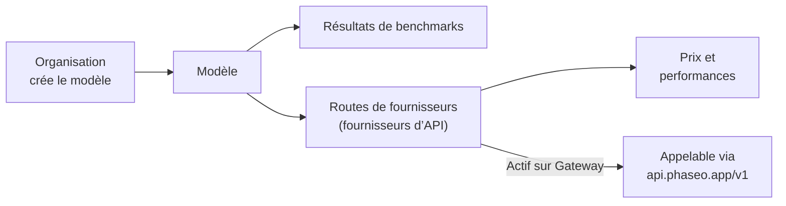

Recherchez n’importe quel modèle sur [phaseo.app](https://phaseo.app/models) pour voir qui l’a créé, quels fournisseurs le servent, ce qu’il coûte et quels scores il obtient, puis appelez-le via le Gateway lorsqu’il a une route active.

## Ce que contient le catalogue

| Enregistrement | Ce que c’est | Où le consulter |
| --- | --- | --- |
| [Organisations](./organisations.mdx) | Les entreprises et laboratoires de recherche qui créent et publient des modèles. | [Organisations](https://phaseo.app/organisations) |
| [Modèles](./models.mdx) | Chaque modèle publié, regroupé en familles de modèles apparentés. | [Modèles](https://phaseo.app/models) |
| [Benchmarks](./benchmarks.mdx) | Les évaluations et les scores que les modèles y obtiennent. | [Évaluations comparatives](https://phaseo.app/benchmarks) |
| [Fournisseurs d’API](./api-providers.mdx) | Les plateformes qui servent des modèles via une API. | [Fournisseurs d’API](https://phaseo.app/api-providers) |
| [Prix et performances](./pricing-performance.mdx) | Le prix de chaque fournisseur par token, image, seconde ou requête, et la vitesse mesurée sur le Gateway. | Pages de modèle, [Comparer](https://phaseo.app/compare) |
| [Offres d’abonnement](./subscription-plans.mdx) | Les offres Phaseo et les abonnements vendus par les fournisseurs. | [Forfaits d’abonnement](https://phaseo.app/subscription-plans) |

Un enregistrement du catalogue ne signifie pas que vous pouvez appeler le modèle. Seuls les modèles marqués **Actif sur Gateway** ont une route ; `GET /v1/models` ne renvoie que ceux-là.

## Lire les données

- **Les prix** sont en USD, par million de tokens pour le texte, ou dans l’unité propre au fournisseur (par image, par seconde, par requête) pour les médias.
- **Les dates** sont des jours UTC, affichées sous la forme `01 Jan 2026` en anglais.
- **Les scores de benchmark** conservent l’échelle et le sens propres au benchmark. Phaseo ne les convertit pas en un score commun ; consultez [Benchmarks](./benchmarks.mdx).
- **Les familles** regroupent des modèles apparentés, comme les tailles et les versions d’une même gamme.

## Comment les données restent à jour

Les tâches de synchronisation des fournisseurs proposent de nouveaux prix, qu’un administrateur vérifie avant publication. Les imports de benchmarks et les tâches de cycle de vie des modèles mettent à jour la base de données selon un calendrier. Tout le monde peut signaler une correction ou un enregistrement manquant via une issue GitHub ; les mainteneurs examinent les preuves et appliquent les modifications approuvées. Consultez [Contribuer](../contributing/overview.mdx).

## Exemples de questions

| Objectif | Où trouver la réponse |
| --- | --- |
| Comparer deux modèles sur un benchmark | [Comparer](https://phaseo.app/compare) ou la page du benchmark |
| Trouver le modèle le moins cher pour une tâche | La liste des [Modèles](https://phaseo.app/models) triée par prix, puis le [calculateur de prix](https://phaseo.app/tools/pricing-calculator) |
| Voir l’évolution d’un benchmark dans le temps | Le graphique **Progression** du benchmark |
| Trouver les fournisseurs qui prennent en charge une fonctionnalité | La section **Fournisseurs** de la page du modèle, ou `GET /v1/models/{author}/{slug}/endpoints` |
| Trouver des enregistrements à compléter | Les pages de modèle sans benchmarks ou métadonnées ; consultez [Contribuer](../contributing/overview.mdx) |
