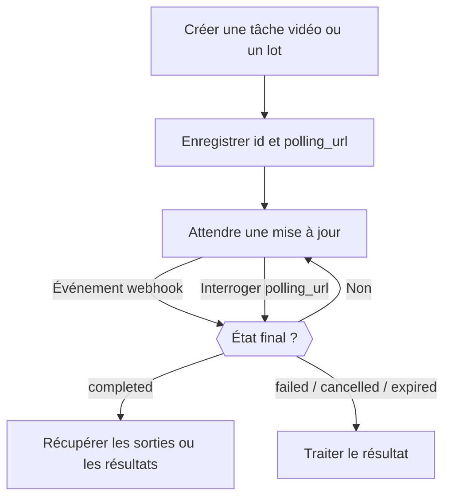

<Note>
La Video API et la Batch API sont des aperçus bêta sur invitation, réservés à certains espaces de travail. Consultez **Paramètres → Aperçu des fonctionnalités** pour savoir si elles sont disponibles. L’accès est géré par espace de travail ; activer une préférence web personnelle ne donne pas accès à l’API. Les frais habituels d’utilisation des modèles s’appliquent.
</Note>

Créer une vidéo ou un lot renvoie une tâche avant que le travail soit terminé. Enregistrez son `id` et son `polling_url`, puis attendez un webhook ou interrogez l’URL jusqu’à ce que la tâche atteigne un état final : `completed`, `failed`, `cancelled` ou `expired`. Une réponse de création réussie signifie seulement que la tâche a été acceptée.



Conservez le mécanisme d’interrogation même si vous utilisez des webhooks. Pendant la bêta, commencez par de petites requêtes et une limite de dépenses sur la clé API. Les entrées de référence, l’annulation et la conservation des sorties dépendent du fournisseur et du modèle. Enregistrez votre propre copie des sorties terminées avant leur expiration.

<span id="receive-updates"></span>
## Recevoir les mises à jour

Associez un endpoint de webhook appartenant à votre espace de travail lorsque vous créez l’un ou l’autre type de tâche :

```json
{
  "webhook": {
    "endpoint_id": "YOUR_ENDPOINT_ID",
    "events": ["job.status_changed", "job.completed", "job.failed", "job.cancelled", "job.expired"]
  }
}
```

Phaseo rapproche l’état chez le fournisseur et envoie les notifications : les fournisseurs qui ne prennent en charge que l’interrogation, comme les lots de messages Anthropic, produisent donc quand même des webhooks. Un échec de livraison de webhook ne signifie pas que la tâche a échoué.

Abonnez-vous séparément aux événements Batch et Video avec des types d’événements préfixés, comme `batch.completed` ou `video.failed`. Les types d’événements génériques `job.*` fonctionnent toujours et s’abonnent à la phase correspondante pour les deux types de tâches.

### Vérifier et confirmer les livraisons

Vérifiez `x-phaseo-signature` avec le secret de l’endpoint : il s’agit du HMAC-SHA256 hexadécimal de `x-phaseo-timestamp`, d’un point littéral et du **corps de la requête non modifié**. Vérifiez que l’horodatage est récent, dédupliquez sur `x-phaseo-event-id` et confirmez les livraisons acceptées par une réponse 2xx. Les livraisons peuvent être relancées ou arriver dans le désordre : récupérez donc la tâche avant d’appliquer un changement d’état contradictoire.

| Tentative | Moment |
| --- | --- |
| 1 | Dès que l’événement se produit |
| 2 | Environ 1 minute après une tentative en échec |
| 3 | Environ 5 minutes plus tard |
| 4 | Environ 15 minutes plus tard ; en cas d’échec, la livraison est marquée comme définitivement échouée |

Une réponse 2xx met fin à la livraison. Les nouvelles tentatives sont envoyées par des balayages en arrière-plan : une nouvelle tentative peut donc arriver plus tard que prévu. Chaque tentative enregistre son numéro, son heure, son code d’état HTTP, son erreur et l’heure de la prochaine tentative. Dédupliquez malgré tout : une confirmation perdue ou un worker interrompu peut rendre une livraison incertaine.

Après avoir enregistré un endpoint, utilisez **Envoyer un événement de test** dans les paramètres pour livrer une charge utile `webhook.test` signée. Une livraison de test n’est tentée qu’une fois, n’est pas relancée et n’est pas ajoutée à l’historique de livraison des tâches.

## Consulter les journaux des tâches et des requêtes

Dans **Paramètres → Utilisation → Journaux**, utilisez **Requêtes** pour le détail des requêtes d’inférence, **Vidéos** pour le cycle de vie des vidéos et **Lots** pour les traitements par lots et les résultats par ligne. Les vues détaillées Vidéos et Lots indiquent l’état de facturation, les tentatives auprès du fournisseur et les tentatives de webhook. Une tâche peut se terminer avec succès alors que la livraison de son webhook échoue.

L’envoi d’une vidéo réserve du crédit avant de contacter le fournisseur. Un délai d’attente dépassé sans ID de tâche conserve la réservation pour le rapprochement ; ce n’est pas la preuve d’un échec de génération. Si une réservation Video ou Batch payante est valorisée à zéro de façon inattendue après un travail réussi, la facturation reste ouverte avec `unexpected_zero_cost` pour enquête. Une réponse de création à coût nul est, à elle seule, normale pour une génération asynchrone.

## Estimer le coût d’une vidéo

Les prix des vidéos dépendent du fournisseur et du modèle. Un prix à la seconde doit être multiplié par la durée facturable ; un prix par clip ne s’applique qu’à la durée et à la résolution qu’il précise. Plusieurs sorties et des entrées de référence facturables peuvent augmenter le total.

La génération texte/image de LTX facture les secondes de sortie, tandis que l’audio-vers-vidéo facture les secondes d’audio en entrée. BytePlus Seedance utilise des tokens vidéo, avec des tarifs différents lorsqu’une vidéo de référence est présente. MiniMax Hailuo V1 utilise des prix par clip à durée fixe ; H3 utilise des secondes et peut facturer les entrées de référence. Vérifiez les dimensions tarifaires du fournisseur sélectionné plutôt que d’interpréter un prix d’appel comme le coût d’une requête entière.

Les réservations sont des estimations retenues avant l’envoi. La facturation finale utilise l’utilisation facturable de la tâche ; le crédit réservé non utilisé est libéré après rapprochement. Qu’un fournisseur prenne en charge une résolution ou une option ne garantit pas qu’elle soit disponible pendant la bêta.

## Définir la durée, les images clés et les références

Utilisez `seconds` ou `duration` pour la durée de sortie. Si les deux sont présents, ils doivent concorder. Utilisez `resolution` avec `aspect_ratio`, ou une `size` en pixels comme `1280x720`.

Utilisez `frame_images` pour indiquer explicitement la première et la dernière image :

```json
{
  "frame_images": [
    {
      "type": "image_url",
      "frame_type": "first_frame",
      "image_url": { "url": "https://example.com/start.png" }
    }
  ],
  "input_references": [
    {
      "type": "image_url",
      "role": "reference",
      "image_url": { "url": "https://example.com/character.png" }
    }
  ]
}
```

Les URL de référence doivent utiliser HTTPS. Indiquez explicitement `role: "reference"` pour les images servant uniquement de référence : les anciennes requêtes sans `frame_images` interprètent la première image sans étiquette comme première image. Ne combinez pas `frame_images` avec des rôles de première ou dernière image dans `input_references`, ni avec `input_reference`.

Les références vidéo et audio utilisent `type: "video_url"` ou `"audio_url"` et `media_url: { "url": "https://..." }`. Les modèles et les fournisseurs prennent en charge des combinaisons différentes. Lorsque la durée de la référence influe sur le prix, fournissez `input_video_duration` et `input_audio_duration` en secondes.

## Transmettre des options vidéo propres au fournisseur

Gardez le modèle, la durée, la résolution, la génération audio, les médias d’entrée et le nombre de sorties dans les champs canoniques. Transmettez les extensions propres au fournisseur sous l’ID canonique du fournisseur :

```json
{
  "provider_options": {
    "atlascloud": { "watermark": false, "output_format": "mp4" },
    "byteplus": { "camera_fixed": true }
  }
}
```

Seules les options du fournisseur sélectionné sont transmises. Les options ne sélectionnent pas de fournisseur ; utilisez pour cela la configuration de routage `provider`. Ne combinez pas `provider_options` avec l’ancien `provider_params`. Les options imbriquées ne peuvent pas remplacer les champs de facturation ou de rappel contrôlés par le Gateway.

| Fournisseur | Exemples d’extensions natives | Référence |
| --- | --- | --- |
| AtlasCloud Seedance 2.5 | `watermark`, `output_format`, `return_last_frame`, `omni_reference_task_type` | [Model API](https://www.atlascloud.ai/models/bytedance/seedance-2.5/reference-to-video) |
| Novita Seedance 1.5 | `watermark`, `camera_fixed`, `fps` (24), `service_tier` (`default`) | [Unified video API](https://docs.novita.ai/api-reference/reference-unified-video-generation) |
| BytePlus Seedance | `camera_fixed` | Vérifiez le contrat du fournisseur pour le modèle sélectionné avant utilisation. |
| MiniMax V1 | `fast_pretreatment` ; utilisez le champ canonique `enhance_prompt` pour l’optimisation du prompt | [Video API](https://platform.minimax.io/docs/api-reference/video-generation-t2v) |

AtlasCloud Seedance utilise les champs natifs `resolution`, `ratio` et `last_image`. Sa variante référence-vers-vidéo reçoit des références image, vidéo et audio ordonnées. L’édition à durée automatique (`duration: -1`) n’est pas prise en charge par le contrat de réservation à durée fixe du Gateway. La disponibilité et les prix du modèle chez le fournisseur doivent être configurés avant qu’un modèle puisse être routé ; une option de fournisseur n’active pas un modèle indisponible.

MiniMax H3 utilise V2 : de 4 à 15 secondes entières en `768P` ou `2K`. H3 Max prend en charge de 5 à 15 secondes entières en `480P` ou `768P`, avec du texte ou des images clés. H3 prend en charge les images, vidéos et audios de référence ; les références ne peuvent pas être mélangées avec une première ou une dernière image. Les deux modèles produisent une vidéo par requête et ne prennent pas en charge les options d’optimisation du prompt de V1. Utilisez le champ canonique `aspect_ratio` ; les images clés en entrée déterminent leur propre format. Les réservations pour une vidéo de référence couvrent la limite d’entrée de 15 secondes du fournisseur, l’utilisation réelle étant réglée à la fin. Consultez le [contrat MiniMax V2](https://platform.minimax.io/docs/api-reference/video-generation-v2-create).

## Vérifier ce que prend en charge chaque fournisseur de lots

Les requêtes de lot acceptent aussi `provider_options` : OpenAI prend en charge `output_expires_after`, et Mistral prend en charge `metadata`. Utilisez les ID canoniques des fournisseurs et ne dupliquez pas ces champs au niveau supérieur. Par exemple, `provider_options: { "openai": { "output_expires_after": { "anchor": "created_at", "seconds": 86400 } } }` définit la conservation des sorties OpenAI. Les entrées des lignes, les modèles, les endpoints et les destinations de webhook ne peuvent pas être remplacés via les options.

Mistral dispose déjà d’un adaptateur de lots natif. Les lots de messages Anthropic sont interrogés ; d’autres fournisseurs peuvent combiner l’interrogation avec des notifications de fin natives. La disponibilité dépend des endpoints pris en charge par le fournisseur et de la liste d’autorisation de lots du déploiement. Vérifiez la réponse de capacités des lots avant d’envoyer un fichier ou des requêtes en ligne.

Les lots Vertex Gemini acceptent des `requests` en ligne avec `/v1/generateContent`, ou `model` et `prompts`. Sélectionnez `provider: "google-vertex"` pour utiliser Vertex. Les lignes réussies sont facturées aux tarifs Batch. Cet adaptateur nécessite des identifiants gérés ; les lots BYOK, avec des fichiers téléversés, d’embeddings et `google-vertex-eu` ne sont pas disponibles. L’entrée est limitée à 20 Mo et 10 000 requêtes. Les entrées et sorties stockées expirent après 30 jours.

Les résultats Vertex utilisent `custom_id` pour identifier chaque ligne envoyée, avec une génération réussie dans `response.body` ou une `error` par requête. L’ordre des sorties peut différer de celui des entrées. Un envoi dont le résultat chez le fournisseur est incertain reste en examen manuel, avec sa retenue de crédit conservée ; évitez de créer un remplacement tant que son résultat n’est pas confirmé.

Un lot terminé peut contenir des lignes en échec. Examinez chaque résultat à l’aide de son ID personnalisé au lieu de supposer que toutes les lignes ont réussi. Conservez l’entrée d’origine et l’ID de la tâche jusqu’au rapprochement des résultats et de la facturation. Un envoi incertain doit faire l’objet d’une enquête avant un nouvel envoi, car un fournisseur peut avoir accepté la requête d’origine.

### Télécharger les résultats d’un lot

Lorsqu’un lot pris en charge atteint un état final, son `results_url` pointe vers un téléchargement Phaseo authentifié. Utilisez votre clé API Phaseo habituelle, issue de l’espace de travail propriétaire du lot :

```bash
curl --fail "https://api.phaseo.app/v1/batches/$BATCH_ID/results" \
  -H "Authorization: Bearer $PHASEO_API_KEY" \
  --output results.jsonl
```

La réponse diffuse du JSONL via le même endpoint pour tous les fournisseurs de lots pris en charge. Phaseo combine les fichiers de réussite et d’erreur séparés, convertit les tableaux de résultats en ligne en JSONL et suit la pagination des résultats. Le contenu généré et les erreurs par requête sont conservés. Les champs des lignes restent au format natif du fournisseur : utilisez `custom_id` pour les lignes compatibles OpenAI et Anthropic, les métadonnées de requête pour Gemini, et `batch_request_id` pour xAI. Les lignes Anthropic réussies contiennent le message généré dans `result.message`.

Les téléchargements prennent en charge les adaptateurs OpenAI, Anthropic, Google AI Studio, Mistral, Together, Groq, Alibaba Cloud, Moonshot, Parasail, OVHcloud et xAI. La disponibilité des fournisseurs dépend toujours de l’accès à l’aperçu et de la liste d’autorisation d’envoi ; la prise en charge du téléchargement n’active pas de routes supplémentaires. Les endpoints existants `output_file_id`, `error_file_id` et de contenu de fichier restent disponibles. L’endpoint des lignes de requête du lot contient des métadonnées de suivi et de facturation, pas le corps des messages générés.

Télécharger les résultats n’envoie pas d’autre lot et n’ajoute pas de frais d’inférence. Vous n’avez pas besoin d’identifiants de fournisseur. Les webhooks signalent les mises à jour des tâches ; téléchargez les résultats séparément. Une tâche terminée peut avoir des résultats partiels ou aucune sortie : l’endpoint renvoie `409` pendant le traitement et `404` lorsqu’aucune sortie n’est disponible. Enregistrez les résultats avant la fin de la période de conservation du fournisseur. Si un téléchargement est interrompu, supprimez le fichier partiel et relancez le téléchargement, pas l’envoi du lot. Les résultats JSON en ligne sont diffusés avec une limite de sécurité de 8 Mio par ligne ; les fichiers JSONL natifs sont diffusés sans cette limite par ligne.

Pour les sorties volumineuses, `client.batches.streamResults(batchId, { signal })` en TypeScript renvoie un `ReadableStream<Uint8Array>` sans mise en mémoire tampon. Redirigez-le vers votre destination, et annulez le flux ou le signal pour arrêter plus tôt ; il n’y a pas de délai maximal fixe pour le téléchargement total. En Python, `client.batches.stream_results(batch_id)` produit des fragments d’octets avec le délai HTTP configuré ; fermez l’itérateur si vous arrêtez plus tôt. Les opérations générées `retrieveBatchResults` renvoient le texte JSONL complet et conviennent mieux aux petites sorties.

### Limites de téléchargement des lots

Les téléchargements de résultats de lots sont limités à 10 tentatives par espace de travail et par lot sur une fenêtre glissante de 30 minutes, partagées entre les clés API et les alias `/batches` et `/batch`. Les tentatives qui atteignent l’admission au téléchargement comptent, même si le téléchargement en amont échoue ou est annulé. Les échecs liés à la propriété ou à la disponibilité ne comptent pas. Une réponse `429` inclut `Retry-After` en secondes. Si le limiteur est indisponible, les téléchargements renvoient `503` avec `Retry-After: 30`.
