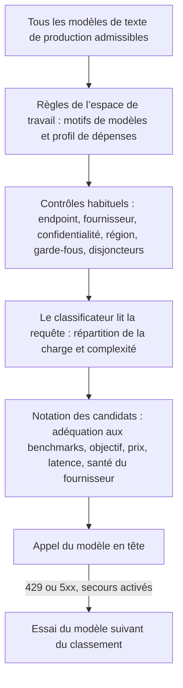

Envoyez `"model": "phaseo/auto"` et Phaseo choisit un modèle pour chaque requête en fonction de la charge de travail, de l’objectif de votre espace de travail et de ses limites de prix. Le routage automatique est une version Alpha disponible pour certains espaces de travail.

```json
{
  "model": "phaseo/auto",
  "input": "Review this TypeScript function for correctness."
}
```

Le champ `model` de la réponse indique quel modèle a répondu.

## Comment un modèle est choisi



1. **Candidats.** Phaseo part de tous les modèles de texte de production dont le prix standard est connu, puis ne garde que ceux qui correspondent à vos motifs de modèles et à votre profil de dépenses.
2. **Contrôles.** Chaque candidat doit passer les mêmes contrôles d’endpoint, de modèles de l’espace de travail, de fournisseur, de confidentialité, de garde-fous et de disjoncteurs qu’une requête vers un modèle fixe.
3. **Classificateur.** Un modèle peu coûteux et figé lit la requête et renvoie une répartition de la charge de travail (code, raisonnement, utilisation d’outils, etc.), un score de complexité et un niveau de confiance. Il ne choisit jamais le modèle lui-même. Les outils et la sortie structurée présents dans la requête lui sont transmis comme des faits fiables.
4. **Notation.** La complexité détermine le modèle le moins performant susceptible de donner une réponse acceptable, plus une marge. Phaseo combine ensuite les benchmarks du catalogue non auto-déclarés avec votre objectif et le prix, la latence, la santé et la fiabilité actuels de chaque candidat. Les données manquantes comptent comme neutres ; elles n’élargissent jamais la présélection.

La requête ne peut pas modifier l’objectif, le profil de dépenses ou les motifs de l’espace de travail. Une requête avec un modèle fixe ignore entièrement le routage automatique.

## Configurer le routage automatique

<Steps>
<Step title="Ouvrez Routage automatique">

Accédez à **Tableau de bord -> Paramètres -> Routage -> Routage automatique**.

</Step>
<Step title="Choisissez un objectif">

| Objectif | Ce qui pèse le plus |
| --- | --- |
| `balanced` | Un compromis pratique entre qualité, prix, latence et fiabilité. |
| `quality` | Les résultats de benchmarks pertinents pour la charge de travail. |
| `cost` | Un prix plus bas des tokens d’entrée et de sortie. |
| `latency` | Une latence récente plus faible chez le fournisseur. |

</Step>
<Step title="Choisissez un profil de dépenses">

Chaque profil est un plafond strict sur les prix de texte du niveau standard, en USD par million de tokens. Les modèles au-dessus ne sont jamais pris en compte.

| Profil de dépenses | Entrée max. | Sortie max. |
| --- | ---: | ---: |
| Économique | $0.10 | $0.50 |
| Standard | $0.30 | $1.50 |
| Premium | $1 | $5 |
| Tous les prix | Aucun | Aucun |

**Personnalisé** vous permet de définir vous-même les deux plafonds.

</Step>
<Step title="Restreignez les modèles (facultatif)">

Ajoutez des motifs comme `anthropic/*`, `openai/gpt-5.*` ou un ID de modèle exact.

</Step>
<Step title="Autorisez les secours et enregistrez">

Lorsque les secours sont activés, Phaseo essaie le modèle suivant du classement après une réponse `429`, `500`, `502`, `503` ou `504`. Chaque secours repasse par tous les contrôles. Les erreurs côté client ne font pas changer de modèle.

</Step>
</Steps>

Depuis la CLI : `phaseo routing auto update --objective <o> --spend-profile <p> --allowed-patterns <list> --allow-fallbacks`, et `phaseo routing auto get` pour relire la configuration. L’API est `PATCH /v1/routing/auto`.

<Warning>
  Les profils de dépenses et les motifs déterminent quels modèles sont admissibles. Ils ne garantissent pas la qualité : vérifiez donc la répartition des modèles obtenue sur vos propres charges de travail.
</Warning>

## La requête au classificateur

Chaque requête `phaseo/auto` crée une requête enfant distincte vers le modèle classificateur, avec le même espace de travail et la même identité de facturation. Elle apparaît séparément dans les journaux de requêtes avec `purpose=auto_routing_classifier` et l’ID de la requête parente, et elle est comptabilisée séparément.

Si le classificateur échoue, dépasse le délai ou renvoie des données invalides, Phaseo utilise à la place un classificateur local à base de règles (code, raisonnement, utilisation d’outils, sortie structurée, traduction, résumé ou général) : la requête principale s’exécute donc quand même.

## Limites de confidentialité et de région

Les limites de données de la requête s’appliquent aussi au routage automatique :

- Avec `provider.require_zero_data_retention: true`, ou avec un garde-fou d’espace de travail ou de clé qui n’autorise que les fournisseurs sans conservation de données, seuls les modèles disposant d’un tel fournisseur sont présélectionnés.
- Les régions requises sont vérifiées pour les fournisseurs de chaque candidat.
- La requête au classificateur porte les mêmes limites, ainsi que les listes de fournisseurs `only` et `ignore`. Si son modèle ne peut pas les respecter, Phaseo utilise le classificateur local.

Si les exigences de résidence suffisent à elles seules à n’en laisser aucun modèle, la requête échoue avec `403 model_region_unavailable` et `unmet_requirements`, comme le ferait un modèle fixe. Si des modèles ont aussi été écartés pour d’autres raisons, elle échoue avec `400 unsupported_model_or_endpoint`.

## Examiner une décision

Les détails de la requête indiquent la charge de travail, l’objectif, le modèle sélectionné, l’ordre de secours, les scores globaux et par facteur de chaque candidat, les ID de benchmarks, les exclusions et la version de l’algorithme. Les traces ne contiennent aucun contenu de prompt ni de réponse.

## Combiner avec d’autres règles de routage

- **Routes dynamiques.** Un modèle fixe choisi par une [route dynamique](./routing-and-fallbacks#attach-routing-rules-to-api-keys) associée l’emporte. Ce remplacement est enregistré, et les secours du routage automatique sont désactivés pour cette requête.
- **Secours au niveau de la requête.** `phaseo/auto` gère son propre classement de secours : il ne peut donc pas être combiné avec une [liste `models`](./routing-and-fallbacks#request-level-model-fallbacks) ni y figurer.
